# Interactive apps {#sec-apps}

This page lists every app in the book, with what it shows, where it is used, and a link that opens it full-size in its own tab. The full-size versions are useful for teaching from a projector or a shared screen, and for exploring away from the text.

Each app is a single, self-contained web page. It runs in any modern browser, on a computer, tablet or phone, with nothing to install. It works with a mouse, a touchscreen or a keyboard, and follows your notation settings and your light or dark theme.

::: {.callout-tip appearance="simple"}
## For teachers
- **Link to a particular setup.** Several apps read settings from the end of their web address, so you can link students straight to a particular example. These are listed under each app as *Start-up settings*.
- **Use them in a learning platform.** Each app is one HTML file, so you can download it from its page (in most browsers, right-click and choose *Save page as*) and upload it to Canvas, Moodle or Blackboard. The code is under the MIT licence (see the [Welcome](../index.qmd#licence-and-reuse) page), so you can also adapt it.
:::

| App | What it shows | First used in |
|:----|:--------------|:--------------|
| [Matrix multiplication animator](#app-matrix-multiplication) | How each entry of a product is built | @sec-multiplication |
| [Vector explorer](#app-vector-explorer) | Components, length, dot and cross products | [Refresher](../front/refresher.qmd) |
| [Linear combination explorer](#app-vector-mixer) | Scaling and adding vectors to reach a target | @sec-arithmetic |
| [Transformation lab](#app-transformation-lab) | A $2 \times 2$ matrix moving the plane; composing and undoing | @sec-transformations |
| [Determinant explorer](#app-determinant-explorer) | The determinant as an area or volume scale factor | @sec-determinants |
| [Invariant line finder](#app-invariant-lines) | Directions that a matrix only stretches | @sec-invariant-lines |
| [Systems explorer](#app-linear-systems) | Equations as lines and planes, and as combinations of columns | @sec-linear-systems |
| [Row reduction stepper](#app-row-reduction) | Gaussian elimination, Gauss–Jordan and LU, one row operation at a time | @sec-gaussian-elimination |
| [Span explorer](#app-span-explorer) | The line, plane or space that some vectors span, and whether they are independent | @sec-span-independence |
| [Basis grids](#app-basis-grids) | One vector's coordinates in two different bases | @sec-basis-change |
| [Line of best fit](#app-line-fit) | Fitting a line by eye and by least squares, with the squared errors drawn | @sec-orthogonality-least-squares |
| [Matrix powers](#app-matrix-powers) | Applying a matrix over and over, and how the eigenvalues decide what happens | @sec-diagonalisation |
| [Quadratic forms](#app-quadratic-forms) | The contours of $\vect{x}\T\M{A}\vect{x}$, and their principal axes | @sec-symmetric-matrices |
| [SVD explorer](#app-svd-explorer) | Rotate, stretch, rotate; and compressing a picture with the SVD | @sec-svd-pca |
| [Phase portrait](#app-phase-portrait) | Solutions of $\dot{\vect{x}} = \M{A}\vect{x}$, and their stability | @sec-linear-odes |
| [Condition explorer](#app-condition-explorer) | How far a small change in the data moves the solution | @sec-floating-point-conditioning |
| [Pivoting explorer](#app-pivoting) | Elimination in few-digit arithmetic, with and without row swaps | @sec-pivoting |
| [Iteration race](#app-iteration-race) | Jacobi, Gauss–Seidel and SOR converging, or not | @sec-iterative-methods |
| [Newton basins](#app-newton-basins) | Which root Newton's method reaches from each starting point | @sec-newton-systems |
| [Power method](#app-power-method) | Power, inverse and shifted inverse iteration homing in on an eigenvector | @sec-eigenvalue-algorithms |
| [Truss solver](#app-truss-solver) | Member forces in a loaded truss, and what happens when a member is removed | @sec-trusses |
| [Heat plate](#app-heat-plate) | Steady heat flow in a plate, solved sweep by sweep | @sec-finite-differences |
| [Robot arm](#app-robot-arm) | Forward kinematics as a product of matrices, and reaching a target with Newton's method | @sec-graphics-robotics |
| [Random surfer](#app-random-surfer) | PageRank as the steady state of a random walk on a small web | @sec-markov-pagerank |
| [Hill cipher](#app-hill-cipher) | Encrypting and decrypting by matrix multiplication modulo 26 | @sec-cryptography |
| [Normal modes](#app-normal-modes) | Natural frequencies, mode shapes and resonance of masses on springs | @sec-vibrations |
| [Network split](#app-network-split) | Laplacian eigenvalues, the Fiedler vector and centrality on a small network | @sec-networks |

## Matrix multiplication animator {#app-matrix-multiplication}

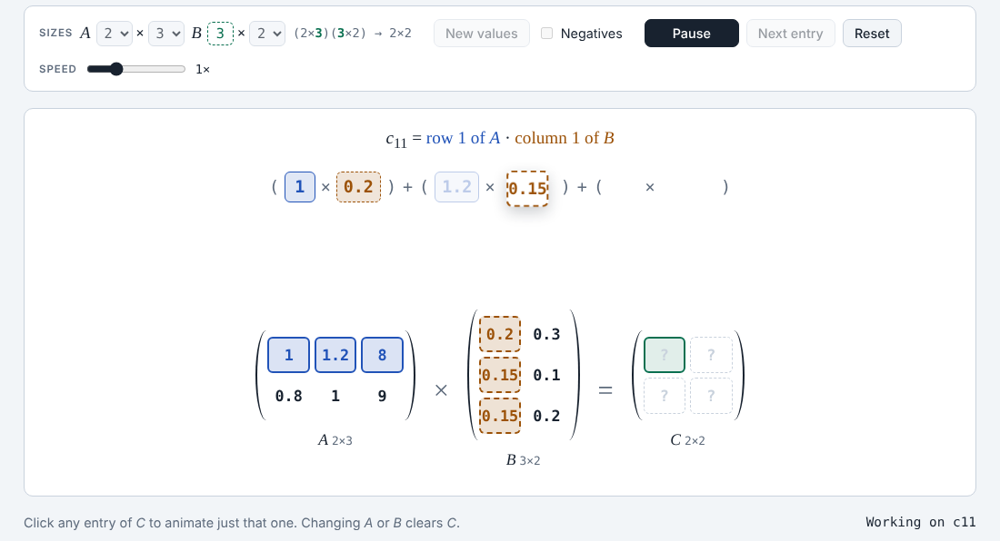{fig-alt="The matrix multiplication animator, part way through calculating the first entry of a product: row 1 of A and column 1 of B are highlighted and their numbers are being multiplied in pairs."}

Animates the row-times-column rule. For each entry of the product, it highlights a row of $\M{A}$ and a column of $\M{B}$, lifts the numbers out, multiplies them in pairs, adds, and drops the result into place. Choose any sizes up to $6 \times 6$, edit entries, or generate random whole numbers. Press **Play all**, or click a single entry of the product to animate just that one.

- **Used in:** @sec-multiplication.
- **Open:** [matrix multiplication animator](../apps/matrix-multiplication.html){target="_blank"}.
- **Start-up settings:** `?a=` and `&b=` set the two matrices, with rows separated by `;` and entries by `,`. For example, the bakery example from @sec-multiplication is [`?a=1,1.2,8;0.8,1,9&b=0.2,0.3;0.15,0.1;0.15,0.2`](../apps/matrix-multiplication.html?a=1,1.2,8;0.8,1,9&b=0.2,0.3;0.15,0.1;0.15,0.2){target="_blank"}.
- **Teaching ideas:** ask students to predict each entry before it is animated. Try a $1 \times 3$ times a $3 \times 1$, then the other way round, to show that the same two vectors give a number one way and a matrix the other.

## Vector explorer {#app-vector-explorer}

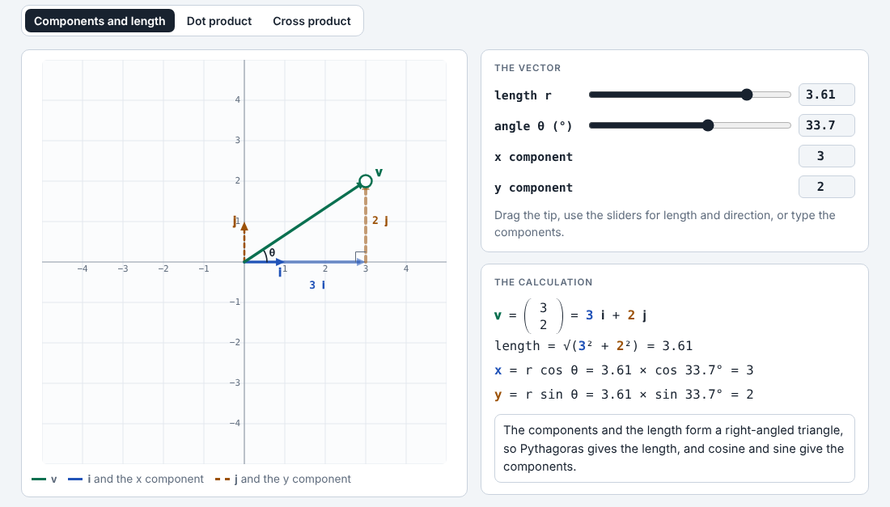{fig-alt="The vector explorer showing the vector (3, 2) built from 3 i and 2 j, with its length and angle, and the calculation of its components."}

Three views of vectors in the plane, chosen with the buttons at the top.

- **Components and length:** drag a vector or set its length and angle, and see its components, $x = r\cos\theta$ and $y = r\sin\theta$, and its length by Pythagoras.
- **Dot product:** two vectors, with the dot product worked out from components and from $\lVert\vect{a}\rVert\,\lVert\vect{b}\rVert\cos\theta$, and the projection of one onto the other.
- **Cross product:** two vectors in the plane, the parallelogram they make, and the cross product as its area, $\lVert\vect{a}\rVert\,\lVert\vect{b}\rVert\sin\theta$, pointing out of or into the screen.

- **Used in:** the [Refresher](../front/refresher.qmd).
- **Open:** [components and length](../apps/vector-explorer.html?mode=components){target="_blank"}, [dot product](../apps/vector-explorer.html?mode=dot){target="_blank"}, [cross product](../apps/vector-explorer.html?mode=cross){target="_blank"}.
- **Start-up settings:** `?mode=` is `components`, `dot` or `cross`. Adding `&lock` hides the buttons for the other modes.
- **Teaching ideas:** in the dot product view, ask when the dot product is zero, negative or largest, before showing the formula with $\cos\theta$.

## Linear combination explorer {#app-vector-mixer}

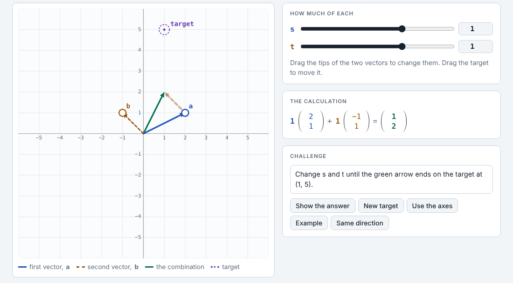{fig-alt="The linear combination explorer: two vectors a and b, a target point, and sliders for how much of each vector to use."}

Two vectors $\vect{a}$ and $\vect{b}$, and sliders for the amounts $s$ and $t$. The app draws $s\vect{a} + t\vect{b}$ tip to tail, and challenges you to land it on a target. Drag the vectors and the target to change them. **Same direction** shows what goes wrong when the two vectors are parallel: only the points on one line can be reached.

- **Used in:** @sec-arithmetic.
- **Open:** [linear combination explorer](../apps/vector-mixer.html){target="_blank"}.
- **Teaching ideas:** a good lead-in to simultaneous equations, and later to span and linear independence (@sec-span-independence). Ask students to find $s$ and $t$ by hand, then check with **Show the answer**.

## Transformation lab {#app-transformation-lab}

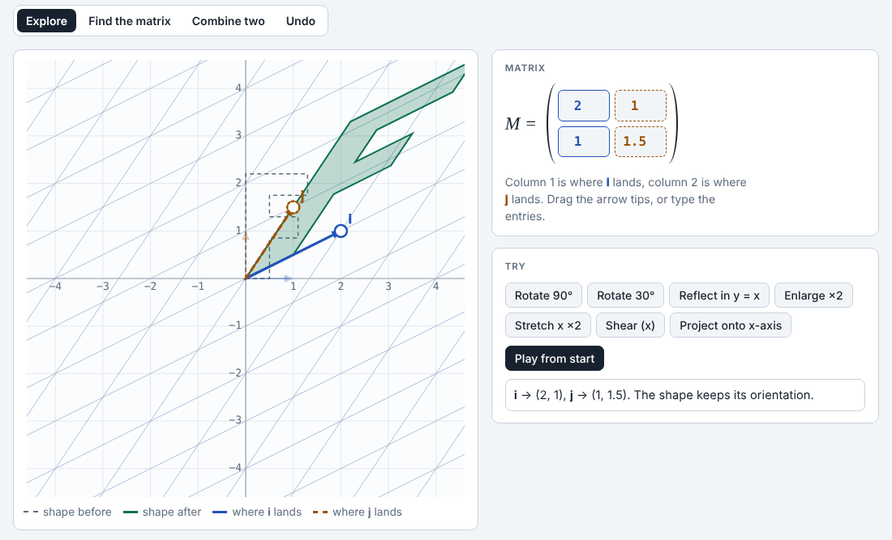{fig-alt="The transformation lab showing a grid and a letter F transformed by a 2 by 2 matrix, with arrows for the images of i and j."}

A $2 \times 2$ matrix moving the whole plane: a grid, a letter F, and arrows showing where $\ui$ and $\uj$ land. It has four modes.

- **Explore:** drag the arrow tips or type entries, or try the preset transformations, and watch the grid move.
- **Find the matrix:** a quiz. You are shown where the F has gone and must find the matrix that sends it there.
- **Combine two:** two transformations applied in both orders, side by side, to show that the order matters.
- **Undo:** apply a transformation, then its inverse, and see which transformations cannot be undone.

- **Used in:** @sec-transformations (explore), @sec-composition (combine two) and @sec-inverses (undo).
- **Open:** [explore](../apps/transformation-lab.html?mode=explore){target="_blank"}, [find the matrix](../apps/transformation-lab.html?mode=quiz){target="_blank"}, [combine two](../apps/transformation-lab.html?mode=compose){target="_blank"}, [undo](../apps/transformation-lab.html?mode=undo){target="_blank"}.
- **Start-up settings:** `?mode=` is `explore`, `quiz`, `compose` or `undo`. Adding `&lock` hides the buttons for the other modes.
- **Teaching ideas:** *Find the matrix* works well as a class warm-up: students write down the matrix before anyone touches the screen. In *Combine two*, ask for a pair that commutes and a pair that doesn't.

## Determinant explorer {#app-determinant-explorer}

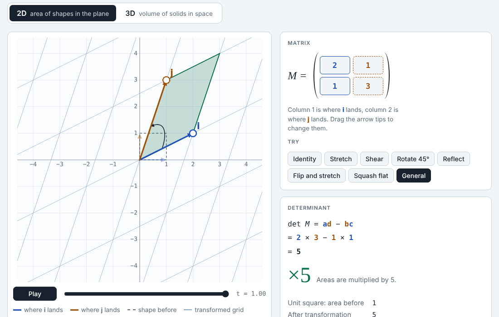{fig-alt="The determinant explorer in two dimensions: the unit square transformed into a parallelogram, with the determinant shown as the area scale factor."}

Shows the determinant as a scale factor. In two dimensions, a square, a circle and a letter F are transformed, and their areas before and after are compared. In three dimensions, a cube, a ball and an L-shaped block are transformed and their volumes compared; drag the picture to turn it. Presets include stretches, shears, rotations, a reflection (negative determinant) and a matrix that squashes everything flat (zero determinant). **Play** animates the transformation from the identity.

- **Used in:** @sec-determinants (in two dimensions) and @sec-transformations-3d (in three).
- **Open:** [in two dimensions](../apps/determinant-explorer.html){target="_blank"}, [in three dimensions](../apps/determinant-explorer.html?dim=3){target="_blank"}.
- **Start-up settings:** `?dim=3` starts in three dimensions. `&preset=` picks a preset by its button label, written with `%20` for each space and `%C2%B0` for the degree sign, as in [`?dim=3&preset=Rotate%2045%C2%B0%20about%20z`](../apps/determinant-explorer.html?dim=3&preset=Rotate%2045%C2%B0%20about%20z){target="_blank"}.
- **Teaching ideas:** ask students to predict the sign of the determinant from the picture, by checking whether the F has been mirrored, before revealing it.

## Invariant line finder {#app-invariant-lines}

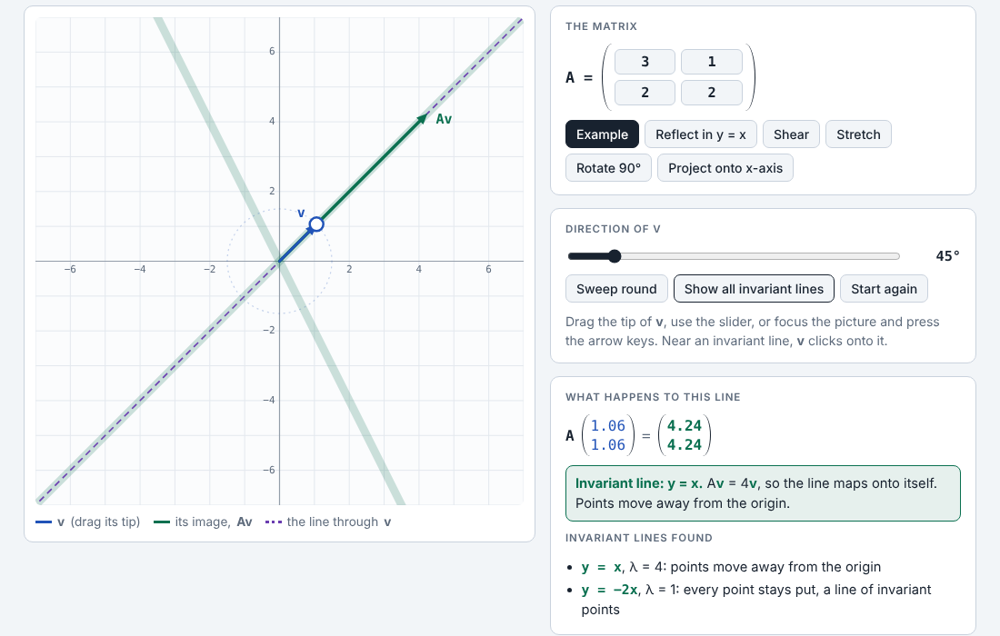{fig-alt="The invariant line finder: a vector v and its image Av lying along the same line y = x, with the two invariant lines of the matrix highlighted."}

Turn a vector $\vect{v}$ and watch its image $\M{A}\vect{v}$. When the two lie along the same line, that line is invariant, and the app shows the stretch factor $\lambda$ along it. **Sweep round** turns $\vect{v}$ through a full circle and collects the invariant lines on the way. Presets include a reflection, a shear, a stretch, a rotation (no invariant lines) and a projection, and you can type in any matrix.

- **Used in:** @sec-invariant-lines and @sec-eigenvalues.
- **Open:** [invariant line finder](../apps/invariant-lines.html){target="_blank"}.
- **Start-up settings:** `?m=` sets the matrix, row by row, as in [`?m=1,2,3,2`](../apps/invariant-lines.html?m=1,2,3,2){target="_blank"} for the matrix with rows $(1, 2)$ and $(3, 2)$.
- **Teaching ideas:** ask how many invariant lines students expect before they sweep. The rotation has none, and the shear has only one, which leads into complex eigenvalues and into matrices that cannot be diagonalised (@sec-diagonalisation).

## Systems explorer {#app-linear-systems}

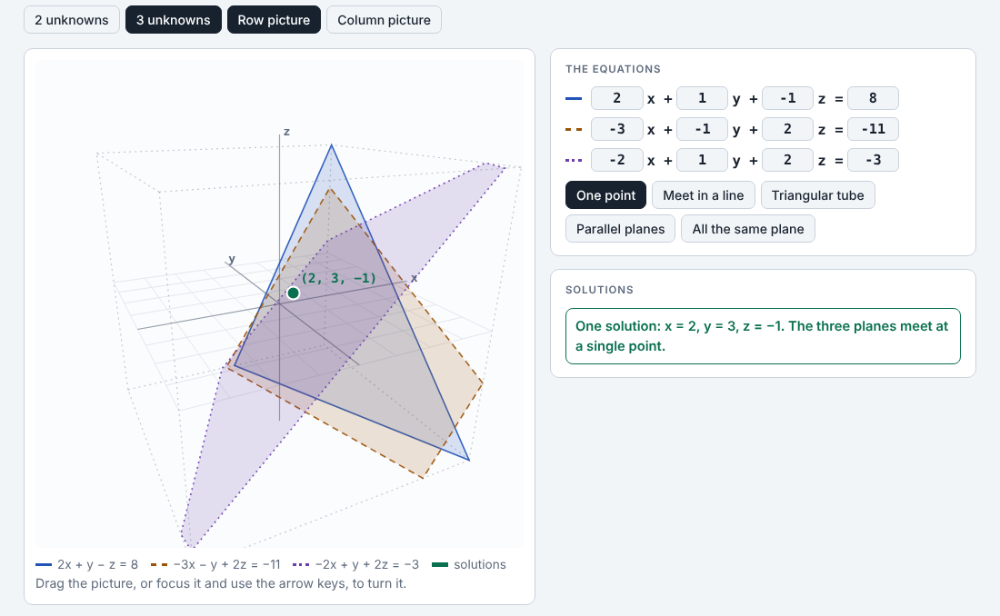{fig-alt="The systems explorer showing three planes in space meeting at a single point, with the equations alongside."}

A system of two equations in two unknowns, or three in three, shown two ways. The **row picture** draws each equation as a line or a plane, and marks the solution where they meet: a point, a line, or nothing at all. The **column picture** draws the columns of the matrix, and shows how much of each is needed to reach the right-hand side. Edit any coefficient, or try the presets, which include every way for three planes to fail to meet at a point. Drag the three-dimensional picture to turn it.

- **Used in:** @sec-linear-systems.
- **Open:** [with two unknowns](../apps/linear-systems.html){target="_blank"}, [with three unknowns](../apps/linear-systems.html?dim=3){target="_blank"}.
- **Start-up settings:** `?dim=3` starts with three unknowns, and `&view=col` with the column picture. `?m=` sets the equations, one row of the augmented matrix at a time, as in [`?m=1,1,1,3;1,-1,1,1;2,0,2,5`](../apps/linear-systems.html?m=1,1,1,3;1,-1,1,1;2,0,2,5){target="_blank"}, the triangular tube of @sec-linear-systems, Example 2.
- **Teaching ideas:** before turning on the column picture, ask students to predict what it will look like for a system with no solution. In three dimensions, ask them to sketch each of the "no solution" arrangements before showing them.

## Row reduction stepper {#app-row-reduction}

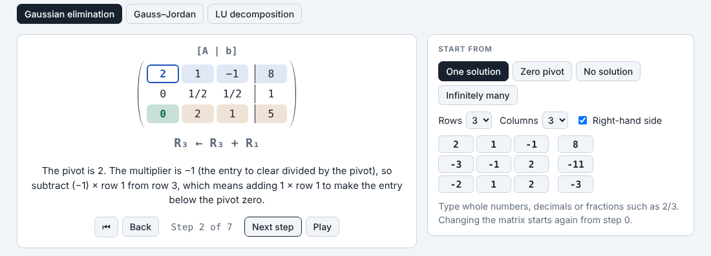{fig-alt="The row reduction stepper part way through Gaussian elimination: the pivot is outlined, the row being changed is highlighted, and the step R3 ← R3 + R1 is explained below the matrix."}

Carries out row reduction one row operation at a time, in exact fractions, with an explanation of each step: the pivot, the multiplier and why it is chosen. It has three modes.

- **Gaussian elimination:** reduces to row echelon form, then solves by back substitution, or explains why there is no solution or infinitely many.
- **Gauss–Jordan:** reduces to reduced row echelon form, then reads off the rank and every solution. Tick **Find the inverse** to reduce $[\M{A} \mid \M{I}]$.
- **LU decomposition:** writes each multiplier into $\M{L}$ as elimination turns $\M{A}$ into $\M{U}$, with a permutation matrix $\M{P}$ when rows are swapped.

Matrices can be up to $4 \times 4$, with or without a right-hand side, and entries can be typed as whole numbers, decimals or fractions. The arrow keys step forwards and backwards.

- **Used in:** @sec-gaussian-elimination, @sec-gauss-jordan-rank and @sec-lu-decomposition.
- **Open:** [Gaussian elimination](../apps/row-reduction.html?mode=ge){target="_blank"}, [Gauss–Jordan](../apps/row-reduction.html?mode=rref){target="_blank"}, [LU decomposition](../apps/row-reduction.html?mode=lu){target="_blank"}.
- **Start-up settings:** `?mode=` is `ge`, `rref` or `lu`, and `&lock` hides the buttons for the other modes. `&preset=` picks a starting example by its button label (with `%20` for each space), and `&m=` sets your own matrix, row by row, with `&rhs` if the last column is a right-hand side, as in [`?mode=ge&m=1,1,2,4;2,3,3,9;1,2,1,5&rhs`](../apps/row-reduction.html?mode=ge&m=1,1,2,4;2,3,3,9;1,2,1,5&rhs){target="_blank"}.
- **Teaching ideas:** pause before each step and ask what the next row operation should be. Projected on a screen, it also makes a quick way to check students' hand calculations, including the fractions.

## Span explorer {#app-span-explorer}

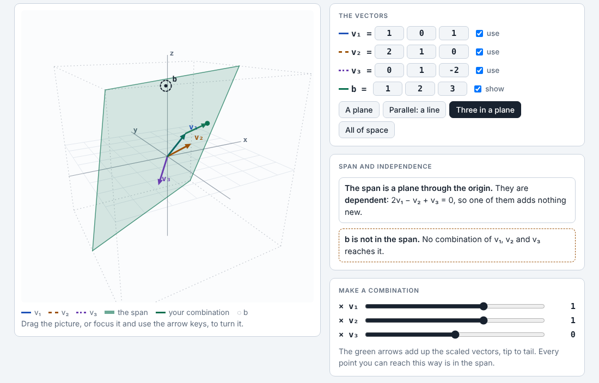{fig-alt="The span explorer showing three vectors that lie in one plane, with the plane they span shaded and the dependence relation between them."}

Up to three vectors in space, and their span: a line, a plane or all of space, drawn in green. The app says whether the vectors are independent, and if not, gives the relation between them. Sliders build any combination of the vectors, tip to tail, and a target $\vect{b}$ shows whether a given vector is in the span, and with which coefficients. Drag the picture to turn it.

- **Used in:** @sec-span-independence, and in @sec-fundamental-subspaces to show a column space.
- **Open:** [span explorer](../apps/span-explorer.html){target="_blank"}.
- **Start-up settings:** `?v=` sets one to three vectors, separated by `;`, and `&b=` the target, as in [`?v=1,2,1;0,1,2;1,3,3&b=1,5,7`](../apps/span-explorer.html?v=1,2,1;0,1,2;1,3,3&b=1,5,7){target="_blank"}, the columns of the matrix in @sec-fundamental-subspaces. `?preset=` picks a preset by its label.
- **Teaching ideas:** in **Three in a plane**, ask students to change one entry of $\vect{v}_3$ so that the span becomes all of space, then to explain, using the determinant, why almost any change works.

## Basis grids {#app-basis-grids}

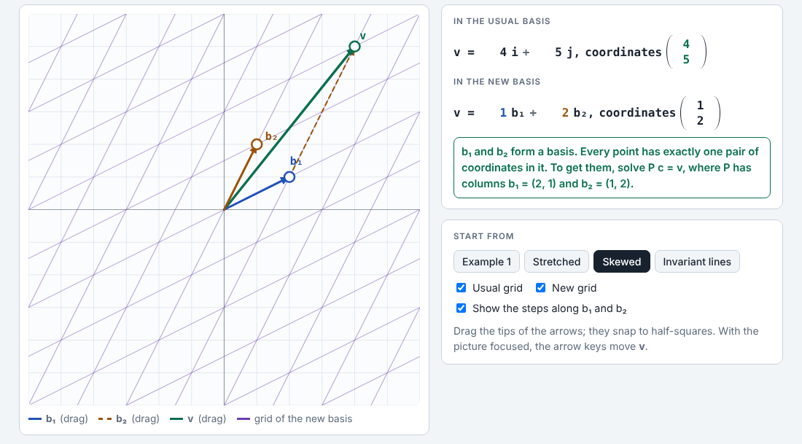{fig-alt="The basis grids app: a vector v drawn over the usual square grid and over the slanted grid of a new basis b1, b2, with its coordinates in both."}

A fixed vector $\vect{v}$, the usual square grid, and the slanted grid made by a second basis $\vect{b}_1$, $\vect{b}_2$. The readout gives $\vect{v}$'s coordinates in both bases, and dashed arrows show the steps along $\vect{b}_1$ and $\vect{b}_2$ that reach it. Drag any of the three arrows. If $\vect{b}_1$ and $\vect{b}_2$ are dragged onto one line, the app explains why they are no longer a basis.

- **Used in:** @sec-basis-change.
- **Open:** [basis grids](../apps/basis-grids.html){target="_blank"}.
- **Start-up settings:** `?b1=`, `&b2=` and `&v=` set the three vectors, as in [`?b1=1,1&b2=1,-2&v=3,0`](../apps/basis-grids.html?b1=1,1&b2=1,-2&v=3,0){target="_blank"}, the basis of invariant lines from @sec-invariant-lines.
- **Teaching ideas:** before revealing the new coordinates, ask students to count them off the purple grid. Then double $\vect{b}_1$ and ask what happens to the coordinates, and why they change in the opposite way to the basis vector.

## Line of best fit {#app-line-fit}

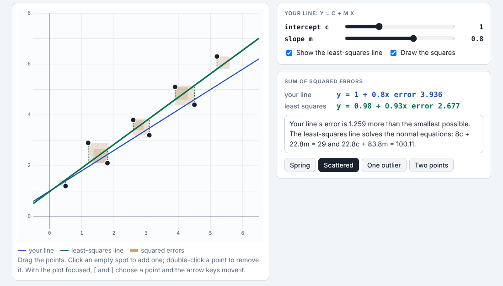{fig-alt="The line of best fit app with eight data points, a line set by sliders, the least-squares line, and the squares on the vertical errors shaded."}

Data points that can be dragged, added and removed, and a line whose intercept and slope are set by sliders. The vertical errors are drawn, with a square on each, and the app adds up their areas. Tick **Show the least-squares line** to compare your line with the best one, and to see the normal equations that it solves. **One outlier** shows how strongly a single wild point pulls a least-squares fit.

- **Used in:** @sec-orthogonality-least-squares.
- **Open:** [line of best fit](../apps/line-fit.html){target="_blank"}.
- **Start-up settings:** `?preset=` picks a starting data set by its label (`Spring`, `Scattered`, `One%20outlier` or `Two%20points`), and `&best` shows the least-squares line straight away.
- **Teaching ideas:** run it as a competition: whose line by eye has the smallest error? Then reveal the least-squares line, and ask why the squares, not the plain errors, are added up.

## Matrix powers {#app-matrix-powers}

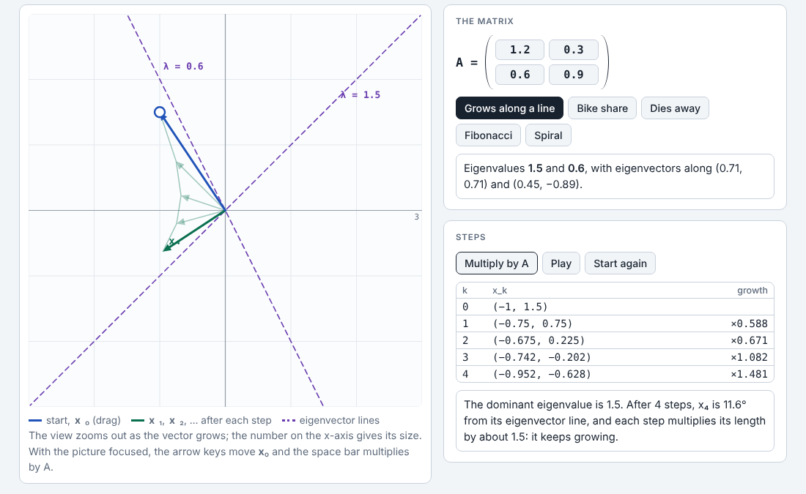{fig-alt="The matrix powers app after four multiplications: the starting vector and its images under A, A squared and so on, turning towards the eigenvector line with eigenvalue 1.5, with a table of the vectors and their growth factors."}

A starting vector $\vect{x}_0$, which can be dragged, and the vectors $\M{A}\vect{x}_0$, $\M{A}^2\vect{x}_0$, … produced by **Multiply by A** or **Play**. The eigenvector lines are drawn with their eigenvalues, a table lists each vector and how much it grew, and a summary says what is happening in the long run: growth along the dominant eigenvector, a steady state, decay, or a spiral when the eigenvalues are complex. The view zooms out as the vectors grow. Presets include a bike-share Markov chain and the Fibonacci numbers.

- **Used in:** @sec-diagonalisation.
- **Open:** [matrix powers](../apps/matrix-powers.html){target="_blank"}.
- **Start-up settings:** `?m=` sets the matrix, row by row, and `&x=` the starting vector, as in [`?m=0.9,0.2,0.1,0.8&x=0.2,0.8`](../apps/matrix-powers.html?m=0.9,0.2,0.1,0.8&x=0.2,0.8){target="_blank"}. `?preset=` picks a preset by its label.
- **Teaching ideas:** in **Bike share**, start from different splits of the bikes and ask students to predict where each one ends up. Then ask why the starting point doesn't matter, and what the second eigenvalue says about how fast the steady state is reached.

## Quadratic forms {#app-quadratic-forms}

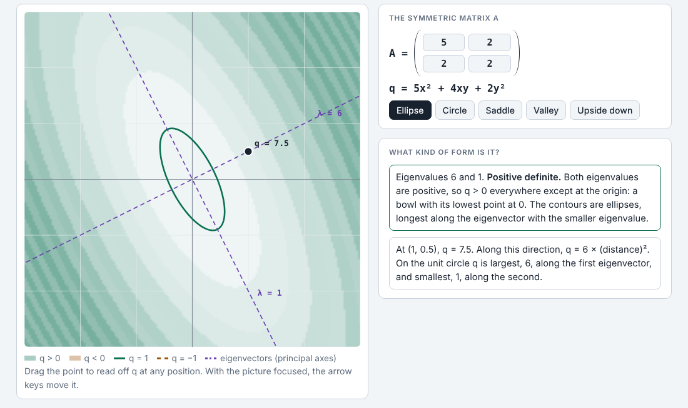{fig-alt="The quadratic forms app for q = 5x squared + 4xy + 2y squared: shaded contours forming tilted ellipses, the ellipse q = 1, and the two eigenvector lines along its axes, with a panel saying the form is positive definite."}

The values of $q = \vect{x}\T\M{A}\vect{x}$ for a symmetric $2 \times 2$ matrix, shaded over the plane, with the contour $q = 1$ (and $q = -1$) and the eigenvector lines. The panel classifies the form as positive definite, semidefinite, negative definite or indefinite, and explains what that means for the shape. Drag the point to read off $q$ anywhere, and compare it with the eigenvalue along each axis.

- **Used in:** @sec-symmetric-matrices.
- **Open:** [quadratic forms](../apps/quadratic-forms.html){target="_blank"}.
- **Start-up settings:** `?m=a,b,c` sets the matrix $\mat{a & b \\ b & c}$, as in [`?m=1,2,1`](../apps/quadratic-forms.html?m=1,2,1){target="_blank"} for the saddle $x^2 + 4xy + y^2$. `?preset=` picks a preset by its label.
- **Teaching ideas:** start from **Ellipse** and ask students to make the ellipse longer and thinner, then to turn it into a hyperbola, predicting first which entry to change. Link the moment the shape changes to the determinant passing through zero.

## SVD explorer {#app-svd-explorer}

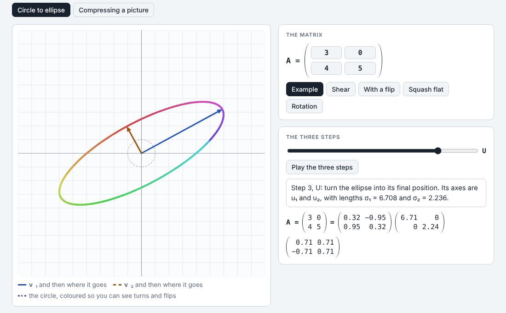{fig-alt="The SVD explorer in its first mode: the unit circle, coloured so that turns and flips can be seen, stretched into a tilted ellipse, with the singular vectors and the factorisation of A into U, Sigma and V transpose."}

Two modes. **Circle to ellipse** takes the unit circle through the three steps of $\M{A} = \M{U}\M{\Sigma}\M{V}\T$, controlled by a slider or **Play the three steps**: turn by $\M{V}\T$, stretch by $\sigma_1$ and $\sigma_2$, turn by $\M{U}$. The circle is coloured, so that reflections show up, and the factorisation is written out. **Compressing a picture** rebuilds a $120 \times 120$ picture from its first $k$ singular values, with a chart of the singular values and the storage needed. It has four built-in pictures, and accepts a picture of your own, which never leaves your computer.

- **Used in:** @sec-svd-pca.
- **Open:** [SVD explorer](../apps/svd-explorer.html){target="_blank"}.
- **Start-up settings:** `?m=` sets the matrix, row by row, as in [`?m=3,0,4,5`](../apps/svd-explorer.html?m=3,0,4,5){target="_blank"}. `?mode=img` opens the picture mode, as in [`?mode=img`](../apps/svd-explorer.html?mode=img){target="_blank"}.
- **Teaching ideas:** in the picture mode, ask students to predict how many terms **Stripes** and **Checks** need, then explain the answers using rank. For the first mode, ask why a rotation has both singular values equal to 1.

## Phase portrait {#app-phase-portrait}

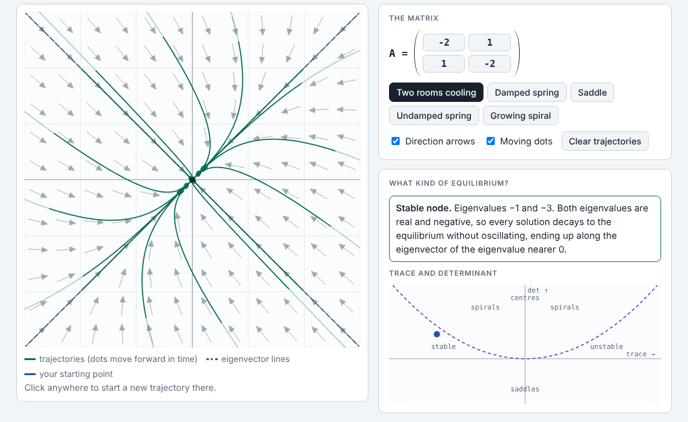{fig-alt="The phase portrait app for the two-rooms cooling example: direction arrows, curved trajectories approaching the origin along the eigenvector line through (1, 1), and a trace-determinant chart with the matrix marked as a stable node."}

Paths of $\dot{\vect{x}} = \M{A}\vect{x}$ from many starting points, with direction arrows and dots that move forward in time. Click anywhere to start a new path there. The panel classifies the equilibrium (node, saddle, spiral or centre, stable or unstable) from the eigenvalues, and a trace–determinant chart shows where the matrix sits among all the types.

- **Used in:** @sec-linear-odes.
- **Open:** [phase portrait](../apps/phase-portrait.html){target="_blank"}.
- **Start-up settings:** `?m=` sets the matrix, row by row, as in [`?m=0,1,-5,-2`](../apps/phase-portrait.html?m=0,1,-5,-2){target="_blank"} for the damped spring. `?preset=` picks a preset by its label.
- **Teaching ideas:** starting from **Undamped spring**, ask students to add a little damping, then a lot, and to watch the dot cross from centre to spiral to node on the chart. Ask what the trace and determinant mean physically for a spring.

## Condition explorer {#app-condition-explorer}

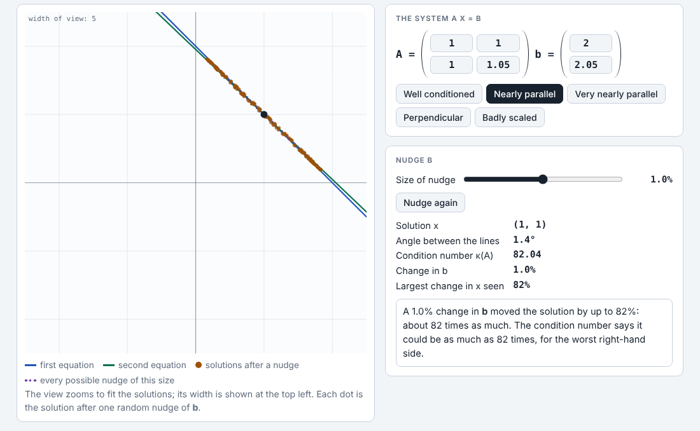{fig-alt="The condition explorer for two nearly parallel lines: a long thin cloud of solutions after random 1% nudges of b, stretched along the lines, with the condition number 82."}

Two equations drawn as lines, and the solutions after 160 random nudges of the right-hand side $\vect{b}$, all of the same small relative size, with the dashed curve showing every possible nudge of that size. The panel gives the angle between the lines, the condition number, and how much the nudges were amplified. Edit $\M{A}$ and $\vect{b}$, or change the size of the nudge.

- **Used in:** @sec-floating-point-conditioning.
- **Open:** [condition explorer](../apps/condition-explorer.html){target="_blank"}.
- **Start-up settings:** `?m=` sets the matrix, row by row, and `&b=` the right-hand side, as in [`?m=1,1,1,1.01&b=2,2.01`](../apps/condition-explorer.html?m=1,1,1,1.01&b=2,2.01){target="_blank"} for [Example 2](../part-5/24-floating-point-conditioning.qmd#ex-floating-point-conditioning-2) of @sec-floating-point-conditioning. `?preset=` picks a preset by its label.
- **Teaching ideas:** ask students to rank the presets by how much they amplify errors before revealing the condition numbers. **Badly scaled** makes the point that a large condition number is not only about nearly parallel lines.

## Pivoting explorer {#app-pivoting}

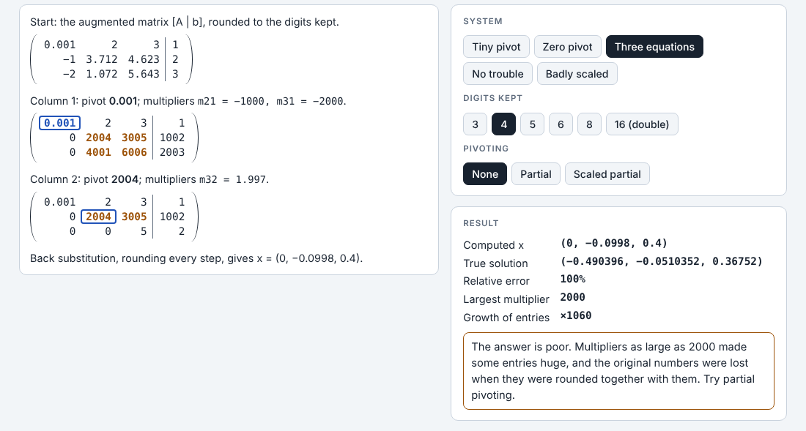{fig-alt="The pivoting explorer working through a 3 by 3 system in 4-digit arithmetic without pivoting: the tiny pivot 0.001 creates entries in the thousands, and the computed answer is completely wrong."}

Gaussian elimination written out stage by stage on a pretend computer that keeps only a few significant digits, rounding every result. Choose the number of digits (3 to 8, or 16 for double precision) and the pivoting strategy: none, partial or scaled partial. Pivots are outlined and unusually large entries highlighted; the panel compares the computed answer with the true one and explains what went wrong.

- **Used in:** @sec-pivoting.
- **Open:** [pivoting explorer](../apps/pivoting.html){target="_blank"}.
- **Start-up settings:** `?preset=` picks a system by its label, `&digits=` the digits kept, and `&pivot=` the strategy (`none`, `partial` or `scaled`), as in [`?preset=Badly%20scaled&pivot=partial`](../apps/pivoting.html?preset=Badly%20scaled&pivot=partial){target="_blank"}.
- **Teaching ideas:** before switching pivoting on, ask students to find the step at which the information in the second equation is lost. Then ask whether keeping more digits is a fix or just a delay.

## Iteration race {#app-iteration-race}

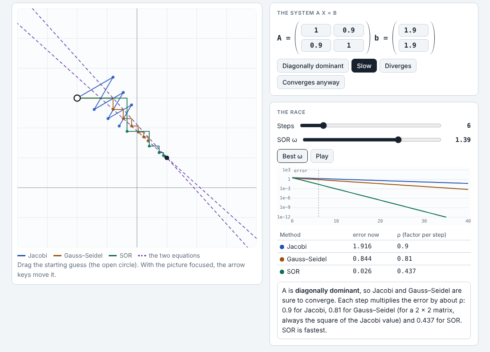{fig-alt="The iteration race for a slowly converging system: the zigzag path of Jacobi, the staircase of Gauss-Seidel and the faster staircase of SOR heading towards the crossing point of two nearly parallel lines, with a chart of their errors."}

The paths of the Jacobi, Gauss–Seidel and SOR iterations for two equations, from a starting guess you can drag, with a chart of their errors over 40 steps, their spectral radii, and a slider for the SOR factor $\omega$. **Best ω** sets the optimal value.

- **Used in:** @sec-iterative-methods.
- **Open:** [iteration race](../apps/iteration-race.html){target="_blank"}.
- **Start-up settings:** `?m=`, `&b=` and `&x=` set the matrix (row by row), the right-hand side and the starting guess, and `&omega=` the SOR factor, as in [`?m=4,1,2,5&b=5,7&x=0,0`](../apps/iteration-race.html?m=4,1,2,5&b=5,7&x=0,0){target="_blank"} for [Example 1](../part-5/27-iterative-methods.qmd#ex-iterative-methods-1) of @sec-iterative-methods. `?preset=` picks a preset by its label.
- **Teaching ideas:** ask why Gauss–Seidel moves in a staircase and Jacobi diagonally. In **Diverges**, ask students to fix the system without changing its solution.

## Newton basins {#app-newton-basins}

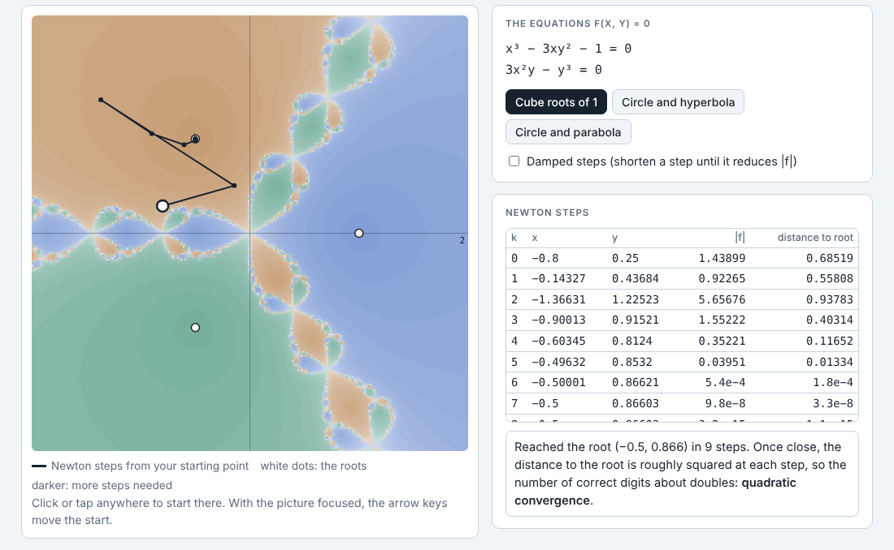{fig-alt="The Newton basins app for the cube roots of 1: the plane coloured in three colours by the root each starting point reaches, with intricate fractal boundaries between them, and the Newton steps from one start."}

The plane coloured by which root of a pair of nonlinear equations Newton's method reaches from each starting point, shaded by the number of steps. Click anywhere to see the steps from there, with a table of the residual and the distance to the root. Three systems are built in, and **Damped steps** switches on a simple line search.

- **Used in:** @sec-newton-systems.
- **Open:** [Newton basins](../apps/newton-basins.html){target="_blank"}.
- **Start-up settings:** `?preset=` picks a system by its label, `&x=` the starting point, and `&damped` turns on damping, as in [`?preset=Circle%20and%20hyperbola&x=2,0.5`](../apps/newton-basins.html?preset=Circle%20and%20hyperbola&x=2,0.5){target="_blank"} for [Example 1](../part-5/28-newton-systems.qmd#ex-newton-systems-1) of @sec-newton-systems.
- **Teaching ideas:** ask students to count the zeros in the "distance to root" column from step to step, to discover quadratic convergence. In **Circle and hyperbola**, ask why the colours meet along the lines $y = \pm x$.

## Power method {#app-power-method}

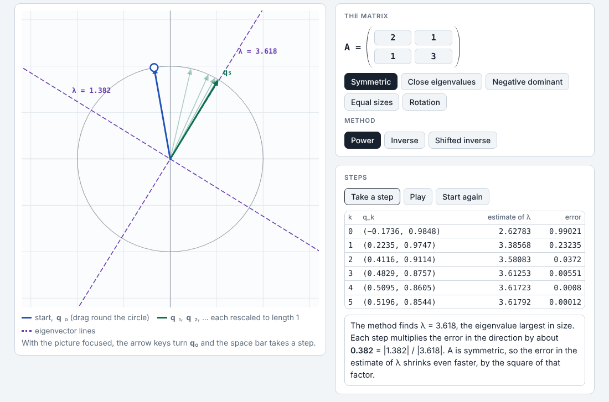{fig-alt="The power method app: a starting vector on the unit circle and its successors, each rescaled to length 1, turning towards the eigenvector line with eigenvalue 3.618, with a table of eigenvalue estimates and errors."}

A vector on the unit circle, repeatedly multiplied by a $2 \times 2$ matrix (or its inverse, or $(\M{A} - \mu\M{I})^{-1}$) and rescaled to length 1. The table shows the Rayleigh quotient estimate of the eigenvalue and its error, and the panel gives the convergence factor and explains it. Drag the starting vector round the circle.

- **Used in:** @sec-eigenvalue-algorithms.
- **Open:** [power method](../apps/power-method.html){target="_blank"}.
- **Start-up settings:** `?m=` sets the matrix, row by row, `&method=` the method (`power`, `inverse` or `shift`) and `&mu=` the shift, as in [`?m=2,1,1,3&method=shift&mu=1`](../apps/power-method.html?m=2,1,1,3&method=shift&mu=1){target="_blank"} for [Example 2](../part-5/29-eigenvalue-algorithms.qmd#ex-eigenvalue-algorithms-2) of @sec-eigenvalue-algorithms. `?preset=` picks a preset by its label.
- **Teaching ideas:** in **Close eigenvalues**, ask students to choose a shift that makes convergence as fast as possible, and to explain their choice using the convergence factor.

## Truss solver {#app-truss-solver}

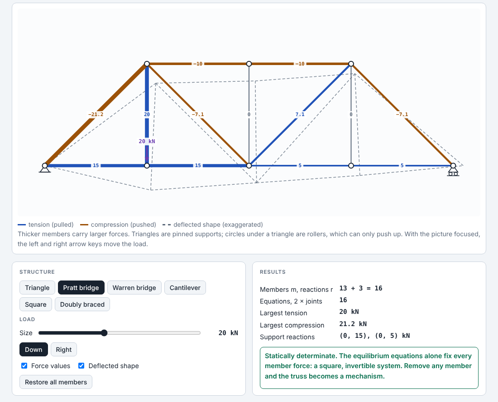{fig-alt="The truss solver showing a Pratt bridge with a 20 kilonewton load near its left end: members coloured blue for tension and orange for compression, with thickness showing the size of each force, force values on each member, and the exaggerated deflected shape dashed."}

A pin-jointed truss, solved by the stiffness method with every member equally stiff. Members are coloured by tension or compression, with thickness in proportion to the force, and labelled with their forces in kilonewtons; the deflected shape is drawn exaggerated. Click a joint to move the load there, and a member to remove or restore it. The panel counts members, reactions and equations, and says whether the truss is statically determinate, indeterminate, or a mechanism, in which case the dashed shape shows how it would move.

- **Used in:** @sec-trusses.
- **Open:** [truss solver](../apps/truss-solver.html){target="_blank"}.
- **Start-up settings:** `?preset=` picks a structure by its label, `&load=` the loaded joint (numbered from 0), `&kN=` the load, `&dir=right` a sideways load, and `&off=` a list of members to remove, as in [`?preset=Pratt%20bridge&load=1`](../apps/truss-solver.html?preset=Pratt%20bridge&load=1){target="_blank"}.
- **Teaching ideas:** before revealing the colours, ask students to predict which members of the Pratt bridge are in tension. Then ask them to remove as many members as possible from **Doubly braced** while keeping it standing.

## Heat plate {#app-heat-plate}

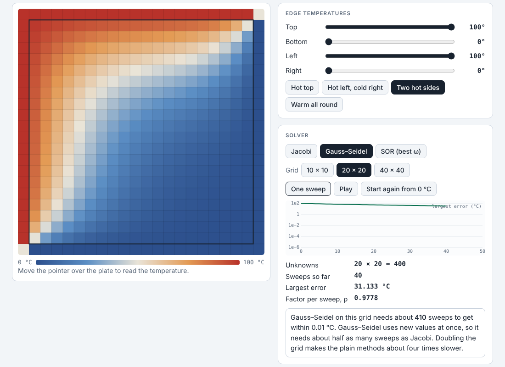{fig-alt="The heat plate app: a square plate shown as a heat map, hot along its top and left edges and cold elsewhere, part way through solving, with a chart of the error falling sweep by sweep."}

A square plate with its four edges held at temperatures set by sliders, shown as a heat map. Starting from 0 °C everywhere, Jacobi, Gauss–Seidel or SOR sweeps update the interior temperatures, one sweep at a time or continuously, and a chart shows the largest error against the exact steady state. Grids of $10 \times 10$, $20 \times 20$ and $40 \times 40$ interior points show how the number of sweeps grows.

- **Used in:** @sec-finite-differences.
- **Open:** [heat plate](../apps/heat-plate.html){target="_blank"}.
- **Start-up settings:** `?edges=` sets the top, bottom, left and right temperatures, `&method=` the solver (`jacobi`, `gs` or `sor`) and `&n=` the grid (10, 20 or 40), as in [`?edges=100,0,0,0&method=jacobi&n=10`](../apps/heat-plate.html?edges=100,0,0,0&method=jacobi&n=10){target="_blank"}.
- **Teaching ideas:** ask students to predict the steady temperature at the centre for **Hot top**, using symmetry, before running the solver. Then compare how many sweeps each method needs on each grid.

## Robot arm {#app-robot-arm}

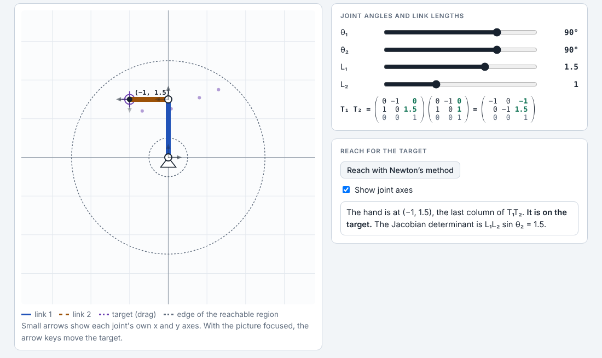{fig-alt="The robot arm app: a two-link arm reaching a target, with dots showing the hand's positions during the Newton steps, the dotted circles bounding the reachable region, and the homogeneous transformation matrices for the two links and their product."}

A two-link planar arm, with sliders for the joint angles and link lengths. The two $3 \times 3$ homogeneous transformation matrices and their product are written out, with the hand's position in the product's last column. Drag the target and press **Reach** to watch Newton's method find joint angles that put the hand there, step by step. Dotted circles bound the reachable region, and the status reports when the Jacobian is singular.

- **Used in:** @sec-graphics-robotics.
- **Open:** [robot arm](../apps/robot-arm.html){target="_blank"}.
- **Start-up settings:** `?angles=`, `&lengths=` and `&target=` set the joint angles in degrees, the link lengths and the target, as in [`?angles=30,60&lengths=1.5,1&target=-1,1.5`](../apps/robot-arm.html?angles=30,60&lengths=1.5,1&target=-1,1.5){target="_blank"}.
- **Teaching ideas:** ask students to predict the hand's position from the angles before reading it off. Put the target just outside the reachable region and ask what Newton's method should do.

## Random surfer {#app-random-surfer}

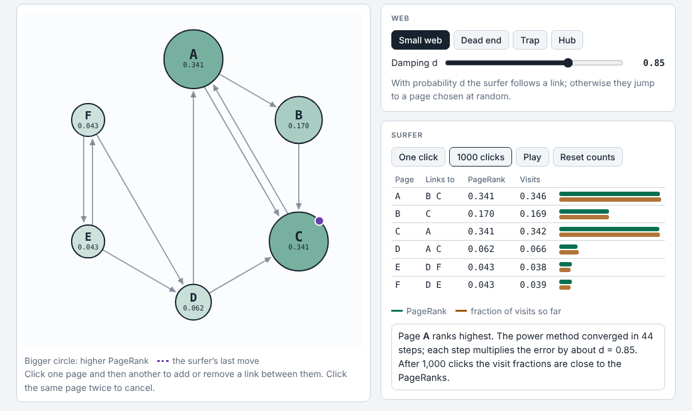{fig-alt="The random surfer app: six web pages as circles sized by PageRank, with arrows for the links, and a table comparing each page's PageRank with the fraction of visits by a simulated surfer after 1000 clicks."}

Six web pages with links between them, drawn with circles sized by their PageRank, computed by the power method. A simulated random surfer clicks links, or jumps to a random page with probability $1 - d$; the table compares the fraction of visits to each page with its PageRank. Click two pages in turn to add or remove a link. Presets include a dead end, a trap and a hub.

- **Used in:** @sec-markov-pagerank.
- **Open:** [random surfer](../apps/random-surfer.html){target="_blank"}.
- **Start-up settings:** `?preset=` picks a web by its label and `&d=` the damping factor; `?links=` sets the links directly, listing the pages each of A to F links to, as in [`?links=BC,C,A,C,AC,C&d=0.85`](../apps/random-surfer.html?links=BC,C,A,C,AC,C&d=0.85){target="_blank"}.
- **Teaching ideas:** ask students to add one link that makes page D the highest ranked, then to explain why a link from an important page counts for more.

## Hill cipher {#app-hill-cipher}

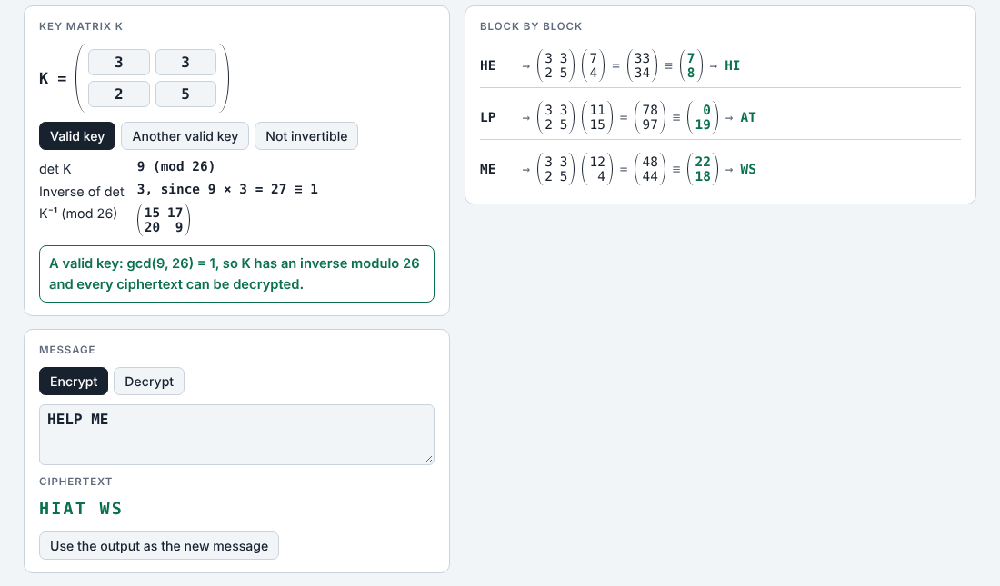{fig-alt="The Hill cipher machine encrypting HELP ME with the key with rows 3, 3 and 2, 5: each pair of letters is shown as a vector, multiplied by the key, and reduced modulo 26, giving HIAT WS."}

A Hill cipher machine with a $2 \times 2$ key. Type a message and see each pair of letters turned into a vector, multiplied by the key and reduced modulo 26. The panel checks whether the key is valid, showing its determinant, the determinant's inverse and the inverse key modulo 26, and switches between encrypting and decrypting.

- **Used in:** @sec-cryptography.
- **Open:** [Hill cipher](../apps/hill-cipher.html){target="_blank"}.
- **Start-up settings:** `?key=` sets the key, row by row, `&msg=` the message and `&mode=dec` decryption, as in [`?key=3,3,2,5&msg=HIAT&mode=dec`](../apps/hill-cipher.html?key=3,3,2,5&msg=HIAT&mode=dec){target="_blank"}.
- **Teaching ideas:** have pairs of students exchange encrypted messages and keys. Then give one pair a ciphertext and a guessed word, and ask them to recover the key by hand.

## Normal modes {#app-normal-modes}

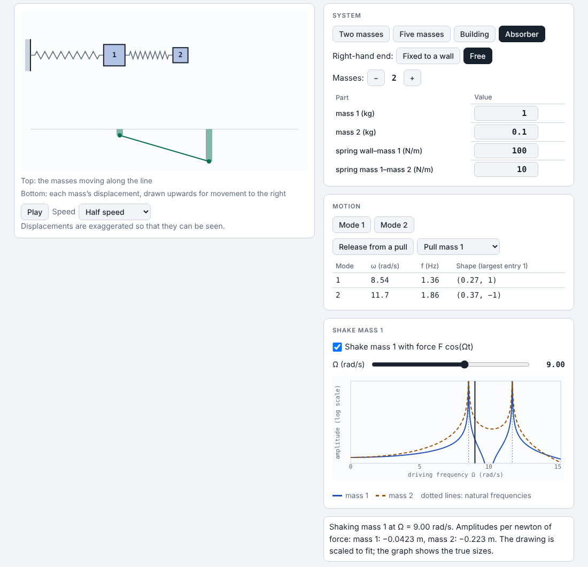{fig-alt="The normal modes app with the Absorber preset: a 1 kg mass on a spring with a 0.1 kg mass attached, a table of the two natural frequencies and mode shapes, and a graph of each mass's amplitude against driving frequency, with two resonance peaks and a dip to zero for mass 1 between them."}

A row of up to six masses joined by springs, fixed to a wall at the left and either fixed or free at the right. The masses and stiffnesses can be edited. Choose a mode to watch the masses vibrate in that shape at its natural frequency, or release them from a pulled position to see several modes at once; a bar chart below shows each mass's displacement. **Shake mass 1** drives the first mass at a chosen frequency, and the graph shows the amplitude of every mass against the driving frequency, with peaks at the natural frequencies. Animation starts only when **Play** is pressed.

- **Used in:** @sec-vibrations.
- **Open:** [normal modes](../apps/normal-modes.html){target="_blank"}.
- **Start-up settings:** `?preset=` picks a system by its label, `&mode=` a mode to show, and `&drive=1&omega=` shakes mass 1 at a given frequency in rad/s, as in [`?preset=Absorber&drive=1&omega=10`](../apps/normal-modes.html?preset=Absorber&drive=1&omega=10){target="_blank"}.
- **Teaching ideas:** before playing the modes of **Five masses**, ask students to sketch what they expect mode 3 to look like. With **Building**, ask which change, stiffening the lower storey or lightening the top floor, raises the first frequency more.

## Network split {#app-network-split}

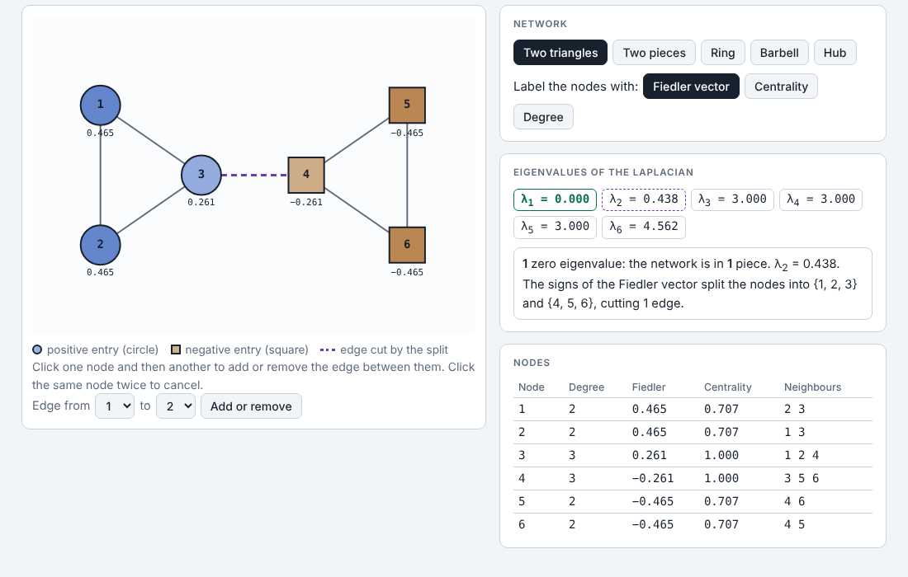{fig-alt="The network split app with two triangles joined by one edge: nodes on the left are circles with positive Fiedler vector entries and nodes on the right are squares with negative entries, the bridge edge is dashed as the one cut, and the Laplacian eigenvalues 0, 0.438, 3, 3, 3 and 4.562 are listed."}

A small network of up to eight nodes. Click two nodes in turn, or use the menus, to add or remove an edge. The panel lists the eigenvalues of the graph Laplacian, counts the zero ones to give the number of pieces, and splits the nodes by the signs of the Fiedler vector, marking the edges cut. The nodes can instead be labelled with their eigenvector centrality or their degree, and a table gives all three for every node.

- **Used in:** @sec-networks.
- **Open:** [network split](../apps/network-split.html){target="_blank"}.
- **Start-up settings:** `?preset=` picks a network by its label and `&show=centrality` or `&show=degree` the labels, as in [`?preset=Hub&show=centrality`](../apps/network-split.html?preset=Hub&show=centrality){target="_blank"}.
- **Teaching ideas:** ask students to find the single edge whose addition raises $\lambda_2$ the most, then to explain their choice in terms of bottlenecks.
