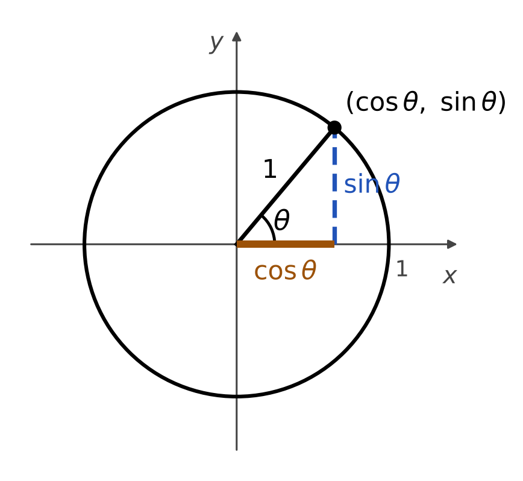

# Refresher {#sec-refresher .unnumbered}

This chapter collects the background that the rest of the book assumes. You don't need to read it straight through. Skim the headings, try the quick questions, and read properly any section where the questions give you trouble. Each section says where in the book the ideas are first used.

## Angles and trigonometry

*First used in @sec-transformations, and in the vectors section below.*

### Degrees and radians

Angles are measured in degrees or in **radians**, where a full turn is $360° = 2\pi$ radians. So $180° = \pi$, $90° = \pi/2$ and $1 \text{ radian} \approx 57.3°$. Mathematics and programming languages use radians by default: in Python, `np.sin(np.pi / 2)` is 1, but `np.sin(90)` is the sine of 90 *radians*. MATLAB has `sind` and `cosd` for degrees.

### Sine and cosine

Measure an angle $\theta$ anticlockwise from the positive $x$-axis. The point at that angle on the circle of radius 1 about the origin is $(\cos\theta, \sin\theta)$ (@fig-unit-circle). This is the picture behind every rotation matrix in the book.

{#fig-unit-circle fig-alt="A circle of radius 1 centred at the origin, with x and y axes. A radius at angle theta from the positive x axis reaches the point labelled cos theta, sin theta. A brown segment along the x axis from the origin is labelled cos theta, and a blue dashed vertical segment from the axis up to the point is labelled sin theta." width=45%}

| $\theta$ | $0°$ | $30°$ | $45°$ | $60°$ | $90°$ |
|:--|:--:|:--:|:--:|:--:|:--:|
| radians | $0$ | $\pi/6$ | $\pi/4$ | $\pi/3$ | $\pi/2$ |
| $\cos\theta$ | $1$ | $\sqrt{3}/2$ | $1/\sqrt{2}$ | $1/2$ | $0$ |
| $\sin\theta$ | $0$ | $1/2$ | $1/\sqrt{2}$ | $\sqrt{3}/2$ | $1$ |

### Identities you will need

$$
\cos^2\theta + \sin^2\theta = 1
$$
(Pythagoras on the unit circle), and
$$
\cos(-\theta) = \cos\theta,
$$
$$
\sin(-\theta) = -\sin\theta.
$$
The angle addition formulas,
$$
\cos(\alpha + \beta) = \cos\alpha\cos\beta - \sin\alpha\sin\beta,
$$
$$
\sin(\alpha + \beta) = \sin\alpha\cos\beta + \cos\alpha\sin\beta,
$$
are derived from matrices in @sec-composition, so you don't need to remember them.

::: {.callout-tip collapse="true"}
## Quick check: what are the coordinates of the point at $120°$ on the unit circle?

$(\cos 120°, \sin 120°) = (-\tfrac{1}{2}, \tfrac{\sqrt{3}}{2})$: it is the reflection of the $60°$ point in the $y$-axis.
:::

## Vectors

*First used in @sec-matrices.*

A **vector** is a quantity with both a size and a direction, such as a velocity or a force. It can be drawn as an arrow, and described by a list of numbers called its **components**: how far the arrow goes along each axis. In two dimensions,
$$
\vect{v} = \mat{3 \\ 4}
$$
is the arrow from the origin to the point $(3, 4)$: 3 units along the $x$-axis and 4 up the $y$-axis. In three dimensions there is a third component, for the $z$-axis.

This book writes vectors as columns, as above. (Later chapters sometimes write a column on one line to save space, as $(3, 4)\T$; the small $\mathsf{T}$ is explained in @sec-matrices.)

### Unit vectors along the axes

The vectors of length 1 pointing along the axes are
$$
\ui = \mat{1 \\ 0},
$$
$$
\uj = \mat{0 \\ 1}
$$
in two dimensions, and
$$
\ui = \mat{1 \\ 0 \\ 0},
$$
$$
\uj = \mat{0 \\ 1 \\ 0},
$$
$$
\uk = \mat{0 \\ 0 \\ 1}
$$
in three. Any vector can be built from them by taking the right amount of each:
$$
\mat{3 \\ 4} = 3\ui + 4\uj.
$$

(If you are used to a different notation for these, such as $\hat{\imath}$ or $\mathbf{e}_1$, choose it with the **Notation** button.)

### Length

By Pythagoras' theorem, the length (or **magnitude**) of $\vect{v} = (v_1, v_2)\T$ is
$$
\lVert \vect{v} \rVert = \sqrt{v_1^2 + v_2^2},
$$
and in three dimensions $\lVert \vect{v} \rVert = \sqrt{v_1^2 + v_2^2 + v_3^2}$. For example, the vector with components 3 and 4 has length $\sqrt{9 + 16} = 5$.

### Length and direction

Instead of giving its components, you can describe a vector in two dimensions by its length $r$ and the angle $\theta$ it makes with the positive $x$-axis. The components and the length form a right-angled triangle, so
$$
x = r\cos\theta,
$$
$$
y = r\sin\theta,
$$
$$
r = \sqrt{x^2 + y^2}.
$$

Try it below. Drag the tip of the vector, or change its length and angle with the sliders, and watch its components change. The faint arrows at the origin are the unit vectors $\ui$ and $\uj$, and the vector is built from them tip to tail.

::: {.app-embed}
<iframe class="app-frame" src="../apps/vector-explorer.html?embed=1&mode=components&lock" title="Vector components and length" loading="lazy"></iframe>

[Open the vector explorer in its own tab](../apps/vector-explorer.html?mode=components){.app-open target="_blank"}
:::

Things to try:

- Keep the length fixed and turn the vector all the way round. When is each component positive, negative or zero?
- Set the angle to $90°$. Which component is zero, and why?
- Find a vector with length 5 and whole-number components. (There are several.)

### Adding and scaling

Vectors are added component by component, which on a diagram means placing them tip to tail. Multiplying a vector by a number scales its length, and reverses its direction if the number is negative. @sec-arithmetic covers this in detail, with an interactive app.

### The dot product

The **dot product** of two vectors multiplies matching components and adds:
$$
\vect{a} \cdot \vect{b} = a_1 b_1 + a_2 b_2 + a_3 b_3.
$$
For example,
$$
\mat{1 \\ 2 \\ 3} \cdot \mat{4 \\ -5 \\ 6} = 1 \times 4 + 2 \times (-5) + 3 \times 6 = 12.
$$

The dot product measures how much two vectors point the same way. If $\theta$ is the angle between them,
$$
\vect{a} \cdot \vect{b} = \lVert \vect{a} \rVert \, \lVert \vect{b} \rVert \cos\theta.
$$
Geometrically, $\lVert \vect{b} \rVert \cos\theta$ is how far $\vect{b}$ reaches along the direction of $\vect{a}$: the length of its shadow on the line of $\vect{a}$. So the dot product is positive when the angle is less than $90°$, negative when it is more, and **zero exactly when the vectors are at right angles** (perpendicular).

Drag the two vectors below and compare the two ways of working out the dot product.

::: {.app-embed}
<iframe class="app-frame" src="../apps/vector-explorer.html?embed=1&mode=dot&lock" title="Dot product explorer" loading="lazy"></iframe>

[Open the vector explorer in its own tab](../apps/vector-explorer.html?mode=dot){.app-open target="_blank"}
:::


### The cross product

In three dimensions only, the **cross product** $\vect{a} \times \vect{b}$ is a vector at right angles to both $\vect{a}$ and $\vect{b}$:
$$
\vect{a} \times \vect{b} = \mat{a_2 b_3 - a_3 b_2 \\ a_3 b_1 - a_1 b_3 \\ a_1 b_2 - a_2 b_1}.
$$
Its length is the area of the parallelogram with sides $\vect{a}$ and $\vect{b}$. That parallelogram has base $\lVert \vect{a} \rVert$ and height $\lVert \vect{b} \rVert \sin\theta$, so
$$
\lVert \vect{a} \times \vect{b} \rVert = \lVert \vect{a} \rVert \, \lVert \vect{b} \rVert \sin\theta.
$$
The cross product is largest when the vectors are at right angles, and zero when they point along the same line. Compare the dot product, which has $\cos\theta$ instead.

Its direction follows the **right-hand rule**: point the fingers of your right hand along $\vect{a}$ and curl them towards $\vect{b}$, and your thumb points along $\vect{a} \times \vect{b}$. For example, $\ui \times \uj = \uk$.

In the app below, both vectors lie flat in the screen, so their cross product points straight out of the screen or into it, and only its third component is non-zero.

::: {.app-embed}
<iframe class="app-frame" src="../apps/vector-explorer.html?embed=1&mode=cross&lock" title="Cross product explorer" loading="lazy"></iframe>

[Open the vector explorer in its own tab](../apps/vector-explorer.html?mode=cross){.app-open target="_blank"}
:::


::: {.callout-tip collapse="true"}
## Quick check: find the length of the vector with components 1, 2, 2, and decide whether the vectors with components $(2, 1)$ and $(-1, 2)$ are perpendicular.

$\sqrt{1 + 4 + 4} = 3$. The dot product is $-2 + 2 = 0$, so yes, they are perpendicular.
:::

## Sigma notation

*First used in @sec-multiplication.*

The Greek capital sigma, $\Sigma$, means "add up". The expression
$$
\sum_{k=1}^{4} k^2 = 1^2 + 2^2 + 3^2 + 4^2 = 30
$$
says: let $k$ run through $1, 2, 3, 4$, work out $k^2$ each time, and add the results. The letter $k$ is just a counter, and any other letter would do.

The most important use in this book is adding up products of matching entries. With $a_1, a_2, a_3 = 1, 2, 3$ and $b_1, b_2, b_3 = 4, 5, 6$,
$$
\sum_{k=1}^{3} a_k b_k = a_1 b_1 + a_2 b_2 + a_3 b_3 = 4 + 10 + 18 = 32,
$$
which is the dot product.

Two sums can be nested, and the order in which you add up a finite number of terms doesn't matter, so
$$
\sum_{i=1}^{m} \sum_{j=1}^{n} c_{ij} = \sum_{j=1}^{n} \sum_{i=1}^{m} c_{ij}.
$$
Both add up every entry of a table: one row by row, the other column by column.

::: {.callout-tip collapse="true"}
## Quick check: write $x_1 + 2x_2 + 3x_3 + 4x_4 + 5x_5$ with sigma notation.

$\sum_{k=1}^{5} k\,x_k$.
:::

## Simultaneous equations

*First used in @sec-arithmetic, and the main subject of Part II.*

A set of equations that must all hold at once is called a **system** of simultaneous equations. To solve
$$
\begin{aligned}
2x + y &= 7 \\
x - y &= 2,
\end{aligned}
$$
add the equations to **eliminate** $y$: $3x = 9$, so $x = 3$. Then **substitute** back: $3 - y = 2$, so $y = 1$. Always check in the original equations: $2(3) + 1 = 7$ ✓ and $3 - 1 = 2$ ✓.

Three equations in three unknowns work the same way: use pairs of equations to eliminate one unknown, leaving two equations in two unknowns. For example,
$$
\begin{aligned}
x + y + z &= 6 \\
x - y + z &= 2 \\
2x + y - z &= 1.
\end{aligned}
$$
Subtracting the second equation from the first gives $2y = 4$, so $y = 2$. The first and third then become $x + z = 4$ and $2x - z = -1$; adding these gives $3x = 3$, so $x = 1$ and $z = 3$.

### When there is no single answer

Each equation in two unknowns is a straight line, and the solution is where the lines cross. Two lines usually cross at one point, but not always (@fig-two-lines).

```{python}
#| fig-alt: "Three panels, each with a pair of straight lines: in the first they cross at the single point (3, 1); in the second they are parallel and never meet; in the third they lie on top of each other."
#| label: fig-two-lines
#| fig-cap: "Two equations in two unknowns are two lines. Left: they cross once, so there is one solution. Middle: they are parallel, so there is none. Right: they are the same line, so every point on it is a solution."
#| code-fold: true
#| code-summary: "Show the code for this figure"
import numpy as np
import matplotlib.pyplot as plt

x = np.linspace(-1, 5, 2)
cases = [
    ("One solution", [(2, 1, 7, "2x + y = 7"), (1, -1, 2, "x − y = 2")], (3, 1)),
    ("No solution", [(1, 1, 2, "x + y = 2"), (2, 2, 5, "2x + 2y = 5")], None),
    ("Infinitely many", [(1, 1, 2, "x + y = 2"), (2, 2, 4, "2x + 2y = 4")], None),
]
fig, axes = plt.subplots(1, 3, figsize=(9.6, 3.4), sharey=True)
for ax, (title, lines, point) in zip(axes, cases):
    for k, (a, b, c, label) in enumerate(lines):
        ax.plot(x, (c - a * x) / b, lw=3 if k == 0 else 1.8, ls="-" if k == 0 else "--",
                color=["#2153b8", "#9c5208"][k], label=label)
    if point:
        ax.plot(*point, "o", color="#0a7050", ms=8)
        ax.annotate("(3, 1)", point, xytext=(8, 6), textcoords="offset points", color="#0a7050")
    ax.set_title(title, fontsize=11)
    ax.set_xlim(-1, 5); ax.set_ylim(-3, 5); ax.grid(alpha=0.3)
    ax.axhline(0, color="grey", lw=0.6); ax.axvline(0, color="grey", lw=0.6)
    ax.legend(fontsize=8, loc="upper right")
plt.tight_layout()
plt.show()
```

- $x + y = 2$ and $2x + 2y = 5$ are **parallel** lines: no solution. (Doubling the first gives $2x + 2y = 4$, which contradicts the second.)
- $x + y = 2$ and $2x + 2y = 4$ are the **same** line: infinitely many solutions, one for every point on it.

@sec-gaussian-elimination turns elimination into a systematic method that works for any number of equations, and shows how to spot these cases.

::: {.callout-tip collapse="true"}
## Quick check: solve $3x + 2y = 12$, $x - 2y = 4$.

Adding: $4x = 16$, so $x = 4$ and then $y = 0$.
:::

## Complex numbers

*First used in Part IV, for eigenvalues of rotations and vibrations.*

The number $i$ is defined by $i^2 = -1$. A **complex number** $z = a + bi$ has a *real part* $a$ and an *imaginary part* $b$, and can be pictured as the point $(a, b)$ in a plane. Complex numbers are added and multiplied like ordinary algebra, replacing $i^2$ by $-1$:
$$
(2 + 3i)(1 - i) = 2 - 2i + 3i - 3i^2 = 5 + i.
$$

The **modulus** $|z| = \sqrt{a^2 + b^2}$ is the distance from the origin, and the **argument** $\arg z$ is the angle from the positive real axis. Euler's formula,
$$
e^{i\theta} = \cos\theta + i\sin\theta,
$$
links complex numbers to rotation: multiplying by $e^{i\theta}$ rotates a point by $\theta$ about the origin. @sec-composition shows the same idea with matrices.

::: {.callout-tip collapse="true"}
## Quick check: find $|3 + 4i|$ and $(1 + i)^2$.

$|3 + 4i| = 5$, and $(1 + i)^2 = 1 + 2i + i^2 = 2i$.
:::

## Getting started with the code {#sec-code-primer}

Every chapter shows its methods in both Python and MATLAB. Choose a tab and the whole book follows; you can set which language appears first with the **Notation** button. You only need one of the two.

### Setting up

::: {.panel-tabset group="language"}
## Python

Python is free. The simplest way to get it is to install [Anaconda](https://www.anaconda.com/download), which comes with all the libraries this book uses, as well as Jupyter. [Miniforge](https://github.com/conda-forge/miniforge) is a smaller alternative; with Miniforge, install the libraries by typing this in its terminal (called Miniforge Prompt on Windows):

```bash
conda install numpy scipy matplotlib jupyter
```

If you already have Python from somewhere else, such as [python.org](https://www.python.org), use `pip` instead:

```bash
pip install numpy scipy matplotlib jupyter
```

Use one or the other for a given Python installation: mixing `conda` and `pip` in the same environment can cause conflicts.

Write and run code in [Jupyter](https://jupyter.org) notebooks or in an editor such as [VS Code](https://code.visualstudio.com). You can also run Python in a browser, with nothing to install, using [Google Colab](https://colab.research.google.com).

Every Python example in this book starts by loading NumPy, the library for working with arrays of numbers:

```python
import numpy as np
```

## MATLAB

MATLAB needs a licence, which most universities provide. You can also use [MATLAB Online](https://matlab.mathworks.com) in a browser. [GNU Octave](https://octave.org) is a free alternative that runs almost all of the MATLAB in this book unchanged.

Type commands at the `>>` prompt in the Command Window, or save them in a script file (ending `.m`) and press **Run**.
:::

### The basics, side by side

| Task | Python (NumPy) | MATLAB |
|:-----|:---------------|:-------|
| A matrix | `A = np.array([[1, 2], [3, 4]])` | `A = [1 2; 3 4]` |
| A vector | `x = np.array([5, 6])` | `x = [5; 6]` |
| Size | `A.shape` | `size(A)` |
| Entry in row 1, column 2 | `A[0, 1]` | `A(1,2)` |
| Row 1 / column 2 | `A[0, :]` / `A[:, 1]` | `A(1,:)` / `A(:,2)` |
| Transpose | `A.T` | `A'` |
| Matrix product | `A @ B` | `A * B` |
| Entry-by-entry product | `A * B` | `A .* B` |
| Identity matrix | `np.eye(3)` | `eye(3)` |
| Matrix of zeros | `np.zeros((2, 3))` | `zeros(2, 3)` |
| Solve $\M{A}\vect{x} = \vect{b}$ | `np.linalg.solve(A, b)` | `A \ b` |
| Square root, sine (radians) | `np.sqrt(2)`, `np.sin(x)` | `sqrt(2)`, `sin(x)` |

Two differences cause most early mistakes:

- **Counting.** Python counts rows and columns from 0, MATLAB from 1. The entry $a_{12}$ is `A[0, 1]` in Python and `A(1,2)` in MATLAB.
- **Multiplying.** The symbol for an ordinary matrix product is `@` in Python and `*` in MATLAB. In Python, `*` multiplies entry by entry, which is a different operation (@sec-multiplication).

### A first example

This builds a matrix and a vector, multiplies them, and plots the result as an arrow.

::: {.panel-tabset group="language"}
## Python

```{python}
#| fig-alt: "Two arrows from the origin: the vector (1, 2) and its image (4, 7) after multiplying by the matrix."
#| fig-cap: "The vector (1, 2) and its image after multiplying by the matrix A."
import numpy as np
import matplotlib.pyplot as plt

A = np.array([[2, 1],
              [1, 3]])
x = np.array([1, 2])
y = A @ x                       # matrix times vector
print(y)

fig, ax = plt.subplots(figsize=(4, 4))
ax.quiver(0, 0, *x, angles="xy", scale_units="xy", scale=1, color="grey", label="x")
ax.quiver(0, 0, *y, angles="xy", scale_units="xy", scale=1, color="C0", label="Ax")
ax.set_xlim(-1, 8); ax.set_ylim(-1, 8)
ax.set_aspect("equal"); ax.grid(alpha=0.3); ax.legend()
plt.show()
```

Lines starting with `#` are comments, ignored by Python. `print` shows a value; `plt.show()` shows a figure.

## MATLAB

```matlab
A = [2 1;
     1 3];
x = [1; 2];
y = A * x                % matrix times vector

figure
quiver(0, 0, x(1), x(2), 0, 'Color', [0.5 0.5 0.5]); hold on
quiver(0, 0, y(1), y(2), 0, 'b')
axis equal; grid on; xlim([-1 8]); ylim([-1 8])
legend('x', 'Ax')
```

```{.text .code-output}
y =

     4
     7
```

Text after `%` is a comment. A line without a semicolon at the end shows its result; ending a line with `;` hides it. The final `0` in `quiver` stops MATLAB rescaling the arrows.
:::

### Functions

Wrapping a calculation in a function lets you reuse it. Chapters often define small functions like this one.

::: {.panel-tabset group="language"}
## Python

```{python}
def rotation(theta_deg):
    """Matrix of the rotation by theta degrees anticlockwise."""
    t = np.radians(theta_deg)
    return np.array([[np.cos(t), -np.sin(t)],
                     [np.sin(t),  np.cos(t)]])

print(np.round(rotation(90), 10))
```

Indentation matters in Python: the lines inside the function must be indented. `np.round(..., 10)` hides tiny rounding errors.

## MATLAB

```matlab
rotation = @(theta) [cosd(theta) -sind(theta);
                     sind(theta)  cosd(theta)];
rotation(90)
```

```{.text .code-output}
ans =

     0    -1
     1     0
```

The `@(theta)` creates a short *anonymous function*. Longer functions go at the end of a script, or in their own file, starting with the word `function` (see @sec-gaussian-elimination for an example).
:::

### When things go wrong

- **Read the last line of the error message first.** It usually names the problem, such as a size mismatch or a misspelt name.
- **Check sizes.** Print `A.shape` or `size(A)` for every matrix in a failing line. Most errors in linear algebra code are matrices of the wrong size.
- **Expect tiny rounding errors.** Computers store numbers to about 16 significant figures, so you will see results like `0.30000000000000004` instead of `0.3`. Compare numbers with a tolerance (`np.isclose` in Python, `abs(a - b) < 1e-10` in MATLAB), never with `==`.
