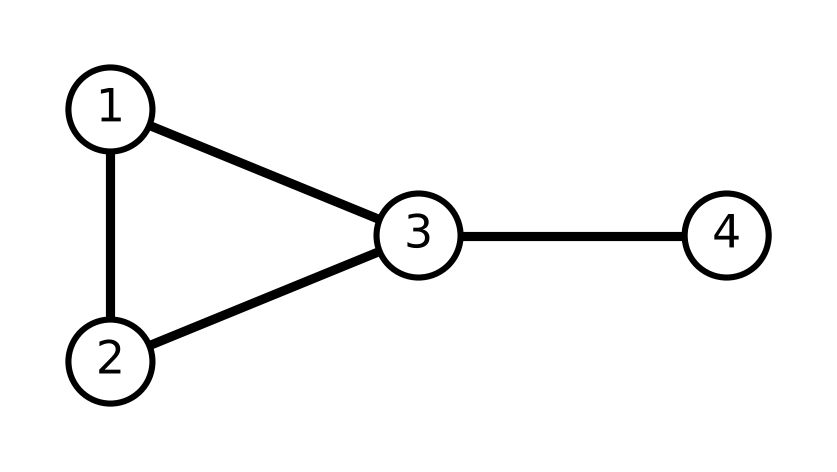

# What is a matrix? {#sec-matrices}

[Core]{.level-badge .core}

::: {.callout-note appearance="simple" icon=false}
## In this chapter you will

- see how matrices store equations, data and networks
- read and write matrix notation: size, entries $a_{ij}$, rows and columns
- recognise square and symmetric matrices
- find the transpose of a matrix
:::

**Builds on** school algebra only. The [Refresher](../front/refresher.qmd) covers everything you need.

A **matrix** is a rectangular array of numbers. That simple idea turns out to be one of the most useful in applied mathematics. The same object can hold the coefficients of a set of equations, a table of measurements, the connections in a network or the pixels of an image, and the same operations work on all of them.

This chapter sets out the vocabulary. The rest of Part I shows what matrices can *do*.

## Build intuition

Here are three situations that lead to the same kind of object.

**Equations.** A circuit, a structure or a chemical process often gives a set of **linear** equations, in which the unknowns are only multiplied by numbers and added (no squares, products of unknowns or other functions of them), such as

$$
\begin{aligned}
3x + 2y - z &= 1 \\
x - y + 4z &= 6.
\end{aligned}
$$

Everything that matters is in the numbers in front of the unknowns:

$$
\mat{3 & 2 & -1 \\ 1 & -1 & 4}.
$$

**Data.** Three temperature sensors are read every hour. Each row is one reading time, and each column is one sensor:

| Time | Sensor 1 (°C) | Sensor 2 (°C) | Sensor 3 (°C) |
|:-----|------:|------:|------:|
| 09:00 | 18.2 | 19.1 | 17.6 |
| 10:00 | 19.5 | 20.3 | 18.4 |
| 11:00 | 21.0 | 21.8 | 19.9 |
| 12:00 | 22.4 | 23.0 | 21.2 |

Without the labels, this is a matrix with 4 rows and 3 columns.

**Networks.** Four towns are linked by roads: 1 to 2, 1 to 3, 2 to 3 and 3 to 4 (@fig-towns). Put a 1 in row $i$, column $j$ when towns $i$ and $j$ are linked, and 0 otherwise:

$$
\mat{0 & 1 & 1 & 0 \\ 1 & 0 & 1 & 0 \\ 1 & 1 & 0 & 1 \\ 0 & 0 & 1 & 0}.
$$

{#fig-towns fig-alt="A network of four numbered circles. Towns 1, 2 and 3 form a triangle, joined by roads 1–2, 1–3 and 2–3, and town 4 is joined only to town 3." width=50%}

This table of connections is called the **adjacency matrix** of the network ("adjacent" means "next to"). It holds more information than it seems: @sec-multiplication shows how to use it to count routes between towns.

## The ideas

### Size and entries

A matrix with $m$ rows and $n$ columns is an **$m \times n$ matrix** (read "$m$ by $n$"). Rows always come first. The temperature table is $4 \times 3$; the equations gave a $2 \times 3$ matrix.

Matrices are named with capital letters, and their **entries** with the matching lower-case letter and two subscripts: $a_{ij}$ is the entry of $\M{A}$ in **row $i$, column $j$**. A general $m \times n$ matrix is

$$
\M{A} = \mat{a_{11} & a_{12} & \cdots & a_{1n} \\ a_{21} & a_{22} & \cdots & a_{2n} \\ \vdots & \vdots & \ddots & \vdots \\ a_{m1} & a_{m2} & \cdots & a_{mn}}.
$$

A shorthand for the same thing is $\M{A} = (a_{ij})$. Two matrices are **equal** when they have the same size and every pair of corresponding entries is equal.

::: {.callout-tip appearance="simple"}
## Remembering the order
Row then column, as in "RC". In the temperature matrix, $a_{23} = 18.4$: row 2 is 10:00 and column 3 is sensor 3.
:::

::: {#ex-matrices-1 .callout-note appearance="simple" icon=false}
### Example 1: from equations to a matrix

Write down the coefficient matrix of
$$
\begin{aligned}
2x_1 - x_3 &= 5 \\
x_1 + 3x_2 + x_3 &= 0 \\
4x_2 - 2x_3 &= -1.
\end{aligned}
$$

**Solution.** Each row is an equation and each column is an unknown. A missing unknown has coefficient 0:
$$
\M{A} = \mat{2 & 0 & -1 \\ 1 & 3 & 1 \\ 0 & 4 & -2}.
$$
This is $3 \times 3$, and $a_{13} = -1$ is the coefficient of $x_3$ in the first equation.
:::

::: {#ex-matrices-2 .callout-note appearance="simple" icon=false}
### Example 2: building a matrix from a rule

Write down the $3 \times 3$ matrix with entries $b_{ij} = i - 2j$.

**Solution.** Work along each row in turn. Row 1 has $b_{11} = 1 - 2 = -1$, $b_{12} = 1 - 4 = -3$ and $b_{13} = 1 - 6 = -5$, and so on:
$$
\M{B} = \mat{-1 & -3 & -5 \\ 0 & -2 & -4 \\ 1 & -1 & -3}.
$$
:::

### Row and column vectors

A matrix with one row is a **row vector**, and a matrix with one column is a **column vector**. In this book, vectors are columns unless we say otherwise:

$$
\vect{x} = \mat{x_1 \\ x_2 \\ x_3}.
$$

It is often useful to think of a matrix as a row of column vectors, or as a stack of row vectors.

### Square and symmetric matrices

A matrix is **square** if it has as many rows as columns. The entries $a_{11}, a_{22}, \dots, a_{nn}$, running from top left to bottom right, form its **main diagonal**.

Look again at the road network matrix. Because every road goes both ways, town 1 is linked to town 3 exactly when town 3 is linked to town 1, so $a_{13} = a_{31}$, and the same holds for every pair. The matrix is a mirror image of itself across the main diagonal. A matrix like this, with $a_{ij} = a_{ji}$ for every $i$ and $j$, is called **symmetric**. Symmetric matrices turn up whenever the relationship between $i$ and $j$ is the same as the relationship between $j$ and $i$: distances between cities, or how strongly pairs of measurements are related. They have special properties that later chapters use.

Other kinds of matrix, such as the identity matrix and triangular matrices, are introduced in the chapters where they are first needed. @sec-reference lists them all in one place.

### The transpose

The **transpose** of an $m \times n$ matrix $\M{A}$ is the $n \times m$ matrix $\M{A}\T$ whose rows are the columns of $\M{A}$:

$$
\M{A} = \mat{1 & 2 & 3 \\ 4 & 5 & 6}
\quad\Longrightarrow\quad
\M{A}\T = \mat{1 & 4 \\ 2 & 5 \\ 3 & 6}.
$$

In symbols, the $(i, j)$ entry of $\M{A}\T$ is $a_{ji}$. Transposing twice gets you back where you started: $(\M{A}\T)\T = \M{A}$.

Two uses of the transpose appear straight away:

- A column vector can be written on one line as the transpose of a row: $\vect{x} = (x_1, x_2, x_3)\T$.
- A square matrix is symmetric exactly when $\M{A}\T = \M{A}$: transposing it changes nothing.

::: {#ex-matrices-3 .callout-note appearance="simple" icon=false}
### Example 3: transposes and symmetry

For which values of $p$ and $q$ is
$$
\M{C} = \mat{3 & p & 2 \\ 7 & 1 & q \\ 2 & -4 & 0}
$$
symmetric?

**Solution.** We need $c_{ij} = c_{ji}$ for every pair. The pair $c_{13} = c_{31} = 2$ already matches. The others need $p = c_{12} = c_{21} = 7$ and $q = c_{23} = c_{32} = -4$.
:::

## In code

Both languages store matrices as arrays. The main trap is indexing: *Python counts from 0 and MATLAB counts from 1*, so the entry $a_{23}$ is `A[1, 2]` in Python and `A(2,3)` in MATLAB.

::: {.panel-tabset group="language"}
## Python

```{python}
import numpy as np

# Temperature readings: rows are times, columns are sensors
T = np.array([[18.2, 19.1, 17.6],
              [19.5, 20.3, 18.4],
              [21.0, 21.8, 19.9],
              [22.4, 23.0, 21.2]])

print(T.shape)        # (rows, columns)
print(T[1, 2])        # row 2, column 3 (Python counts from 0)
print(T[:, 0])        # all of column 1: sensor 1
print(T.T)            # the transpose
```

To check whether a matrix is symmetric, compare it with its transpose:

```{python}
A = np.array([[1, 4, 5], [4, 2, 6], [5, 6, 3]])
print(np.array_equal(A, A.T))
```

## MATLAB

```matlab
% Temperature readings: rows are times, columns are sensors
T = [18.2 19.1 17.6;
     19.5 20.3 18.4;
     21.0 21.8 19.9;
     22.4 23.0 21.2];

size(T)        % rows, columns
T(2,3)         % row 2, column 3
T(:,1)         % all of column 1: sensor 1
T'             % the transpose
```

```{.text .code-output}
ans =

     4     3

ans =

   18.4000

ans =

   18.2000
   19.5000
   21.0000
   22.4000

ans =

   18.2000   19.5000   21.0000   22.4000
   19.1000   20.3000   21.8000   23.0000
   17.6000   18.4000   19.9000   21.2000
```

To check whether a matrix is symmetric, compare it with its transpose:

```matlab
A = [1 4 5; 4 2 6; 5 6 3];
isequal(A, A')
```

```{.text .code-output}
ans =

  logical

   1
```

In MATLAB, `A'` is the transpose for real matrices. For complex matrices it also takes complex conjugates; use `A.'` for the plain transpose.
:::

## Check your understanding

::: {.callout-tip collapse="true"}
## What size is the coefficient matrix of 5 equations in 3 unknowns?

$5 \times 3$: one row per equation and one column per unknown.
:::

::: {.callout-tip collapse="true"}
## If $\M{A}$ is $2 \times 5$, what size is $\M{A}\T$, and what is its $(4, 1)$ entry?

$\M{A}\T$ is $5 \times 2$. Its $(4, 1)$ entry is the $(1, 4)$ entry of $\M{A}$, that is $a_{14}$.
:::

::: {.callout-tip collapse="true"}
## Can a matrix that is not square be symmetric?

No. Transposing an $m \times n$ matrix gives an $n \times m$ matrix, which can only equal the original if $m = n$.
:::

## Key ideas

- A matrix is a rectangular table of numbers. An $m \times n$ matrix has $m$ rows and $n$ columns, and $a_{ij}$ is the entry in row $i$, column $j$: row first, column second.
- The same table can hold the coefficients of equations, a data set, or the links in a network; much of the skill is in setting up the matrix.
- A vector is a matrix with one column (or one row).
- The transpose $\M{A}\T$ swaps rows and columns, so entry $(i, j)$ of $\M{A}\T$ is $a_{ji}$.
- A square matrix is symmetric when $\M{A}\T = \M{A}$: it is a mirror image of itself across the main diagonal.

## Exercises {#sec-matrices-exercises}

1. []{#exercise-matrices-1}Write down the $2 \times 4$ matrix with entries $a_{ij} = 2i + j$.

   [Solution to exercise 1](../appendices/solutions-1.qmd#solution-matrices-1){.sol-link}

2. []{#exercise-matrices-2}For
   $$\M{P} = \mat{4 & -1 & 0 & 2 \\ 3 & 5 & -2 & 1 \\ 0 & 6 & 8 & -3},$$
   state the size of $\M{P}$, the entries $p_{23}$ and $p_{32}$, and write down $\M{P}\T$.

   [Solution to exercise 2](../appendices/solutions-1.qmd#solution-matrices-2){.sol-link}

3. []{#exercise-matrices-3}Which of these matrices are symmetric? For any that are not, say which entries break the symmetry.

   - $\M{A} = \mat{2 & 0 \\ 0 & 5}$
   - $\M{B} = \mat{0 & 3 \\ -3 & 0}$
   - $\M{C} = \mat{1 & 2 & 4 \\ 2 & 1 & 0 \\ 4 & 0 & 6}$
   - $\M{D} = \mat{1 & 2 & 3 \\ 2 & 1 & 2}$

   [Solution to exercise 3](../appendices/solutions-1.qmd#solution-matrices-3){.sol-link}

4. []{#exercise-matrices-4}The table below gives approximate road distances in kilometres between four cities. Write it as a matrix. Why must it be symmetric, and why is its main diagonal zero?

   | City | Leeds | Liverpool | Manchester | Sheffield |
   |:--|--:|--:|--:|--:|
   | Leeds | 0 | 118 | 69 | 56 |
   | Liverpool | 118 | 0 | 56 | 125 |
   | Manchester | 69 | 56 | 0 | 61 |
   | Sheffield | 56 | 125 | 61 | 0 |

   [Solution to exercise 4](../appendices/solutions-1.qmd#solution-matrices-4){.sol-link}

5. []{#exercise-matrices-5}Five people in a group follow each other on social media: A follows B and C, B follows C, C follows A, D follows A, B and C, and E follows nobody. Write down the matrix with $f_{ij} = 1$ if person $i$ follows person $j$, and 0 otherwise. Is it symmetric? What does the sum of column $j$ tell you?

   [Solution to exercise 5](../appendices/solutions-1.qmd#solution-matrices-5){.sol-link}

6. []{#exercise-matrices-6}**Code.** Create the $6 \times 6$ matrix with entries $a_{ij} = 1/(i + j - 1)$, and check that it is symmetric. (It is called the *Hilbert matrix*, and it returns in @sec-floating-point-conditioning as a famously difficult matrix for computers.) In Python you may find `np.fromfunction` useful; in MATLAB, try `hilb(6)` and compare.

   [Solution to exercise 6](../appendices/solutions-1.qmd#solution-matrices-6){.sol-link}

Solutions are in @sec-solutions-matrices.

## In practice

- **Data science** stores data sets as matrices with one row per observation (a person, a day, a sample) and one column per thing measured. Most statistical methods are calculations on this table.
- **Images**: a black-and-white photograph is a matrix of pixel brightnesses; a colour image is three matrices, one each for red, green and blue.
- **Engineering**: when a bridge or building is analysed by computer, the way each joint pushes and pulls on the others is stored in a large symmetric matrix.
- **Networks**: tables of connections describe road and rail networks, electricity grids, social networks and the links between web pages (@sec-markov-pagerank).

## Going further

A large matrix can be split into **blocks**, smaller matrices placed side by side and on top of each other. For example, the coefficient matrix of a set of equations with the right-hand sides added as an extra column, written $[\M{A} \mid \vect{b}]$, is a block matrix with two blocks. It is called an augmented matrix, and @sec-gaussian-elimination uses it to solve equations. Block structure often reflects the physics of a problem, such as separate parts of a structure joined at a few points, and good software exploits it to save time and memory.
