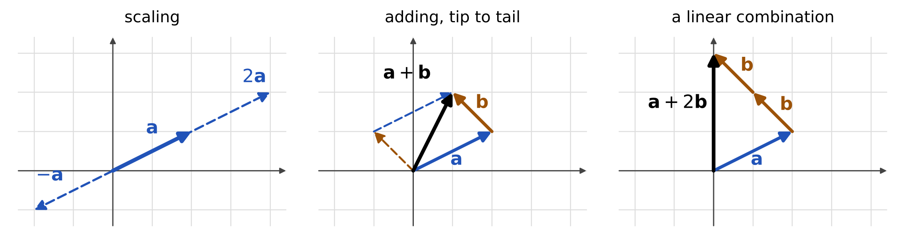

# Adding and scaling matrices {#sec-arithmetic}

[Core]{.level-badge .core}

::: {.callout-note appearance="simple" icon=false}
## In this chapter you will

- add and subtract matrices, and multiply them by a number
- solve simple equations involving matrices
- form linear combinations of vectors, and picture them as arrows
:::

**Builds on** @sec-matrices.

Adding matrices and multiplying them by a number work exactly as you would guess: entry by entry. These operations are simple, but they let us combine whole tables of numbers at once, and they lead to one of the central ideas of the subject, the *linear combination*.

## Build intuition

A bakery makes two things, cakes and biscuits. Here are the ingredients for one batch of each, in kilograms:

| Ingredient | Cake | Biscuits |
|:-----------|-----:|---------:|
| Flour | 0.2 | 0.3 |
| Sugar | 0.15 | 0.1 |
| Butter | 0.15 | 0.2 |

Each column is a list of three numbers, so we can write the recipes as vectors:
$$
\vect{c} = \mat{0.2 \\ 0.15 \\ 0.15},
$$
$$
\vect{b} = \mat{0.3 \\ 0.1 \\ 0.2}.
$$

How much of each ingredient do we need for 3 batches of cake and 2 of biscuits? Common sense says: triple every amount in the cake recipe, double every amount in the biscuit recipe, and add the two lists ingredient by ingredient:
$$
3\vect{c} + 2\vect{b} = \mat{0.6 \\ 0.45 \\ 0.45} + \mat{0.6 \\ 0.2 \\ 0.4} = \mat{1.2 \\ 0.65 \\ 0.85}.
$$
That is 1.2 kg of flour, 0.65 kg of sugar and 0.85 kg of butter. This chapter is about exactly these two operations, scaling and adding, done on whole vectors and matrices at once.

## The ideas

### Adding and subtracting

Two matrices **of the same size** are added by adding the entries in matching positions:

$$
\mat{1 & 4 \\ -2 & 0 \\ 3 & 5} + \mat{2 & -1 \\ 6 & 3 \\ 0 & -4} = \mat{3 & 3 \\ 4 & 3 \\ 3 & 1}.
$$

In symbols, if $\M{C} = \M{A} + \M{B}$ then $c_{ij} = a_{ij} + b_{ij}$. Subtraction works the same way. Matrices of different sizes cannot be added, because there is no sensible way to pair up their entries.

The matrix whose entries are all zero is the **zero matrix**, written $\M{0}$. Adding it to any matrix of the same size changes nothing, just as adding the number 0 changes nothing.

### Multiplying by a number

To multiply a matrix by a number, multiply every entry by that number:

$$
3\mat{2 & -1 \\ 0 & 4} = \mat{6 & -3 \\ 0 & 12}.
$$

An ordinary single number like this is called a **scalar**, to distinguish it from a vector or a matrix. The name comes from the fact that multiplying by a number *scales* things up or down. So this operation is called **scalar multiplication**. Writing $-\M{A}$ means $(-1)\M{A}$, and $\M{A} - \M{B}$ is the same as $\M{A} + (-1)\M{B}$.

::: {#ex-arithmetic-1 .callout-note appearance="simple" icon=false}
### Example 1: combining tables of orders

The bakery supplies two cafés. Monday's and Tuesday's orders, in batches, were

| Product | Café A | Café B |
|:--|--:|--:|
| Cake | 4 | 10 |
| Biscuits | 6 | 3 |

and

| Product | Café A | Café B |
|:--|--:|--:|
| Cake | 5 | 8 |
| Biscuits | 2 | 7 |

Find the total for both days, and the orders for a busy Saturday when each café expects 50% more than on Monday.

**Solution.** Writing the tables as matrices $\M{M}$ and $\M{T}$,
$$
\M{M} + \M{T} = \mat{4 & 10 \\ 6 & 3} + \mat{5 & 8 \\ 2 & 7} = \mat{9 & 18 \\ 8 & 10},
$$
$$
1.5\M{M} = \mat{6 & 15 \\ 9 & 4.5}.
$$
Every entry is worked out at once, and each keeps its meaning: the bottom-right entry is always biscuits for café B.
:::

### Rearranging works as usual

Because everything happens entry by entry, equations involving only adding, subtracting and scaling can be rearranged just as with ordinary numbers. You can add in any order, collect like terms, multiply out brackets such as $2(\M{A} + \M{B}) = 2\M{A} + 2\M{B}$, and move terms from one side of an equation to the other. Example 2 below does exactly this. (The full list of rules is in @sec-reference, if you ever need to check one.)

Things become more interesting when matrices are multiplied by *each other*. That is the subject of @sec-multiplication, and some familiar rules fail there.

::: {#ex-arithmetic-2 .callout-note appearance="simple" icon=false}
### Example 2: solving a matrix equation

Find $\M{X}$ if $2\M{X} + \M{A} = 3\M{B}$, where
$$
\M{A} = \mat{4 & -2 \\ 1 & 0},
$$
$$
\M{B} = \mat{2 & 0 \\ -1 & 3}.
$$

**Solution.** Rearrange first, exactly as for numbers, then calculate:
$$
\M{X} = \tfrac{1}{2}(3\M{B} - \M{A})
= \tfrac{1}{2}\left(\mat{6 & 0 \\ -3 & 9} - \mat{4 & -2 \\ 1 & 0}\right)
= \tfrac{1}{2}\mat{2 & 2 \\ -4 & 9}
= \mat{1 & 1 \\ -2 & 4.5}.
$$
:::

### Linear combinations

A vector with two entries can be drawn as an arrow from the origin to the point with those coordinates. Scaling and adding then have a picture (@fig-vector-pictures):

- $s\vect{a}$ is an arrow along the same line as $\vect{a}$, $s$ times as long, pointing backwards if $s$ is negative;
- $\vect{a} + \vect{b}$ is found by placing the tail of $\vect{b}$ at the tip of $\vect{a}$ (**tip to tail**).

{#fig-vector-pictures fig-alt="Three panels on a square grid. Scaling: the blue arrow a from the origin to (2, 1), with dashed arrows 2a to (4, 2) and minus a to (minus 2, minus 1). Adding: a, then b from its tip, reach a plus b at (1, 2); the dashed path b then a reaches the same point, making a parallelogram. A linear combination: a, then b twice, reach a plus 2b at (0, 3)." width=100%}

A sum of scaled vectors, such as $s\vect{a} + t\vect{b}$, is called a **linear combination** of $\vect{a}$ and $\vect{b}$. The numbers $s$ and $t$ say how much of each vector to use. The bakery's shopping list $3\vect{c} + 2\vect{b}$ was a linear combination of the two recipes.

Try it below. Change $s$ and $t$ to steer the green arrow onto the target, then drag the arrow tips to change the vectors themselves.

::: {.app-embed}
<iframe class="app-frame" src="../apps/vector-mixer.html?embed=1" title="Linear combination explorer" loading="lazy"></iframe>

[Open the linear combination explorer in its own tab](../apps/vector-mixer.html){.app-open target="_blank"}
:::

Things to try:

- Press **New target** a few times. Can you always reach it?
- Press **Use the axes**. The vectors are now $(1, 0)\T$ and $(0, 1)\T$. How are $s$ and $t$ related to the target's coordinates?
- Press **Same direction**. What goes wrong, and why?

With the axis vectors, $s$ and $t$ are just the coordinates of the point: $(x, y)\T = x(1, 0)\T + y(0, 1)\T$. With other vectors you can usually still reach any point, as long as the two vectors don't point along the same line. Finding the right amounts always means solving a pair of equations, as Example 3 shows. That is the first glimpse of the connection between vectors and simultaneous equations that runs through the whole book.

::: {#ex-arithmetic-3 .callout-note appearance="simple" icon=false}
### Example 3: finding the amounts

Write $\vect{w} = (1, 5)\T$ as a linear combination of $\vect{a} = (2, 1)\T$ and $\vect{b} = (-1, 1)\T$. (This is the first target in the app.)

**Solution.** We need numbers $s$ and $t$ with
$$
s\mat{2 \\ 1} + t\mat{-1 \\ 1} = \mat{1 \\ 5}.
$$
Comparing the top entries and the bottom entries gives two equations:
$$
\begin{aligned} 2s - t &= 1 \\ s + t &= 5. \end{aligned}
$$
Adding them gives $3s = 6$, so $s = 2$, and then $t = 3$. Check: $2(2, 1)\T + 3(-1, 1)\T = (1, 5)\T$. ✓
:::

## In code

In both languages, `+`, `-` and multiplying by a number work entry by entry, just as in the mathematics.

::: {.panel-tabset group="language"}
## Python

```{python}
import numpy as np

c = np.array([0.2, 0.15, 0.15])     # cake recipe: flour, sugar, butter (kg)
b = np.array([0.3, 0.1, 0.2])       # biscuit recipe
print(3 * c + 2 * b)                # shopping list for 3 cakes and 2 biscuits

A = np.array([[4, -2], [1, 0]])
B = np.array([[2, 0], [-1, 3]])
X = (3 * B - A) / 2
print(X)
```

## MATLAB

```matlab
c = [0.2; 0.15; 0.15];      % cake recipe: flour, sugar, butter (kg)
b = [0.3; 0.1; 0.2];        % biscuit recipe
3*c + 2*b                   % shopping list for 3 cakes and 2 biscuits

A = [4 -2; 1 0];
B = [2 0; -1 3];
X = (3*B - A) / 2
```

```{.text .code-output}
ans =

    1.2000
    0.6500
    0.8500

X =

    1.0000    1.0000
   -2.0000    4.5000
```
:::

::: {.callout-warning appearance="simple"}
## A trap: adding things of different sizes
In mathematics, adding matrices of different sizes is not allowed. **NumPy and MATLAB sometimes do it anyway.** If you add a column of 3 numbers to a row of 3 numbers, both stretch the smaller pieces to fit and give a $3 \times 3$ result (this is called *broadcasting* in NumPy and *implicit expansion* in MATLAB). It is useful on purpose, for example to subtract the average of each column from a table, but it can hide mistakes. If a result comes out an unexpected size, check the sizes of what you added.
:::

## Check your understanding

::: {.callout-tip collapse="true"}
## Can you add a $2 \times 3$ matrix to a $3 \times 2$ matrix?

No. Addition needs both matrices to be the same size.
:::

::: {.callout-tip collapse="true"}
## What is $\M{A} - \M{A}\T$ when $\M{A}$ is symmetric?

The zero matrix, since a symmetric matrix equals its transpose.
:::

::: {.callout-tip collapse="true"}
## Which vectors are linear combinations of $\vect{a} = (1, 2)\T$ on its own?

The multiples $s\vect{a} = (s, 2s)\T$: all the vectors along the line $y = 2x$.
:::

## Key ideas

- Matrices of the same size are added, subtracted and multiplied by a number entry by entry. Matrices of different sizes cannot be added.
- The familiar rules of algebra hold for these operations, so matrix equations such as $2\M{X} + \M{A} = \M{B}$ can be rearranged as usual.
- A linear combination of vectors is a sum of multiples of them, $c_1\vect{v}_1 + c_2\vect{v}_2 + \dots$. Pictured as arrows, it means following each arrow, scaled, one after another.
- Finding the amounts $c_1, c_2, \dots$ that make a given vector is the problem the rest of the book keeps coming back to.

## Exercises {#sec-arithmetic-exercises}

1. []{#exercise-arithmetic-1}With
   $$
   \M{A} = \mat{3 & -1 & 2 \\ 0 & 4 & 1},
   $$
   $$
   \M{B} = \mat{-2 & 5 & 0 \\ 1 & -3 & 6},
   $$
   find $\M{A} + \M{B}$, $2\M{A} - 3\M{B}$ and $(\M{A} - \M{B})\T$.

   [Solution to exercise 1](../appendices/solutions-1.qmd#solution-arithmetic-1){.sol-link}

2. []{#exercise-arithmetic-2}Solve for $\M{X}$: $\;3\M{X} - \mat{1 & 2 \\ 0 & -1} = \M{X} + \mat{5 & 0 \\ 4 & 3}$.

   [Solution to exercise 2](../appendices/solutions-1.qmd#solution-arithmetic-2){.sol-link}

3. []{#exercise-arithmetic-3}Find $a$, $b$ and $c$ so that
   $$ a\mat{1 & 0 \\ 0 & 1} + b\mat{0 & 1 \\ 1 & 0} + c\mat{0 & 1 \\ -1 & 0} = \mat{3 & 5 \\ 1 & 3}. $$

   [Solution to exercise 3](../appendices/solutions-1.qmd#solution-arithmetic-3){.sol-link}

4. []{#exercise-arithmetic-4}Using the bakery's recipes $\vect{c}$ and $\vect{b}$, the baker has 1.3 kg of flour and 0.6 kg of sugar. How many batches of each can be made using exactly this flour and sugar? How much butter is then needed?

   [Solution to exercise 4](../appendices/solutions-1.qmd#solution-arithmetic-4){.sol-link}

5. []{#exercise-arithmetic-5}Write $(7, 0)\T$ as a linear combination of $(1, 2)\T$ and $(3, -1)\T$. Then show that $(1, 3)\T$ is *not* a linear combination of $(2, 4)\T$ and $(-1, -2)\T$, and explain why with a sketch. (You can check both in the app above.)

   [Solution to exercise 5](../appendices/solutions-1.qmd#solution-arithmetic-5){.sol-link}

6. []{#exercise-arithmetic-6}**Code.** The matrix `T` from @sec-matrices holds four hourly readings from three temperature sensors. Subtract each sensor's average reading from its column, using broadcasting, and check that each column of the result adds up to zero (up to rounding).

   [Solution to exercise 6](../appendices/solutions-1.qmd#solution-arithmetic-6){.sol-link}

Solutions are in @sec-solutions-arithmetic.

## In practice

- **Combining effects**: in many physical systems, two causes acting together produce the sum of the effects of each one alone. Engineers call this *superposition*. It means the effect of a lorry and a strong wind on a bridge can be worked out separately and added, as matrices of forces.
- **Averaging and blending**: averaging repeated measurements is a linear combination. So is fading from one image to another: with the images stored as matrices of pixel brightnesses, the screen shows the blend $(1 - t)\M{A} + t\M{B}$ as $t$ goes from 0 to 1.
- **Mixtures**: the make-up of a mixture, whether a recipe, an alloy or a fertiliser, is a linear combination of the make-up of its ingredients.

## Going further

The rules for adding and scaling (listed in @sec-reference) are shared by many other kinds of object, such as polynomials and functions. Anything that follows these rules is called a **vector space**, and many of the methods in this book apply to it. @sec-basis-change takes this further.
