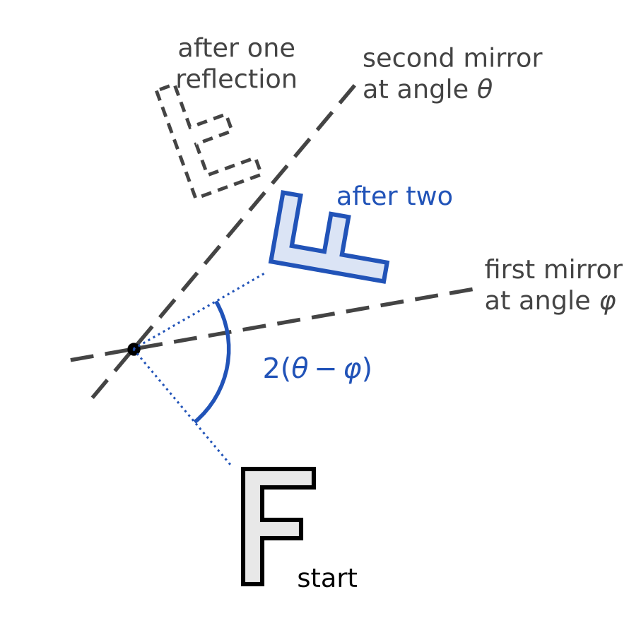

# Composing transformations {#sec-composition}

[Core]{.level-badge .core}

::: {.callout-note appearance="simple" icon=false}
## In this chapter you will

- find the single matrix for "do $\M{B}$, then $\M{A}$" as the product $\M{A}\M{B}$
- explain geometrically why $\M{A}\M{B}$ and $\M{B}\M{A}$ usually differ
- use composition to derive results such as the angle addition formulas
- break a transformation into simpler steps
:::

**Builds on** @sec-multiplication, @sec-transformations.

@sec-multiplication defined matrix multiplication by the row-times-column rule and promised a reason for it. Here is the reason: **multiplying matrices is doing one transformation after another**. The strange-looking rule is exactly what makes this work.

## Build intuition

Take a quarter turn anticlockwise, $\M{R} = \mat{0 & -1 \\ 1 & 0}$, and the reflection in the $x$-axis, $\M{X} = \mat{1 & 0 \\ 0 & -1}$. The app below applies them to a letter F in both orders: on the left the rotation first, on the right the reflection first. The dotted outline shows the F after the first step.

::: {.app-embed}
<iframe class="app-frame" src="../apps/transformation-lab.html?embed=1&mode=compose&lock" title="Composition explorer" loading="lazy"></iframe>

[Open the composition explorer in its own tab](../apps/transformation-lab.html){.app-open target="_blank"}
:::

The two orders give different results. Rotating and then reflecting gives the reflection in the line $y = -x$; reflecting and then rotating gives the reflection in $y = x$.

Things to try:

- Choose other pairs for $\M{A}$ and $\M{B}$. Find a pair that gives the same result in both orders, and a pair that doesn't.
- Make $\M{A}$ and $\M{B}$ both rotations. Does the order ever matter?
- Look at the matrices printed under each picture, and check one of them by multiplying.

## The ideas

### Doing one thing after another

Suppose we apply $\M{B}$ to a vector $\vect{x}$, then apply $\M{A}$ to the result. The final position is $\M{A}(\M{B}\vect{x})$. By associativity (@sec-multiplication) this equals $(\M{A}\M{B})\vect{x}$, so:

::: {.callout-important appearance="simple"}
## Composition is multiplication
"Apply $\M{B}$, then $\M{A}$" is the single transformation with matrix $\M{A}\M{B}$.
:::

Notice the order: the transformation done **first is written on the right**, nearest to $\vect{x}$. This matches function notation, where $f(g(x))$ means "do $g$, then $f$". A sequence $\M{A}_1$, then $\M{A}_2$, then $\M{A}_3$ has matrix $\M{A}_3\M{A}_2\M{A}_1$.

You can also see why the row-times-column rule had to be the definition. Column 1 of the combined matrix must be where $\ui$ ends up (@sec-transformations). First $\M{B}$ sends $\ui$ to column 1 of $\M{B}$; then $\M{A}$ sends that to $\M{A}$ times column 1 of $\M{B}$. That is exactly column 1 of $\M{A}\M{B}$, by the column view of multiplication (@sec-multiplication). The same goes for $\uj$ and column 2.

::: {#ex-composition-1 .callout-note appearance="simple" icon=false}
### Example 1: a sequence of three steps

Find the single matrix for: stretch by factor 2 parallel to the $x$-axis, then rotate by $90°$ anticlockwise, then reflect in the $x$-axis. Where does the point $(1, 1)$ end up?

**Solution.** The matrices, in the order applied, are
$$
\M{S} = \mat{2 & 0 \\ 0 & 1},
$$
$$
\M{R} = \mat{0 & -1 \\ 1 & 0},
$$
$$
\M{X} = \mat{1 & 0 \\ 0 & -1}.
$$
The combined matrix is $\M{X}\M{R}\M{S}$: the first step on the right.
$$
\M{R}\M{S} = \mat{0 & -1 \\ 2 & 0},
$$
$$
\M{X}\M{R}\M{S} = \mat{0 & -1 \\ -2 & 0}.
$$
So $(1, 1)$ goes to $\M{X}\M{R}\M{S}\,(1, 1)\T = (-1, -2)\T$. Check step by step: $(1, 1) \to (2, 1) \to (-1, 2) \to (-1, -2)$. ✓
:::

::: {#ex-composition-2 .callout-note appearance="simple" icon=false}
### Example 2: undoing a transformation by composing

Find a matrix $\M{B}$ such that applying the shear $\M{H} = \mat{1 & 3 \\ 0 & 1}$ and then $\M{B}$ brings every point back to where it started.

**Solution.** The shear moves each point sideways by 3 times its height, without changing its height. To undo it, move each point back by 3 times its height: $\M{B} = \mat{1 & -3 \\ 0 & 1}$. Check: $\M{B}\M{H} = \mat{1 & 0 \\ 0 & 1} = \M{I}$. This is an example of an inverse matrix, the subject of @sec-inverses.
:::

### Order matters

Since $\M{A}\M{B}$ and $\M{B}\M{A}$ are different transformations, there is no reason for them to be equal, and usually they are not. In the example above,
$$
\M{X}\M{R} = \mat{1 & 0 \\ 0 & -1}\mat{0 & -1 \\ 1 & 0} = \mat{0 & -1 \\ -1 & 0},
$$
$$
\M{R}\M{X} = \mat{0 & -1 \\ 1 & 0}\mat{1 & 0 \\ 0 & -1} = \mat{0 & 1 \\ 1 & 0}.
$$
These are the reflections in $y = -x$ and $y = x$, as the app showed.

Some pairs do commute, and it helps to know which:

- two rotations about the origin: turning by $\alpha$ then $\beta$ is the same as $\beta$ then $\alpha$;
- two stretches along the same axes (two diagonal matrices);
- any matrix with an enlargement $k\M{I}$, or with the identity;
- any matrix with its own powers.

::: {#ex-composition-3 .callout-note appearance="simple" icon=false}
### Example 3: does this pair commute?

Does the shear $\M{H} = \mat{1 & 1 \\ 0 & 1}$ commute with the stretch $\M{S} = \mat{2 & 0 \\ 0 & 1}$?

**Solution.**
$$
\M{H}\M{S} = \mat{2 & 1 \\ 0 & 1},
$$
$$
\M{S}\M{H} = \mat{2 & 2 \\ 0 & 1}.
$$
They differ, so no. Geometrically: stretching first and then shearing slides the top of the unit square by 1; shearing first and then stretching doubles that slide to 2.
:::

### Two rotations: the angle addition formulas

Rotating by $\beta$ and then by $\alpha$ must be a rotation by $\alpha + \beta$, so $\M{R}(\alpha)\M{R}(\beta) = \M{R}(\alpha + \beta)$. Multiplying out the left side,
$$
\mat{\cos\alpha & -\sin\alpha \\ \sin\alpha & \cos\alpha}\mat{\cos\beta & -\sin\beta \\ \sin\beta & \cos\beta}
= \mat{\cos\alpha\cos\beta - \sin\alpha\sin\beta & \cdots \\ \sin\alpha\cos\beta + \cos\alpha\sin\beta & \cdots}.
$$
Comparing the first column with that of $\M{R}(\alpha + \beta)$ gives both angle addition formulas at once:
$$
\cos(\alpha + \beta) = \cos\alpha\cos\beta - \sin\alpha\sin\beta,
$$
$$
\sin(\alpha + \beta) = \sin\alpha\cos\beta + \cos\alpha\sin\beta.
$$
It also follows that $\M{R}(\theta)^n = \M{R}(n\theta)$. For example, $\M{R}(60°)^6 = \M{R}(360°) = \M{I}$.

### Two reflections make a rotation

Reflecting in a line through the origin at angle $\varphi$, then in a line at angle $\theta$, gives a rotation by $2(\theta - \varphi)$, twice the angle between the lines (@fig-two-reflections). (Exercise 4 asks you to check this by multiplying, using the optional reflection formula in @sec-transformations.) You can see it with a pair of mirrors: two reflections reverse the picture twice, so the result is the right way round, but turned.

{#fig-two-reflections fig-alt="Two dashed mirror lines through the origin, at 10 and 50 degrees. A grey letter F labelled start, below them; its dashed reflection in the first mirror, above both mirrors; and the reflection of that in the second mirror, in blue, between the mirrors. An arc from the start to the final shape is labelled 2 times theta minus phi: the final F is the start rotated about the origin." width=55%}

### Breaking a transformation into pieces

Composition also works backwards: a complicated matrix can often be understood as a sequence of simple ones. For example,
$$
\mat{1 & -1 \\ 1 & 1} = \sqrt{2}\,\mat{\cos 45° & -\sin 45° \\ \sin 45° & \cos 45°},
$$
so it is a rotation by $45°$ followed by an enlargement with factor $\sqrt{2}$ (in either order, because an enlargement gives the same result whether it is done first or second). Every matrix of the form $\mat{a & -b \\ b & a}$ is a rotation combined with an enlargement in this way.

## In code

::: {.panel-tabset group="language"}
## Python

```{python}
import numpy as np

def R(theta_deg):
    """Rotation matrix for an anticlockwise rotation by theta degrees."""
    t = np.radians(theta_deg)
    return np.array([[np.cos(t), -np.sin(t)],
                     [np.sin(t),  np.cos(t)]])

print(np.allclose(R(25) @ R(50), R(75)))          # rotations add
print(np.allclose(np.linalg.matrix_power(R(60), 6), np.eye(2)))

S = np.array([[2, 0], [0, 1]])
X = np.array([[1, 0], [0, -1]])
M = X @ R(90) @ S                                  # S first, then R, then X
print(np.round(M, 10))
print(M @ np.array([1, 1]))
```

`np.allclose` compares with a small tolerance, which is needed because the sines and cosines are rounded.

## MATLAB

```matlab
R = @(theta) [cosd(theta) -sind(theta);
              sind(theta)  cosd(theta)];   % rotation by theta degrees

norm(R(25)*R(50) - R(75)) < 1e-12           % rotations add
norm(R(60)^6 - eye(2)) < 1e-12

S = [2 0; 0 1];
X = [1 0; 0 -1];
M = X * R(90) * S                           % S first, then R, then X
M * [1; 1]
```

```{.text .code-output}
ans =

  logical

   1

ans =

  logical

   1

M =

     0    -1
    -2     0

ans =

    -1
    -2
```

`cosd` and `sind` take angles in degrees, and give exact results for multiples of $90°$.
:::

## Check your understanding

::: {.callout-tip collapse="true"}
## You want to apply $\M{A}$, then $\M{B}$, then $\M{C}$ to a vector. Which single matrix does this?

$\M{C}\M{B}\M{A}$: the first transformation goes on the right.
:::

::: {.callout-tip collapse="true"}
## What single transformation is a rotation by $150°$ followed by a rotation by $210°$?

A rotation by $360°$, which is the identity.
:::

::: {.callout-tip collapse="true"}
## Two reflections are in lines at $10°$ and $40°$ to the $x$-axis. Reflecting in the $10°$ line first, what is the combined transformation?

A rotation by $2(40° - 10°) = 60°$ anticlockwise.
:::

## Key ideas

- Doing $\M{B}$ and then $\M{A}$ is the single transformation $\M{A}\M{B}$: the matrix applied first is written on the right.
- $\M{A}\M{B}$ and $\M{B}\M{A}$ are usually different transformations, which is the geometric reason why matrix multiplication isn't commutative.
- Composing two rotations adds their angles, and multiplying the matrices gives the angle addition formulas.
- Two reflections make a rotation, and many transformations can be broken into simpler steps, such as a rotation and a stretch.

## Exercises {#sec-composition-exercises}

1. []{#exercise-composition-1}Find the single matrix for each sequence, and describe the result geometrically:
   (a) reflect in the $x$-axis, then reflect in the $y$-axis;
   (b) rotate by $90°$ anticlockwise, then enlarge by factor 3;
   (c) reflect in $y = x$, then rotate by $90°$ anticlockwise.

   [Solution to exercise 1](../appendices/solutions-1.qmd#solution-composition-1){.sol-link}

2. []{#exercise-composition-2}Let $\M{A} = \mat{1 & 2 \\ 0 & 1}$ and $\M{B} = \mat{1 & 0 \\ 2 & 1}$. Find $\M{A}\M{B}$ and $\M{B}\M{A}$, and the image of the unit square under each.

   [Solution to exercise 2](../appendices/solutions-1.qmd#solution-composition-2){.sol-link}

3. []{#exercise-composition-3}Use $\M{R}(\theta)^2 = \M{R}(2\theta)$ to derive the double angle formulas for $\cos 2\theta$ and $\sin 2\theta$.

   [Solution to exercise 3](../appendices/solutions-1.qmd#solution-composition-3){.sol-link}

4. []{#exercise-composition-4}Multiply the reflection matrices for lines at angles $\theta$ and $\varphi$ to show that reflecting in the $\varphi$ line and then the $\theta$ line gives $\M{R}(2(\theta - \varphi))$. What happens when $\theta = \varphi$?

   [Solution to exercise 4](../appendices/solutions-1.qmd#solution-composition-4){.sol-link}

5. []{#exercise-composition-5}Show that every matrix of the form $\mat{a & -b \\ b & a}$ commutes with every other matrix of the same form. Interpret this geometrically.

   [Solution to exercise 5](../appendices/solutions-1.qmd#solution-composition-5){.sol-link}

6. []{#exercise-composition-6}Write $\mat{0 & -2 \\ 2 & 0}$ and $\mat{3 & -3\sqrt{3} \\ 3\sqrt{3} & 3}$ as a rotation followed by an enlargement.

   [Solution to exercise 6](../appendices/solutions-1.qmd#solution-composition-6){.sol-link}

7. []{#exercise-composition-7}**Code.** Pick two random $2 \times 2$ matrices and check numerically that $(\M{A}\M{B})\T = \M{B}\T\M{A}\T$, but that $\M{A}\M{B} \neq \M{B}\M{A}$. Then find, by experiment, a non-diagonal matrix that commutes with $\mat{2 & 1 \\ 1 & 2}$.

   [Solution to exercise 7](../appendices/solutions-1.qmd#solution-composition-7){.sol-link}

Solutions are in @sec-solutions-composition.

## In practice

- **Robot arms** compose one rotation per joint. The position of the gripper is the product of all the joint matrices applied to the tool's position (@sec-graphics-robotics).
- **Computer graphics** builds a single matrix from a chain of steps (place the model in the world, move to the camera's viewpoint, project onto the screen) and applies it to every vertex.
- **Aircraft and spacecraft** describe which way they are facing by three turns applied in a fixed order: *yaw* (turning left or right), *pitch* (nose up or down) and *roll* (tilting the wings). Using the wrong order is a classic source of navigation errors (@sec-transformations-3d).
- **Optics**: the path of a light ray through a camera lens system is tracked by multiplying one small matrix for each lens and each gap, in the order the light meets them.

## Going further

- Matrices of the form $\mat{a & -b \\ b & a}$ multiply exactly like the complex numbers $a + bi$. Multiplying by a complex number rotates and enlarges, which is why complex numbers are so useful for waves and alternating current.
- *Every* $2 \times 2$ matrix can be written as a rotation (or reflection), then a stretch along the axes, then another rotation (or reflection). This is the **singular value decomposition** of @sec-svd-pca, one of the most useful results in applied mathematics.
- Rotations about the origin form what mathematicians call a **group**: combining two rotations gives a rotation, every rotation can be undone by another, and doing nothing counts as a rotation. Groups of transformations describe the symmetries of crystals, molecules and the laws of physics.
