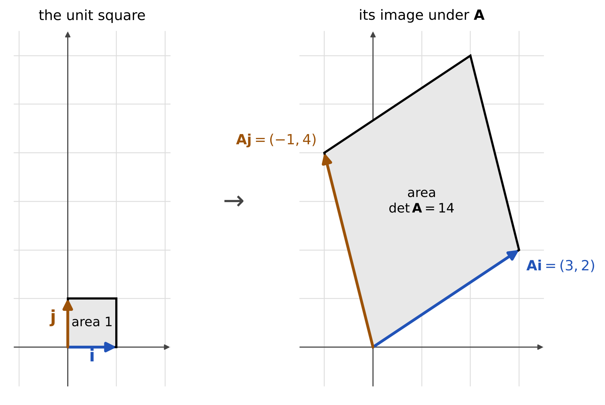

# Determinants {#sec-determinants}

[Core]{.level-badge .core}

::: {.callout-note appearance="simple" icon=false}
## In this chapter you will

- interpret the determinant as the factor by which a matrix scales area or volume, with a sign for orientation
- compute $2 \times 2$ and $3 \times 3$ determinants, choosing the quickest method
- use the properties of determinants, including $\det(\M{A}\M{B}) = \det\M{A}\,\det\M{B}$
- recognise that $\det\M{A} = 0$ exactly when $\M{A}$ squashes space flat
:::

**Builds on** @sec-transformations, @sec-composition.

Every square matrix has a single number attached to it, its **determinant**. It is often taught as a formula to memorise, but it has a simple meaning: it tells you *how much the matrix scales areas* (in two dimensions) *or volumes* (in three), and whether it turns space over. Almost every property of determinants follows from that one idea.

## Build intuition

Drag the arrow tips, type entries or pick a preset, and compare the area (or, in 3D, the volume) of a shape before and after the transformation. The ratio is always the determinant. Try **Reflect** and **Squash flat**.

::: {.app-embed}
<iframe class="app-frame" src="../apps/determinant-explorer.html?embed=1" title="Determinant explorer" loading="lazy"></iframe>

[Open the determinant explorer in its own tab](../apps/determinant-explorer.html){.app-open target="_blank"}
:::

Things to notice:

- The unit square always becomes the parallelogram with the two columns as its sides, and its area is the determinant (ignoring sign).
- The square, the circle and the F are all scaled by the *same* factor. Area scaling doesn't depend on the shape.
- When the F comes out mirrored, the determinant is negative.
- When the two columns line up, the parallelogram collapses and the determinant is zero.

## The ideas

### The area scale factor

A linear transformation turns the grid of unit squares into a grid of identical parallelograms (@sec-transformations). So every unit square has its area multiplied by the same number. Any shape can be approximated by small squares, so *every* area is multiplied by that number.

For $\M{A} = \mat{a & b \\ c & d}$, the unit square becomes the parallelogram with sides $(a, c)\T$ and $(b, d)\T$, the columns of $\M{A}$ (@fig-det-area). Its area is $|ad - bc|$. (To see this for $a, b, c, d > 0$, draw the parallelogram inside the rectangle of width $a + b$ and height $c + d$, and subtract the two triangles and two small rectangles around it; Exercise 7 asks you to do this.)

{#fig-det-area fig-alt="Two grids at the same scale. Left: the unit square, with i along the x axis in blue and j up the y axis in brown, labelled area 1. Right: a parallelogram with sides A i equals (3, 2) in blue and A j equals (minus 1, 4) in brown, labelled area det A equals 14." width=80%}

The **determinant** keeps the sign:
$$
\det\M{A} = \begin{vmatrix} a & b \\ c & d \end{vmatrix} = ad - bc.
$$ {#eq-det2}

::: {#ex-determinants-1 .callout-note appearance="simple" icon=false}
### Example 1: area of a transformed shape

A triangle of area $6\ \text{cm}^2$ is transformed by $\M{A} = \mat{3 & -1 \\ 2 & 4}$. What is the area of the image? Does the transformation reverse orientation?

**Solution.** $\det\M{A} = 3 \cdot 4 - (-1) \cdot 2 = 14$. The image has area $14 \times 6 = 84\ \text{cm}^2$, and since the determinant is positive, the orientation is kept.
:::

### What the sign means

The sign records **orientation**. Going from $\ui$ to $\uj$ is a quarter turn anticlockwise. If $\M{A}\ui$ to $\M{A}\uj$ is still an anticlockwise turn, $\det\M{A} > 0$. If it has become clockwise, the plane has been flipped over, like a page turned face down, and $\det\M{A} < 0$. Every reflection has determinant $-1$; every rotation has determinant $+1$.

### Zero determinant

If $\det\M{A} = 0$, the unit square has collapsed to something with no area: a line segment or a point. The columns of $\M{A}$ point along the same line, and the whole plane is squashed onto that line (or onto the origin). Such a matrix is called **singular**. Information is lost, since many points land on the same point, so a singular transformation can't be undone. That is the subject of @sec-inverses, and the link to linear systems:

::: {.callout-important appearance="simple"}
## Determinants and systems
For a square matrix $\M{A}$, the system $\M{A}\vect{x} = \vect{b}$ has exactly one solution for every $\vect{b}$ if and only if $\det\M{A} \neq 0$.
:::

::: {#ex-determinants-2 .callout-note appearance="simple" icon=false}
### Example 2: when is a matrix singular?

For which values of $k$ is $\mat{k & 2 \\ 3 & k - 1}$ singular?

**Solution.**
$$\det = k(k - 1) - 6 = k^2 - k - 6 = (k - 3)(k + 2),$$
which is zero when $k = 3$ or $k = -2$. For those values, the columns are parallel: with $k = 3$ they are $(3, 3)\T$ and $(2, 2)\T$.
:::

### Three by three: volume

In three dimensions, the unit cube becomes the slanted box (**parallelepiped**) with the three columns as its edges, and $\det\M{A}$ is its volume, with a sign. A negative determinant means the transformation turns a right-handed set of axes into a left-handed one, like a reflection in a mirror.

### Properties

These follow from the scale factor idea, and are proved in @sec-proofs-determinants.

| Property | Why it makes sense |
|:---------|:-------------------|
| $\det(\M{A}\M{B}) = \det\M{A}\,\det\M{B}$ | Scaling by $\det\M{B}$ then by $\det\M{A}$ scales by the product |
| $\det\M{I} = 1$ | The identity doesn't change areas |
| $\det(\M{A}\T) = \det\M{A}$ | So every rule about rows also holds for columns |
| $\det(k\M{A}) = k^n\det\M{A}$ for $n \times n$ $\M{A}$ | Every one of the $n$ directions is scaled by $k$ |

::: {.callout-warning appearance="simple"}
## Watch out: sums and multiples

$\det(\M{A} + \M{B})$ is not in general $\det\M{A} + \det\M{B}$: for $\M{A} = \M{B} = \M{I}$, of size $2 \times 2$, the left side is 4 and the right side is 2. And $\det(k\M{A})$ is $k^n\det\M{A}$, not $k\det\M{A}$, because multiplying the matrix by $k$ multiplies every one of its $n$ rows by $k$.
:::

::: {.callout-tip appearance="simple"}
## Working determinants out
The sections above say what a determinant *is*. The three below are about *calculating* one by hand. A computer does this for you (see [In code](#in-code)), so on a first read, learn the $3 \times 3$ expansion and skim the rest. Examples 3 and 4 show the methods in action, and you can come back to the details when you need them.
:::

### Expanding a $3 \times 3$ determinant

To work out a $3 \times 3$ determinant by hand, use **cofactor expansion** along the first row:
$$
\begin{vmatrix} a & b & c \\ d & e & f \\ g & h & i \end{vmatrix}
= a\begin{vmatrix} e & f \\ h & i \end{vmatrix}
- b\begin{vmatrix} d & f \\ g & i \end{vmatrix}
+ c\begin{vmatrix} d & e \\ g & h \end{vmatrix}.
$$ {#eq-det3}

Each entry of the row is multiplied by the determinant of the $2 \times 2$ matrix left when you cross out its row and column (its **minor**), with signs alternating $+, -, +$.

You can expand along *any* row or column instead, using the checkerboard of signs
$$
\begin{matrix} + & - & + \\ - & + & - \\ + & - & + \end{matrix}
$$
and you always get the same answer. Choose the row or column with the most zeros. The same pattern defines determinants of any size: an $n \times n$ determinant expands into $n$ determinants of size $n - 1$.

::: {#ex-determinants-3 .callout-note appearance="simple" icon=false}
### Example 3: a $3 \times 3$ determinant, two ways

Find $\det\M{B}$ for $\M{B} = \mat{2 & 1 & 3 \\ 0 & -1 & 4 \\ 1 & 2 & 0}$.

**Solution 1: along the first row.**
$$
\det\M{B} = 2\begin{vmatrix} -1 & 4 \\ 2 & 0 \end{vmatrix} - 1\begin{vmatrix} 0 & 4 \\ 1 & 0 \end{vmatrix} + 3\begin{vmatrix} 0 & -1 \\ 1 & 2 \end{vmatrix}
= 2(-8) - 1(-4) + 3(1) = -9.
$$

**Solution 2: down the first column**, which has a zero, so one term vanishes. The signs for column 1 are $+, -, +$:
$$
\det\M{B} = 2\begin{vmatrix} -1 & 4 \\ 2 & 0 \end{vmatrix} - 0 + 1\begin{vmatrix} 1 & 3 \\ -1 & 4 \end{vmatrix}
= 2(-8) + 1(7) = -9.
$$
The transformation scales volumes by 9 and turns space into its mirror image.
:::

### Triangular matrices

A square matrix is **upper triangular** if every entry below the main diagonal is zero, and **lower triangular** if every entry above it is zero:
$$
\mat{2 & 5 & 1 \\ 0 & 3 & -2 \\ 0 & 0 & 7} \text{ (upper)}, \qquad \mat{2 & 0 & 0 \\ 5 & 3 & 0 \\ 1 & -2 & 7} \text{ (lower)}.
$$
For a triangular matrix, expanding along the column (or row) with the most zeros again and again gives
$$
\det\M{A} = a_{11}a_{22}\cdots a_{nn},
$$
the product of the diagonal entries. This is the fastest way to find a determinant, once a matrix has been made triangular.

### Row operations

There are three simple ways to change the rows of a matrix, called **row operations**: add a multiple of one row to another, swap two rows, or multiply a row by a non-zero number. They are the basis of the standard method for solving equations (@sec-gaussian-elimination), and they are written in a shorthand: $R_2 \leftarrow R_2 - 2R_1$ means "replace row 2 by row 2 minus twice row 1". Their effect on the determinant is especially useful:

| Row operation | Effect on the determinant |
|:--------------|:--------------------------|
| Add a multiple of one row to another | none |
| Swap two rows | changes the sign |
| Multiply a row by $c$ | multiplies it by $c$ |

So a matrix can be reduced to triangular form by adding multiples of rows, keeping track of any swaps, and its determinant read off from the diagonal. A matrix with two equal rows, or a row of zeros, has determinant zero.

::: {#ex-determinants-4 .callout-note appearance="simple" icon=false}
### Example 4: by row reduction

Find $\det\M{C}$ for $\M{C} = \mat{1 & 2 & 1 \\ 2 & 5 & 4 \\ 3 & 7 & 8}$.

**Solution.** Adding multiples of rows doesn't change the determinant:
$$
\M{C} \xrightarrow[R_3 \,\leftarrow\, R_3 - 3R_1]{R_2 \,\leftarrow\, R_2 - 2R_1}
\mat{1 & 2 & 1 \\ 0 & 1 & 2 \\ 0 & 1 & 5}
\xrightarrow{R_3 \,\leftarrow\, R_3 - R_2}
\mat{1 & 2 & 1 \\ 0 & 1 & 2 \\ 0 & 0 & 3}.
$$
The result is triangular, so $\det\M{C} = 1 \cdot 1 \cdot 3 = 3$.
:::

## In code

::: {.panel-tabset group="language"}
## Python

```{python}
import numpy as np

B = np.array([[2, 1, 3], [0, -1, 4], [1, 2, 0]])
print(np.linalg.det(B))
```

The exact answer is $-9$. If you see something like `-8.999999999999998`, the tiny error comes from rounding in floating-point arithmetic: NumPy computes determinants by elimination (as in Example 4), not by cofactors, and each step is rounded.

For the same reason, *never test whether a matrix is singular with `det(A) == 0`*. A singular matrix may give a tiny non-zero determinant, and a perfectly healthy matrix can have a tiny determinant just because its entries are small: $\det(0.1\M{I}_{10}) = 10^{-10}$. To check whether a matrix is close to singular, use its **rank**, the number of independent directions it keeps (3 for a healthy $3 \times 3$ matrix; see @sec-gauss-jordan-rank), or its **condition number**, which is huge for a matrix that is singular or nearly so (@sec-floating-point-conditioning):

```{python}
S = np.array([[1, 2, 3], [4, 5, 6], [7, 8, 9]])
print(np.linalg.matrix_rank(S))      # 2, not 3: S is singular
print(np.linalg.cond(S))             # enormous: S is singular or nearly so
```

## MATLAB

```matlab
S = [1 2 3; 4 5 6; 7 8 9];
d = det(S)
```

```{.text .code-output}
d =

   6.6613e-16
```

This matrix is singular (its rows are in arithmetic progression, so row 1 minus twice row 2 plus row 3 is zero), so its determinant should be exactly 0. The tiny error comes from rounding in floating-point arithmetic, because MATLAB computes determinants by elimination (as in Example 4), not by cofactors.

For the same reason, *never test whether a matrix is singular with `det(A) == 0`*. A singular matrix may give a tiny non-zero determinant, as here, and a perfectly healthy matrix can have a tiny determinant just because its entries are small: `det(0.1*eye(10))` is $10^{-10}$. To check whether a matrix is close to singular, use its **rank**, the number of independent directions it keeps (3 for a healthy $3 \times 3$ matrix; see @sec-gauss-jordan-rank), or its **condition number**, which is huge for a matrix that is singular or nearly so (@sec-floating-point-conditioning):

```matlab
rank(S)          % 2, not 3: S is singular
cond(S)          % enormous: S is singular or nearly so
```
:::

## Check your understanding

::: {.callout-tip collapse="true"}
## $\det\M{A} = 3$ and $\det\M{B} = -2$ for $3 \times 3$ matrices. Find $\det(\M{A}\M{B})$, $\det(2\M{A})$ and $\det(\M{B}\T)$.

$\det(\M{A}\M{B}) = 3 \times (-2) = -6$; $\det(2\M{A}) = 2^3 \times 3 = 24$; $\det(\M{B}\T) = -2$.
:::

::: {.callout-tip collapse="true"}
## Without calculating, why is $\begin{vmatrix} 1 & 4 & 7 \\ 2 & 8 & 14 \\ 5 & 0 & 3 \end{vmatrix} = 0$?

Row 2 is twice row 1. Subtracting twice row 1 from row 2 (which doesn't change the determinant) gives a row of zeros.
:::

::: {.callout-tip collapse="true"}
## Can $\M{A}\M{B}$ be singular if $\M{A}$ is not?

Yes, if $\M{B}$ is singular: $\det(\M{A}\M{B}) = \det\M{A}\det\M{B} = 0$ whenever either factor has determinant zero.
:::

## Key ideas

- $\det\M{A}$ is the factor by which $\M{A}$ scales area (in two dimensions) or volume (in three). A negative sign means the orientation is flipped.
- For a $2 \times 2$ matrix, $\det\mat{a & b \\ c & d} = ad - bc$. Larger determinants come from cofactor expansion, or more quickly from row reduction.
- $\det\M{A} = 0$ exactly when $\M{A}$ squashes space into a lower dimension. Such a matrix is called singular.
- $\det(\M{A}\M{B}) = \det\M{A}\,\det\M{B}$, and the determinant of a triangular matrix is the product of its diagonal entries.
- Row operations change the determinant in predictable ways: a swap changes its sign, scaling a row scales it, and adding a multiple of one row to another leaves it unchanged.

## Exercises {#sec-determinants-exercises}

Exercises marked † are harder: they take longer, or need an idea that the worked examples don't show.

1. []{#exercise-determinants-1}Find the determinants:

   (a) $\begin{vmatrix} 5 & 2 \\ -3 & 4 \end{vmatrix}$
   (b) $\begin{vmatrix} \cos\theta & -\sin\theta \\ \sin\theta & \cos\theta \end{vmatrix}$
   (c) $\begin{vmatrix} 1 & 0 & 2 \\ 3 & -1 & 1 \\ 0 & 4 & 2 \end{vmatrix}$
   (d) $\begin{vmatrix} 2 & 0 & 0 & 0 \\ 7 & -1 & 0 & 0 \\ 3 & 5 & 4 & 0 \\ 9 & 1 & 6 & 3 \end{vmatrix}$

   [Solution to exercise 1](../appendices/solutions-1.qmd#solution-determinants-1){.sol-link}

2. []{#exercise-determinants-2}The unit square is transformed by $\mat{4 & 1 \\ 2 & 3}$, then by $\mat{0 & 1 \\ -1 & 2}$. Find the area of the final image in two ways.

   [Solution to exercise 2](../appendices/solutions-1.qmd#solution-determinants-2){.sol-link}

3. []{#exercise-determinants-3}Find the values of $\lambda$ for which $\det\left(\mat{4 & 1 \\ 2 & 3} - \lambda\M{I}\right) = 0$. (These are the eigenvalues of the matrix, which appear in @sec-eigenvalues.)

   [Solution to exercise 3](../appendices/solutions-1.qmd#solution-determinants-3){.sol-link}

4. []{#exercise-determinants-4}Use row operations to evaluate $\begin{vmatrix} 2 & 4 & 6 \\ 1 & 3 & 5 \\ 3 & 7 & 12 \end{vmatrix}$.

   [Solution to exercise 4](../appendices/solutions-1.qmd#solution-determinants-4){.sol-link}

5. []{#exercise-determinants-5}[†]{.harder aria-hidden="true" title="Harder"}[Harder exercise.]{.visually-hidden} Show that
   $$\begin{vmatrix} 1 & 1 & 1 \\ x & y & z \\ x^2 & y^2 & z^2 \end{vmatrix} = (y - x)(z - x)(z - y).$$
   When is this matrix singular? (*Hint*: subtract the first column from the other two (allowed, because $\det(\M{A}\T) = \det\M{A}$), expand along the first row, and take out the factors $y - x$ and $z - x$.)

   [Solution to exercise 5](../appendices/solutions-1.qmd#solution-determinants-5){.sol-link}

6. []{#exercise-determinants-6}A matrix $\M{Q}$ satisfies $\M{Q}\T\M{Q} = \M{I}$. Show that $\det\M{Q} = \pm 1$. What does this tell you about the transformation? (*Hint*: take determinants of both sides, using $\det(\M{A}\M{B}) = \det\M{A}\,\det\M{B}$ and $\det(\M{A}\T) = \det\M{A}$.)

   [Solution to exercise 6](../appendices/solutions-1.qmd#solution-determinants-6){.sol-link}

7. []{#exercise-determinants-7}[†]{.harder aria-hidden="true" title="Harder"}[Harder exercise.]{.visually-hidden} Prove that the area of the parallelogram with sides $(a, c)\T$ and $(b, d)\T$ is $ad - bc$ when $a, b, c, d > 0$ and $(b, d)\T$ is anticlockwise from $(a, c)\T$, by subtracting areas from the surrounding rectangle. (*Hint*: the rectangle has sides $a + b$ and $c + d$. The pieces outside the parallelogram come in equal pairs: two triangles with legs $a$ and $c$, two with legs $b$ and $d$, and two small rectangles.)

   [Solution to exercise 7](../appendices/solutions-1.qmd#solution-determinants-7){.sol-link}

8. []{#exercise-determinants-8}**Code.** Generate random $n \times n$ matrices with entries between $-1$ and $1$, and record $|\det\M{A}|$ for $n = 2, 5, 10, 20, 50$. How does the typical size of the determinant change with $n$? Why is the size of a determinant a poor guide to whether a matrix is nearly singular?

   [Solution to exercise 8](../appendices/solutions-1.qmd#solution-determinants-8){.sol-link}

Solutions are in @sec-solutions-determinants.

## In practice

- **Changing coordinates**: when an area or volume is calculated in a different coordinate system, such as polar coordinates, the determinant gives the scale factor between the two (@sec-matrix-calculus).
- **Structures**: if the matrix describing how a frame of beams balances its loads has determinant zero, the frame can move without any force pushing it. It is a mechanism, like a folding chair, rather than a rigid structure.
- **Geometry and graphics**: the sign of a $2 \times 2$ determinant tells you whether a path through three points turns left or right. Computer games use this to work out which side of a wall a player is on, and to skip drawing the backs of objects.
- **Eigenvalues** are the solutions of $\det(\M{A} - \lambda\M{I}) = 0$ (@sec-eigenvalues).

## Going further

Cofactor expansion of an $n \times n$ determinant needs about $n!$ multiplications. For $n = 20$ that is about $2.4 \times 10^{18}$: years of computing. Elimination needs about $\tfrac{2}{3}n^3$, about 5000 for $n = 20$. That is why software always computes determinants by elimination, as in Example 4, and why in practice the determinant is rarely the best tool for large problems.

Proofs of the product rule and of the effect of row operations are in @sec-proofs-determinants.
