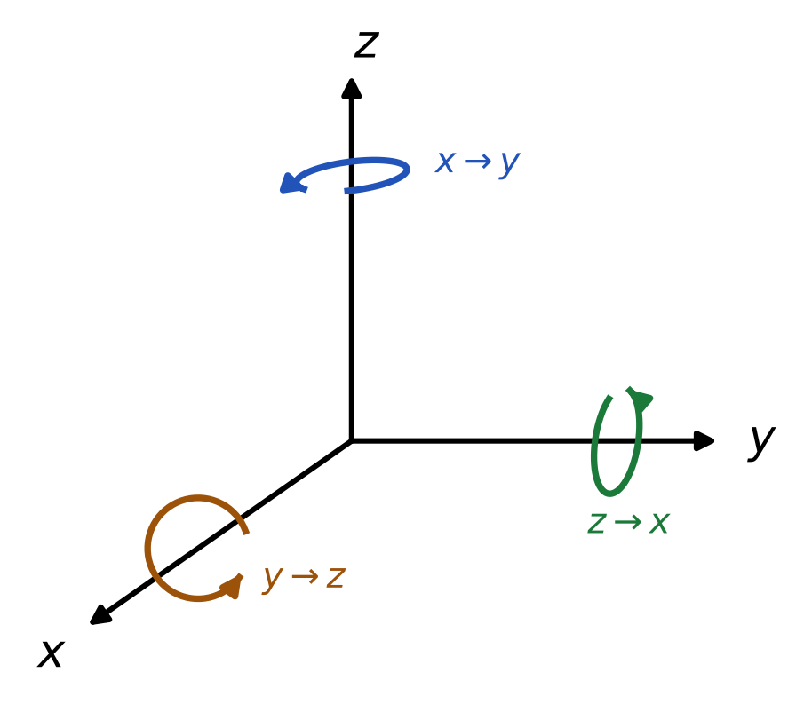

# Transformations in three dimensions {#sec-transformations-3d}

[Core]{.level-badge .core}

::: {.callout-note appearance="simple" icon=false}
## In this chapter you will

- write $3 \times 3$ matrices for rotations about the coordinate axes, reflections in coordinate planes, stretches and projections
- use the right-hand rule to get the signs of rotation matrices right
- recognise a rotation from its matrix, and see why the order of rotations matters
:::

**Builds on** @sec-transformations, @sec-composition.

Everything in the last four chapters carries over to three dimensions. A $3 \times 3$ matrix moves every point of space, its columns are the images of $\ui$, $\uj$ and $\uk$, composition is multiplication, and the determinant is a volume scale factor. This chapter collects the standard transformations. @sec-invariant-lines then asks what a transformation leaves unchanged.

## Build intuition

Here is the determinant explorer from @sec-determinants again, this time in three dimensions. It starts with a rotation by $45°$ about the $z$-axis: the cube turns about the vertical axis, and the points on that axis stay where they are. Drag the picture to look at it from different angles.

::: {.app-embed}
<iframe class="app-frame" src="../apps/determinant-explorer.html?embed=1&dim=3&preset=Rotate%2045%C2%B0%20about%20z" title="Determinant explorer in three dimensions" loading="lazy"></iframe>

[Open the determinant explorer in its own tab](../apps/determinant-explorer.html?dim=3){.app-open target="_blank"}
:::

Things to try:

- Press **Play** to watch the rotation happen. Which points never move?
- Try **Reflect** and **Shear**. Look for the points, lines and planes that stay where they are.
- Type your own entries into the $3 \times 3$ matrix. Each column is where one of $\ui$, $\uj$ and $\uk$ lands, exactly as in two dimensions.

## The ideas

### Rotations about the axes

A rotation about the $z$-axis leaves $z$-coordinates alone and rotates the $xy$-plane exactly as in two dimensions. Rotations about the other axes are similar:
$$
\M{R}_x(\theta) = \mat{1 & 0 & 0 \\ 0 & \cos\theta & -\sin\theta \\ 0 & \sin\theta & \cos\theta},
$$
$$
\M{R}_y(\theta) = \mat{\cos\theta & 0 & \sin\theta \\ 0 & 1 & 0 \\ -\sin\theta & 0 & \cos\theta},
$$
$$
\M{R}_z(\theta) = \mat{\cos\theta & -\sin\theta & 0 \\ \sin\theta & \cos\theta & 0 \\ 0 & 0 & 1}.
$$

**The right-hand rule** (as for the cross product in the [Refresher](../front/refresher.qmd)) fixes which way is positive: point your right thumb along the positive axis, and your fingers curl in the direction of a positive rotation. So a positive rotation about $z$ takes $x$ towards $y$; about $x$, it takes $y$ towards $z$; and about $y$, it takes $z$ towards $x$ (@fig-right-hand-rule).

{#fig-right-hand-rule fig-alt="Three axes x, y and z drawn in perspective, with z upwards. A curved arrow around each axis shows the positive direction of rotation: around z, labelled x to y, in blue; around x, labelled y to z, in brown; around y, labelled z to x, in green." width=50%}

That last one explains the odd-looking signs in $\M{R}_y$. A positive rotation about $y$ moves $\uk$ towards $\ui$, so the image of $\uk$ (column 3) has a *positive* $x$-component, $\sin\theta$, and the image of $\ui$ has a *negative* $z$-component. If you list the axes in the cyclic order $z, x$ rather than $x, z$, it looks just like the others.

All three are orthogonal matrices (@sec-inverses): $\M{R}\T\M{R} = \M{I}$, and their determinant is 1. This works the other way round too. Any $3 \times 3$ orthogonal matrix with determinant 1 is a rotation about some axis through the origin (a proof is in @sec-proofs-transformations-3d). @sec-invariant-lines shows how to find the axis.

::: {#ex-transformations-3d-1 .callout-note appearance="simple" icon=false}
### Example 1: a rotation about the $z$-axis

Find the image of $(1, 2, 3)$ under a rotation by $90°$ about the $z$-axis.

**Solution.** With $\theta = 90°$,
$$
\M{R}_z(90°)\mat{1 \\ 2 \\ 3} = \mat{0 & -1 & 0 \\ 1 & 0 & 0 \\ 0 & 0 & 1}\mat{1 \\ 2 \\ 3} = \mat{-2 \\ 1 \\ 3}.
$$
The height $z = 3$ is unchanged, and $(1, 2)$ has turned a quarter turn to $(-2, 1)$.
:::

::: {#ex-transformations-3d-2 .callout-note appearance="simple" icon=false}
### Example 2: order matters in three dimensions

Show that rotating by $90°$ about the $x$-axis and then by $90°$ about the $z$-axis is not the same as doing them in the other order.

**Solution.**
$$
\M{R}_z(90°)\M{R}_x(90°) = \mat{0 & -1 & 0 \\ 1 & 0 & 0 \\ 0 & 0 & 1}\mat{1 & 0 & 0 \\ 0 & 0 & -1 \\ 0 & 1 & 0} = \mat{0 & 0 & 1 \\ 1 & 0 & 0 \\ 0 & 1 & 0},
$$
$$
\M{R}_x(90°)\M{R}_z(90°) = \mat{1 & 0 & 0 \\ 0 & 0 & -1 \\ 0 & 1 & 0}\mat{0 & -1 & 0 \\ 1 & 0 & 0 \\ 0 & 0 & 1} = \mat{0 & -1 & 0 \\ 0 & 0 & -1 \\ 1 & 0 & 0}.
$$
They differ. (The first product turns out to be a single rotation, by $120°$ about the line through the origin and $(1, 1, 1)$: see @fig-cube-rotation in the next chapter.) In two dimensions all rotations about the origin commute; in three dimensions, rotations about different axes usually don't. Try it with a book: turn it a quarter turn about one edge, then about another, then start again in the other order.
:::

### Reflections, stretches and projections

| Transformation | Matrix |
|:--|:--:|
| Reflection in the plane $z = 0$ (the $xy$-plane) | $\mat{1 & 0 & 0 \\ 0 & 1 & 0 \\ 0 & 0 & -1}$ |
| Reflection in the plane $x = y$ | $\mat{0 & 1 & 0 \\ 1 & 0 & 0 \\ 0 & 0 & 1}$ |
| Stretch by factors $a$, $b$, $c$ along the axes | $\mat{a & 0 & 0 \\ 0 & b & 0 \\ 0 & 0 & c}$ |
| Projection onto the $xy$-plane | $\mat{1 & 0 & 0 \\ 0 & 1 & 0 \\ 0 & 0 & 0}$ |
| Shear: $x$ increases by $k$ times the height $z$ | $\mat{1 & 0 & k \\ 0 & 1 & 0 \\ 0 & 0 & 1}$ |

As always, each column is the image of a unit vector. Reflections have determinant $-1$, projections have determinant 0, and shears have determinant 1.

## In code

::: {.panel-tabset group="language"}
## Python

```{python}
import numpy as np

def Rx(t):
    c, s = np.cos(t), np.sin(t)
    return np.array([[1, 0, 0], [0, c, -s], [0, s, c]])

def Rz(t):
    c, s = np.cos(t), np.sin(t)
    return np.array([[c, -s, 0], [s, c, 0], [0, 0, 1]])

q = np.pi / 2
print(np.round(Rz(q) @ Rx(q), 10))
print(np.round(Rx(q) @ Rz(q), 10))

# Check that a rotation is orthogonal with determinant 1
R = Rz(q) @ Rx(q)
print(np.allclose(R.T @ R, np.eye(3)), np.linalg.det(R))
```

## MATLAB

```matlab
Rx = @(t) [1 0 0; 0 cos(t) -sin(t); 0 sin(t) cos(t)];
Rz = @(t) [cos(t) -sin(t) 0; sin(t) cos(t) 0; 0 0 1];

q = pi/2;
clean = @(X) round(X * 1e10) / 1e10;   % remove rounding errors
clean(Rz(q) * Rx(q))
clean(Rx(q) * Rz(q))

% Check that a rotation is orthogonal with determinant 1
R = Rz(q) * Rx(q);
disp(norm(R' * R - eye(3)) < 1e-12), disp(det(R))
```

```{.text .code-output}
ans =

     0     0     1
     1     0     0
     0     1     0

ans =

     0    -1     0
     0     0    -1
     1     0     0

1
1
```

`clean` rounds to 10 decimal places, which removes tiny errors such as $\cos(\pi/2) \approx 6 \times 10^{-17}$. The check uses `norm`, which measures the size of a matrix, so a tiny value means $\M{R}\T\M{R}$ is $\M{I}$ up to rounding error; 1 means true.
:::

## Check your understanding

::: {.callout-tip collapse="true"}
## What is the matrix of the reflection in the plane $y = 0$?

$\mat{1 & 0 & 0 \\ 0 & -1 & 0 \\ 0 & 0 & 1}$: only the $y$-coordinate changes sign.
:::

::: {.callout-tip collapse="true"}
## Why is $\M{R}_x(\theta)^{-1} = \M{R}_x(-\theta)$?

Undoing a rotation by $\theta$ means rotating by $-\theta$ about the same axis. Since $\cos(-\theta) = \cos\theta$ and $\sin(-\theta) = -\sin\theta$, $\M{R}_x(-\theta)$ is also the transpose of $\M{R}_x(\theta)$, as it must be for an orthogonal matrix.
:::

::: {.callout-tip collapse="true"}
## What is the determinant of the projection onto the $xy$-plane, and why?

0: it squashes every solid flat, so every volume becomes 0.
:::

## Key ideas

- A $3 \times 3$ matrix transforms space, and its columns are where $\ui$, $\uj$ and $\uk$ land.
- Rotations about the coordinate axes have a $2 \times 2$ rotation block and a 1 on the diagonal for the axis that stays fixed.
- The right-hand rule fixes the direction of a positive rotation, and so the signs of the sines.
- A rotation matrix is orthogonal with determinant 1. Rotations about different axes usually don't commute, so their order matters.

## Exercises {#sec-transformations-3d-exercises}

1. []{#exercise-transformations-3d-1}Write down the matrix of: (a) rotation by $180°$ about the $y$-axis; (b) reflection in the plane $x = 0$; (c) the stretch that doubles $x$, halves $y$ and leaves $z$ alone. Find the determinant of each and interpret it.

   [Solution to exercise 1](../appendices/solutions-1.qmd#solution-transformations-3d-1){.sol-link}

2. []{#exercise-transformations-3d-2}Find the image of $(2, -1, 4)$ under a rotation by $90°$ about the $x$-axis, and under a rotation by $90°$ about the $y$-axis.

   [Solution to exercise 2](../appendices/solutions-1.qmd#solution-transformations-3d-2){.sol-link}

3. []{#exercise-transformations-3d-3}Find the matrix of the reflection in the plane $y = z$, and check that its determinant is $-1$ and that applying it twice gives $\M{I}$.

   [Solution to exercise 3](../appendices/solutions-1.qmd#solution-transformations-3d-3){.sol-link}

4. []{#exercise-transformations-3d-4}Write down the matrix $\M{P}$ of the projection onto the $xz$-plane. Show that $\M{R}_y(90°)\M{P} = \M{P}\M{R}_y(90°)$, and explain geometrically why the order does not matter here.

   [Solution to exercise 4](../appendices/solutions-1.qmd#solution-transformations-3d-4){.sol-link}

5. []{#exercise-transformations-3d-5}Show that the shear $\mat{1 & 0 & k \\ 0 & 1 & 0 \\ 0 & 0 & 1}$ has determinant 1, and find its inverse without calculation by thinking about how to undo it.

   [Solution to exercise 5](../appendices/solutions-1.qmd#solution-transformations-3d-5){.sol-link}

6. []{#exercise-transformations-3d-6}**Code.** Aircraft orientation is often given as three angles: *yaw* $\psi$ (turning left or right, about the vertical $z$-axis), *pitch* $\theta$ (nose up or down, about $y$) and *roll* $\phi$ (tilting the wings, about $x$), applied in the aircraft's own frame, which gives the matrix $\M{R}_z(\psi)\M{R}_y(\theta)\M{R}_x(\phi)$. Compute this, $\M{R}_1$, for $\psi = 30°$, $\theta = 10°$, $\phi = 5°$, and compare it with the product in the reverse order, $\M{R}_2$. By how many degrees do the two orientations differ? (*Hint*: the rotation angle of an orthogonal matrix $\M{M}$ with determinant 1 satisfies $\operatorname{trace}\M{M} = 1 + 2\cos\alpha$, where the trace is the sum of the diagonal entries; apply this to $\M{M} = \M{R}_1\T\M{R}_2$.)

   [Solution to exercise 6](../appendices/solutions-1.qmd#solution-transformations-3d-6){.sol-link}

Solutions are in @sec-solutions-transformations-3d.

## In practice

- **Aircraft, drones and robots** describe which way they are facing by three rotations about axes, applied in a fixed order. The order is part of the definition, and getting it wrong is a classic error.
- **Chemistry and materials science** classify crystals and molecules by the rotations and reflections that leave them looking the same.
- **Engineering drawing and CAD** use projections onto planes to produce the front, side and top views of a part.
- **Computer vision**: a phone that stitches photos into a panorama works out the rotation of the camera between shots as a $3 \times 3$ orthogonal matrix.

## Going further

- There is a formula, called **Rodrigues' formula**, for the matrix of a rotation by any angle about any axis. Animation and flight software often use **quaternions** instead, a four-number description of a rotation that blends smoothly between orientations and avoids a problem with describing orientation by three angles, where two of the axes can line up and a direction of movement is lost (@sec-graphics-robotics).
- What a transformation leaves unchanged, including the axis of any rotation: @sec-invariant-lines.
- Proofs that orthogonal matrices preserve lengths and angles, and that every rotation of space has an axis: @sec-proofs-transformations-3d.
