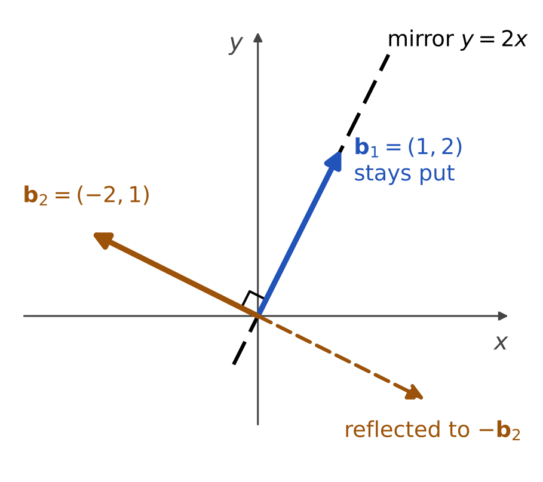

# Basis, dimension and change of basis {#sec-basis-change}

[Core]{.level-badge .core}

::: {.callout-note appearance="simple" icon=false}
## In this chapter you will

- recognise a basis, and find a basis and the dimension of a span
- find the coordinates of a vector in any basis
- describe a transformation in a new basis using $\M{P}^{-1}\M{A}\M{P}$, and use this to build matrices from simple pieces
:::

**Builds on** @sec-inverses, @sec-span-independence.

Coordinates are not built into a vector. They depend on the directions you measure along. Measuring along $\ui$ and $\uj$ is natural for a page, but for a reflection it is more natural to measure along the mirror and at right angles to it, and for a rotating body, along its axis. In the right directions, a complicated matrix often becomes very simple. This chapter shows how to choose directions (a **basis**), how to find a vector's coordinates in them, and how to rewrite a matrix in them. It is the groundwork for eigenvalues and diagonalisation in Part IV.

## Build intuition

The green vector $\vect{v}$ stays fixed while you choose a new pair of basis vectors $\vect{b}_1$ and $\vect{b}_2$. The purple grid is the grid they make, and the readout gives $\vect{v}$'s coordinates in the usual basis and in the new one.

::: {.app-embed}
<iframe class="app-frame" src="../apps/basis-grids.html?embed=1" title="Basis grids" loading="lazy"></iframe>

[Open the basis grids app in its own tab](../apps/basis-grids.html){.app-open target="_blank"}
:::

Things to try:

- In the **Example 2** preset, count along the purple grid to check the new coordinates of $\vect{v}$.
- Drag $\vect{b}_1$ to twice its length. What happens to the first new coordinate of $\vect{v}$, and why?
- Drag $\vect{b}_2$ until it lies along the same line as $\vect{b}_1$. What goes wrong?

## The ideas

### Basis

A **basis** for a subspace (@sec-span-independence) is a set of vectors that

1. **spans** the subspace, so every vector in it can be made from them, and
2. is **linearly independent**, so none of them is wasted.

Together these say that every vector in the subspace can be written as a combination of the basis vectors in **exactly one way** (@sec-span-independence). The **standard basis** of $\R^n$ is $\ue{1}, \dots, \ue{n}$, the columns of the identity matrix; in $\R^2$ and $\R^3$ these are $\ui$, $\uj$ and $\uk$. But there are infinitely many other bases. Any two vectors in $\R^2$ that don't lie along the same line form a basis for $\R^2$.

### Dimension

A subspace has many different bases, but they all have **the same number of vectors** (a proof is in @sec-proofs-basis-change). That number is the **dimension** of the subspace:

- a line through the origin has dimension 1;
- a plane through the origin has dimension 2;
- $\R^n$ has dimension $n$, since the standard basis has $n$ vectors;
- the subspace containing only $\zerovec$ has dimension 0, with the empty set as its basis.

So dimension makes the everyday idea precise. It also gives useful shortcuts in $\R^n$:

- any $n$ independent vectors in $\R^n$ form a basis (they automatically span);
- any $n$ vectors that span $\R^n$ form a basis (they are automatically independent);
- fewer than $n$ vectors can't span $\R^n$, and more than $n$ can't be independent.

### Finding a basis for a span

Given some vectors, put them in the columns of a matrix $\M{A}$ and reduce it to echelon form. The **pivot columns** tell you which of the vectors to keep: the original vectors in the pivot columns form a basis for their span, and the others are combinations of them. (Row operations change the vectors but not the relationships between them, which is why you go back to the original columns, as in the proof in @sec-proofs-gauss-jordan-rank.) So the dimension of the span is the rank of $\M{A}$.

::: {#ex-basis-change-1 .callout-note appearance="simple" icon=false}
### Example 1: a basis for a span

Find a basis for the span of $(1, 2, 1)\T$, $(2, 4, 2)\T$, $(1, 0, 1)\T$ and $(0, 2, 0)\T$, and its dimension.

**Solution.** Reduce the matrix with these columns:
$$
\mat{1 & 2 & 1 & 0 \\ 2 & 4 & 0 & 2 \\ 1 & 2 & 1 & 0}
\xrightarrow[R_3 \,\leftarrow\, R_3 - R_1]{R_2 \,\leftarrow\, R_2 - 2R_1}
\mat{1 & 2 & 1 & 0 \\ 0 & 0 & -2 & 2 \\ 0 & 0 & 0 & 0}.
$$
The pivots are in columns 1 and 3, so $(1, 2, 1)\T$ and $(1, 0, 1)\T$ form a basis, and the span has dimension 2: it is a plane. The other two vectors are combinations of these: $(2, 4, 2)\T$ is twice the first, and $(0, 2, 0)\T$ is the first minus the second.
:::

### Coordinates

If $\vect{b}_1, \dots, \vect{b}_n$ is a basis for $\R^n$, each vector $\vect{v}$ can be written in exactly one way as
$$
\vect{v} = c_1\vect{b}_1 + \dots + c_n\vect{b}_n.
$$
The numbers $c_1, \dots, c_n$ are the **coordinates** of $\vect{v}$ in this basis, written $[\vect{v}]_B$. The usual entries of $\vect{v}$ are just its coordinates in the standard basis.

Put the basis vectors in the columns of a matrix $\M{P}$. By the column view of multiplication,
$$
\vect{v} = \M{P}\,[\vect{v}]_B
\qquad\text{and so}\qquad
[\vect{v}]_B = \M{P}^{-1}\vect{v}.
$$ {#eq-coordinates}
$\M{P}$ is invertible because its columns are independent. Multiplying by $\M{P}$ converts new coordinates to standard ones; multiplying by $\M{P}^{-1}$, or better, solving $\M{P}\vect{c} = \vect{v}$, converts the other way.

::: {#ex-basis-change-2 .callout-note appearance="simple" icon=false}
### Example 2: coordinates in a new basis

Show that $\vect{b}_1 = (1, 1)\T$ and $\vect{b}_2 = (1, -1)\T$ form a basis for $\R^2$, and find the coordinates of $\vect{v} = (5, 1)\T$ in it.

**Solution.** The vectors don't lie along the same line ($\det\mat{1 & 1 \\ 1 & -1} = -2 \neq 0$), so they are independent, and two independent vectors in $\R^2$ form a basis. Solve $c_1\vect{b}_1 + c_2\vect{b}_2 = \vect{v}$:
$$
\begin{aligned}
c_1 + c_2 &= 5 \\
c_1 - c_2 &= 1
\end{aligned}
$$
Adding gives $2c_1 = 6$, so $c_1 = 3$ and $c_2 = 2$: $[\vect{v}]_B = (3, 2)\T$. Check: $3(1, 1)\T + 2(1, -1)\T = (5, 1)\T$. ✓ This is [**Example 2**](../apps/basis-grids.html?preset=Example%202){target="_blank" aria-label="Example 2 preset in the basis grids app (opens in a new tab)"} in the app.
:::

### A transformation in a new basis

Suppose $\M{A}$ is the matrix of a transformation in standard coordinates. What is its matrix in the basis $B$? Start with a vector's new coordinates $[\vect{x}]_B$, and follow three steps, each a matrix multiplication:

1. convert to standard coordinates: multiply by $\M{P}$;
2. apply the transformation: multiply by $\M{A}$;
3. convert back to new coordinates: multiply by $\M{P}^{-1}$.

So the matrix of the same transformation in the new basis is
$$
\M{B} = \M{P}^{-1}\M{A}\M{P}.
$$ {#eq-change-of-basis}
Read it from right to left, as with any composition (@sec-composition). Turned round, $\M{A} = \M{P}\M{B}\M{P}^{-1}$: this lets you *build* a matrix by describing what it does in a convenient basis, as Example 3 shows.

Two matrices related by $\M{B} = \M{P}^{-1}\M{A}\M{P}$ for some invertible $\M{P}$ are called **similar**. Similar matrices describe the same transformation in different coordinates, so they share everything that doesn't depend on the coordinates. For example, they have the same determinant (the same area or volume scale factor):
$$
\det\M{B} = \det\M{P}^{-1}\,\det\M{A}\,\det\M{P} = \det\M{A}.
$$
They also have the same eigenvalues (@sec-eigenvalues).

::: {#ex-basis-change-3 .callout-note appearance="simple" icon=false}
### Example 3: a reflection built in a convenient basis

Find the matrix of the reflection in the line $y = 2x$.

**Solution.** In the right basis, this reflection is easy to describe. Take $\vect{b}_1 = (1, 2)\T$ along the mirror and $\vect{b}_2 = (-2, 1)\T$ at right angles to it (@fig-reflect-basis). The reflection leaves $\vect{b}_1$ alone and reverses $\vect{b}_2$, so in this basis its matrix is
$$
\M{B} = \mat{1 & 0 \\ 0 & -1}.
$$
With $\M{P} = \mat{1 & -2 \\ 2 & 1}$, whose determinant is 5, the inverse is $\M{P}^{-1} = \tfrac{1}{5}\mat{1 & 2 \\ -2 & 1}$, and so
$$
\M{A} = \M{P}\M{B}\M{P}^{-1} = \mat{1 & 2 \\ 2 & -1} \cdot \frac{1}{5}\mat{1 & 2 \\ -2 & 1} = \frac{1}{5}\mat{-3 & 4 \\ 4 & 3}.
$$
Check: $\M{A}(1, 2)\T = \tfrac{1}{5}(5, 10)\T = (1, 2)\T$, so the mirror line is fixed. ✓ This agrees with the reflection formula in @sec-transformations.

{#fig-reflect-basis fig-alt="Axes with a dashed mirror line y equals 2x. The blue vector b1 equals (1, 2) lies along the mirror, labelled stays put. The brown vector b2 equals (minus 2, 1) is at right angles to the mirror, and a dashed brown arrow pointing the opposite way is labelled reflected to minus b2." width=50%}
:::

::: {#ex-basis-change-4 .callout-note appearance="simple" icon=false}
### Example 4: a matrix that becomes diagonal

In @sec-invariant-lines, the matrix $\M{A} = \mat{3 & 1 \\ 2 & 2}$ had invariant lines along $(1, 1)\T$, stretched by 4, and $(1, -2)\T$, fixed. Find its matrix in the basis of these two vectors.

**Solution.** With $\M{P} = \mat{1 & 1 \\ 1 & -2}$, first compute $\M{A}\M{P}$, whose columns are the images of the basis vectors:
$$
\M{A}\M{P} = \mat{4 & 1 \\ 4 & -2}.
$$
Column 1 is $4\vect{b}_1$ and column 2 is $1\vect{b}_2$, so in the new basis the images have coordinates $(4, 0)\T$ and $(0, 1)\T$:
$$
\M{P}^{-1}\M{A}\M{P} = \mat{4 & 0 \\ 0 & 1}.
$$
In the basis of its invariant lines, the matrix is **diagonal**: it just stretches each new coordinate. This is the idea behind diagonalisation (@sec-diagonalisation), and the [**Invariant lines**](../apps/basis-grids.html?preset=Invariant%20lines){target="_blank" aria-label="Invariant lines preset in the basis grids app (opens in a new tab)"} preset in the app shows this basis.
:::

## In code

Coordinates come from solving $\M{P}\vect{c} = \vect{v}$, and the change of basis from solving $\M{P}\M{B} = \M{A}\M{P}$. As usual, it is better to solve than to compute $\M{P}^{-1}$ (@sec-inverses).

::: {.panel-tabset group="language"}
## Python

```{python}
import numpy as np

P = np.array([[1, 1], [1, -1]])            # basis vectors as columns
v = np.array([5, 1])
print(np.linalg.solve(P, v))               # coordinates of v (Example 2)

A = np.array([[3, 1], [2, 2]])
P = np.array([[1, 1], [1, -2]])
B = np.linalg.solve(P, A @ P)              # P^(-1) A P (Example 4)
print(np.round(B, 10) + 0)
```

## MATLAB

```matlab
P = [1 1; 1 -1];           % basis vectors as columns
v = [5; 1];
c = P \ v                  % coordinates of v (Example 2)

A = [3 1; 2 2];
P = [1 1; 1 -2];
B = P \ (A * P)            % P^(-1) A P (Example 4)
```

```{.text .code-output}
c =

     3
     2

B =

     4     0
     0     1
```
:::

## Check your understanding

::: {.callout-tip collapse="true"}
## Do $(1, 0, 0)\T$ and $(0, 1, 0)\T$ form a basis for $\R^3$?

No: two vectors can't span $\R^3$, which has dimension 3. They form a basis for the $xy$-plane.
:::

::: {.callout-tip collapse="true"}
## If $\vect{b}_1$ is doubled in length, what happens to the first coordinate of every vector?

It halves: you need half as many of the longer steps.
:::

::: {.callout-tip collapse="true"}
## Can two similar matrices have different determinants?

No: similar matrices describe the same transformation, and $\det(\M{P}^{-1}\M{A}\M{P}) = \det\M{A}$.
:::

## Key ideas

- A basis is a set of independent vectors that spans a space. Every vector in the space can then be written as a combination of them in exactly one way.
- Every basis of a space has the same number of vectors, its dimension.
- The pivot columns of a matrix form a basis for the span of its columns.
- The coordinates of $\vect{x}$ in the basis that makes up the columns of $\M{P}$ are $\M{P}^{-1}\vect{x}$.
- In that basis, the transformation $\M{A}$ has the matrix $\M{P}^{-1}\M{A}\M{P}$. Choosing a convenient basis can make a matrix simple, even diagonal.

## Exercises {#sec-basis-change-exercises}

1. []{#exercise-basis-change-1}Which of these are bases of $\R^2$ or $\R^3$? Give a reason in each case.

   (a) $(1, 2)\T$, $(2, 4)\T$
   (b) $(1, 2)\T$, $(3, 4)\T$
   (c) $(1, 0, 0)\T$, $(1, 1, 0)\T$
   (d) $(1, 1, 0)\T$, $(0, 1, 1)\T$, $(1, 0, 1)\T$

   [Solution to exercise 1](../appendices/solutions-3.qmd#solution-basis-change-1){.sol-link}

2. []{#exercise-basis-change-2}Find the coordinates of $\vect{v} = (4, 7)\T$ in the basis $\vect{b}_1 = (1, 2)\T$, $\vect{b}_2 = (1, 3)\T$, and check with the app.

   [Solution to exercise 2](../appendices/solutions-3.qmd#solution-basis-change-2){.sol-link}

3. []{#exercise-basis-change-3}Find a basis and the dimension of the span of $(1, -1, 0)\T$, $(0, 1, -1)\T$ and $(1, 0, -1)\T$.

   [Solution to exercise 3](../appendices/solutions-3.qmd#solution-basis-change-3){.sol-link}

4. []{#exercise-basis-change-4}Find a basis for the plane $x + y + z = 0$. What is its dimension?

   [Solution to exercise 4](../appendices/solutions-3.qmd#solution-basis-change-4){.sol-link}

5. []{#exercise-basis-change-5}Use a convenient basis, as in Example 3, to find the matrix of the projection onto the line $y = x$.

   [Solution to exercise 5](../appendices/solutions-3.qmd#solution-basis-change-5){.sol-link}

6. []{#exercise-basis-change-6}Show that if $\M{B} = \M{P}^{-1}\M{A}\M{P}$, then $\M{B}^2 = \M{P}^{-1}\M{A}^2\M{P}$. Explain what this means geometrically.

   [Solution to exercise 6](../appendices/solutions-3.qmd#solution-basis-change-6){.sol-link}

7. []{#exercise-basis-change-7}**Code.** In @sec-invariant-lines you found that $\M{C} = \mat{0 & 0 & 1 \\ 1 & 0 & 0 \\ 0 & 1 & 0}$ is the rotation by $120°$ about the line through $(1, 1, 1)$. Build it the other way, by a change of basis. Use $\vect{p} = \tfrac{1}{\sqrt{2}}(1, -1, 0)\T$, $\vect{q} = \tfrac{1}{\sqrt{6}}(1, 1, -2)\T$ and $\vect{u} = \tfrac{1}{\sqrt{3}}(1, 1, 1)\T$ as the columns of $\M{P}$, so that the axis $\vect{u}$ plays the part of the $z$-axis. Compute $\M{P}\,\M{R}_z(120°)\,\M{P}^{-1}$ and compare it with $\M{C}$. (These three vectors are perpendicular unit vectors, so $\M{P}$ is orthogonal and $\M{P}^{-1} = \M{P}\T$.)

   [Solution to exercise 7](../appendices/solutions-3.qmd#solution-basis-change-7){.sol-link}

Solutions are in @sec-solutions-basis-change.

## In practice

- **Finite element analysis**: each beam or panel in a structure is easiest to describe in its own **local** coordinates, along and across the member. The program converts each member's stiffness matrix to the **global** coordinates of the whole structure with a change of basis, $\M{P}\M{K}\M{P}\T$, before assembling them.
- **Robotics and graphics**: a robot arm or an animated character is a chain of parts, each with its own coordinate frame. Positions are passed along the chain by multiplying change-of-basis matrices (@sec-graphics-robotics).
- **Crystals and materials**: properties such as stiffness or electrical conductivity are simplest along a crystal's own axes, and are converted to laboratory axes by a change of basis.
- **Data**: principal component analysis (@sec-svd-pca) finds a new basis in which a cloud of data points is described most efficiently.

## Going further

- Bases exist for any vector space, not just $\R^n$. The polynomials of degree at most 2 have the basis $1, x, x^2$, so they form a space of dimension 3. Some spaces, such as the space of all continuous functions, have no finite basis at all, and are infinite-dimensional.
- A transformation between abstract vector spaces, such as differentiation of polynomials, has a matrix once a basis is chosen for each space, and changing the bases changes the matrix as in @eq-change-of-basis.
- Proof that every basis of a subspace has the same number of vectors: @sec-proofs-basis-change.
