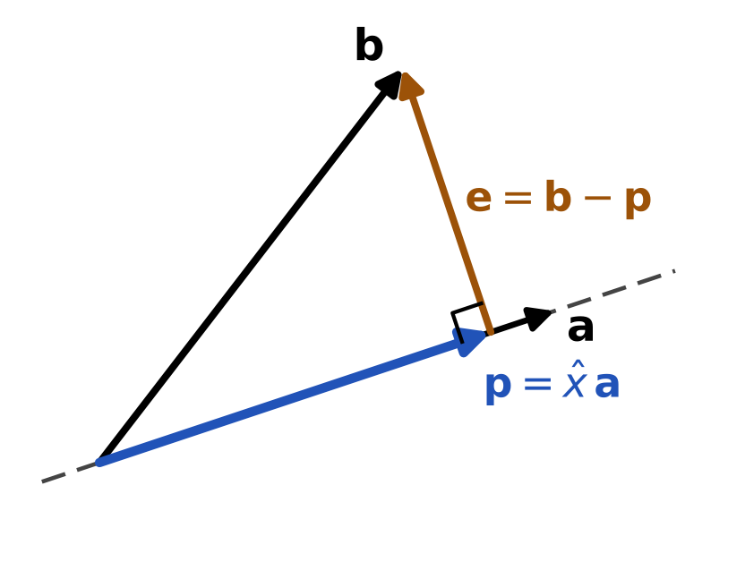
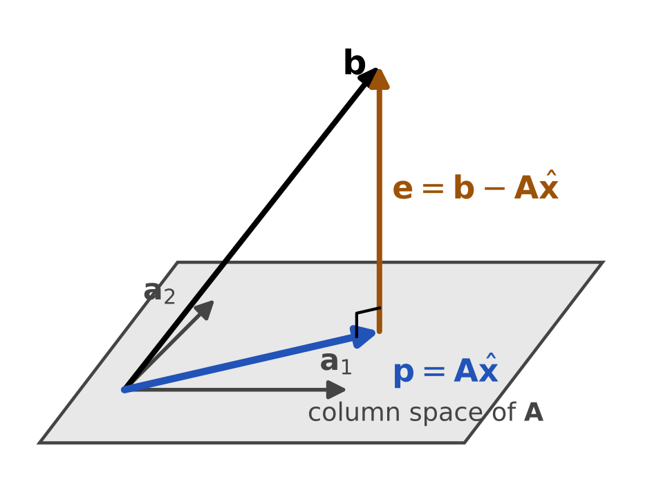

# Orthogonality and least squares {#sec-orthogonality-least-squares}

[Core]{.level-badge .core}

::: {.callout-note appearance="simple" icon=false}
## In this chapter you will

- use dot products to measure lengths, angles and right angles in $\R^n$
- project a vector onto a line, and onto the column space of a matrix
- find the least-squares solution of an inconsistent system with the normal equations, and use it to fit models to data
- build an orthonormal basis with the Gram–Schmidt process
:::

**Builds on** @sec-inverses, @sec-fundamental-subspaces, and the dot product from the [Refresher](../front/refresher.qmd).

Measured data never fits a model exactly. Five measurements of a spring under five loads give five equations for two unknowns (its natural length and its stretchiness), and because every measurement has a small error, no straight line passes through all five points. The system has no solution. But giving up would be absurd: there is clearly a *best* line. This chapter makes "best" precise, as the line that makes the total squared error as small as possible, and finds it with one linear system, the **normal equations**. The key idea is a right angle, so the chapter starts with dot products.

## Build intuition

Adjust the blue line to fit the points as well as you can by eye. Each vertical dashed line is the error at one point, and the shaded squares show those errors squared. The **least-squares** line is the one with the smallest total area of squares.

::: {.app-embed}
<iframe class="app-frame" src="../apps/line-fit.html?embed=1" title="Line of best fit" loading="lazy"></iframe>

[Open the line of best fit app in its own tab](../apps/line-fit.html){.app-open target="_blank"}
:::

Things to try:

- How small can you make the error by moving the sliders? Then show the least-squares line. Was your line close?
- Drag one point a long way up. How much does the least-squares line move? Try **One outlier**.
- With **Two points**, what is the smallest possible error, and why?

## The ideas

### Lengths, angles and right angles in $\R^n$

The dot product of the [Refresher](../front/refresher.qmd) works for vectors of any length:
$$
\vect{x} \cdot \vect{y} = x_1y_1 + x_2y_2 + \dots + x_ny_n = \vect{x}\T\vect{y}.
$$
The second form, a row times a column, is how it usually appears in matrix calculations. From it come:

- the **length** (or **norm**) $\lVert\vect{x}\rVert = \sqrt{\vect{x} \cdot \vect{x}}$, Pythagoras in $n$ dimensions;
- the **distance** between $\vect{x}$ and $\vect{y}$, which is $\lVert\vect{x} - \vect{y}\rVert$;
- the **angle** $\theta$ between $\vect{x}$ and $\vect{y}$, from $\vect{x} \cdot \vect{y} = \lVert\vect{x}\rVert\,\lVert\vect{y}\rVert\cos\theta$.

That last formula needs $\lvert\vect{x} \cdot \vect{y}\rvert \le \lVert\vect{x}\rVert\,\lVert\vect{y}\rVert$, so that $\cos\theta$ lies between $-1$ and 1. This is the **Cauchy–Schwarz inequality**, and it holds in any number of dimensions (a proof is in @sec-proofs-orthogonality-least-squares).

Two vectors are **orthogonal** (perpendicular) when $\vect{x} \cdot \vect{y} = 0$. For orthogonal vectors, Pythagoras' theorem holds:
$$
\lVert\vect{x} + \vect{y}\rVert^2 = (\vect{x} + \vect{y}) \cdot (\vect{x} + \vect{y}) = \lVert\vect{x}\rVert^2 + 2\,\vect{x} \cdot \vect{y} + \lVert\vect{y}\rVert^2 = \lVert\vect{x}\rVert^2 + \lVert\vect{y}\rVert^2.
$$

### Projection onto a line

The closest point to $\vect{b}$ on the line through the origin in the direction $\vect{a}$ is found by dropping a perpendicular. Call it $\vect{p} = \hat{x}\,\vect{a}$. The error $\vect{e} = \vect{b} - \vect{p}$ must be at right angles to $\vect{a}$ (@fig-project-line):
$$
\vect{a} \cdot (\vect{b} - \hat{x}\,\vect{a}) = 0
\quad\Longrightarrow\quad
\hat{x} = \frac{\vect{a} \cdot \vect{b}}{\vect{a} \cdot \vect{a}},
\qquad
\vect{p} = \frac{\vect{a} \cdot \vect{b}}{\vect{a} \cdot \vect{a}}\,\vect{a}.
$$ {#eq-project-line}
This $\vect{p}$ is the **projection** of $\vect{b}$ onto the line. It really is the closest point: any other point $\vect{q}$ on the line gives $\vect{b} - \vect{q} = \vect{e} + (\vect{p} - \vect{q})$, a sum of two orthogonal vectors, so by Pythagoras $\lVert\vect{b} - \vect{q}\rVert^2 = \lVert\vect{e}\rVert^2 + \lVert\vect{p} - \vect{q}\rVert^2$, which is bigger. You met this as the "shadow" of one vector on another in the dot product view of the vector explorer.

{#fig-project-line fig-alt="A dashed line through the origin in the direction of the vector a. The vector b points up and to the right, off the line. The blue vector p runs along the line to the foot of the perpendicular from b, and the brown vector e goes from the tip of p to the tip of b, with a right-angle mark where it meets the line." width=50%}

::: {#ex-orthogonality-least-squares-1 .callout-note appearance="simple" icon=false}
### Example 1: projection onto a line

Project $\vect{b} = (3, 1)\T$ onto the line through $\vect{a} = (1, 2)\T$, and find the distance from $\vect{b}$ to the line.

**Solution.** $\vect{a} \cdot \vect{b} = 3 + 2 = 5$ and $\vect{a} \cdot \vect{a} = 1 + 4 = 5$, so by @eq-project-line, $\vect{p} = \tfrac{5}{5}\vect{a} = (1, 2)\T$. The error is $\vect{e} = \vect{b} - \vect{p} = (2, -1)\T$. Check that it is at right angles to the line: $\vect{e} \cdot \vect{a} = 2 - 2 = 0$. ✓ The distance from $\vect{b}$ to the line is $\lVert\vect{e}\rVert = \sqrt{5}$.
:::

### Projection onto a subspace

Now project $\vect{b}$ onto a bigger subspace: the column space of a matrix $\M{A}$ with independent columns (@sec-fundamental-subspaces). The closest point is $\vect{p} = \M{A}\hat{\vect{x}}$ for some $\hat{\vect{x}}$, and the same argument says the error $\vect{e} = \vect{b} - \M{A}\hat{\vect{x}}$ must be at right angles to the whole subspace (@fig-project-plane), so to every column of $\M{A}$. Dotting with every column at once is multiplying by $\M{A}\T$:
$$
\M{A}\T(\vect{b} - \M{A}\hat{\vect{x}}) = \zerovec
\quad\Longrightarrow\quad
\M{A}\T\M{A}\,\hat{\vect{x}} = \M{A}\T\vect{b}.
$$ {#eq-normal-equations}
These are the **normal equations** ("normal" is another word for perpendicular). $\M{A}\T\M{A}$ is a square matrix, with one row and column for each column of $\M{A}$, and it is invertible exactly when the columns of $\M{A}$ are independent (@sec-fundamental-subspaces, Exercise 6). Then the projection is
$$
\vect{p} = \M{A}\hat{\vect{x}} = \M{A}(\M{A}\T\M{A})^{-1}\M{A}\T\vect{b}.
$$
The matrix $\M{P} = \M{A}(\M{A}\T\M{A})^{-1}\M{A}\T$ is the **projection matrix** onto the column space. Projecting twice is the same as projecting once, so $\M{P}^2 = \M{P}$.

{#fig-project-plane fig-alt="A shaded parallelogram represents the plane, the column space of A, containing the column vectors a1 and a2 from a common origin. The vector b rises above the plane. The blue vector p equals A x hat lies in the plane, directly below the tip of b, and the brown vector e equals b minus A x hat rises vertically from the tip of p to the tip of b, with a right-angle mark." width=55%}

### Least squares

Suppose $\M{A}\vect{x} = \vect{b}$ has no solution, because $\vect{b}$ is not in the column space. The **least-squares solution** is the $\hat{\vect{x}}$ that makes $\M{A}\hat{\vect{x}}$ as close as possible to $\vect{b}$: it minimises
$$
\lVert\M{A}\vect{x} - \vect{b}\rVert^2 = \text{the sum of the squares of the errors in each equation}.
$$
The closest point of the column space to $\vect{b}$ is its projection, so the least-squares solution is the solution of the **normal equations** @eq-normal-equations. When $\M{A}\vect{x} = \vect{b}$ does have a solution, the normal equations give it, with zero error.

The most common use is **fitting a model to data**. To fit a straight line $y = c + mt$ to points $(t_1, y_1), \dots, (t_k, y_k)$, ask for every point to lie on the line:
$$
\mat{1 & t_1 \\ 1 & t_2 \\ \vdots & \vdots \\ 1 & t_k}\mat{c \\ m} = \mat{y_1 \\ y_2 \\ \vdots \\ y_k}.
$$
With more points than unknowns, this generally has no solution, and least squares gives the line of best fit. The method works for any model in which the unknown coefficients appear **linearly**, even if the model is curved. A parabola $y = c_0 + c_1t + c_2t^2$ just needs a third column, holding $t_i^2$.

Why squares, rather than the plain size of the errors? Squaring makes every error count as positive, gives a smooth quantity that calculus can minimise (@sec-matrix-calculus finds the normal equations that way too), and matches the geometry of distance. It has one weakness, which the app shows: a single wild point has a large squared error, so it can pull the line a long way.

::: {#ex-orthogonality-least-squares-2 .callout-note appearance="simple" icon=false}
### Example 2: calibrating a spring

A spring is hung with loads of 0, 1, 2 and 3 newtons, and its length is measured as 1, 2, 4 and 5 cm. Fit the straight line $y = c + mt$, where $t$ is the load and $y$ the length.

**Solution.** Asking every point to lie on the line gives four equations for two unknowns:
$$
\M{A} = \mat{1 & 0 \\ 1 & 1 \\ 1 & 2 \\ 1 & 3},
\qquad
\vect{y} = \mat{1 \\ 2 \\ 4 \\ 5}.
$$
The normal equations need
$$
\M{A}\T\M{A} = \mat{4 & 6 \\ 6 & 14},
\qquad
\M{A}\T\vect{y} = \mat{12 \\ 25}.
$$
(The entries are the number of points, the sum of the $t_i$, the sum of the $t_i^2$, the sum of the $y_i$ and the sum of the $t_iy_i$.) Solving $4c + 6m = 12$ and $6c + 14m = 25$ gives $c = 0.9$ and $m = 1.4$, so the line of best fit is
$$
y = 0.9 + 1.4t.
$$
The spring is about 0.9 cm long unloaded, and stretches about 1.4 cm per newton. The errors are $\vect{e} = \vect{y} - \M{A}\hat{\vect{x}} = (0.1, -0.3, 0.3, -0.1)\T$, so the sum of squared errors is $0.01 + 0.09 + 0.09 + 0.01 = 0.2$. As the theory says, $\vect{e}$ is at right angles to both columns: its entries add up to 0, and $0(0.1) + 1(-0.3) + 2(0.3) + 3(-0.1) = 0$. This is the **Spring** example in the app.
:::

### Orthonormal bases and Gram–Schmidt

Vectors $\vect{q}_1, \dots, \vect{q}_k$ are **orthonormal** if each has length 1 and each pair is orthogonal. Put them in the columns of a matrix $\M{Q}$. The entries of $\M{Q}\T\M{Q}$ are the dot products $\vect{q}_i \cdot \vect{q}_j$, so orthonormality says exactly
$$
\M{Q}\T\M{Q} = \M{I}.
$$
(A square $\M{Q}$ like this is an orthogonal matrix, as in @sec-inverses.) Orthonormal bases make everything easy:

- the coordinates of $\vect{v}$ in an orthonormal basis are just dot products, $c_i = \vect{q}_i \cdot \vect{v}$, with no system to solve;
- the normal equations become $\hat{\vect{x}} = \M{Q}\T\vect{b}$, and the projection onto the column space is $\vect{p} = \M{Q}\M{Q}\T\vect{b} = (\vect{q}_1 \cdot \vect{b})\vect{q}_1 + \dots + (\vect{q}_k \cdot \vect{b})\vect{q}_k$, a sum of projections onto lines.

The **Gram–Schmidt process** turns any independent vectors $\vect{a}_1, \dots, \vect{a}_k$ into orthonormal ones with the same span. Take each vector in turn, subtract its projections onto the orthonormal vectors found so far, and scale what is left to length 1:
$$
\vect{v}_j = \vect{a}_j - (\vect{q}_1 \cdot \vect{a}_j)\,\vect{q}_1 - \dots - (\vect{q}_{j-1} \cdot \vect{a}_j)\,\vect{q}_{j-1},
\qquad
\vect{q}_j = \frac{\vect{v}_j}{\lVert\vect{v}_j\rVert}.
$$
What is left, $\vect{v}_j$, is the part of $\vect{a}_j$ at right angles to all the earlier vectors. Recording the numbers used along the way writes $\M{A} = \M{Q}\M{R}$, with $\M{R}$ upper triangular, the **QR factorisation**. It is the reliable way to solve least-squares problems on a computer (@sec-qr-least-squares).

::: {#ex-orthogonality-least-squares-3 .callout-note appearance="simple" icon=false}
### Example 3: Gram–Schmidt, and a projection onto a plane

Find an orthonormal basis for the plane spanned by $\vect{a}_1 = (1, 1, 0)\T$ and $\vect{a}_2 = (1, 0, 1)\T$, and use it to project $\vect{b} = (1, 2, 3)\T$ onto the plane.

**Solution.** First, $\lVert\vect{a}_1\rVert = \sqrt{2}$, so $\vect{q}_1 = \tfrac{1}{\sqrt{2}}(1, 1, 0)\T$. Next, remove from $\vect{a}_2$ its projection onto $\vect{q}_1$. Since $\vect{q}_1 \cdot \vect{a}_2 = \tfrac{1}{\sqrt{2}}$,
$$
\vect{v}_2 = \vect{a}_2 - \tfrac{1}{\sqrt{2}}\vect{q}_1 = (1, 0, 1)\T - \tfrac{1}{2}(1, 1, 0)\T = \left(\tfrac{1}{2}, -\tfrac{1}{2}, 1\right)\T.
$$
Its length is $\sqrt{\tfrac{1}{4} + \tfrac{1}{4} + 1} = \sqrt{\tfrac{3}{2}}$, so $\vect{q}_2 = \tfrac{1}{\sqrt{6}}(1, -1, 2)\T$. Check: $\vect{q}_1 \cdot \vect{q}_2 = \tfrac{1}{\sqrt{12}}(1 - 1 + 0) = 0$. ✓

With an orthonormal basis, the projection is a sum of projections onto lines. $\vect{q}_1 \cdot \vect{b} = \tfrac{3}{\sqrt{2}}$ and $\vect{q}_2 \cdot \vect{b} = \tfrac{5}{\sqrt{6}}$, so
$$
\vect{p} = \tfrac{3}{2}(1, 1, 0)\T + \tfrac{5}{6}(1, -1, 2)\T = \left(\tfrac{7}{3}, \tfrac{2}{3}, \tfrac{5}{3}\right)\T.
$$
The error $\vect{b} - \vect{p} = \tfrac{4}{3}(-1, 1, 1)\T$ is at right angles to both $\vect{a}_1$ and $\vect{a}_2$, as it should be.
:::

## In code

For least squares, use a solver that works on $\M{A}$ directly rather than forming $\M{A}\T\M{A}$: NumPy's `lstsq`, or MATLAB's backslash, which automatically gives the least-squares solution when $\M{A}$ has more rows than columns. They use the QR factorisation, which is more accurate (@sec-qr-least-squares). For fitting polynomials there is also `polyfit`, which lists the coefficients from the highest power down.

::: {.panel-tabset group="language"}
## Python

```{python}
import numpy as np

t = np.array([0, 1, 2, 3])
y = np.array([1, 2, 4, 5])
A = np.column_stack([np.ones_like(t), t])        # columns: 1 and t

x, sse, rank, sv = np.linalg.lstsq(A, y, rcond=None)
print(x, sse)                                    # c and m, and the sum of squared errors

print(np.linalg.solve(A.T @ A, A.T @ y))         # the normal equations: same answer
print(np.polyfit(t, y, 1))                       # slope first, then intercept

Q, R = np.linalg.qr(np.array([[1, 1], [1, 0], [0, 1]]))
print(np.round(Q, 4) + 0)                        # orthonormal columns (Example 3, up to sign)
```

## MATLAB

```matlab
t = [0; 1; 2; 3];
y = [1; 2; 4; 5];
A = [ones(4, 1), t];       % columns: 1 and t

x = A \ y                  % least squares, because A is tall
sum((y - A*x).^2)          % the sum of squared errors
p = polyfit(t, y, 1)       % slope first, then intercept

[Q, R] = qr([1 1; 1 0; 0 1], 0);
Q                          % orthonormal columns (Example 3, up to sign)
```

```{.text .code-output}
x =

    0.9000
    1.4000

ans =

    0.2000

p =

    1.4000    0.9000

Q =

   -0.7071    0.4082
   -0.7071   -0.4082
         0    0.8165
```
:::

The QR factorisation may give $-\vect{q}_1$ or $-\vect{q}_2$ instead of $\vect{q}_1$ or $\vect{q}_2$. Either sign is an equally good orthonormal basis.

## Check your understanding

::: {.callout-tip collapse="true"}
## What is the projection of $\vect{b}$ onto a line if $\vect{b}$ is already on the line? If $\vect{b}$ is at right angles to the line?

$\vect{b}$ itself; and $\zerovec$.
:::

::: {.callout-tip collapse="true"}
## Why does the least-squares error vector have to be at right angles to every column of $\M{A}$?

If it weren't, moving $\M{A}\hat{\vect{x}}$ a little along that column would bring it closer to $\vect{b}$, so it wouldn't be the closest point.
:::

::: {.callout-tip collapse="true"}
## If the columns of $\M{Q}$ are orthonormal, what is $\M{Q}\T\M{Q}$?

The identity matrix.
:::

## Key ideas

- The dot product measures length, $\lVert\vect{v}\rVert = \sqrt{\vect{v}\cdot\vect{v}}$, and angle, $\cos\theta = \vect{u}\cdot\vect{v}/(\lVert\vect{u}\rVert\lVert\vect{v}\rVert)$, in any number of dimensions. Vectors are orthogonal when their dot product is zero.
- Projecting $\vect{b}$ onto a line or subspace gives its closest point there, and the error is at right angles to the subspace.
- When $\M{A}\vect{x} = \vect{b}$ has no solution, the least-squares solution solves the normal equations $\M{A}\T\M{A}\hat{\vect{x}} = \M{A}\T\vect{b}$, and makes $\M{A}\hat{\vect{x}}$ the projection of $\vect{b}$ onto the column space.
- Fitting a line or curve to data is a least-squares problem.
- Gram–Schmidt turns any basis into an orthonormal one, in which coordinates and projections are just dot products.

## Exercises {#sec-orthogonality-least-squares-exercises}

1. []{#exercise-orthogonality-least-squares-1}Find the angle between (a) $(1, 2, 2)\T$ and $(2, 1, -2)\T$; (b) $(1, 1, 0)\T$ and $(1, 0, 1)\T$.

   [Solution to exercise 1](../appendices/solutions-3.qmd#solution-orthogonality-least-squares-1){.sol-link}

2. []{#exercise-orthogonality-least-squares-2}Project $\vect{b} = (2, 3, 4)\T$ onto the line through $\vect{a} = (1, 1, 1)\T$. Check that the error is at right angles to $\vect{a}$.

   [Solution to exercise 2](../appendices/solutions-3.qmd#solution-orthogonality-least-squares-2){.sol-link}

3. []{#exercise-orthogonality-least-squares-3}Find the line of best fit $y = c + mt$ through the points $(0, 6)$, $(1, 0)$ and $(2, 0)$, and the sum of squared errors. Check your answer with the app.

   [Solution to exercise 3](../appendices/solutions-3.qmd#solution-orthogonality-least-squares-3){.sol-link}

4. []{#exercise-orthogonality-least-squares-4}Show that a projection matrix $\M{P} = \M{A}(\M{A}\T\M{A})^{-1}\M{A}\T$ satisfies $\M{P}\T = \M{P}$ and $\M{P}^2 = \M{P}$. Explain the second property geometrically.

   [Solution to exercise 4](../appendices/solutions-3.qmd#solution-orthogonality-least-squares-4){.sol-link}

5. []{#exercise-orthogonality-least-squares-5}Apply Gram–Schmidt to $\vect{a}_1 = (1, 2, 2)\T$ and $\vect{a}_2 = (1, 0, 1)\T$.

   [Solution to exercise 5](../appendices/solutions-3.qmd#solution-orthogonality-least-squares-5){.sol-link}

6. []{#exercise-orthogonality-least-squares-6}Show that for a straight-line fit $y = c + mt$, the least-squares errors always add up to zero. (*Hint*: look at the first of the normal equations, $\M{A}\T\vect{e} = \zerovec$.)

   [Solution to exercise 6](../appendices/solutions-3.qmd#solution-orthogonality-least-squares-6){.sol-link}

7. []{#exercise-orthogonality-least-squares-7}**Code.** A ball is thrown upwards, and its height $h$ in metres is measured at times $t = 0, 0.5, 1, 1.5, 2, 2.5$ seconds as $2.1, 7.6, 11.3, 11.8, 10.5, 6.2$. Fit the model $h = c_0 + c_1t + c_2t^2$ by least squares. Since $h = h_0 + ut - \tfrac{1}{2}gt^2$ for a ball thrown up with speed $u$, use your fit to estimate $g$, the acceleration due to gravity.

   [Solution to exercise 7](../appendices/solutions-3.qmd#solution-orthogonality-least-squares-7){.sol-link}

Solutions are in @sec-solutions-orthogonality-least-squares.

## In practice

- **Calibration**: instruments from thermometers to strain gauges are calibrated by fitting a line or curve to readings at known values, exactly as in Example 2.
- **Statistics**: linear regression is least squares. Each row of $\M{A}$ is one observation, each column one explanatory variable, and $\hat{\vect{x}}$ holds the estimated effects (@sec-data-science).
- **GPS**: a receiver measures its distance to more satellites than it strictly needs, with small errors in each. It finds its position by least squares (after a step that makes the equations linear, @sec-newton-systems), and the extra satellites improve the accuracy.
- **Surveying and image processing**: networks of measured angles and distances are adjusted by least squares so that they fit together consistently, and least squares underlies many methods for removing blur and noise from images.

## Going further

- **Weighted least squares** gives more reliable measurements more influence, by minimising $\sum w_i e_i^2$ with weights $w_i$. **Robust** methods reduce the influence of outliers, for example by minimising $\sum \lvert e_i\rvert$ instead.
- Forming $\M{A}\T\M{A}$ squares the condition number of the problem (@sec-floating-point-conditioning), so it can lose accuracy when the columns of $\M{A}$ are nearly dependent. The QR factorisation avoids this (@sec-qr-least-squares).
- When the columns of $\M{A}$ are dependent, there are many least-squares solutions. The singular value decomposition picks the shortest one, through the pseudo-inverse (@sec-svd-pca).
- Orthogonality works for functions too, with the dot product replaced by an integral, $\int f(t)g(t)\,dt$. Fourier series are projections onto orthogonal sines and cosines.
- Proofs of the Cauchy–Schwarz inequality, that the normal equations give the minimum, and that Gram–Schmidt works: @sec-proofs-orthogonality-least-squares.
