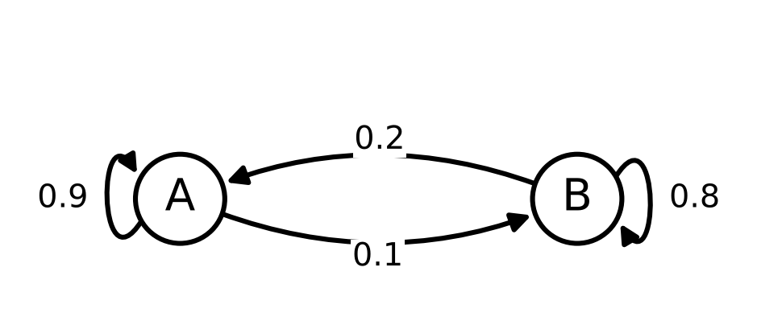

# Diagonalisation and matrix powers {#sec-diagonalisation}

[Core]{.level-badge .core}

::: {.callout-note appearance="simple" icon=false}
## In this chapter you will

- diagonalise a matrix as $\M{A} = \M{P}\M{D}\M{P}^{-1}$, and know when this is possible
- compute high powers of a matrix from its eigenvalues
- predict the long-run behaviour of a process $\vect{x}_{k+1} = \M{A}\vect{x}_k$ from its dominant eigenvalue
:::

**Builds on** @sec-basis-change, @sec-eigenvalues.

Many processes repeat the same linear step over and over: next year's population from this year's, tomorrow's distribution of hire bikes from today's, the next pair of Fibonacci numbers from the last pair. After $k$ steps the state is $\M{A}^k\vect{x}_0$. Multiplying out $\M{A}^k$ for large $k$ is slow and gives no insight. But in the basis of its eigenvectors, $\M{A}$ is just a diagonal matrix (@sec-basis-change, Example 4), and powers of a diagonal matrix are easy. This chapter turns that observation into a method, and uses it to predict what happens in the long run.

## Build intuition

Start from a vector and multiply by the same matrix again and again. The dashed lines are the eigenvector directions, labelled with their eigenvalues.

::: {.app-embed}
<iframe class="app-frame" src="../apps/matrix-powers.html?embed=1" title="Matrix powers" loading="lazy"></iframe>

[Open the matrix powers app in its own tab](../apps/matrix-powers.html){.app-open target="_blank"}
:::

Things to try:

- In **Grows along a line**, press **Play**. Which eigenvector line does the vector end up along, and how fast does it grow at each step? Drag the starting point and try again. Can you find a starting point where it *doesn't* end up along that line?
- In **Bike share**, what does the vector settle down to?
- In **Fibonacci**, read down the table of steps. Where have you seen these numbers? What does the growth factor settle to?
- In **Spiral**, the eigenvalues are complex. What happens instead?

## The ideas

### Diagonalisation

Suppose the $n \times n$ matrix $\M{A}$ has $n$ independent eigenvectors $\vect{v}_1, \dots, \vect{v}_n$, with eigenvalues $\lambda_1, \dots, \lambda_n$. Put the eigenvectors in the columns of $\M{P}$, and the eigenvalues, in the same order, on the diagonal of $\M{D}$. The equations $\M{A}\vect{v}_i = \lambda_i\vect{v}_i$, side by side, say
$$
\M{A}\M{P} = \M{P}\M{D}.
$$
$\M{P}$ is invertible because its columns are independent, so
$$
\M{A} = \M{P}\M{D}\M{P}^{-1}
\qquad\text{and}\qquad
\M{D} = \M{P}^{-1}\M{A}\M{P}.
$$ {#eq-diagonalisation}
This is **diagonalisation**. By @sec-basis-change, it says exactly what you would hope: in the basis of eigenvectors, $\M{A}$ is the diagonal matrix $\M{D}$, which just stretches each coordinate by its own eigenvalue.

When is it possible? Exactly when $\M{A}$ has $n$ independent eigenvectors.

- If the $n$ eigenvalues are all **different**, it always is: eigenvectors for different eigenvalues are independent (a proof is in @sec-proofs-diagonalisation).
- If some eigenvalue is repeated, it is possible exactly when each eigenspace has as many dimensions as its eigenvalue repeats (@sec-eigenvalues, Example 2 is fine). A **defective** matrix, such as the shear, can't be diagonalised.
- Complex eigenvalues are allowed, but then $\M{P}$ and $\M{D}$ contain complex numbers.

::: {#ex-diagonalisation-1 .callout-note appearance="simple" icon=false}
### Example 1: a matrix that can't be diagonalised

Find $\M{H}^k$ for the shear $\M{H} = \mat{1 & 1 \\ 0 & 1}$.

**Solution.** $\M{H}$ is defective (@sec-eigenvalues, Example 3), so @eq-powers can't be used. But multiplying out a few powers shows the pattern: $\M{H}^2 = \mat{1 & 2 \\ 0 & 1}$, $\M{H}^3 = \mat{1 & 3 \\ 0 & 1}$, and in general
$$
\M{H}^k = \mat{1 & k \\ 0 & 1}.
$$
Both eigenvalues are 1, yet the entries grow, steadily rather than exponentially. The eigenvalues alone don't tell the whole story for a defective matrix.
:::

### Powers

The middle factors cancel when a diagonalised matrix is multiplied by itself:
$$
\M{A}^2 = \M{P}\M{D}\M{P}^{-1}\M{P}\M{D}\M{P}^{-1} = \M{P}\M{D}^2\M{P}^{-1},
$$
and in general
$$
\M{A}^k = \M{P}\M{D}^k\M{P}^{-1},
$$ {#eq-powers}
where $\M{D}^k$ is diagonal with entries $\lambda_1^k, \dots, \lambda_n^k$. This gives a formula for $\M{A}^k$ with $k$ as a variable, so it says how the entries grow, not just what they are for one $k$.

::: {#ex-diagonalisation-2 .callout-note appearance="simple" icon=false}
### Example 2: a formula for $\M{A}^k$

Diagonalise $\M{A} = \mat{4 & 1 \\ 2 & 3}$, and find a formula for $\M{A}^k$.

**Solution.** From @sec-eigenvalues, Example 1, the eigenvalues are 5 and 2, with eigenvectors $(1, 1)\T$ and $(1, -2)\T$. So
$$
\M{P} = \mat{1 & 1 \\ 1 & -2},
$$
$$
\M{D} = \mat{5 & 0 \\ 0 & 2},
$$
$$
\M{P}^{-1} = \frac{1}{3}\mat{2 & 1 \\ 1 & -1}.
$$
Then $\M{A}^k = \M{P}\M{D}^k\M{P}^{-1}$, which multiplies out to
$$
\M{A}^k = \frac{1}{3}\mat{2 \cdot 5^k + 2^k & 5^k - 2^k \\ 2 \cdot 5^k - 2 \cdot 2^k & 5^k + 2 \cdot 2^k}.
$$
Check with $k = 1$: $\tfrac{1}{3}\mat{12 & 3 \\ 6 & 9} = \M{A}$. ✓ For large $k$, the $5^k$ terms dominate, so every entry grows by a factor of about 5 per step.
:::

::: {#ex-diagonalisation-3 .callout-note appearance="simple" icon=false}
### Example 3: Fibonacci numbers

The Fibonacci numbers $0, 1, 1, 2, 3, 5, 8, 13, \dots$ obey $F_{k+1} = F_k + F_{k-1}$. Find a formula for $F_k$.

**Solution.** Put two neighbouring numbers in a vector. Then
$$
\mat{F_{k+1} \\ F_k} = \mat{1 & 1 \\ 1 & 0}\mat{F_k \\ F_{k-1}},
$$
a process with $\M{A} = \mat{1 & 1 \\ 1 & 0}$. Its trace is 1 and determinant $-1$, so $\lambda^2 - \lambda - 1 = 0$, and
$$
\lambda_1 = \frac{1 + \sqrt{5}}{2} \approx 1.618,
\qquad
\lambda_2 = \frac{1 - \sqrt{5}}{2} \approx -0.618.
$$
($\lambda_1$ is the golden ratio, $\varphi$.) For each eigenvalue, $\M{A} - \lambda\M{I}$ has first row $(1 - \lambda, 1)$, so the eigenvectors are $\vect{v}_i = (\lambda_i, 1)\T$. The starting vector $(F_1, F_0)\T = (1, 0)\T$ is $\tfrac{1}{\sqrt{5}}(\vect{v}_1 - \vect{v}_2)$, as you can check, so by @eq-modes, reading off the second entry,
$$
F_k = \frac{\lambda_1^k - \lambda_2^k}{\sqrt{5}}.
$$
Since $\lvert\lambda_2\rvert < 1$, the second term shrinks quickly, and $F_k$ is just $\lambda_1^k/\sqrt{5}$ rounded to the nearest whole number. For example, $\varphi^{30}/\sqrt{5} \approx 832\,040.0000002$, and indeed $F_{30} = 832\,040$. The ratio of neighbouring Fibonacci numbers tends to $\varphi$, as the [**Fibonacci**](../apps/matrix-powers.html?preset=Fibonacci){target="_blank" aria-label="Fibonacci preset in the matrix powers app (opens in a new tab)"} preset in the app shows.
:::

### Repeated steps: $\vect{x}_{k+1} = \M{A}\vect{x}_k$

For a process that applies $\M{A}$ at each step, write the starting vector in the eigenvector basis, $\vect{x}_0 = c_1\vect{v}_1 + \dots + c_n\vect{v}_n$ (the coefficients are $\vect{c} = \M{P}^{-1}\vect{x}_0$, as in @sec-basis-change). Each step multiplies each eigenvector by its eigenvalue, so
$$
\vect{x}_k = \M{A}^k\vect{x}_0 = c_1\lambda_1^k\vect{v}_1 + c_2\lambda_2^k\vect{v}_2 + \dots + c_n\lambda_n^k\vect{v}_n.
$$ {#eq-modes}
Each eigenvector is a **mode** of the process, evolving on its own by powers of its eigenvalue.

Now order the eigenvalues so that $\lvert\lambda_1\rvert$ is the largest, the **dominant eigenvalue**, strictly larger than the others. As $k$ grows, $\lvert\lambda_1\rvert^k$ outgrows every other $\lvert\lambda_i\rvert^k$, so (as long as $c_1 \neq 0$)
$$
\vect{x}_k \approx c_1\lambda_1^k\,\vect{v}_1 \quad\text{for large } k.
$$
Two things follow. The **direction** of $\vect{x}_k$ settles along the dominant eigenvector, whatever the start. And the **size** changes by a factor of about $\lvert\lambda_1\rvert$ per step: it grows without limit if $\lvert\lambda_1\rvert > 1$, dies away if every $\lvert\lambda_i\rvert < 1$, and settles to a steady state if $\lambda_1 = 1$ and the others are smaller. The speed of settling is set by the ratio $\lvert\lambda_2\rvert / \lvert\lambda_1\rvert$: the smaller it is, the faster the other modes fade.

::: {#ex-diagonalisation-4 .callout-note appearance="simple" icon=false}
### Example 4: where do the bikes end up?

A bike-hire scheme has two docking stations, A and B. Each day, 90% of the bikes at A end the day at A and 10% at B; of those at B, 20% end at A and 80% stay at B (@fig-bike-stations). If all the bikes start at A, what happens in the long run?

{#fig-bike-stations fig-alt="Two circles, A and B. A has a loop labelled 0.9 and an arrow to B labelled 0.1. B has a loop labelled 0.8 and an arrow to A labelled 0.2." width=50%}

**Solution.** Let $\vect{x}_k$ hold the fractions of bikes at A and at B after $k$ days. Then $\vect{x}_{k+1} = \M{M}\vect{x}_k$ with
$$
\M{M} = \mat{0.9 & 0.2 \\ 0.1 & 0.8}.
$$
Each column adds up to 1, because every bike ends up somewhere. The trace is 1.7 and the determinant $0.72 - 0.02 = 0.7$, so $\lambda^2 - 1.7\lambda + 0.7 = 0$, giving $\lambda_1 = 1$ and $\lambda_2 = 0.7$.

For $\lambda_1 = 1$: $\M{M} - \M{I} = \mat{-0.1 & 0.2 \\ 0.1 & -0.2}$ gives $x = 2y$, so $\vect{v}_1 = (2, 1)\T$. For $\lambda_2 = 0.7$: $\M{M} - 0.7\M{I} = \mat{0.2 & 0.2 \\ 0.1 & 0.1}$ gives $\vect{v}_2 = (1, -1)\T$.

Starting from $\vect{x}_0 = (1, 0)\T = \tfrac{1}{3}(2, 1)\T + \tfrac{1}{3}(1, -1)\T$,
$$
\vect{x}_k = \frac{1}{3}\mat{2 \\ 1} + \frac{1}{3}(0.7)^k\mat{1 \\ -1}.
$$
The second term dies away, so in the long run $\tfrac{2}{3}$ of the bikes are at A and $\tfrac{1}{3}$ at B, whatever the starting arrangement. After a week ($k = 7$, $0.7^7 \approx 0.08$) the arrangement is already within 3 percentage points of this. This is the [**Bike share**](../apps/matrix-powers.html?preset=Bike%20share){target="_blank" aria-label="Bike share preset in the matrix powers app (opens in a new tab)"} preset in the app.
:::

## In code

The diagonalisation comes straight from `eig`. For powers with a specific $k$, `matrix_power` (or `A^k` in MATLAB) multiplies efficiently by repeated squaring; the formula @eq-powers is most useful for understanding.

::: {.panel-tabset group="language"}
## Python

```{python}
import numpy as np

A = np.array([[4, 1], [2, 3]])
lam, P = np.linalg.eig(A)
lam, P = lam.real, P.real                       # recent NumPy returns complex numbers
D = np.diag(lam)
print(np.allclose(A, P @ D @ np.linalg.inv(P)))  # A = P D P^(-1)

k = 5
print(np.linalg.matrix_power(A, k))
print(np.round(P @ np.diag(lam**k) @ np.linalg.inv(P)))   # the same, from the eigenvalues

F = np.array([[1, 1], [1, 0]])
print(np.linalg.matrix_power(F, 30)[0, 1])      # the 30th Fibonacci number
```

## MATLAB

```matlab
A = [4 1; 2 3];
[P, D] = eig(A);
norm(A - P*D/P)            % zero, up to rounding: A = P D P^(-1)

k = 5;
A^k
round(P * D^k / P)         % the same, from the eigenvalues

F = [1 1; 1 0];
F30 = F^30;
F30(1, 2)                  % the 30th Fibonacci number
```

```{.text .code-output}
ans =

   1.1102e-16

ans =

        2094        1031
        2062        1063

ans =

        2094        1031
        2062        1063

ans =

      832040
```

`P*D/P` means $\M{P}\M{D}\M{P}^{-1}$: MATLAB's `/` solves rather than inverting. The value of the first `norm` depends on your computer; it is always tiny.
:::

## Check your understanding

::: {.callout-tip collapse="true"}
## A $3 \times 3$ matrix has eigenvalues 1, 2 and 3. Can it be diagonalised?

Yes: three different eigenvalues give three independent eigenvectors.
:::

::: {.callout-tip collapse="true"}
## If $\M{A} = \M{P}\M{D}\M{P}^{-1}$, what is $\M{A}^{-1}$?

$\M{P}\M{D}^{-1}\M{P}^{-1}$, where $\M{D}^{-1}$ has the reciprocals $1/\lambda_i$ on its diagonal (if none of them is 0).
:::

::: {.callout-tip collapse="true"}
## A process $\vect{x}_{k+1} = \M{A}\vect{x}_k$ has eigenvalues 0.9 and 0.5. What happens to $\vect{x}_k$?

It shrinks to $\zerovec$, eventually along the eigenvector for 0.9, shrinking by about 10% per step.
:::

## Key ideas

- If $\M{A}$ has $n$ independent eigenvectors, then $\M{A} = \M{P}\M{D}\M{P}^{-1}$, with the eigenvectors in the columns of $\M{P}$ and the eigenvalues on the diagonal of $\M{D}$.
- Distinct eigenvalues guarantee this; a defective matrix can't be diagonalised.
- Powers become easy: $\M{A}^k = \M{P}\M{D}^k\M{P}^{-1}$, and $\M{D}^k$ just raises each eigenvalue to the power $k$.
- For a process $\vect{x}_{k+1} = \M{A}\vect{x}_k$, the eigenvalue of largest size dominates in the long run: the process grows if it is bigger than 1 in size, dies away if it is smaller, and lines up with its eigenvector.

## Exercises {#sec-diagonalisation-exercises}

Exercises marked † are harder: they take longer, or need an idea that the worked examples don't show.

1. []{#exercise-diagonalisation-1}Diagonalise $\M{A} = \mat{1 & 2 \\ 2 & 1}$, and use your answer to find $\M{A}^{10}$.

   [Solution to exercise 1](../appendices/solutions-4.qmd#solution-diagonalisation-1){.sol-link}

2. []{#exercise-diagonalisation-2}A market has two brands. Each month, 70% of brand 1's customers stay and 30% switch to brand 2; 60% of brand 2's customers stay and 40% switch to brand 1. Write this as $\vect{x}_{k+1} = \M{M}\vect{x}_k$, and find the long-run market shares. How quickly are they approached?

   [Solution to exercise 2](../appendices/solutions-4.qmd#solution-diagonalisation-2){.sol-link}

3. []{#exercise-diagonalisation-3}Show that $\mat{2 & 1 \\ 0 & 2}$ can't be diagonalised. (*Hint*: find the eigenvalues, then show that the eigenvectors all lie on one line, so there aren't enough of them to form a basis.)

   [Solution to exercise 3](../appendices/solutions-4.qmd#solution-diagonalisation-3){.sol-link}

4. []{#exercise-diagonalisation-4}Use $\M{A} = \M{P}\M{D}\M{P}^{-1}$ to show that $\det\M{A}$ is the product of the eigenvalues, for a diagonalisable matrix. (*Hint*: take determinants of both sides, using $\det(\M{X}\M{Y}) = \det\M{X}\,\det\M{Y}$ and $\det(\M{P}^{-1}) = 1/\det\M{P}$.)

   [Solution to exercise 4](../appendices/solutions-4.qmd#solution-diagonalisation-4){.sol-link}

5. []{#exercise-diagonalisation-5}[†]{.harder aria-hidden="true" title="Harder"}[Harder exercise.]{.visually-hidden} The Lucas numbers $2, 1, 3, 4, 7, 11, \dots$ follow the same rule as the Fibonacci numbers, $L_{k+1} = L_k + L_{k-1}$, but start from $L_0 = 2$, $L_1 = 1$. Show that $L_k = \lambda_1^k + \lambda_2^k$, with $\lambda_1$ and $\lambda_2$ as in Example 3. (*Hint*: as in Example 3, $L_k = a\lambda_1^k + b\lambda_2^k$ for some numbers $a$ and $b$. Use $L_0 = 2$ and $L_1 = 1$ to find them.)

   [Solution to exercise 5](../appendices/solutions-4.qmd#solution-diagonalisation-5){.sol-link}

6. []{#exercise-diagonalisation-6}A matrix has eigenvalues 1 and $-1$, with independent eigenvectors. Show that $\M{A}^2 = \M{I}$, and give a geometric example of such a matrix. (*Hint*: write $\M{A} = \M{P}\M{D}\M{P}^{-1}$ with $\M{D} = \operatorname{diag}(1, -1)$, and work out $\M{A}^2$.)

   [Solution to exercise 6](../appendices/solutions-4.qmd#solution-diagonalisation-6){.sol-link}

7. []{#exercise-diagonalisation-7}**Code.** A **Leslie matrix** models a population divided into age groups. For a species with three age groups (young, adult, old), suppose each adult has 1.5 young per year and each old animal 1, 60% of the young survive to become adults, and 70% of adults survive to become old:
   $$
   \M{L} = \mat{0 & 1.5 & 1 \\ 0.6 & 0 & 0 \\ 0 & 0.7 & 0}.
   $$
   Find the dominant eigenvalue and its eigenvector. What is the long-run growth rate of the population, and what fraction of the animals is in each age group in the long run? Check by applying $\M{L}$ 50 times to a starting population.

   [Solution to exercise 7](../appendices/solutions-4.qmd#solution-diagonalisation-7){.sol-link}

Solutions are in @sec-solutions-diagonalisation.

## In practice

- **Population models**: the dominant eigenvalue of a Leslie matrix is the long-run growth rate of a population, and its eigenvector the stable mix of ages. Conservation biologists use the model to see which life stage matters most for a threatened species (@sec-population-models).
- **Markov chains**: processes that move between states with fixed probabilities, like the bikes in Example 4, settle down to the eigenvector with eigenvalue 1. The same idea models customers switching brands, weather patterns, and the random web surfer of PageRank (@sec-markov-pagerank).
- **Recurrences and signal processing**: any recurrence like the Fibonacci one, such as a digital filter that computes each output from the last few, can be written as matrix powers. Its eigenvalues decide whether the filter is stable.
- **Decoupling**: in the eigenvector basis, a set of interacting equations becomes independent ones, one per mode. This is how engineers analyse a vibrating structure one mode at a time (@sec-linear-odes).

## Going further

- Every square matrix, even a defective one, can be written as $\M{P}\M{J}\M{P}^{-1}$, where the **Jordan form** $\M{J}$ is diagonal apart from some 1s just above the diagonal. Example 1's shear is already in Jordan form. Jordan forms are fragile in floating-point arithmetic, so they are a tool for theory rather than computation.
- Repeatedly multiplying by $\M{A}$ and rescaling is itself a way to find the dominant eigenvector: the **power method**, which underlies PageRank (@sec-eigenvalue-algorithms).
- Diagonalisation lets you apply other functions to matrices, such as square roots and exponentials, by applying them to the eigenvalues: $f(\M{A}) = \M{P}f(\M{D})\M{P}^{-1}$. The matrix exponential is the key to @sec-linear-odes.
- Proof that eigenvectors for different eigenvalues are independent: @sec-proofs-diagonalisation.
