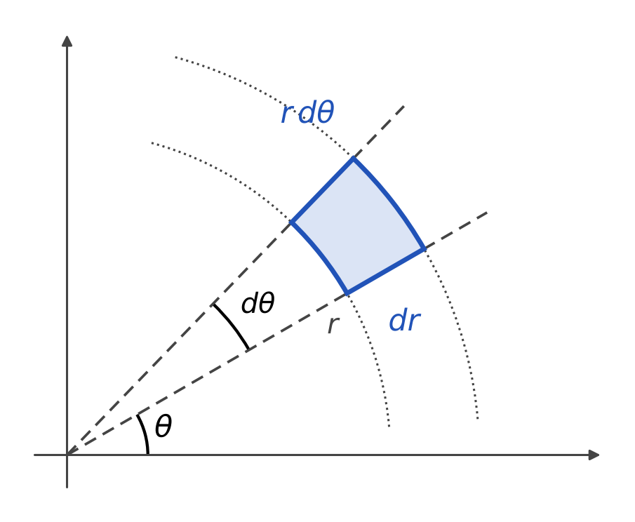
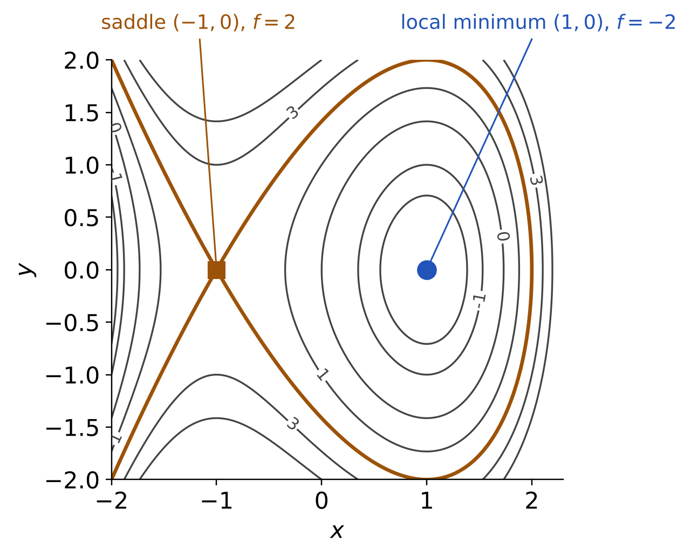

# Derivatives with vectors and matrices {#sec-matrix-calculus}

[Further]{.level-badge .further}

::: {.callout-note appearance="simple" icon=false}
## In this chapter you will

- compute gradients of scalar functions of vectors, including linear and quadratic forms
- form the Jacobian of a vector function and use it to linearise
- use the Hessian to classify stationary points
- derive the normal equations of least squares, and minimise functions by gradient descent
:::

**Builds on** @sec-orthogonality-least-squares, @sec-symmetric-matrices, and partial derivatives.

Much of applied mathematics is about finding the best of something: the line that fits the data most closely, the design with the least weight, the model parameters with the smallest error. With one variable you set a derivative to zero. With many variables, the derivatives collect into vectors and matrices, and matrix notation turns pages of partial derivatives into a few lines. This chapter assumes you know how to take partial derivatives; everything else is built from there.

## Build intuition

There is no app for this chapter. Instead, study @fig-gradient-descent below. It shows the contours (lines of constant height) of the quadratic function of Example 1, like the contour lines on a map of a valley, with arrows showing the gradient at points across the plane, and the path taken by gradient descent from $(-2, -1)$.

```{python}
#| fig-alt: "Elliptical contour lines around a minimum at (1, 2), grey gradient arrows pointing downhill, and a red zigzag path of gradient descent from (−2, −1) to the minimum."
#| label: fig-gradient-descent
#| fig-cap: "Contours of $f(\\vect{x}) = \\tfrac{1}{2}\\vect{x}\\T\\M{A}\\vect{x} - \\vect{b}\\T\\vect{x}$ with $\\M{A} = \\mat{3 & 1 \\\\ 1 & 2}$ and $\\vect{b} = (5, 5)\\T$. The grey arrows show the negative gradient $-\\nabla f$ (scaled down), and the red path is gradient descent with step size 0.4, starting from $(-2, -1)$ and reaching the minimum at $(1, 2)$."
#| code-fold: true
#| code-summary: "Show the code for this figure"
import numpy as np
import matplotlib.pyplot as plt

A = np.array([[3.0, 1.0], [1.0, 2.0]])
b = np.array([5.0, 5.0])
f = lambda x, y: 0.5 * (A[0, 0] * x**2 + 2 * A[0, 1] * x * y + A[1, 1] * y**2) - b[0] * x - b[1] * y

x, y = np.meshgrid(np.linspace(-3, 5, 200), np.linspace(-2, 5, 200))
fig, ax = plt.subplots(figsize=(6, 5))
ax.contour(x, y, f(x, y), levels=np.arange(-7, 40, 3), cmap="viridis", linewidths=1)

gx, gy = np.meshgrid(np.linspace(-2.5, 4.5, 9), np.linspace(-1.5, 4.5, 8))
grad = np.einsum("ij,jkl->ikl", A, np.array([gx, gy])) - b[:, None, None]
ax.quiver(gx, gy, -grad[0], -grad[1], color="0.55", angles="xy", scale=120, width=0.004)

path = [np.array([-2.0, -1.0])]
for _ in range(20):
    path.append(path[-1] - 0.4 * (A @ path[-1] - b))
path = np.array(path)
ax.plot(path[:, 0], path[:, 1], "o-", color="#c0392b", ms=4, lw=1.5)
ax.plot(1, 2, "k*", ms=12)
ax.set_aspect("equal")
ax.set_xlabel("$x_1$")
ax.set_ylabel("$x_2$")
plt.tight_layout()
plt.show()
```

Things to look for:

- At each point, how is the arrow placed relative to the contour line through that point?
- The arrows are longer in some places than others. Where are they longest, and why?
- The contours are ellipses. Compare their axes with the eigenvectors of $\M{A}$ (@sec-symmetric-matrices).
- The red path zigzags instead of heading straight for the minimum. Why might that be?

## The ideas

### The gradient

For a scalar function $f(\vect{x})$ of a vector $\vect{x} = (x_1, \dots, x_n)\T$, the **gradient** is the column vector of its partial derivatives,
$$
\nabla f = \mat{\partial f/\partial x_1 \\ \vdots \\ \partial f/\partial x_n}.
$$
For a small change $\Delta\vect{x}$, the change in $f$ is approximately a dot product:
$$
f(\vect{x} + \Delta\vect{x}) \approx f(\vect{x}) + \nabla f(\vect{x}) \cdot \Delta\vect{x}.
$$ {#eq-gradient-linear}
This one formula explains the gradient's geometry. Moving along a contour leaves $f$ unchanged, so $\nabla f \cdot \Delta\vect{x} = 0$: the gradient is perpendicular to the contours. And among all steps of a given length, the dot product is largest when $\Delta\vect{x}$ points along $\nabla f$ (@sec-orthogonality-least-squares): the gradient points in the direction of steepest increase, and its length is the rate of increase in that direction.

At a minimum or maximum of a smooth function, no direction goes uphill to first order, so $\nabla f = \zerovec$. Points where this happens are called **stationary points**.

### Two gradients worth knowing

Two kinds of function come up again and again: linear functions $\vect{a}\T\vect{x}$ and quadratic forms $\vect{x}\T\M{A}\vect{x}$ (@sec-symmetric-matrices).

::: {.callout-important appearance="simple"}
## Gradients of linear and quadratic forms
$$
\nabla(\vect{a}\T\vect{x}) = \vect{a},
\qquad
\nabla(\vect{x}\T\M{A}\vect{x}) = (\M{A} + \M{A}\T)\vect{x},
$$
which is $2\M{A}\vect{x}$ when $\M{A}$ is symmetric.
:::

These are the vector versions of $\frac{d}{dx}(ax) = a$ and $\frac{d}{dx}(ax^2) = 2ax$. You can check them in two dimensions by writing everything out: with $\M{A} = \mat{a & b \\ b & c}$, $\vect{x}\T\M{A}\vect{x} = ax_1^2 + 2bx_1x_2 + cx_2^2$, whose partial derivatives are $2ax_1 + 2bx_2$ and $2bx_1 + 2cx_2$, the entries of $2\M{A}\vect{x}$. The general proof is in @sec-proofs-matrix-calculus, and more formulas like these are collected in @sec-identities.

A consequence is used all the time. If $\M{A}$ is symmetric, the function
$$
f(\vect{x}) = \tfrac{1}{2}\vect{x}\T\M{A}\vect{x} - \vect{b}\T\vect{x}
$$
has gradient $\M{A}\vect{x} - \vect{b}$, so its stationary point solves the linear system $\M{A}\vect{x} = \vect{b}$. If $\M{A}$ is positive definite, the graph is a bowl and that point is its unique minimum. Solving a symmetric positive definite system and minimising a quadratic are the same problem, which is the starting point for several of the iterative methods in @sec-iterative-methods.

::: {#ex-matrix-calculus-1 .callout-note appearance="simple" icon=false}
### Example 1: minimising a quadratic

Find the minimum of $f(x_1, x_2) = \tfrac{3}{2}x_1^2 + x_1x_2 + x_2^2 - 5x_1 - 5x_2$, and take one step of gradient descent from $(-2, -1)$ with step size $0.4$.

**Solution.** In matrix form, $f = \tfrac{1}{2}\vect{x}\T\M{A}\vect{x} - \vect{b}\T\vect{x}$ with
$$
\M{A} = \mat{3 & 1 \\ 1 & 2},
\qquad
\vect{b} = \mat{5 \\ 5}.
$$
(Check: $\tfrac{1}{2}\vect{x}\T\M{A}\vect{x} = \tfrac{1}{2}(3x_1^2 + 2x_1x_2 + 2x_2^2)$.) The gradient is $\M{A}\vect{x} - \vect{b}$, and setting it to zero gives $3x_1 + x_2 = 5$, $x_1 + 2x_2 = 5$, so $\vect{x}^* = (1, 2)\T$. The Hessian is $\M{A}$, with trace 5 and determinant 5, so both eigenvalues are positive, $(5 \pm \sqrt{5})/2 \approx 3.62$ and $1.38$: the point is a minimum.

At $(-2, -1)$, the gradient is $\M{A}\vect{x} - \vect{b} = (-7, -4)\T - (5, 5)\T = (-12, -9)\T$, so
$$
\vect{x}_1 = \mat{-2 \\ -1} - 0.4\mat{-12 \\ -9} = \mat{2.8 \\ 2.6}.
$$
The step overshoots, as the figure shows. Each error component along an eigenvector is multiplied by $1 - 0.4\lambda$, about $-0.45$ and $0.45$, so the error shrinks by a factor of about 0.45 per step and falls below $10^{-6}$ after 19 steps.
:::

### Least squares by calculus

In @sec-orthogonality-least-squares, the normal equations came from geometry: the error must be perpendicular to the column space. Calculus gets there too. Expand the squared error:
$$
E(\vect{x}) = \lVert\M{A}\vect{x} - \vect{b}\rVert^2 = (\M{A}\vect{x} - \vect{b})\T(\M{A}\vect{x} - \vect{b}) = \vect{x}\T\M{A}\T\M{A}\vect{x} - 2(\M{A}\T\vect{b})\T\vect{x} + \vect{b}\T\vect{b}.
$$
The first term is a quadratic form with the symmetric matrix $\M{A}\T\M{A}$, the second is linear, and the third is constant, so
$$
\nabla E = 2\M{A}\T\M{A}\vect{x} - 2\M{A}\T\vect{b}.
$$
Setting this to zero gives the normal equations $\M{A}\T\M{A}\hat{\vect{x}} = \M{A}\T\vect{b}$, in three lines. The same method, writing the quantity to minimise in matrix form and setting its gradient to zero, derives the formulas behind ridge regression, Kalman filters and many other techniques.

### The Jacobian

Now let $\vect{f}$ be a function from $\R^n$ to $\R^m$: $m$ outputs, each depending on $n$ inputs. Applying @eq-gradient-linear to each output and stacking the results gives
$$
\vect{f}(\vect{x} + \Delta\vect{x}) \approx \vect{f}(\vect{x}) + \M{J}(\vect{x})\,\Delta\vect{x},
$$ {#eq-jacobian-linear}
where the **Jacobian** $\M{J}$ is the $m \times n$ matrix of partial derivatives, with $J_{ij} = \partial f_i/\partial x_j$. Row $i$ is the gradient of $f_i$ written as a row; column $j$ shows how all the outputs respond to the input $x_j$.

@eq-jacobian-linear says that, close to any point, a smooth nonlinear function looks like a linear transformation (@sec-transformations), with the Jacobian as its matrix. Everything from Part I applies locally: in particular, $\lvert\det\M{J}\rvert$ is the factor by which the function scales small areas or volumes (@sec-determinants), which is why it appears when you change variables in a multiple integral.

The **chain rule** becomes matrix multiplication. If $\vect{y} = \vect{g}(\vect{x})$ and $\vect{z} = \vect{f}(\vect{y})$, then a small change passes through two linear approximations in turn, so
$$
\M{J}_{\vect{f} \circ \vect{g}}(\vect{x}) = \M{J}_{\vect{f}}(\vect{y})\,\M{J}_{\vect{g}}(\vect{x}),
$$
just as composing transformations multiplies their matrices (@sec-composition). Backpropagation, the algorithm that trains neural networks, is this product evaluated efficiently from left to right.

::: {#ex-matrix-calculus-2 .callout-note appearance="simple" icon=false}
### Example 2: the Jacobian of polar coordinates

The map from polar to Cartesian coordinates is $x = r\cos\theta$, $y = r\sin\theta$. Find its Jacobian and its determinant, and use the Jacobian to estimate how $(x, y)$ moves when $(r, \theta)$ changes from $(2, \pi/6)$ by $(0.1, 0.05)$.

**Solution.** Differentiating each output with respect to each input,
$$
\M{J} = \mat{\partial x/\partial r & \partial x/\partial\theta \\ \partial y/\partial r & \partial y/\partial\theta} = \mat{\cos\theta & -r\sin\theta \\ \sin\theta & r\cos\theta},
\qquad
\det\M{J} = r\cos^2\theta + r\sin^2\theta = r.
$$
This is the $r$ in $dA = r\,dr\,d\theta$ for integrals in polar coordinates: a small patch $dr$ by $d\theta$ has area about $r\,dr\,d\theta$ (@fig-polar-patch). At $r = 2$, $\theta = \pi/6$,
$$
\Delta\mat{x \\ y} \approx \mat{\sqrt{3}/2 & -1 \\ 1/2 & \sqrt{3}}\mat{0.1 \\ 0.05} \approx \mat{0.0366 \\ 0.1366}.
$$
The exact change is $(0.0319, 0.1396)$, so the linear approximation is close.

{#fig-polar-patch fig-alt="Two dashed rays from the origin at angles theta and theta plus d theta, and two dotted arcs at radii r and r plus dr. The shaded blue patch between them has a radial side labelled dr and an outer curved side labelled r d theta." width=50%}
:::

### The Hessian

The second derivatives of a scalar function $f$ form the **Hessian**, the $n \times n$ matrix $\M{H}$ with $H_{ij} = \partial^2 f/\partial x_i\partial x_j$. For smooth functions the order of differentiation doesn't matter, so the Hessian is symmetric. It is the Jacobian of the gradient, and it gives the next term of the approximation:
$$
f(\vect{x} + \Delta\vect{x}) \approx f(\vect{x}) + \nabla f(\vect{x}) \cdot \Delta\vect{x} + \tfrac{1}{2}\Delta\vect{x}\T\M{H}(\vect{x})\,\Delta\vect{x}.
$$
At a stationary point the middle term vanishes, so the shape of $f$ nearby is the shape of the quadratic form $\Delta\vect{x}\T\M{H}\Delta\vect{x}$, which @sec-symmetric-matrices classified by eigenvalues.

::: {.callout-important appearance="simple"}
## The second derivative test
At a stationary point, where $\nabla f = \zerovec$:

- if $\M{H}$ is positive definite (all eigenvalues positive), the point is a local **minimum**;
- if $\M{H}$ is negative definite (all eigenvalues negative), it is a local **maximum**;
- if $\M{H}$ has both positive and negative eigenvalues, it is a **saddle point**;
- if some eigenvalues are zero and the rest have one sign, the test is inconclusive.
:::

For a quadratic $\tfrac{1}{2}\vect{x}\T\M{A}\vect{x} - \vect{b}\T\vect{x}$, the Hessian is $\M{A}$ itself, the same at every point.

::: {#ex-matrix-calculus-3 .callout-note appearance="simple" icon=false}
### Example 3: classifying stationary points

Find and classify the stationary points of $f(x, y) = x^3 - 3x + y^2$.

**Solution.** The gradient is $\nabla f = (3x^2 - 3, \; 2y)\T$, which is zero at $(1, 0)$ and $(-1, 0)$. The Hessian is
$$
\M{H} = \mat{6x & 0 \\ 0 & 2}.
$$
At $(1, 0)$, $\M{H} = \mat{6 & 0 \\ 0 & 2}$ has eigenvalues 6 and 2, both positive: a local minimum, with $f = -2$. At $(-1, 0)$, $\M{H} = \mat{-6 & 0 \\ 0 & 2}$ has eigenvalues $-6$ and 2: a saddle point, a maximum along the $x$ direction and a minimum along the $y$ direction (@fig-stationary-contours).

{#fig-stationary-contours fig-alt="A contour plot for x from minus 2 to 2.3 and y from minus 2 to 2. Nested ovals surround a blue dot at (1, 0), labelled local minimum with f equals minus 2. A brown contour, f equals 2, crosses itself in an X shape at a brown square at (minus 1, 0), labelled saddle, and loops around the ovals. Other contours curve away on either side of the saddle." width=65%}
:::

### Gradient descent

When setting $\nabla f = \zerovec$ can't be solved by hand, the simplest numerical method walks downhill. Starting from a guess $\vect{x}_0$, repeat
$$
\vect{x}_{k+1} = \vect{x}_k - \alpha\nabla f(\vect{x}_k),
$$
taking a step of size $\alpha$, the **step size** or **learning rate**, in the direction of steepest descent. For the quadratic above, the error $\vect{e}_k = \vect{x}_k - \vect{x}^*$ obeys $\vect{e}_{k+1} = (\M{I} - \alpha\M{A})\vect{e}_k$: a matrix power, exactly as in @sec-diagonalisation. Along each eigenvector of $\M{A}$, the error is multiplied by $1 - \alpha\lambda_i$ at every step. So:

- the method converges only if $\lvert 1 - \alpha\lambda_i\rvert < 1$ for every $i$, which needs $\alpha < 2/\lambda_{\max}$;
- the step size must suit the steepest direction (largest $\lambda$), so progress along the shallowest one (smallest $\lambda$) is slow. The larger the ratio $\lambda_{\max}/\lambda_{\min}$, the more the path zigzags and the slower it gets.

That ratio is the condition number of $\M{A}$, the same number that measures sensitivity to errors (@sec-floating-point-conditioning). Near the minimum of any smooth function, the Hessian plays the role of $\M{A}$. Newton's method instead uses the Hessian to rescale each step, which removes the zigzag at the cost of solving a linear system per step (@sec-newton-systems).

## In code

::: {.code-files}
**Run this chapter's code yourself:** [open the notebook in Colab](https://colab.research.google.com/github/trgoodale/matrix-book/blob/main/code/python/22-matrix-calculus.ipynb){target="_blank" aria-label="Open the notebook in Colab (opens in a new tab)"}, or download the [Jupyter notebook](../code/python/22-matrix-calculus.ipynb){download=""} or the [MATLAB script](../code/matlab/ch22_matrix_calculus.m){download=""}.
:::

Getting gradients right by hand is error-prone, so it is worth checking them numerically: compare each entry with a **finite difference** $(f(\vect{x} + h\ue{i}) - f(\vect{x} - h\ue{i}))/(2h)$ for a small $h$. In Python, the SymPy package (`pip install sympy`) can also find gradients, Jacobians and Hessians symbolically, as can MATLAB's Symbolic Math Toolbox with `gradient`, `jacobian` and `hessian`.

::: {.panel-tabset group="language"}
## Python

```{python}
import numpy as np

A = np.array([[3.0, 1.0], [1.0, 2.0]])
b = np.array([5.0, 5.0])
f = lambda x: 0.5 * x @ A @ x - b @ x
grad = lambda x: A @ x - b

# Check the gradient by central differences
x = np.array([-2.0, -1.0])
h = 1e-6
fd = np.array([(f(x + h * e) - f(x - h * e)) / (2 * h) for e in np.eye(2)])
print(grad(x), fd)

# Gradient descent
for k in range(19):
    x = x - 0.4 * grad(x)
print(x)                                   # close to (1, 2)
```

```{python}
import sympy as sp

x, y, r, t = sp.symbols("x y r theta")
f = x**3 - 3*x + y**2
print(sp.hessian(f, (x, y)))
print(sp.solve([sp.diff(f, x), sp.diff(f, y)], [x, y]))

J = sp.Matrix([r*sp.cos(t), r*sp.sin(t)]).jacobian([r, t])
print(J, sp.simplify(J.det()))
```

## MATLAB

```matlab
A = [3 1; 1 2];
b = [5; 5];
f = @(x) 0.5 * x' * A * x - b' * x;
grad = @(x) A * x - b;

% Check the gradient by central differences
x = [-2; -1];
h = 1e-6;
E = eye(2);
fd = zeros(2, 1);
for i = 1:2
    fd(i) = (f(x + h*E(:, i)) - f(x - h*E(:, i))) / (2*h);
end
[grad(x), fd]

% Gradient descent
for k = 1:19
    x = x - 0.4 * grad(x);
end
x                          % close to (1, 2)
```

```{.text .code-output}
ans =

  -12.0000  -12.0000
   -9.0000   -9.0000

x =

    1.0000
    2.0000
```
:::

## Check your understanding

::: {.callout-tip collapse="true"}
## What is the gradient of $\lVert\vect{x}\rVert^2 = \vect{x}\T\vect{x}$?

$2\vect{x}$: it is $\vect{x}\T\M{I}\vect{x}$, so the gradient is $2\M{I}\vect{x}$. It points straight away from the origin, perpendicular to the circles $\lVert\vect{x}\rVert = $ constant.
:::

::: {.callout-tip collapse="true"}
## What shape is the Jacobian of a function from $\R^3$ to $\R^2$?

$2 \times 3$: one row per output, one column per input.
:::

::: {.callout-tip collapse="true"}
## What is the Jacobian of a linear function $\vect{f}(\vect{x}) = \M{A}\vect{x}$?

$\M{A}$ itself, at every point: the best linear approximation to a linear function is the function.
:::

## Key ideas

- The gradient $\nabla f$ collects the partial derivatives of a scalar function, and points in the direction of steepest increase.
- Two gradients cover most uses: $\nabla(\vect{a}\T\vect{x}) = \vect{a}$, and $\nabla(\vect{x}\T\M{A}\vect{x}) = 2\M{A}\vect{x}$ for symmetric $\M{A}$.
- Setting the gradient of $\lVert\M{A}\vect{x} - \vect{b}\rVert^2$ to zero gives the normal equations of least squares.
- The Jacobian of a vector function holds all its first partial derivatives, and gives its best linear approximation near a point.
- The Hessian holds the second derivatives: at a stationary point, positive definite means a minimum, negative definite a maximum, and mixed signs a saddle. Gradient descent steps downhill along $-\nabla f$.

## Exercises {#sec-matrix-calculus-exercises}

Exercises marked † are harder: they take longer, or need an idea that the worked examples don't show.

1. []{#exercise-matrix-calculus-1}Find the gradients of $f(\vect{x}) = 3x_1 - 2x_2 + x_3$ and $g(\vect{x}) = \lVert\vect{x} - \vect{c}\rVert^2$ for a fixed vector $\vect{c}$.

   [Solution to exercise 1](../appendices/solutions-4.qmd#solution-matrix-calculus-1){.sol-link}

2. []{#exercise-matrix-calculus-2}Find the gradient of $\vect{x}\T\M{A}\vect{x}$ for $\M{A} = \mat{1 & 2 \\ 0 & 3}$, and check it by writing the function out in full.

   [Solution to exercise 2](../appendices/solutions-4.qmd#solution-matrix-calculus-2){.sol-link}

3. []{#exercise-matrix-calculus-3}Find the Jacobian of $\vect{f}(x, y) = (x^2y, \; x + \sin y)\T$, and evaluate it at $(1, 0)$.

   [Solution to exercise 3](../appendices/solutions-4.qmd#solution-matrix-calculus-3){.sol-link}

4. []{#exercise-matrix-calculus-4}Find and classify the stationary point of $f(x, y) = x^2 + xy + y^2 - 3x$.

   [Solution to exercise 4](../appendices/solutions-4.qmd#solution-matrix-calculus-4){.sol-link}

5. []{#exercise-matrix-calculus-5}Let $h(u, v) = f(\vect{g}(u, v))$, where $\vect{g}(u, v) = (u + v, \; uv)\T$ and $f(x, y) = x^2 - y$. Use the chain rule in matrix form to find $\partial h/\partial u$ and $\partial h/\partial v$, and check by substituting first.

   [Solution to exercise 5](../appendices/solutions-4.qmd#solution-matrix-calculus-5){.sol-link}

6. []{#exercise-matrix-calculus-6}[†]{.harder aria-hidden="true" title="Harder"}[Harder exercise.]{.visually-hidden} **Ridge regression** minimises $\lVert\M{A}\vect{x} - \vect{b}\rVert^2 + \mu\lVert\vect{x}\rVert^2$ for a constant $\mu > 0$. Find the gradient, and show that the minimiser solves $(\M{A}\T\M{A} + \mu\M{I})\vect{x} = \M{A}\T\vect{b}$. Why is this system always solvable, even when the columns of $\M{A}$ are dependent?

   [Solution to exercise 6](../appendices/solutions-4.qmd#solution-matrix-calculus-6){.sol-link}

7. []{#exercise-matrix-calculus-7}**Code.** Use gradient descent to minimise $f(\vect{x}) = \tfrac{1}{2}\vect{x}\T\M{A}\vect{x}$ with $\M{A} = \mat{10 & 0 \\ 0 & 1}$, starting from $(1, 1)$, with step sizes $\alpha = 0.1$, $0.18$ and $0.21$. For each, count the steps until $\lVert\vect{x}\rVert < 10^{-6}$, or report that it fails. Explain the results using the eigenvalues of $\M{A}$.

   [Solution to exercise 7](../appendices/solutions-4.qmd#solution-matrix-calculus-7){.sol-link}

Solutions are in @sec-solutions-matrix-calculus.

## In practice

- **Machine learning**: training a model means minimising a loss function over millions of parameters by variants of gradient descent. Automatic differentiation software (as in PyTorch, JAX and TensorFlow) computes the gradients by applying the chain rule as a product of Jacobians.
- **Statistics**: maximum likelihood estimation sets the gradient of the log-likelihood to zero, and the Hessian at the maximum gives the standard errors of the estimates.
- **Engineering design**: optimising the shape of a structure or wing uses gradients of performance with respect to hundreds of design variables, often computed by solving one extra linear system, the adjoint method.
- **Robotics**: the Jacobian of a robot arm maps joint speeds to the speed of its hand. Where it is singular, the arm loses the ability to move in some direction (@sec-graphics-robotics).
- **Nonlinear equations**: Newton's method for systems repeatedly replaces the equations by their Jacobian linearisation and solves the resulting linear system (@sec-newton-systems).

## Going further

- Proofs of the gradient formulas and the second derivative test: @sec-proofs-matrix-calculus. A longer list of gradients, including derivatives with respect to matrices, such as $\partial \operatorname{tr}(\M{A}\M{X})/\partial\M{X}$, is in @sec-identities.
- Some books lay out derivatives as rows instead of columns (the "numerator layout"). The results are transposes of each other, so check which convention a source uses before copying a formula.
- The method of **Lagrange multipliers** handles minimisation subject to constraints. For a quadratic objective with linear constraints it leads to a single symmetric linear system, which is how many structural and economic models are solved.
