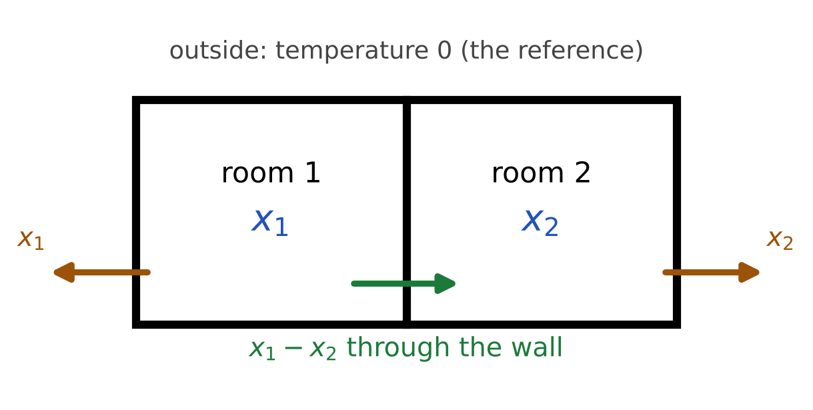

# Linear ODE systems and the matrix exponential {#sec-linear-odes}

[Further]{.level-badge .further}

::: {.callout-note appearance="simple" icon=false}
## In this chapter you will

- write coupled linear differential equations as $\dot{\vect{x}} = \M{A}\vect{x}$
- solve them with eigenvalues and eigenvectors
- use the matrix exponential $e^{\M{A}t}$
- classify equilibria as stable or unstable from the eigenvalues
:::

**Builds on** @sec-eigenvalues, @sec-diagonalisation, and first-order differential equations.

Two rooms lose heat to the outside and to each other; two masses on springs push and pull on each other; a drug passes from the gut into the blood and is then removed. In each case several quantities change at once, and the rate at which each one changes depends on all of them. When the dependence is linear, the whole system is one equation, $\dot{\vect{x}} = \M{A}\vect{x}$, where the dot means the derivative with respect to time. @sec-diagonalisation solved $\vect{x}_{k+1} = \M{A}\vect{x}_k$ for systems that change in steps; this chapter does the same for systems that change continuously, with the same tools. This chapter assumes you have met first-order differential equations such as $\dot{x} = ax$.

## Build intuition

The app draws the **phase portrait** of $\dot{\vect{x}} = \M{A}\vect{x}$: the paths that the state $\vect{x}(t)$ traces out in the plane, from many starting points. Small arrows show the direction of motion at each point, and the chart on the right places the matrix by its trace and determinant.

::: {.app-embed}
<iframe class="app-frame" src="../apps/phase-portrait.html?embed=1" title="Phase portrait explorer" loading="lazy"></iframe>

[Open the phase portrait explorer in its own tab](../apps/phase-portrait.html){.app-open target="_blank"}
:::

Things to try:

- In **Two rooms cooling**, click to start some new paths. They all end at the origin, but how do they approach it? Compare the paths with the dashed eigenvector lines.
- In **Saddle**, start paths close to each eigenvector line. Which line do paths move along towards the origin, and which away?
- Compare **Damped spring**, **Undamped spring** and **Growing spiral**. Their eigenvalues are complex. What does the real part decide?
- Change one entry of $\M{A}$ at a time and watch the dot move on the trace–determinant chart, which this chapter explains later. Where on the chart does the picture change type?

## The ideas

### Systems of differential equations

Suppose quantities $x_1, \dots, x_n$ change with time $t$, and each rate of change is a linear combination of all of them:
$$
\begin{aligned}
\dot{x}_1 &= a_{11}x_1 + \dots + a_{1n}x_n, \\
&\;\;\vdots \\
\dot{x}_n &= a_{n1}x_1 + \dots + a_{nn}x_n.
\end{aligned}
$$
In matrix form this is $\dot{\vect{x}} = \M{A}\vect{x}$, and together with a starting state $\vect{x}(0) = \vect{x}_0$ it has exactly one solution. The origin is an **equilibrium**: if $\vect{x} = \zerovec$, nothing changes.

Higher-order equations fit the same pattern. For a mass on a spring with damping, $\ddot{x} + c\dot{x} + kx = 0$, take the position and the velocity as the two quantities, $x_1 = x$ and $x_2 = \dot{x}$. Then $\dot{x}_1 = x_2$ and $\dot{x}_2 = -kx_1 - cx_2$, so
$$
\frac{d}{dt}\mat{x_1 \\ x_2} = \mat{0 & 1 \\ -k & -c}\mat{x_1 \\ x_2}.
$$
Any linear equation of order $n$ becomes a system of $n$ first-order equations in this way, which is also how numerical ODE solvers expect equations to be written.

### Eigenvector solutions

For one equation, $\dot{x} = ax$ has solution $x = e^{at}x_0$. So try $\vect{x}(t) = e^{\lambda t}\vect{v}$ for a fixed vector $\vect{v}$. Then $\dot{\vect{x}} = \lambda e^{\lambda t}\vect{v}$ and $\M{A}\vect{x} = e^{\lambda t}\M{A}\vect{v}$, and these are equal exactly when $\M{A}\vect{v} = \lambda\vect{v}$. Every eigenvector gives a solution that stays on its line through the origin, growing if $\lambda > 0$ and shrinking if $\lambda < 0$.

The equation is linear, so sums of solutions are solutions. If $\M{A}$ has $n$ independent eigenvectors, write the starting state in terms of them, $\vect{x}_0 = c_1\vect{v}_1 + \dots + c_n\vect{v}_n$ (@sec-basis-change). Then
$$
\vect{x}(t) = c_1e^{\lambda_1 t}\vect{v}_1 + c_2e^{\lambda_2 t}\vect{v}_2 + \dots + c_ne^{\lambda_n t}\vect{v}_n.
$$ {#eq-ode-modes}
Each term is a mode of the system, evolving independently of the others. This is @eq-modes of @sec-diagonalisation with $\lambda^k$ replaced by $e^{\lambda t}$. In the long run, the mode with the largest $\lambda$ dominates.

::: {#ex-linear-odes-1 .callout-note appearance="simple" icon=false}
### Example 1: two rooms cooling

Two rooms, at temperatures $x_1$ and $x_2$ above the outside temperature, each lose heat to the outside and exchange heat with each other through a shared wall (@fig-two-rooms). With suitable units,
$$
\dot{x}_1 = -x_1 - (x_1 - x_2),
\qquad
\dot{x}_2 = -x_2 - (x_2 - x_1).
$$
Starting from $\vect{x}_0 = (3, 1)\T$, find $\vect{x}(t)$.

{#fig-two-rooms fig-alt="Two rooms side by side, room 1 with temperature x1 and room 2 with x2. Brown arrows leave each room through its outer wall, labelled x1 and x2. A green arrow crosses the shared wall from room 1 to room 2, labelled x1 minus x2 through the wall. Above, a note says the outside is at temperature 0, the reference." width=65%}

**Solution.** The matrix is $\M{A} = \mat{-2 & 1 \\ 1 & -2}$, with trace $-4$ and determinant 3, so $\lambda^2 + 4\lambda + 3 = 0$ and $\lambda = -1$ or $-3$. Eigenvectors: $(1, 1)\T$ for $\lambda = -1$ and $(1, -1)\T$ for $\lambda = -3$. Writing $\vect{x}_0 = (3, 1)\T = 2(1, 1)\T + 1(1, -1)\T$,
$$
\vect{x}(t) = 2e^{-t}\mat{1 \\ 1} + e^{-3t}\mat{1 \\ -1}.
$$
The modes have a physical meaning. In the first, both rooms are equally warm, so no heat crosses the wall and both cool at rate 1. In the second, one room is warmer than the other by as much as the other is cooler; heat also flows through the wall, so this difference dies away three times as fast. After a short time the temperatures are almost equal, and both fall together. This is [**Two rooms cooling**](../apps/phase-portrait.html?preset=Two%20rooms%20cooling){target="_blank" aria-label="Two rooms cooling preset in the phase portrait explorer (opens in a new tab)"} in the app: paths first move parallel to $(1, -1)$ onto the line through $(1, 1)$, then slide along it to the origin.
:::

### Complex eigenvalues: oscillation

A real matrix can have complex eigenvalues $\lambda = \alpha \pm \beta i$ (@sec-eigenvalues). @eq-ode-modes still holds, and by Euler's formula
$$
e^{(\alpha + \beta i)t} = e^{\alpha t}(\cos\beta t + i\sin\beta t).
$$
The imaginary parts cancel in the real solution, leaving combinations of $e^{\alpha t}\cos\beta t$ and $e^{\alpha t}\sin\beta t$. The imaginary part $\beta$ sets the angular frequency of oscillation, and the real part $\alpha$ decides whether the oscillation dies away ($\alpha < 0$), grows ($\alpha > 0$) or carries on for ever ($\alpha = 0$).

::: {#ex-linear-odes-2 .callout-note appearance="simple" icon=false}
### Example 2: a damped spring

Solve $\ddot{x} + 2\dot{x} + 5x = 0$ with $x(0) = 1$, $\dot{x}(0) = 0$, and describe the motion.

**Solution.** With $x_1 = x$ and $x_2 = \dot{x}$, the matrix is $\M{A} = \mat{0 & 1 \\ -5 & -2}$, with trace $-2$ and determinant 5. So $\lambda^2 + 2\lambda + 5 = 0$, giving $\lambda = -1 \pm 2i$. The solution is a combination of $e^{-t}\cos 2t$ and $e^{-t}\sin 2t$:
$$
x(t) = e^{-t}(a\cos 2t + b\sin 2t).
$$
From $x(0) = 1$, $a = 1$. Differentiating, $\dot{x}(0) = -a + 2b = 0$, so $b = \tfrac{1}{2}$, and
$$
x(t) = e^{-t}\left(\cos 2t + \tfrac{1}{2}\sin 2t\right).
$$
The mass oscillates with angular frequency 2, and the amplitude decays like $e^{-t}$: a stable spiral in the phase plane, [**Damped spring**](../apps/phase-portrait.html?preset=Damped%20spring){target="_blank" aria-label="Damped spring preset in the phase portrait explorer (opens in a new tab)"} in the app. Without damping ($\ddot{x} + 4x = 0$, **Undamped spring**), the eigenvalues would be $\pm 2i$ and the paths closed ellipses.
:::

### Stability

The equilibrium is **stable** if every solution tends to $\zerovec$, and that depends only on the real parts of the eigenvalues.

::: {.callout-important appearance="simple"}
## Stability of $\dot{\vect{x}} = \M{A}\vect{x}$
Every solution tends to $\zerovec$ if and only if every eigenvalue of $\M{A}$ has negative real part. If any eigenvalue has positive real part, most solutions grow without limit.
:::

Compare the discrete case of @sec-diagonalisation, where the test was $\lvert\lambda\rvert < 1$: there the factor per step is $\lambda$, here it is $e^{\lambda}$ per unit time, and $\lvert e^{\lambda}\rvert < 1$ exactly when the real part of $\lambda$ is negative.

For a $2 \times 2$ matrix, the eigenvalues are the roots of $\lambda^2 - \tau\lambda + \Delta = 0$, where $\tau$ is the trace and $\Delta$ the determinant (@sec-eigenvalues), so these two numbers decide the type of the phase portrait:

| Condition | Eigenvalues | Phase portrait |
|:--|:--|:--|
| $\Delta < 0$ | real, opposite signs | **saddle**: unstable |
| $\Delta > 0$, $\tau^2 > 4\Delta$ | real, same sign | **node**: stable if $\tau < 0$, unstable if $\tau > 0$ |
| $\Delta > 0$, $\tau^2 < 4\Delta$, $\tau \neq 0$ | complex | **spiral**: stable if $\tau < 0$, unstable if $\tau > 0$ |
| $\Delta > 0$, $\tau = 0$ | purely imaginary | **centre**: closed orbits |

This is the chart in the app: the parabola $\tau^2 = 4\Delta$ separates nodes from spirals, and the vertical axis separates stable from unstable.

### The matrix exponential

For one equation the solution is $e^{at}x_0$. For a system, define the **matrix exponential** by the same power series as $e^x$:
$$
e^{\M{A}t} = \M{I} + \M{A}t + \frac{(\M{A}t)^2}{2!} + \frac{(\M{A}t)^3}{3!} + \cdots
$$
The series always converges, and differentiating term by term gives $\frac{d}{dt}e^{\M{A}t} = \M{A}e^{\M{A}t}$ (@sec-proofs-linear-odes). So the solution of $\dot{\vect{x}} = \M{A}\vect{x}$, $\vect{x}(0) = \vect{x}_0$, is
$$
\vect{x}(t) = e^{\M{A}t}\vect{x}_0,
$$
for every square matrix, diagonalisable or not. The matrix $e^{\M{A}t}$ maps the state at time 0 to the state at time $t$.

When $\M{A} = \M{P}\M{D}\M{P}^{-1}$ is diagonalisable, every power is $\M{A}^k = \M{P}\M{D}^k\M{P}^{-1}$ (@sec-diagonalisation), so the whole series factorises:
$$
e^{\M{A}t} = \M{P}e^{\M{D}t}\M{P}^{-1},
\qquad
e^{\M{D}t} = \mat{e^{\lambda_1 t} & & \\ & \ddots & \\ & & e^{\lambda_n t}}.
$$
This is @eq-ode-modes again, written as a single matrix.

::: {.callout-warning appearance="simple"}
## Watch out: exponentials of sums

For numbers, $e^a e^b = e^{a + b}$. For matrices, $e^{\M{A}}e^{\M{B}}$ equals $e^{\M{A} + \M{B}}$ only when $\M{A}\M{B} = \M{B}\M{A}$, because matrix multiplication is not commutative.
:::

::: {#ex-linear-odes-3 .callout-note appearance="simple" icon=false}
### Example 3: a matrix exponential

Find $e^{\M{A}t}$ for the matrix of Example 1, and use it to find $\vect{x}(1)$.

**Solution.** The unit eigenvectors are $\tfrac{1}{\sqrt{2}}(1, 1)\T$ and $\tfrac{1}{\sqrt{2}}(1, -1)\T$, and since $\M{A}$ is symmetric, $\M{P}^{-1} = \M{P}\T$ (@sec-symmetric-matrices). Then
$$
e^{\M{A}t} = \M{P}\mat{e^{-t} & 0 \\ 0 & e^{-3t}}\M{P}\T = \frac{1}{2}\mat{e^{-t} + e^{-3t} & e^{-t} - e^{-3t} \\ e^{-t} - e^{-3t} & e^{-t} + e^{-3t}}.
$$
At $t = 0$ this is $\M{I}$, as it should be. At $t = 1$,
$$
\vect{x}(1) = e^{\M{A}}\mat{3 \\ 1} = \mat{2e^{-1} + e^{-3} \\ 2e^{-1} - e^{-3}} \approx \mat{0.7855 \\ 0.6860},
$$
which agrees with Example 1.
:::

## In code

::: {.code-files}
**Run this chapter's code yourself:** [open the notebook in Colab](https://colab.research.google.com/github/trgoodale/matrix-book/blob/main/code/python/23-linear-odes.ipynb){target="_blank" aria-label="Open the notebook in Colab (opens in a new tab)"}, or download the [Jupyter notebook](../code/python/23-linear-odes.ipynb){download=""} or the [MATLAB script](../code/matlab/ch23_linear_odes.m){download=""}.
:::

SciPy's `expm` and MATLAB's `expm` compute the matrix exponential directly, without needing eigenvectors, and work for any square matrix. For systems that are not linear, or not constant in time, numerical solvers such as `solve_ivp` and `ode45` step the solution forward in time; they are worth trying on linear systems too, where you can check their answers.

::: {.panel-tabset group="language"}
## Python

```{python}
import numpy as np
from scipy.linalg import expm
from scipy.integrate import solve_ivp

A = np.array([[-2, 1], [1, -2]])
x0 = np.array([3, 1])
print(expm(A * 1.0) @ x0)                  # x(1) for Example 1

# Example 2: the damped spring, solved numerically
S = np.array([[0, 1], [-5, -2]])
sol = solve_ivp(lambda t, x: S @ x, [0, 2], [1, 0], rtol=1e-10, atol=1e-12)
print(sol.y[:, -1])                        # position and velocity at t = 2
print(np.exp(-2) * (np.cos(4) + 0.5 * np.sin(4)))   # exact position
print(np.linalg.eigvals(S))                # -1 + 2i and -1 - 2i
```

## MATLAB

```matlab
A = [-2 1; 1 -2];
x0 = [3; 1];
expm(A * 1) * x0           % x(1) for Example 1

% Example 2: the damped spring, solved numerically
S = [0 1; -5 -2];
opts = odeset('RelTol', 1e-10, 'AbsTol', 1e-12);
[t, x] = ode45(@(t, x) S * x, [0 2], [1; 0], opts);
x(end, :)                  % position and velocity at t = 2
exp(-2) * (cos(4) + 0.5 * sin(4))   % exact position
eig(S)                     % -1 + 2i and -1 - 2i
```

```{.text .code-output}
ans =

    0.7855
    0.6860

ans =

   -0.1397    0.2561

ans =

   -0.1397

ans =

  -1.0000 + 2.0000i
  -1.0000 - 2.0000i
```
:::

## Check your understanding

::: {.callout-tip collapse="true"}
## A $2 \times 2$ matrix has eigenvalues $-1$ and $2$. Is the origin stable?

No: it is a saddle. Paths along the eigenvector for $-1$ go in, but almost every other path is eventually carried away along the eigenvector for 2.
:::

::: {.callout-tip collapse="true"}
## What is $e^{\M{A}t}$ when $\M{A} = \M{0}$?

$\M{I}$, for every $t$: nothing changes.
:::

::: {.callout-tip collapse="true"}
## Can the trace alone tell you that a $2 \times 2$ system is unstable?

Yes, if it is positive: the trace is the sum of the eigenvalues (or twice their real part), so at least one eigenvalue has positive real part. A negative trace alone is not enough, since a saddle can have negative trace.
:::

## Key ideas

- Coupled linear differential equations can be written as $\dot{\vect{x}} = \M{A}\vect{x}$.
- Each eigenvector $\vect{v}$ with eigenvalue $\lambda$ gives a solution $e^{\lambda t}\vect{v}$, and the general solution is a combination of these.
- Complex eigenvalues $\alpha \pm \beta i$ give oscillation at frequency $\beta$, growing or decaying like $e^{\alpha t}$.
- The equilibrium at the origin is stable when every eigenvalue has a negative real part.
- The matrix exponential solves every such system at once: $\vect{x}(t) = e^{\M{A}t}\vect{x}(0)$.

## Exercises {#sec-linear-odes-exercises}

Exercises marked † are harder: they take longer, or need an idea that the worked examples don't show.

1. []{#exercise-linear-odes-1}Write $\ddot{x} + 3\dot{x} + 2x = 0$ as a first-order system, find the eigenvalues, and classify the equilibrium.

   [Solution to exercise 1](../appendices/solutions-4.qmd#solution-linear-odes-1){.sol-link}

2. []{#exercise-linear-odes-2}Solve $\dot{\vect{x}} = \mat{1 & 2 \\ 2 & 1}\vect{x}$ with $\vect{x}(0) = (1, 0)\T$. What happens to $\vect{x}(t)$ as $t$ grows?

   [Solution to exercise 2](../appendices/solutions-4.qmd#solution-linear-odes-2){.sol-link}

3. []{#exercise-linear-odes-3}Classify the equilibrium for each matrix, using the trace and determinant.
   $$
   \text{(a) } \mat{0 & 1 \\ -4 & 0}
   \qquad
   \text{(b) } \mat{3 & -2 \\ 4 & -1}
   \qquad
   \text{(c) } \mat{-3 & 1 \\ 1 & -3}
   \qquad
   \text{(d) } \mat{2 & 0 \\ 0 & -1}
   $$

   [Solution to exercise 3](../appendices/solutions-4.qmd#solution-linear-odes-3){.sol-link}

4. []{#exercise-linear-odes-4}(a) Show that $e^{\M{D}t} = \mat{e^{at} & 0 \\ 0 & e^{bt}}$ for $\M{D} = \mat{a & 0 \\ 0 & b}$, using the power series.\
   (b) For $\M{N} = \mat{0 & 1 \\ 0 & 0}$, show that $e^{\M{N}t} = \M{I} + \M{N}t$, and use it to solve $\dot{\vect{x}} = \M{N}\vect{x}$. What physical situation does this describe?

   [Solution to exercise 4](../appendices/solutions-4.qmd#solution-linear-odes-4){.sol-link}

5. []{#exercise-linear-odes-5}A mass on a spring obeys $\ddot{x} + c\dot{x} + 4x = 0$ with damping constant $c \ge 0$. For which values of $c$ does the mass oscillate? What happens at the boundary value?

   [Solution to exercise 5](../appendices/solutions-4.qmd#solution-linear-odes-5){.sol-link}

6. []{#exercise-linear-odes-6}[†]{.harder aria-hidden="true" title="Harder"}[Harder exercise.]{.visually-hidden} Show that if $\M{A}$ is symmetric and negative definite, every solution of $\dot{\vect{x}} = \M{A}\vect{x}$ tends to $\zerovec$, and that $\lVert\vect{x}(t)\rVert$ decreases all the time. (*Hint*: use orthonormal eigenvectors, @sec-symmetric-matrices.)

   [Solution to exercise 6](../appendices/solutions-4.qmd#solution-linear-odes-6){.sol-link}

7. []{#exercise-linear-odes-7}**Code.** A dose of 100 mg of a drug is swallowed. The amount $x_1$ in the gut and $x_2$ in the blood obey
   $$
   \dot{x}_1 = -0.5x_1,
   \qquad
   \dot{x}_2 = 0.5x_1 - 0.2x_2,
   $$
   with time in hours. Use the matrix exponential to compute $\vect{x}(t)$ for $0 \le t \le 20$, plot both amounts, and find when the amount in the blood is greatest and what it is. Check against the exact answer from the eigenvalues.

   [Solution to exercise 7](../appendices/solutions-4.qmd#solution-linear-odes-7){.sol-link}

Solutions are in @sec-solutions-linear-odes.

## In practice

- **Control engineering**: aircraft, robots and power grids are modelled near an operating point by $\dot{\vect{x}} = \M{A}\vect{x} + \M{B}\vect{u}$, where $\vect{u}$ is the control input. Feedback $\vect{u} = -\M{K}\vect{x}$ changes the matrix to $\M{A} - \M{B}\M{K}$, and controller design chooses $\M{K}$ to move its eigenvalues into the left half of the complex plane.
- **Vibration**: undamped structures obey $\ddot{\vect{x}} = -\M{K}\vect{x}$, and each eigenvector of $\M{K}$ is a mode shape vibrating at angular frequency $\sqrt{\lambda}$, as in @sec-eigenvalues exercise 7. Engineers check that these frequencies avoid those of engines, footsteps or wind.
- **Pharmacokinetics**: compartment models like exercise 7, with more compartments, predict drug levels in the body and guide dosing.
- **Electrical circuits**: the currents and voltages in a circuit with resistors, capacitors and inductors obey a linear system, whose eigenvalues give the circuit's time constants and resonant frequencies (@sec-circuits).
- **Nonlinear systems**: near an equilibrium, a nonlinear system $\dot{\vect{x}} = \vect{f}(\vect{x})$ behaves like $\dot{\vect{x}} = \M{J}\vect{x}$, where $\M{J}$ is the Jacobian there (@sec-matrix-calculus). The eigenvalues of the Jacobian decide whether populations, chemical reactions or orbits are stable.

## Going further

- Proofs that $\frac{d}{dt}e^{\M{A}t} = \M{A}e^{\M{A}t}$ and that the solution is unique: @sec-proofs-linear-odes.
- A defective matrix, such as $\mat{\lambda & 1 \\ 0 & \lambda}$, gives solutions containing $te^{\lambda t}$, as exercise 4(b) shows for $\lambda = 0$. The Jordan form organises all such cases, but in practice `expm` handles them without it.
- Forced systems $\dot{\vect{x}} = \M{A}\vect{x} + \vect{f}(t)$ are solved by $\vect{x}(t) = e^{\M{A}t}\vect{x}_0 + \int_0^t e^{\M{A}(t - s)}\vect{f}(s)\,ds$, the vector version of the integrating factor method.
- When eigenvalues differ hugely in size, as in chemical kinetics, the fast modes die almost at once but force ordinary solvers to take tiny steps. Such **stiff** systems need special solvers, such as `solve_ivp(..., method="BDF")` or MATLAB's `ode15s`.
