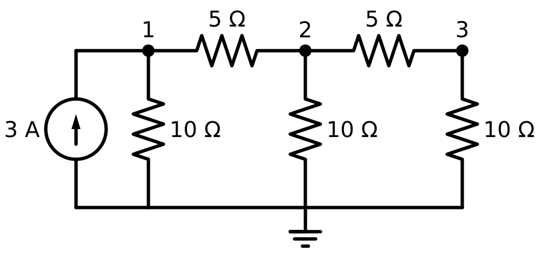
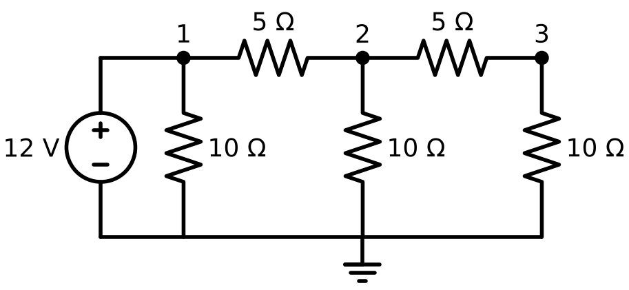
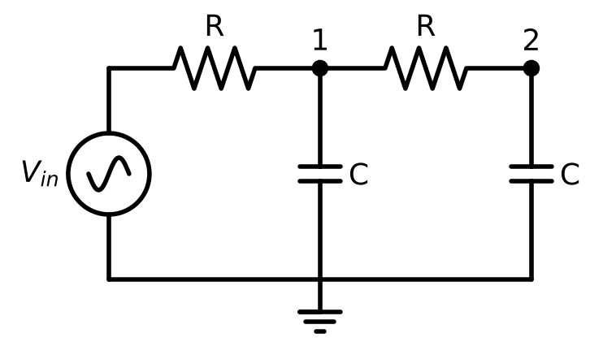

# Electrical circuits {#sec-circuits}

[Core]{.level-badge .core}

::: {.callout-note appearance="simple" icon=false}
## In this chapter you will

- write Kirchhoff's laws for a circuit as a matrix system, by nodal analysis
- solve DC circuits with current and voltage sources
- use complex matrices for AC circuits
- interpret the conductance matrix
:::

**Builds on** @sec-linear-systems, @sec-lu-decomposition, @sec-trusses.

## The problem

Every electronic device, from a phone charger to a power grid, is a network of components joined at **nodes**. Designing one means knowing the voltage at every node and the current in every component, so that nothing overheats and every chip gets the supply it needs. For a circuit of resistors and sources, the laws of physics are linear, so the unknowns satisfy a linear system. Real circuits have thousands or millions of nodes, and simulators such as SPICE set up and solve these systems automatically. This chapter shows how.

## The model

### Kirchhoff's laws and Ohm's law

Three laws govern a DC circuit (one with steady currents):

- **Ohm's law**: the current through a resistor $R$ is $I = (V_a - V_b)/R = G(V_a - V_b)$, where $V_a$ and $V_b$ are the voltages at its ends and $G = 1/R$ is its **conductance**, in siemens (S).
- **Kirchhoff's current law** (KCL): at every node, the total current flowing out equals the total current flowing in. Charge doesn't pile up.
- **Kirchhoff's voltage law** (KVL): around any closed loop, the voltage changes add up to zero. Measuring every voltage relative to one reference node, called **ground** (0 V), satisfies this automatically.

### Nodal analysis

Take the node voltages $V_1, \dots, V_n$ (relative to ground) as the unknowns. At node $i$, KCL says the currents flowing out through the resistors equal the current injected by current sources:
$$
\sum_{\text{resistors from } i \text{ to } j} G(V_i - V_j) = I_i,
$$
with $V_j = 0$ if the resistor goes to ground. Collecting the terms in each $V_j$ gives
$$
\M{G}\vect{v} = \vect{i},
$$
where the **conductance matrix** $\M{G}$ is built by a simple rule:

- the diagonal entry $g_{ii}$ is the sum of the conductances connected to node $i$;
- the off-diagonal entry $g_{ij}$ is minus the conductance connecting nodes $i$ and $j$ (0 if none).

$\M{G}$ is symmetric, and each diagonal entry is at least as large as the sum of the sizes of the others in its row, with strict inequality in any row connected to ground. It is positive definite whenever every node has a path to ground (exercise 2), so nodal equations always have a unique solution, and elimination needs no pivoting (@sec-pivoting).

There is a deeper reason for this structure. Number the resistors, and let $\M{A}$ be the **incidence matrix**: row $k$ has $+1$ in the column of the node where resistor $k$ starts and $-1$ where it ends. Then $\M{A}\vect{v}$ gives the voltage across each resistor, $\M{C}\M{A}\vect{v}$ the currents, where $\M{C}$ is the diagonal matrix of conductances, and KCL says $\M{A}\T(\M{C}\M{A}\vect{v}) = \vect{i}$. So
$$
\M{G} = \M{A}\T\M{C}\M{A},
$$
exactly the pattern $\M{B}\T\M{D}\M{B}$ of the truss stiffness matrix (@sec-trusses), with voltages for displacements and currents for forces.

::: {#ex-circuits-1 .callout-note appearance="simple" icon=false}
### Example 1: nodal analysis

{fig-alt="A circuit with a 3 amp current source feeding node 1. Node 1 connects to ground through 10 ohms and to node 2 through 5 ohms; node 2 connects to ground through 10 ohms and to node 3 through 5 ohms; node 3 connects to ground through 10 ohms." width=70%}

Find the node voltages and the current in each resistor.

**Solution.** The conductances are 0.1 S (10 Ω) and 0.2 S (5 Ω). Node 1 has 0.1 S to ground and 0.2 S to node 2; node 2 has 0.2 S to each neighbour and 0.1 S to ground; node 3 is like node 1. So
$$
\mat{0.3 & -0.2 & 0 \\ -0.2 & 0.5 & -0.2 \\ 0 & -0.2 & 0.3}\mat{V_1 \\ V_2 \\ V_3} = \mat{3 \\ 0 \\ 0}.
$$
Elimination gives $V_3 = \tfrac{40}{7} \approx 5.71$ V, $V_2 = \tfrac{60}{7} \approx 8.57$ V and $V_1 = \tfrac{110}{7} \approx 15.71$ V. The currents follow from Ohm's law: 1.57 A through the first 10 Ω resistor, 1.43 A along to node 2, of which 0.86 A goes to ground and 0.57 A on to node 3 and down through the last resistor. Check at node 1: $1.57 + 1.43 = 3$ A, the source current. ✓
:::

### Voltage sources: modified nodal analysis

A voltage source fixes the difference between two node voltages, but the current through it is unknown. **Modified nodal analysis** (MNA) adds that current as an extra unknown, and the source's equation as an extra row. For a source of $E$ volts from ground to node $k$, with current $I_s$ flowing out of node $k$ into the source,
$$
\mat{\M{G} & \ue{k} \\ \ue{k}\T & 0}\mat{\vect{v} \\ I_s} = \mat{\vect{i} \\ E}.
$$
The matrix is still symmetric, but no longer positive definite (it has a zero on its diagonal), so solvers pivot. MNA is how SPICE handles every kind of component.

::: {#ex-circuits-2 .callout-note appearance="simple" icon=false}
### Example 2: a voltage source

{fig-alt="The same circuit with the current source replaced by a 12 volt voltage source between ground and node 1." width=70%}

Replace the current source with a 12 V source. Find the node voltages and the current the source supplies.

**Solution.** Add the source current $I_s$ (flowing out of node 1 into the source) as a fourth unknown, and the equation $V_1 = 12$ as a fourth row:
$$
\mat{0.3 & -0.2 & 0 & 1 \\ -0.2 & 0.5 & -0.2 & 0 \\ 0 & -0.2 & 0.3 & 0 \\ 1 & 0 & 0 & 0}\mat{V_1 \\ V_2 \\ V_3 \\ I_s} = \mat{0 \\ 0 \\ 0 \\ 12}.
$$
With $V_1 = 12$, the third row gives $V_3 = \tfrac{2}{3}V_2$, and the second then gives $0.5V_2 - 2.4 - \tfrac{0.4}{3}V_2 = 0$, so $V_2 = \tfrac{72}{11} \approx 6.55$ V and $V_3 = \tfrac{48}{11} \approx 4.36$ V. The first row gives $I_s = -0.3 \times 12 + 0.2 \times \tfrac{72}{11} \approx -2.29$ A: the negative sign means 2.29 A flows *out* of the source into node 1. The source delivers $12 \times 2.29 = 27.5$ W.
:::

### AC circuits: complex matrices

For sinusoidal signals at angular frequency $\omega$, capacitors and inductors behave like resistors with complex **impedances**: $Z_C = 1/(j\omega C)$ and $Z_L = j\omega L$, where $j = \sqrt{-1}$ (engineers write $j$, not $i$). Each voltage is represented by a complex number, a **phasor**, whose size is the amplitude and whose angle is the phase. Nodal analysis works unchanged, with complex conductances $Y = 1/Z$ (called **admittances**), giving a complex system $\M{Y}\vect{v} = \vect{i}$. NumPy and MATLAB solve complex systems exactly as they solve real ones.

::: {#ex-circuits-3 .callout-note appearance="simple" icon=false}
### Example 3: an AC filter

{fig-alt="A two-stage RC filter: an AC source feeds node 1 through a resistor R; node 1 has a capacitor C to ground and a second resistor R to node 2; node 2 has a capacitor C to ground." width=55%}

With $R = 1$ kΩ and $C = 1$ µF, find the output voltage $V_2$ as a phasor when the input is $V_{\text{in}} = 1$ V at $\omega = 1000$ rad/s.

**Solution.** Here $\omega RC = 1$, so each capacitor has admittance $j\omega C = j/R$. KCL at nodes 1 and 2, multiplied through by $R$:
$$
\begin{aligned}
(V_1 - V_{\text{in}}) + jV_1 + (V_1 - V_2) &= 0, \\
(V_2 - V_1) + jV_2 &= 0,
\end{aligned}
\qquad\text{so}\qquad
\mat{2 + j & -1 \\ -1 & 1 + j}\mat{V_1 \\ V_2} = \mat{1 \\ 0}.
$$
The second equation gives $V_1 = (1 + j)V_2$. Substituting into the first, $\bigl((2 + j)(1 + j) - 1\bigr)V_2 = 3jV_2 = 1$, so
$$
V_2 = \frac{1}{3j} = -\frac{j}{3},
\qquad
V_1 = (1 + j)\Bigl(-\frac{j}{3}\Bigr) = \frac{1 - j}{3}.
$$
The output has amplitude $\tfrac{1}{3}$ V and lags the input by $90°$, and $V_1$ has amplitude $\sqrt{2}/3 \approx 0.47$ V, lagging by $45°$. At higher frequencies the capacitors short more of the signal to ground: this is a **low-pass filter**.
:::

## Explore

There is no app for this chapter. @fig-filter, produced by solving the complex system of Example 3 at 200 frequencies, shows how the output of the filter depends on frequency.

```{python}
#| fig-alt: "Two plots against frequency on a log scale: the output amplitude of the RC filter falls from 1 towards zero above the cut-off, and the phase drops from 0 towards minus 180 degrees."
#| label: fig-filter
#| fig-cap: "Output amplitude and phase of the two-stage RC filter of Example 3, from solving its 2 × 2 complex nodal system at each frequency. Low frequencies pass through; high frequencies are blocked. The dotted line marks ω = 1000 rad/s, where the output is 1/3 of the input and 90° behind."
#| code-fold: true
#| code-summary: "Show the code for this figure"
import numpy as np
import matplotlib.pyplot as plt

R, C = 1e3, 1e-6
omegas = np.logspace(1, 5, 200)
V2 = []
for w in omegas:
    Y = np.array([[2 / R + 1j * w * C, -1 / R], [-1 / R, 1 / R + 1j * w * C]])
    V2.append(np.linalg.solve(Y, [1 / R, 0])[1])
V2 = np.array(V2)

fig, (ax1, ax2) = plt.subplots(2, 1, figsize=(6, 4.2), sharex=True)
ax1.loglog(omegas, abs(V2), color="#2153b8")
ax1.set_ylabel("|V₂ / V_in|")
ax2.semilogx(omegas, np.degrees(np.angle(V2)), color="#9c5208")
ax2.set_ylabel("phase (degrees)")
ax2.set_xlabel("ω (rad/s)")
for ax in (ax1, ax2):
    ax.axvline(1000, color="0.5", ls=":")
    ax.grid(True, which="both", alpha=0.3)
plt.tight_layout()
plt.show()
```

Things to try, with the code above:

- Change the second capacitor to $10$ µF. How does the curve change, and why?
- Swap each resistor with each capacitor (put the capacitors in series and the resistors to ground). What kind of filter do you get?
- At what frequency is the output $1/\sqrt{2}$ of the input? (Exercise 6.)

## In code

::: {.panel-tabset group="language"}
## Python

```{python}
import numpy as np

# Example 1: nodal analysis
G = np.array([[0.3, -0.2, 0], [-0.2, 0.5, -0.2], [0, -0.2, 0.3]])
v = np.linalg.solve(G, [3, 0, 0])
print(v)

# Example 2: modified nodal analysis with a 12 V source at node 1
M = np.zeros((4, 4))
M[:3, :3] = G
M[0, 3] = M[3, 0] = 1
print(np.linalg.solve(M, [0, 0, 0, 12]))       # V1, V2, V3, Is

# Example 3: a complex system for the AC filter
R, C, w = 1e3, 1e-6, 1000
Y = np.array([[2 / R + 1j * w * C, -1 / R], [-1 / R, 1 / R + 1j * w * C]])
V = np.linalg.solve(Y, [1 / R, 0])
print(V)
print(np.abs(V), np.degrees(np.angle(V)))      # amplitudes and phases
```

## MATLAB

```matlab
% Example 1: nodal analysis
G = [0.3 -0.2 0; -0.2 0.5 -0.2; 0 -0.2 0.3];
v = G \ [3; 0; 0]

% Example 2: modified nodal analysis with a 12 V source at node 1
M = [G, [1; 0; 0]; 1 0 0 0];
x = M \ [0; 0; 0; 12]                 % V1, V2, V3, Is

% Example 3: a complex system for the AC filter
R = 1e3; C = 1e-6; w = 1000;
Y = [2/R + 1i*w*C, -1/R; -1/R, 1/R + 1i*w*C];
V = Y \ [1/R; 0]
[abs(V), rad2deg(angle(V))]           % amplitudes and phases
```

```{.text .code-output}
v =

   15.7143
    8.5714
    5.7143

x =

   12.0000
    6.5455
    4.3636
   -2.2909

V =

   0.3333 - 0.3333i
   0.0000 - 0.3333i

ans =

    0.4714  -45.0000
    0.3333  -90.0000
```
:::

## Check your understanding

::: {.callout-tip collapse="true"}
## Node 1 is joined to ground by 2 S and to node 2 by 1 S; node 2 is joined to ground by 3 S. What is the conductance matrix?

$\M{G} = \mat{3 & -1 \\ -1 & 4}$. Each diagonal entry is the total conductance at that node ($2 + 1$ and $1 + 3$), and the off-diagonal entries are minus the conductance between the nodes.
:::

::: {.callout-tip collapse="true"}
## Why can nodal equations be solved without pivoting, while modified nodal analysis needs it?

A conductance matrix is symmetric positive definite when every node has a path to ground, and elimination on such a matrix never meets a zero or tiny pivot. Adding a voltage source puts a zero on the diagonal, so the MNA matrix is not positive definite, and solvers pivot.
:::

::: {.callout-tip collapse="true"}
## How does a capacitor behave at very low and very high frequencies?

Its impedance $1/(j\omega C)$ is huge when $\omega$ is small, so it acts like a break in the circuit, and tiny when $\omega$ is large, so it acts like a wire. That is why the RC filter of Example 3 passes low frequencies and blocks high ones.
:::

## Key ideas

- Ohm's law and Kirchhoff's current law at each node give a linear system for the node voltages, $\M{G}\vect{v} = \vect{i}$ (nodal analysis).
- The conductance matrix $\M{G}$ is symmetric, and positive definite when every node has a path to ground.
- Voltage sources add extra unknowns and equations (modified nodal analysis), and the matrix is then no longer positive definite.
- AC circuits work the same way with complex impedances, giving complex linear systems.

## Exercises {#sec-circuits-exercises}

Exercises marked † are harder: they take longer, or need an idea that the worked examples don't show.

1. []{#exercise-circuits-1}A 2 A current source feeds node 1. Node 1 is connected to ground by 4 Ω and to node 2 by 2 Ω, and node 2 is connected to ground by 4 Ω. Find the node voltages.

   [Solution to exercise 1](../appendices/solutions-6.qmd#solution-circuits-1){.sol-link}

2. []{#exercise-circuits-2}[†]{.harder aria-hidden="true" title="Harder"}[Harder exercise.]{.visually-hidden} Show that for a circuit of resistors in which every node has a path to ground, the conductance matrix is positive definite. (*Hint*: use $\M{G} = \M{A}\T\M{C}\M{A}$, and the argument of @sec-symmetric-matrices exercise 5.)

   [Solution to exercise 2](../appendices/solutions-6.qmd#solution-circuits-2){.sol-link}

3. []{#exercise-circuits-3}[†]{.harder aria-hidden="true" title="Harder"}[Harder exercise.]{.visually-hidden} In a **Wheatstone bridge**, a 10 V source feeds node $t$. Resistors of 100 Ω and 200 Ω connect $t$ to nodes $a$ and $b$; resistors $R_a$ and 400 Ω connect $a$ and $b$ to ground; and a 50 Ω meter connects $a$ to $b$. Find the current through the meter when (a) $R_a = 200$ Ω, (b) $R_a = 300$ Ω. Explain result (a).

   [Solution to exercise 3](../appendices/solutions-6.qmd#solution-circuits-3){.sol-link}

4. []{#exercise-circuits-4}For the circuit of Example 1, write down the incidence matrix $\M{A}$ (one row per resistor, in the order 10 Ω at node 1, then 5 Ω from 1 to 2, and so on along the ladder) and the diagonal matrix $\M{C}$ of conductances, and check that $\M{A}\T\M{C}\M{A} = \M{G}$.

   [Solution to exercise 4](../appendices/solutions-6.qmd#solution-circuits-4){.sol-link}

5. []{#exercise-circuits-5}A single resistor $R$ and capacitor $C$ form a low-pass filter: the input feeds the output node through $R$, and $C$ connects the output to ground. Show that $V_{\text{out}}/V_{\text{in}} = 1/(1 + j\omega RC)$, and find its size and phase when $\omega RC = 2$.

   [Solution to exercise 5](../appendices/solutions-6.qmd#solution-circuits-5){.sol-link}

6. []{#exercise-circuits-6}**Code.** For the filter of Example 3, find the angular frequency at which $\lvert V_2/V_{\text{in}}\rvert = 1/\sqrt{2}$, by solving the complex system at many frequencies or with a root finder.

   [Solution to exercise 6](../appendices/solutions-6.qmd#solution-circuits-6){.sol-link}

Solutions are in @sec-solutions-circuits.

## Going further

- **SPICE** (Simulation Program with Integrated Circuit Emphasis), developed at Berkeley in the 1970s, and its many descendants build MNA matrices automatically from a list of components. For transistors and diodes, which are nonlinear, they use Newton's method (@sec-newton-systems); for changes over time, they step the differential equations of capacitors and inductors forward, solving a sparse linear system at every step (@sec-cost-sparse).
- **Mesh analysis** uses loop currents as the unknowns instead of node voltages, and KVL instead of KCL. It leads to a symmetric **resistance matrix** of the same $\M{B}\T\M{D}\M{B}$ form.
- **Power grids** are analysed with the same matrices: the **admittance matrix** of a national grid has tens of thousands of rows. Its eigenvalues decide the grid's stability (@sec-linear-odes).
