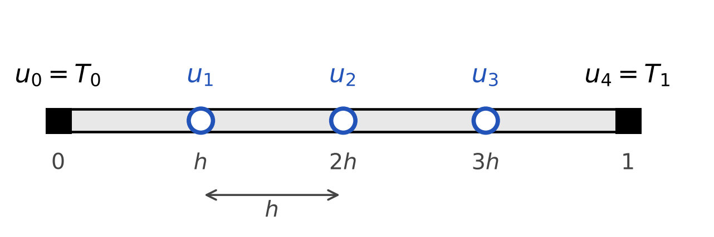
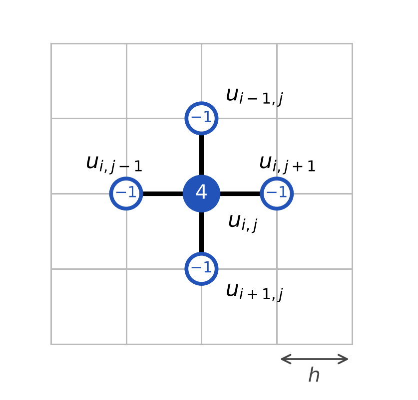
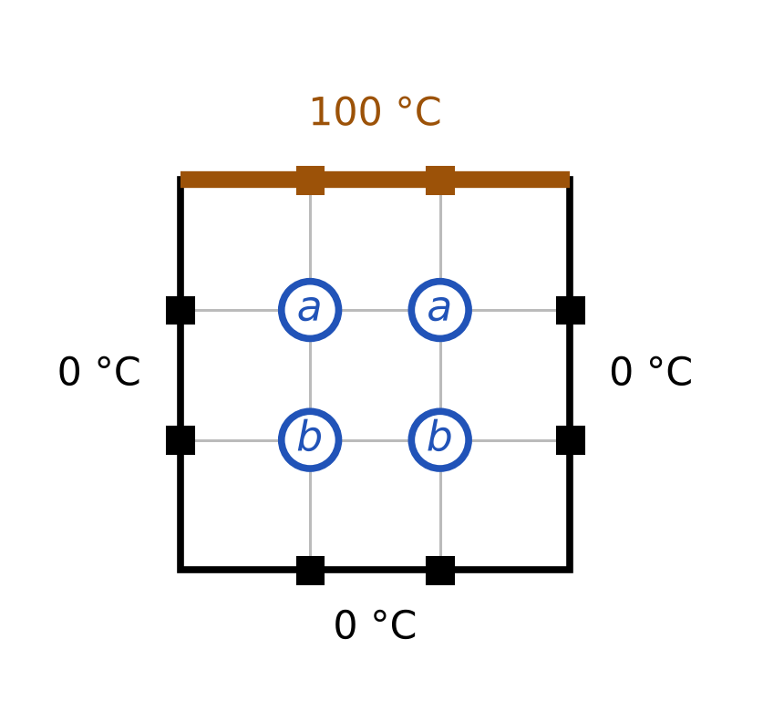

# Heat flow and finite differences {#sec-finite-differences}

[Further]{.level-badge .further}

::: {.callout-note appearance="simple" icon=false}
## In this chapter you will

- replace derivatives by differences, turning a differential equation into a linear system
- solve steady heat flow in a rod (a tridiagonal system) and in a plate (a sparse system)
- check how accuracy improves as the grid gets finer
- compare direct and iterative solvers on a real problem
:::

**Builds on** @sec-cost-sparse, @sec-iterative-methods.

## The problem

How hot does the middle of a heated rod get? What is the temperature inside the wall of a furnace, a computer chip or a cooling fin? In the steady state, temperature satisfies a differential equation, and for all but the simplest shapes it has no formula for its solution. Engineers instead compute the temperature at many points on a grid. Replacing each derivative by a difference of neighbouring values turns the differential equation into a linear system with one unknown per grid point. The same idea, the **finite difference method**, computes electric potentials, groundwater flow, stresses and the pressure in fluids. Its matrices are large and sparse, so this chapter brings together the methods of Part V.

## The model

### Discretising a derivative

Let $u(x)$ be a smooth function, and take grid points a distance $h$ apart. Taylor's theorem gives
$$
u(x \pm h) = u(x) \pm hu'(x) + \tfrac{h^2}{2}u''(x) \pm \tfrac{h^3}{6}u'''(x) + O(h^4).
$$
Adding the two expansions cancels the odd terms, so
$$
u''(x) = \frac{u(x - h) - 2u(x) + u(x + h)}{h^2} + O(h^2).
$$
This **central difference** approximates the second derivative using only the value at a point and its two neighbours. The error is proportional to $h^2$: halving the spacing divides it by four.

### Steady heat flow in a rod

A thin rod of length 1, with its ends held at temperatures $T_0$ and $T_1$, is heated along its length at a rate $q(x)$ per unit length. In the steady state its temperature satisfies
$$
-k\,u''(x) = q(x),
\qquad
u(0) = T_0,
\quad
u(1) = T_1,
$$
where $k$ is the thermal conductivity. Divide the rod into $n + 1$ equal intervals, with $h = 1/(n + 1)$, and let $u_i$ approximate $u(ih)$ (@fig-rod-grid). Replacing $u''$ by the central difference at each interior point,
$$
-u_{i-1} + 2u_i - u_{i+1} = \frac{h^2}{k}q_i,
\qquad i = 1, \dots, n,
$$
with $u_0 = T_0$ and $u_{n+1} = T_1$ known, so they move to the right-hand side. In matrix form,
$$
\mat{2 & -1 & & \\ -1 & 2 & \ddots & \\ & \ddots & \ddots & -1 \\ & & -1 & 2}\mat{u_1 \\ u_2 \\ \vdots \\ u_n} = \frac{h^2}{k}\mat{q_1 \\ q_2 \\ \vdots \\ q_n} + \mat{T_0 \\ 0 \\ \vdots \\ T_1}.
$$
The matrix is tridiagonal, symmetric and positive definite (its eigenvalues are $2 - 2\cos\bigl(m\pi/(n + 1)\bigr) > 0$, as in @sec-eigenvalue-algorithms exercise 7), so the Thomas algorithm solves it in about $8n$ operations without pivoting (@sec-cost-sparse).

{#fig-rod-grid fig-alt="A rod from 0 to 1 with five equally spaced grid points at 0, h, 2h, 3h and 1. The end points are black squares labelled u 0 equals T 0 and u 4 equals T 1. The three interior points are blue circles labelled u 1, u 2 and u 3. The spacing between neighbouring points is h." width=75%}

::: {#ex-finite-differences-1 .callout-note appearance="simple" icon=false}
### Example 1: a heated rod

A rod has its ends at $u(0) = 0$ °C and $u(1) = 100$ °C, and a heat source with $q/k = 200$ °C/m² along its length. Use $n = 3$ interior points.

**Solution.** Here $h = 0.25$, so $h^2q/k = 12.5$, and the system is
$$
\mat{2 & -1 & 0 \\ -1 & 2 & -1 \\ 0 & -1 & 2}\mat{u_1 \\ u_2 \\ u_3} = \mat{12.5 \\ 12.5 \\ 12.5 + 100}.
$$
Solving (by the Thomas algorithm, or elimination) gives $u_1 = 43.75$, $u_2 = 75$ and $u_3 = 93.75$ °C. The exact solution is $u = 200x - 100x^2$, which gives exactly these values at $x = 0.25$, 0.5 and 0.75. That is no coincidence: the exact solution is a quadratic, whose third and higher derivatives are zero, so the central difference has no error at all.
:::

::: {#ex-finite-differences-2 .callout-note appearance="simple" icon=false}
### Example 2: how accuracy improves

Solve $-u'' = \pi^2\sin\pi x$ with $u(0) = u(1) = 0$, whose exact solution is $u = \sin\pi x$, with $n = 3, 7, 15, 31$ and $63$ interior points. How does the largest error depend on $h$?

**Solution.** From the code below:

| $n$ | $h$ | largest error |
|:-:|:-:|:-:|
| 3 | 0.25 | $5.3 \times 10^{-2}$ |
| 7 | 0.125 | $1.3 \times 10^{-2}$ |
| 15 | 0.0625 | $3.2 \times 10^{-3}$ |
| 31 | 0.03125 | $8.0 \times 10^{-4}$ |
| 63 | 0.015625 | $2.0 \times 10^{-4}$ |

Each halving of $h$ divides the error by 4, so the error is proportional to $h^2$: the method is **second-order accurate**, as the Taylor expansion predicted. For an error of $10^{-6}$, $h$ would need to be about 0.001, with 1000 unknowns: no problem in one dimension, but a million in two and a billion in three. That is why accuracy and solver speed both matter.
:::

### Two-dimensional problems

For a square plate with its edges held at fixed temperatures and no heat sources, the temperature satisfies **Laplace's equation**,
$$
\frac{\partial^2 u}{\partial x^2} + \frac{\partial^2 u}{\partial y^2} = 0.
$$
On a square grid of spacing $h$, with $u_{i,j}$ at the point in row $i$ and column $j$, the central difference in each direction gives the **five-point stencil** (@fig-five-point-stencil)
$$
4u_{i,j} - u_{i-1,j} - u_{i+1,j} - u_{i,j-1} - u_{i,j+1} = 0:
$$
in the steady state, **each temperature is the average of its four neighbours**. Neighbours on the edge are known and move to the right-hand side.

{#fig-five-point-stencil fig-alt="A square grid. The centre point, u i j, is a filled blue circle containing 4. Its four neighbours, each a blue circle containing minus 1, are u i minus 1 j above, u i plus 1 j below, u i j minus 1 to the left and u i j plus 1 to the right. The grid spacing is h." width=45%}

Numbering the $n \times n$ interior points row by row gives an $n^2 \times n^2$ matrix. Each row has at most five non-zeros: 4 on the diagonal, and $-1$ for each neighbour, either beside it (one place away) or above or below it ($n$ places away). It can be written compactly with the **Kronecker product**, which `np.kron` and MATLAB's `kron` compute:
$$
\M{A} = \M{I} \otimes \M{T} + \M{T} \otimes \M{I},
$$
where $\M{T}$ is the $n \times n$ tridiagonal matrix of the rod. A grid of $1000 \times 1000$ points gives a million unknowns, but only five million non-zeros, so sparse solvers handle it easily, while a dense solver could not even store it. In three dimensions the stencil has seven points, and fill-in makes direct solvers expensive, so iterative methods such as preconditioned conjugate gradients take over (@sec-iterative-methods).

::: {#ex-finite-differences-3 .callout-note appearance="simple" icon=false}
### Example 3: a plate with a hot edge

A square plate has its top edge at 100 °C and the other three at 0 °C. Find the temperatures on a $2 \times 2$ grid of interior points (@fig-plate-grid), then describe the $3 \times 3$ case.

{#fig-plate-grid fig-alt="A square plate divided into a 3 by 3 grid of cells. The top edge is at 100 degrees and the other three edges are at 0 degrees, with small squares marking the known grid points on each edge. The four interior grid points are blue circles: the top two labelled a and the bottom two labelled b." width=45%}

**Solution.** By symmetry, the two top points share a temperature $a$ and the two bottom points share $b$. Each top point has neighbours 100 (above), 0 (at the side), the other top point and a bottom point: $4a = 100 + 0 + a + b$. Each bottom point: $4b = 0 + 0 + b + a$. So $3a - b = 100$ and $a = 3b$, giving $b = 12.5$ and $a = 37.5$ °C.

For a $3 \times 3$ grid the matrix is $9 \times 9$:

::: {.wide-matrix}
$$
\M{A} = \left(\begin{array}{rrr|rrr|rrr}
4 & -1 & 0 & -1 & 0 & 0 & 0 & 0 & 0 \\
-1 & 4 & -1 & 0 & -1 & 0 & 0 & 0 & 0 \\
0 & -1 & 4 & 0 & 0 & -1 & 0 & 0 & 0 \\ \hline
-1 & 0 & 0 & 4 & -1 & 0 & -1 & 0 & 0 \\
0 & -1 & 0 & -1 & 4 & -1 & 0 & -1 & 0 \\
0 & 0 & -1 & 0 & -1 & 4 & 0 & 0 & -1 \\ \hline
0 & 0 & 0 & -1 & 0 & 0 & 4 & -1 & 0 \\
0 & 0 & 0 & 0 & -1 & 0 & -1 & 4 & -1 \\
0 & 0 & 0 & 0 & 0 & -1 & 0 & -1 & 4
\end{array}\right),
$$

[Open this plate in the heat plate app](../apps/heat-plate.html?edges=100,0,0,0){target="_blank" aria-label="Open this plate in the heat plate app (opens in a new tab)"} to see the same temperatures settle on much finer grids.

:::

**block tridiagonal**: tridiagonal blocks $4\M{I} - (\text{neighbours in the row})$ on the diagonal, and $-\M{I}$ for the rows above and below. The centre temperature turns out to be exactly 25 °C, on any grid with a centre point. Here is why: rotating the plate four times puts the hot edge on each side in turn, and adding the four solutions gives a plate with all edges at 100 °C, which is 100 °C everywhere. The four solutions agree at the centre, so each is 25 °C there.
:::

## Explore

The app solves the plate problem with Jacobi, Gauss–Seidel or SOR, starting from 0 °C everywhere, and shows the error after each sweep.

::: {.app-embed}
<iframe class="app-frame" src="../apps/heat-plate.html?embed=1" title="Heat plate" loading="lazy"></iframe>

[Open the heat plate in its own tab](../apps/heat-plate.html){.app-open target="_blank"}
:::

Things to try:

- With **Jacobi** on the $10 \times 10$ grid, take single sweeps. How does the heat spread in from the hot edge? How many sweeps until the centre warms up at all?
- Compare the number of sweeps needed by the three methods on the $20 \times 20$ grid, then on the $40 \times 40$ grid. How does each count grow when the grid doubles?
- Check the centre temperature in **Hot top** on each grid. Use the superposition argument of Example 3 to predict the centre in **Two hot sides**.
- Hover over the plate in **Hot left, cold right**. Why is the steady state not just a straight-line change from left to right?

## In code

The Kronecker product builds the plate matrix in one line. The example solves a $49 \times 49$ grid, 2401 unknowns, with a sparse direct solver and with conjugate gradients.

::: {.panel-tabset group="language"}
## Python

```{python}
import numpy as np
import scipy.sparse as sp
from scipy.sparse.linalg import spsolve, cg

# Example 2: accuracy in one dimension
for n in [3, 7, 15, 31, 63]:
    h = 1 / (n + 1)
    x = np.arange(1, n + 1) * h
    A = sp.diags([-1.0, 2.0, -1.0], [-1, 0, 1], shape=(n, n), format="csc") / h**2
    u = spsolve(A, np.pi**2 * np.sin(np.pi * x))
    print(f"n = {n:2d}, h = {h:.5f}, error = {np.max(np.abs(u - np.sin(np.pi * x))):.1e}")

# A plate with a hot top edge
n = 49
T = sp.diags([-1.0, 2.0, -1.0], [-1, 0, 1], shape=(n, n))
I = sp.identity(n)
A = (sp.kron(I, T) + sp.kron(T, I)).tocsr()
b = np.zeros((n, n))
b[0, :] = 100                              # neighbours on the hot edge
u = spsolve(A, b.ravel())
print(A.shape, A.nnz, "non-zeros; centre =", u.reshape(n, n)[n // 2, n // 2])

steps = []
x, info = cg(A, b.ravel(), rtol=1e-8, callback=lambda xk: steps.append(1))
print("CG steps:", len(steps))
```

## MATLAB

```matlab
% A plate with a hot top edge
n = 49;
e = ones(n, 1);
T = spdiags([-e 2*e -e], -1:1, n, n);
I = speye(n);
A = kron(I, T) + kron(T, I);
b = zeros(n, n);
b(1, :) = 100;                       % neighbours on the hot edge
u = A \ b(:);
U = reshape(u, n, n);
size(A), nnz(A)
U((n+1)/2, (n+1)/2)                  % centre temperature

[x, flag, relres, iters] = pcg(A, b(:), 1e-8, 500);
iters                                % CG steps
imagesc(U), colorbar, axis equal tight
```

```{.text .code-output}
ans =

        2401        2401

ans =

       11809

ans =

   25.0000

iters =

   135
```
:::

(The grid points are numbered row by row in Python and column by column in MATLAB, but this matrix is the same either way.)

## Check your understanding

::: {.callout-tip collapse="true"}
## You halve the grid spacing $h$. What happens to the error, and to the number of unknowns in one, two and three dimensions?

The error of the central difference is proportional to $h^2$, so it falls by a factor of about 4. The number of unknowns doubles in one dimension, and is multiplied by 4 in two dimensions and by 8 in three.
:::

::: {.callout-tip collapse="true"}
## An interior point of a plate has neighbours at 20, 30, 40 and 50 degrees. What does the five-point stencil say its steady temperature is?

The average of its four neighbours: $(20 + 30 + 40 + 50)/4 = 35$ degrees.
:::

::: {.callout-tip collapse="true"}
## Why not store the matrix for a $1000 \times 1000$ grid as an ordinary dense matrix?

It is $10^6 \times 10^6$, so it would have $10^{12}$ entries, about 8 terabytes at 8 bytes each. Only about $5 \times 10^6$ of them are non-zero, so a sparse format needs a few tens of megabytes.
:::

## Key ideas

- Replacing derivatives by differences on a grid turns a differential equation into a linear system.
- A rod gives a tridiagonal system; a plate gives a large sparse system in which each unknown is the average of its neighbours.
- The central difference has an error proportional to $h^2$, so halving the grid spacing cuts the error by about 4.
- Finer grids mean many more unknowns, especially in two and three dimensions, so sparse direct solvers or iterative methods are essential.

## Exercises {#sec-finite-differences-exercises}

1. []{#exercise-finite-differences-1}Solve the rod problem $-u'' = 0$ with $u(0) = 20$ and $u(1) = 80$, using $n = 3$ interior points. What is the exact solution, and why does the method get it exactly?

   [Solution to exercise 1](../appendices/solutions-6.qmd#solution-finite-differences-1){.sol-link}

2. []{#exercise-finite-differences-2}Use Taylor expansions to show that the **forward difference** $\bigl(u(x + h) - u(x)\bigr)/h$ approximates $u'(x)$ with an error proportional to $h$, while the central difference $\bigl(u(x + h) - u(x - h)\bigr)/(2h)$ has error proportional to $h^2$.

   [Solution to exercise 2](../appendices/solutions-6.qmd#solution-finite-differences-2){.sol-link}

3. []{#exercise-finite-differences-3}A rod with $u(0) = 0$ and $u(1) = 0$ has a heat source $q/k = 1$ only on its left half and none on its right half. Set up the system for $n = 3$ interior points, taking $q_1 = 1$ and $q_2 = q_3 = 0$, and solve it.

   [Solution to exercise 3](../appendices/solutions-6.qmd#solution-finite-differences-3){.sol-link}

4. []{#exercise-finite-differences-4}Find the temperatures on a $2 \times 2$ interior grid for a plate with its top and left edges at 100 °C and the other two at 0 °C. Check your answer with the superposition argument of Example 3.

   [Solution to exercise 4](../appendices/solutions-6.qmd#solution-finite-differences-4){.sol-link}

5. []{#exercise-finite-differences-5}How many unknowns and non-zero matrix entries are there for a $100 \times 100 \times 100$ interior grid in three dimensions, using a seven-point stencil? How much memory would the full matrix need, compared with sparse storage?

   [Solution to exercise 5](../appendices/solutions-6.qmd#solution-finite-differences-5){.sol-link}

6. []{#exercise-finite-differences-6}**Code.** Solve the plate problem with the top at 100 °C and the other edges at 0 °C for $n = 10, 20, 40, 80$, with a sparse direct solver and with CG. Record the time taken and the number of CG steps. How does the number of CG steps grow with $n$? Plot the temperature along the vertical centre line for $n = 80$.

   [Solution to exercise 6](../appendices/solutions-6.qmd#solution-finite-differences-6){.sol-link}

Solutions are in @sec-solutions-finite-differences.

## Going further

- **Time-dependent heat flow**, $\partial u/\partial t = \kappa\,\partial^2u/\partial x^2$, is stepped forward in time. The simple **explicit** method, $\vect{u}_{k+1} = \vect{u}_k - (\kappa\Delta t/h^2)\M{T}\vect{u}_k$, is a matrix power, and it is stable only if every eigenvalue of $\M{I} - (\kappa\Delta t/h^2)\M{T}$ is at most 1 in size (@sec-diagonalisation), which requires $\Delta t \le h^2/(2\kappa)$: tiny time steps on fine grids. **Implicit** methods, which solve a tridiagonal system at each step, have no such limit.
- The **finite element method** handles curved shapes and varying materials better than grids of squares; it leads to sparse symmetric positive definite systems of the same kind (@sec-trusses).
- LeVeque's *Finite Difference Methods for Ordinary and Partial Differential Equations* covers accuracy, stability and convergence in depth.
