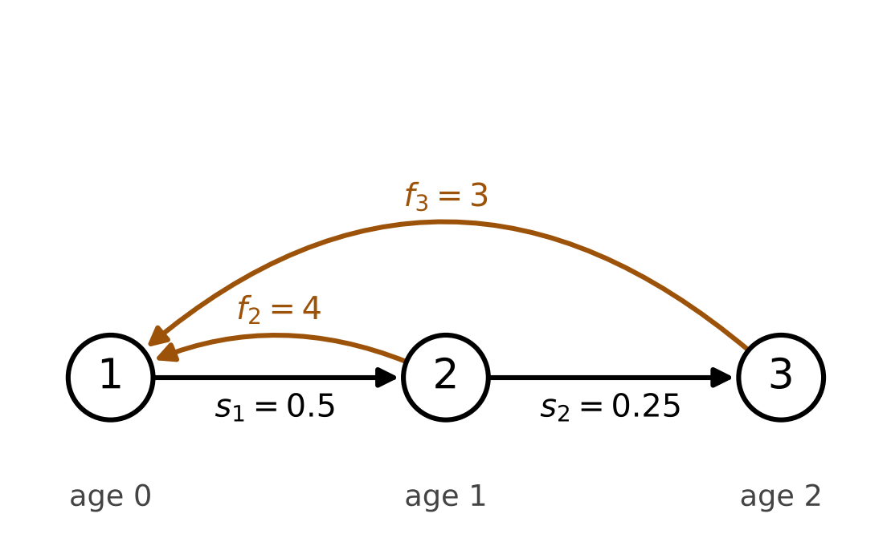

# Population models {#sec-population-models}

[Core]{.level-badge .core}

::: {.callout-note appearance="simple" icon=false}
## In this chapter you will

- build Leslie and stage-based matrices from survival and birth rates
- predict long-term growth or decline from the dominant eigenvalue
- interpret the stable age distribution
- use a real model to compare conservation strategies
:::

**Builds on** @sec-eigenvalues, @sec-diagonalisation.

## The problem

In the early 1980s, loggerhead sea turtles nesting on the beaches of the south-eastern United States were in decline. Conservation effort had focused on the most visible stage of their lives: protecting eggs on nesting beaches and helping hatchlings reach the sea. But were the eggs the right place to intervene? Loggerheads take decades to mature, and many juveniles drowned in shrimp trawling nets.

In 1987, Deborah Crouse, Larry Crowder and Hal Caswell answered the question with a $7 \times 7$ matrix. Their model showed that even if every egg survived, the population would still decline, whereas modest improvements in the survival of large juveniles could reverse the decline. The work helped persuade the US government to require **turtle excluder devices** in shrimp nets, which let turtles escape. This chapter builds the mathematics behind that model.

## The model

### Leslie matrices

Divide a population of females into age classes: newborns (age 0 to 1), one-year-olds, and so on, and count them once a year. Two kinds of number describe the life cycle:

- the **fecundity** $f_i$: the average number of female offspring, surviving to the next count, produced by each female in class $i$;
- the **survival rate** $s_i$: the fraction of class $i$ that survives to join class $i + 1$ a year later.

If $\vect{x}_k$ lists the numbers in each class in year $k$, then next year's newborns are $f_1x_1 + f_2x_2 + \dots + f_nx_n$, and each other class is the survivors of the one before. In matrix form, $\vect{x}_{k+1} = \M{L}\vect{x}_k$, with the **Leslie matrix**
$$
\M{L} = \mat{f_1 & f_2 & \cdots & f_{n-1} & f_n \\ s_1 & 0 & \cdots & 0 & 0 \\ 0 & s_2 & \cdots & 0 & 0 \\ \vdots & & \ddots & & \vdots \\ 0 & 0 & \cdots & s_{n-1} & 0}.
$$

### Stage-based models

For long-lived species, counting every year of age gives an enormous matrix, and individuals of the same age can be very different in size. Biologists instead group them into **stages**, such as eggs, juveniles, subadults and adults, each lasting several years. A stage-based (**Lefkovitch**) matrix has three kinds of entry: fecundities in the first row; $P_i$ on the diagonal, the probability of surviving and *staying* in stage $i$; and $G_i$ below the diagonal, the probability of surviving and *growing* into the next stage. If a stage lasts $D_i$ years and its annual survival is $s_i$, a standard approximation is
$$
P_i = s_i\,\frac{1 - s_i^{D_i - 1}}{1 - s_i^{D_i}},
\qquad
G_i = \frac{s_i^{D_i}(1 - s_i)}{1 - s_i^{D_i}}.
$$

### Growth rate and stable distribution

Either way, $\vect{x}_k = \M{L}^k\vect{x}_0$, and @sec-diagonalisation tells us what happens in the long run. A population matrix has non-negative entries, and if every stage can eventually lead to every other (through births), the Perron–Frobenius theorem says that it has a positive real eigenvalue $\lambda_1$, larger in size than all the others (in the usual cases), with an eigenvector $\vect{w}$ of positive entries. Then, for large $k$,
$$
\vect{x}_k \approx c\,\lambda_1^k\vect{w}.
$$
So:

- $\lambda_1$ is the long-run **growth rate**: the population grows by a factor $\lambda_1$ each year. It increases if $\lambda_1 > 1$, decreases if $\lambda_1 < 1$, and holds steady if $\lambda_1 = 1$. Ecologists usually write $\lambda$ without the subscript.
- $\vect{w}$, scaled so that its entries add up to 1, is the **stable age distribution** (or stable stage distribution): the proportions in each class that the population settles into, whatever it started with.
- The other eigenvalues decide how quickly it settles: the transient effects die away like $\lvert\lambda_2/\lambda_1\rvert^k$.

::: {#ex-population-models-1 .callout-note appearance="simple" icon=false}
### Example 1: a three-class Leslie matrix

An animal lives for at most three years. Half the newborns survive their first year, and a quarter of one-year-olds survive their second. One-year-olds have 4 female young on average and two-year-olds have 3 (@fig-life-cycle). Find the long-run growth rate and the stable age distribution.

{#fig-life-cycle fig-alt="Three circles in a row for classes 1, 2 and 3, ages 0, 1 and 2. Straight arrows go from class 1 to class 2 labelled s 1 equals 0.5, and from class 2 to class 3 labelled s 2 equals 0.25. Curved brown arrows go back to class 1 from class 2, labelled f 2 equals 4, and from class 3, labelled f 3 equals 3." width=60%}

**Solution.**
$$
\M{L} = \mat{0 & 4 & 3 \\ 0.5 & 0 & 0 \\ 0 & 0.25 & 0}.
$$
Expanding $\det(\M{L} - \lambda\M{I})$ along the first column (@sec-determinants),
$$
-\lambda(\lambda^2 - 0) - 0.5\,(4\cdot(-\lambda) - 3 \times 0.25) = -\lambda^3 + 2\lambda + 0.375,
$$
so the eigenvalues solve $\lambda^3 - 2\lambda - 0.375 = 0$. Trying $\lambda = 1.5$: $3.375 - 3 - 0.375 = 0$. ✓ Dividing out $\lambda - 1.5$ leaves $\lambda^2 + 1.5\lambda + 0.25 = 0$, with roots $-1.309$ and $-0.191$, so 1.5 is the dominant eigenvalue: in the long run the population grows by 50% a year. For the eigenvector, the second and third rows of $(\M{L} - 1.5\M{I})\vect{w} = \zerovec$ give $w_2 = w_1/3$ and $w_3 = w_2/6 = w_1/18$, so $\vect{w} \propto (18, 6, 1)$, and scaled to add to 1, $\vect{w} = (0.72, 0.24, 0.04)$: 72% newborns, 24% one-year-olds and 4% two-year-olds.

The second eigenvalue, $-1.309$, is not much smaller in size than 1.5, so the population takes a long time to settle, oscillating as it does (the ratio $1.309/1.5 \approx 0.87$ per year). Starting from 100 newborns, after 10 years the proportions are still $(0.81, 0.14, 0.05)$.
:::

::: {#ex-population-models-2 .callout-note appearance="simple" icon=false}
### Example 2: loggerhead sea turtles

Crouse, Crowder and Caswell divided the loggerhead's life into seven stages: eggs and hatchlings (H), small juveniles ($J_s$), large juveniles ($J_l$), subadults (Sub), novice breeders ($B_1$), first-year remigrants ($B_2$) and mature breeders (M). Their matrix, from field data, is

::: {.wide-matrix .very-wide}
$$
\M{A} = \left(\begin{array}{ccccccc}
0 & 0 & 0 & 0 & 127 & 4 & 80 \\
0.6747 & 0.7370 & 0 & 0 & 0 & 0 & 0 \\
0 & 0.0486 & 0.6610 & 0 & 0 & 0 & 0 \\
0 & 0 & 0.0147 & 0.6907 & 0 & 0 & 0 \\
0 & 0 & 0 & 0.0518 & 0 & 0 & 0 \\
0 & 0 & 0 & 0 & 0.8091 & 0 & 0 \\
0 & 0 & 0 & 0 & 0 & 0.8091 & 0.8089
\end{array}\right).
$$
:::

For example, a small juvenile has a 73.7% chance of surviving and staying a small juvenile next year, and a 4.86% chance of surviving and growing into a large juvenile; a mature breeder produces 80 eggs a year, on average. What does the model predict?

**Solution.** The dominant eigenvalue, from the code below, is $\lambda = 0.945$: the population shrinks by about 5.5% a year, halving in about 12 years. The stable stage distribution is about 21% eggs and hatchlings, 67% small juveniles, 11% large juveniles, and under 1% in each later stage: only about 2 in 1000 turtles is a mature breeder, because so few survive the long juvenile stages.
:::

### Which rates matter most?

A manager can afford to improve only some survival or birth rates. Which change raises $\lambda$ the most? The **sensitivity** of $\lambda$ to the entry $a_{ij}$ of the matrix is
$$
\frac{\partial\lambda}{\partial a_{ij}} = \frac{v_iw_j}{\vect{v} \cdot \vect{w}},
$$
where $\vect{w}$ is the right eigenvector (the stable distribution) and $\vect{v}$ is the **left eigenvector**, $\vect{v}\T\M{L} = \lambda\vect{v}\T$, whose entries are the **reproductive values** of the stages: how much an individual in each stage will contribute to future generations. Because fecundities and survival rates are on very different scales, ecologists compare **elasticities**, $e_{ij} = (a_{ij}/\lambda)\,\partial\lambda/\partial a_{ij}$: the proportional change in $\lambda$ for a 1% change in $a_{ij}$. The elasticities add up to 1.

::: {#ex-population-models-3 .callout-note appearance="simple" icon=false}
### Example 3: eggs or juveniles?

Compare two strategies for the turtles: (a) protecting nests and hatchlings so well that *every* egg survives its first year; (b) using turtle excluder devices to raise the annual survival of large juveniles from 0.676 to 0.776.

**Solution.** (a) Changing the entry $0.6747$ to 1 raises $\lambda$ from 0.945 to only 0.965: even perfect protection of eggs and hatchlings can't stop the decline. (b) Raising the large juveniles' annual survival by 0.1, and recomputing their $P$ and $G$ entries with the formulas above (they last about 8 years), raises $\lambda$ to 1.006: the population grows. The elasticities explain why. Summed over each stage, those for eggs and hatchlings come to about 0.05, while those for the three juvenile and subadult stages come to about 0.6. Large juveniles have a high reproductive value (they are worth about six newly hatched turtles each, for the population's future), and they spend many years exposed to trawling. This kind of analysis, now routine in conservation biology, is a direct application of eigenvectors.
:::

## Explore

There is no app for this chapter. @fig-turtles shows how the growth rate $\lambda$ responds to improving the annual survival of each stage in turn, recomputing its $P$ and $G$ entries.

```{python}
#| fig-alt: "Four straight lines showing the growth rate rising from 0.945 as the survival of one stage is increased by up to 0.2. Large juveniles give the steepest rise, crossing the dashed line at 1 after an increase of about 0.09; small juveniles and subadults cross later; eggs and hatchlings barely raise the rate."
#| label: fig-turtles
#| fig-cap: "Long-run growth rate λ of the loggerhead model as the annual survival of one stage is raised from its current value, the others staying fixed. The population grows only above the dashed line, λ = 1. Raising the first-year survival of eggs and hatchlings barely helps (even 100% survival only gives λ = 0.965); modest improvements for large juveniles are enough."
#| code-fold: true
#| code-summary: "Show the code for this figure"
import numpy as np
import matplotlib.pyplot as plt

A = np.array([[0, 0, 0, 0, 127, 4, 80],
              [0.6747, 0.7370, 0, 0, 0, 0, 0],
              [0, 0.0486, 0.6610, 0, 0, 0, 0],
              [0, 0, 0.0147, 0.6907, 0, 0, 0],
              [0, 0, 0, 0.0518, 0, 0, 0],
              [0, 0, 0, 0, 0.8091, 0, 0],
              [0, 0, 0, 0, 0, 0.8091, 0.8089]])
lam = lambda M: max(np.linalg.eigvals(M).real)

def stage(s, D):
    """Probabilities of staying (P) and growing (G) for annual survival s over D years."""
    return s * (1 - s**(D - 1)) / (1 - s**D), s**D * (1 - s) / (1 - s**D)

increase = np.linspace(0, 0.2, 41)
fig, ax = plt.subplots(figsize=(6, 3.6))
values = []
for dx in increase:
    B = A.copy()
    B[1, 0] = 0.6747 + dx            # first-year survival of eggs and hatchlings
    values.append(lam(B))
ax.plot(increase, values, label="eggs and hatchlings", lw=2)
for col, s0, D, name in [(1, 0.7857, 7, "small juveniles"), (2, 0.6758, 8, "large juveniles"),
                         (3, 0.7425, 6, "subadults")]:
    values = []
    for dx in increase:
        B = A.copy()
        B[col, col], B[col + 1, col] = stage(s0 + dx, D)
        values.append(lam(B))
    ax.plot(increase, values, label=name, lw=2)
ax.axhline(1, color="0.4", ls="--", lw=1)
ax.set_xlabel("increase in annual survival")
ax.set_ylabel("growth rate λ")
ax.legend(fontsize=9)
plt.tight_layout()
plt.show()
```

Things to try, with the code:

- Find how much the annual survival of large juveniles must rise for $\lambda$ to reach exactly 1.
- Halve the fecundities of all breeders. How much does $\lambda$ fall? Compare with halving the survival of mature breeders.
- Start from 1000 eggs and project the population for 50 years. How long does it take to settle into the stable stage distribution?

## In code

::: {.panel-tabset group="language"}
## Python

```{python}
import numpy as np

A = np.array([[0, 0, 0, 0, 127, 4, 80],
              [0.6747, 0.7370, 0, 0, 0, 0, 0],
              [0, 0.0486, 0.6610, 0, 0, 0, 0],
              [0, 0, 0.0147, 0.6907, 0, 0, 0],
              [0, 0, 0, 0.0518, 0, 0, 0],
              [0, 0, 0, 0, 0.8091, 0, 0],
              [0, 0, 0, 0, 0, 0.8091, 0.8089]])

values, vectors = np.linalg.eig(A)
k = np.argmax(values.real)
lam = values[k].real
w = vectors[:, k].real
w = w / w.sum()                      # stable stage distribution
print(f"lambda = {lam:.4f}")
print(np.round(100 * w, 2).tolist())  # percentages

# Left eigenvector (reproductive values), sensitivities and elasticities
lvals, lvecs = np.linalg.eig(A.T)
v = lvecs[:, np.argmax(lvals.real)].real
v = v / v[0]
sens = np.outer(v, w) / (v @ w)
elas = A * sens / lam
print(np.round(elas.sum(axis=0), 3))  # elasticity summed over each stage's column

B = A.copy()
B[1, 0] = 1.0                        # every egg survives its first year
print(f"with perfect egg survival: lambda = {max(np.linalg.eigvals(B).real):.4f}")
```

## MATLAB

```matlab
A = [0 0 0 0 127 4 80;
     0.6747 0.7370 0 0 0 0 0;
     0 0.0486 0.6610 0 0 0 0;
     0 0 0.0147 0.6907 0 0 0;
     0 0 0 0.0518 0 0 0;
     0 0 0 0 0.8091 0 0;
     0 0 0 0 0 0.8091 0.8089];
[V, D] = eig(A);
[lambda, k] = max(real(diag(D)));
lambda
w = real(V(:, k)); w = w / sum(w);   % stable stage distribution
stable_percent = round(1000 * w') / 10

B = A; B(2, 1) = 1;                  % every egg survives its first year
max(real(eig(B)))
```

```{.text .code-output}
lambda =

    0.9450

stable_percent =

   20.7000   67.0000   11.5000    0.7000         0         0    0.2000

ans =

    0.9650
```
:::

## Check your understanding

::: {.callout-tip collapse="true"}
## What goes in the first row and the subdiagonal of a Leslie matrix, and why is everything else zero?

The first row holds the fecundities, the births from each age class, and the subdiagonal the survival rates from each class into the next. Nothing else can happen in a year: no one gets younger, stays the same age or skips a class.
:::

::: {.callout-tip collapse="true"}
## A population matrix has dominant eigenvalue 0.97. What happens to the population in the long run?

It shrinks by about 3% a year, whatever the starting numbers, so it halves roughly every 23 years ($0.97^{23} \approx 0.5$), settling into the stable stage distribution as it does.
:::

::: {.callout-tip collapse="true"}
## Why do ecologists compare elasticities rather than sensitivities?

Fecundities can be large numbers, like 127 eggs, while survival rates are at most 1, so a change of 0.01 means very different things for each. Elasticities measure proportional changes, so they can be compared directly, and they add up to 1.
:::

## Key ideas

- A Leslie matrix has birth rates in its first row and survival rates on its subdiagonal; stage-based models also let individuals stay in a class.
- The dominant eigenvalue $\lambda$ is the long-run growth factor per time step: the population grows if $\lambda > 1$ and declines if $\lambda < 1$.
- Its eigenvector is the stable age (or stage) distribution that every population settles into.
- Sensitivities and elasticities show which rates matter most, which guides conservation.

## Exercises {#sec-population-models-exercises}

1. []{#exercise-population-models-1}A species has two age classes. First-year females have 1 daughter on average and second-years have 1.5, and half of the first-years survive to their second year. Find the Leslie matrix, the long-run growth rate and the stable age distribution.

   [Solution to exercise 1](../appendices/solutions-6.qmd#solution-population-models-1){.sol-link}

2. []{#exercise-population-models-2}For the two-class Leslie matrix $\mat{f_1 & f_2 \\ s & 0}$, show that the population grows in the long run ($\lambda > 1$) exactly when $f_1 + sf_2 > 1$. Interpret $f_1 + sf_2$. (*Hint*: the characteristic equation is $p(\lambda) = \lambda^2 - f_1\lambda - sf_2 = 0$. Since $p(0) < 0$, there is exactly one positive root, and it is greater than 1 exactly when $p(1) < 0$.)

   [Solution to exercise 2](../appendices/solutions-6.qmd#solution-population-models-2){.sol-link}

3. []{#exercise-population-models-3}A fishery removes a fraction $h$ of every age class each year, after breeding. Explain why the new matrix is $(1 - h)\M{L}$, and find the harvest rate $h$ that holds the population of Example 1 steady.

   [Solution to exercise 3](../appendices/solutions-6.qmd#solution-population-models-3){.sol-link}

4. []{#exercise-population-models-4}Check the $P$ and $G$ formulas for large juveniles in Example 2, which have annual survival $s = 0.6758$ and last $D = 8$ years. Explain why $P + G = s$.

   [Solution to exercise 4](../appendices/solutions-6.qmd#solution-population-models-4){.sol-link}

5. []{#exercise-population-models-5}Use Example 1 to explain why a population with a second eigenvalue close in size to the first can take many years to settle into its stable age distribution, and why it oscillates as it does so.

   [Solution to exercise 5](../appendices/solutions-6.qmd#solution-population-models-5){.sol-link}

6. []{#exercise-population-models-6}**Code.** For the loggerhead model, project the population for 100 years from 1000 eggs and hatchlings and nothing else. Plot the total population on a logarithmic scale. After the first few decades, what is its slope, and how does it relate to $\lambda$? How many years does it take for the proportion in each stage to come within 1% of the stable distribution?

   [Solution to exercise 6](../appendices/solutions-6.qmd#solution-population-models-6){.sol-link}

Solutions are in @sec-solutions-population-models.

## Going further

- Crouse, Crowder and Caswell's paper, "A stage-based population model for loggerhead sea turtles and implications for conservation" (*Ecology*, 1987), is short and readable. Caswell's *Matrix Population Models* is the standard text on the whole subject.
- Real populations fluctuate. Models with random variation in the matrix from year to year, or with matrices that depend on population density, capture this; their long-run behaviour is no longer a single eigenvalue, but eigenvalues remain the starting point.
- The same mathematics describes the ageing of a workforce, the turnover of equipment, and the spread of an infection through age groups, where the dominant eigenvalue of the **next-generation matrix** is the famous reproduction number $R_0$.
