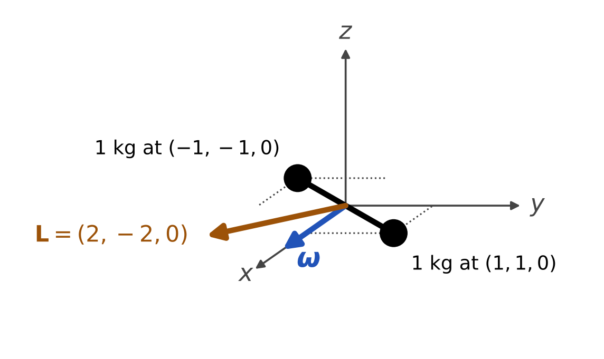

# Physics: rotations, inertia and quantum states {#sec-physics}

[Further]{.level-badge .further}

::: {.callout-note appearance="simple" icon=false}
## In this chapter you will

- compute the inertia tensor of a rigid body, and find its principal axes as eigenvectors
- describe rotating frames and angular velocity with matrices
- represent a two-state quantum system with vectors and matrices, and predict the results of measurements
:::

**Builds on** @sec-transformations-3d, @sec-symmetric-matrices, @sec-linear-odes.

## The problem

Physics is full of quantities that are not numbers or vectors but linear maps from vectors to vectors. Spin a rigid body about some axis, and its angular momentum generally points in a *different* direction: the map from angular velocity to angular momentum is a matrix, the inertia tensor. That is why an unbalanced car wheel wobbles, and why a thrown book spins steadily about two of its axes but tumbles about the third. In quantum mechanics, matrices go further still: the state of a system is a vector, every measurable quantity is a symmetric (or more precisely Hermitian) matrix, and the possible results of a measurement are its eigenvalues. This chapter shows three places where the linear algebra of this book is the physics.

## The model

### The inertia tensor

A rigid body made of point masses $m_k$ at positions $\vect{r}_k$ (relative to its centre of mass) rotates with angular velocity $\vect{\omega}$: the axis of rotation is the direction of $\vect{\omega}$ and the rate is its length. Each mass moves with velocity $\vect{\omega} \times \vect{r}_k$, and the total angular momentum works out to be
$$
\vect{L} = \M{I}\vect{\omega},
\qquad
\M{I} = \sum_k m_k\left(\lVert\vect{r}_k\rVert^2\M{I}_3 - \vect{r}_k\vect{r}_k\T\right),
$$
where $\M{I}_3$ is the $3 \times 3$ identity. The **inertia tensor** $\M{I}$ is symmetric and positive semidefinite. Its diagonal entries are the familiar **moments of inertia** about the axes, such as $I_{xx} = \sum m(y^2 + z^2)$; its off-diagonal entries, the **products of inertia** such as $I_{xy} = -\sum mxy$, measure how unbalanced the body is.

Because $\M{I}$ is symmetric, the spectral theorem (@sec-symmetric-matrices) says that it has three perpendicular eigenvectors: the **principal axes**. About a principal axis, $\vect{L} = \lambda\vect{\omega}$ is parallel to $\vect{\omega}$, and the body spins smoothly; the eigenvalues are the **principal moments of inertia**. About any other axis, $\vect{L}$ and $\vect{\omega}$ point different ways, and keeping the body spinning about that axis needs a constantly changing torque, felt as vibration. Balancing a car wheel means adding small weights to make its axle a principal axis.

::: {.callout-note appearance="simple" icon=false}
### Example 1: a dumbbell

Two masses of 1 kg are at $(1, 1, 0)$ and $(-1, -1, 0)$ (in metres), joined by a light rod. Find the inertia tensor and its principal axes. If the dumbbell spins about the $x$ axis with $\vect{\omega} = (1, 0, 0)$ rad/s, what is its angular momentum?

**Solution.** For $\vect{r} = (1, 1, 0)$, $\lVert\vect{r}\rVert^2 = 2$ and
$$
2\M{I}_3 - \vect{r}\vect{r}\T = \mat{1 & -1 & 0 \\ -1 & 1 & 0 \\ 0 & 0 & 2}.
$$
The other mass gives the same, so $\M{I} = \mat{2 & -2 & 0 \\ -2 & 2 & 0 \\ 0 & 0 & 4}$ kg m². Its eigenvalues are 0, with eigenvector $(1, 1, 0)$, along the rod: the point masses don't resist spinning about their own axis. The other two are both 4, with eigenvectors $(1, -1, 0)$ and $(0, 0, 1)$: any axis perpendicular to the rod.

Spinning about the $x$ axis, $\vect{L} = \M{I}\vect{\omega} = (2, -2, 0)$: not along the $x$ axis at all, but perpendicular to the rod. As the dumbbell turns, $\vect{L}$ turns with it, so a torque is needed to keep it spinning about $x$: the bearings would feel a wobble (@fig-dumbbell).

{#fig-dumbbell fig-alt="3D axes x, y and z. Two black masses at (1, 1, 0) and (minus 1, minus 1, 0), joined by a rod through the origin in the xy plane. A blue arrow omega points along the x axis. A brown arrow L equals (2, minus 2, 0) points in a different direction, at right angles to the rod." width=60%}
:::

### Rotating frames and angular velocity

A body's orientation can be described by the rotation matrix $\M{R}(t)$ that turns its own axes into the fixed ones (@sec-transformations-3d). A point fixed in the body, at $\vect{r}(t) = \M{R}(t)\vect{r}_0$, has velocity
$$
\dot{\vect{r}} = \dot{\M{R}}\vect{r}_0 = \dot{\M{R}}\M{R}\T\vect{r},
$$
using $\M{R}\T\M{R} = \M{I}$. Differentiating $\M{R}\M{R}\T = \M{I}$ shows that $\M{\Omega} = \dot{\M{R}}\M{R}\T$ satisfies $\M{\Omega}\T = -\M{\Omega}$: it is **skew-symmetric**, so it has the form
$$
\M{\Omega} = \mat{0 & -\omega_z & \omega_y \\ \omega_z & 0 & -\omega_x \\ -\omega_y & \omega_x & 0},
\qquad
\M{\Omega}\vect{r} = \vect{\omega} \times \vect{r}.
$$
So the angular velocity vector is hidden in the three independent entries of a skew-symmetric matrix, and $\dot{\M{R}} = \M{\Omega}\M{R}$. For a constant $\vect{\omega}$, this is a linear differential equation with solution $\M{R}(t) = e^{\M{\Omega}t}\M{R}(0)$ (@sec-linear-odes): **the exponential of a skew-symmetric matrix is a rotation**. Gyroscopes in phones and aircraft measure $\vect{\omega}$, and navigation software integrates this equation to track orientation.

::: {.callout-note appearance="simple" icon=false}
### Example 2: angular velocity from a rotation

A body rotates about the $z$ axis at a constant rate $\omega$: $\M{R}(t)$ is the rotation by $\omega t$ about $z$. Find $\M{\Omega} = \dot{\M{R}}\M{R}\T$.

**Solution.** With $c = \cos\omega t$ and $s = \sin\omega t$,
$$
\M{R} = \mat{c & -s & 0 \\ s & c & 0 \\ 0 & 0 & 1},
\qquad
\dot{\M{R}} = \omega\mat{-s & -c & 0 \\ c & -s & 0 \\ 0 & 0 & 0},
\qquad
\dot{\M{R}}\M{R}\T = \omega\mat{0 & -1 & 0 \\ 1 & 0 & 0 \\ 0 & 0 & 0},
$$
using $c^2 + s^2 = 1$. Matching the pattern above, $\vect{\omega} = (0, 0, \omega)$: along the axis of rotation, with length equal to the rate, as it should be. Then, for example, the point $(1, 0, 0)$ has velocity $\M{\Omega}(1, 0, 0)\T = (0, \omega, 0)$.
:::

### Two-state quantum systems

The simplest quantum systems have just two basic states: the spin of an electron (up or down along a chosen axis), the polarisation of a photon, or the two levels of a qubit in a quantum computer. The rules of quantum mechanics, for such a system, are:

- **States** are vectors $\vect{\psi} = (\alpha, \beta)\T$ of complex numbers, with $\lvert\alpha\rvert^2 + \lvert\beta\rvert^2 = 1$. The basis states $(1, 0)\T$ and $(0, 1)\T$ are written $\lvert\uparrow\rangle$ and $\lvert\downarrow\rangle$.
- **Measurable quantities** are **Hermitian** matrices, equal to their own conjugate transpose: the complex version of symmetric. Like symmetric matrices, they have real eigenvalues and orthonormal eigenvectors (@sec-proofs-symmetric-matrices).
- **Measurement**: measuring the quantity $\M{A}$ always gives one of its eigenvalues. The probability of getting the eigenvalue with unit eigenvector $\vect{e}$ is $\lvert\vect{e}^*\vect{\psi}\rvert^2$, the squared size of the component of $\vect{\psi}$ along $\vect{e}$ (where $^*$ is the conjugate transpose). After the measurement, the state *is* that eigenvector.
- **Time evolution**: between measurements, $\vect{\psi}(t) = e^{-i\M{H}t/\hbar}\vect{\psi}(0)$, where the Hermitian **Hamiltonian** $\M{H}$ is the energy, and $\hbar$ is the reduced Planck constant. This is the solution of the linear system $i\hbar\,\dot{\vect{\psi}} = \M{H}\vect{\psi}$, the **Schrödinger equation** (@sec-linear-odes).

For spin, the measurements of spin along the three axes are (in units of $\hbar/2$) the **Pauli matrices**
$$
\M{\sigma}_x = \mat{0 & 1 \\ 1 & 0},
\qquad
\M{\sigma}_y = \mat{0 & -i \\ i & 0},
\qquad
\M{\sigma}_z = \mat{1 & 0 \\ 0 & -1},
$$
each with eigenvalues $+1$ and $-1$: a measurement of spin along any axis gives only "up" or "down", never anything in between. The three matrices don't commute, and so they have no common eigenvectors: a state can't have a definite spin along $x$ and along $z$ at once. That is the uncertainty principle, in its simplest form, and it is a statement about matrices.

::: {.callout-note appearance="simple" icon=false}
### Example 3: measuring a spin

An electron is prepared spin up along $z$, $\vect{\psi} = (1, 0)\T$. Its spin is then measured along $x$. What results are possible, with what probabilities? What if instead it evolves for a time under $\M{H} = \tfrac{1}{2}\hbar\omega\M{\sigma}_x$ (a magnetic field along $x$) before its spin along $z$ is measured?

**Solution.** The eigenvalues of $\M{\sigma}_x$ are $+1$ and $-1$, with eigenvectors $\vect{e}_\pm = \tfrac{1}{\sqrt{2}}(1, \pm 1)\T$. The probabilities are $\lvert\vect{e}_\pm\T\vect{\psi}\rvert^2 = \bigl(\tfrac{1}{\sqrt{2}}\bigr)^2 = \tfrac{1}{2}$ each: knowing the spin along $z$ exactly means knowing nothing at all about it along $x$.

For the time evolution, $\M{\sigma}_x^2 = \M{I}$, so the power series for the matrix exponential (@sec-linear-odes) splits into even and odd terms:
$$
e^{-i\omega t\M{\sigma}_x/2} = \cos\frac{\omega t}{2}\,\M{I} - i\sin\frac{\omega t}{2}\,\M{\sigma}_x,
\qquad
\vect{\psi}(t) = \mat{\cos(\omega t/2) \\ -i\sin(\omega t/2)}.
$$
Measuring spin along $z$ gives up with probability $\cos^2(\omega t/2)$ and down with probability $\sin^2(\omega t/2)$. The spin flips back and forth: **Rabi oscillation**, the basis of magnetic resonance imaging (MRI) and of single-qubit operations in quantum computers. After $\omega t = \pi$ it is certainly down: a quantum NOT gate.
:::

## Explore

There is no app for this chapter. @fig-rabi shows the probabilities of Example 3, computed with the matrix exponential, alongside the probabilities for a state that starts tilted from the $z$ axis.

```{python}
#| fig-alt: "Two wave-shaped curves of probability against time, each swinging between 0 and 1 twice over the plotted range. The dashed curve is shifted along the time axis relative to the solid one."
#| label: fig-rabi
#| fig-cap: "Rabi oscillation: the probability of finding the spin up along z, for a spin evolving under H = ½ħω σₓ, starting spin up (solid) and starting tilted 60° from the z axis towards y (dashed). Each curve comes from applying the 2 × 2 matrix exponential to the starting state."
#| code-fold: true
#| code-summary: "Show the code for this figure"
import numpy as np
import matplotlib.pyplot as plt
from scipy.linalg import expm

sx = np.array([[0, 1], [1, 0]])
t = np.linspace(0, 4 * np.pi, 300)                      # in units of 1/ω
starts = {"spin up": np.array([1, 0]),
          "tilted 60° towards y": np.array([np.cos(np.pi / 6), 1j * np.sin(np.pi / 6)])}

fig, ax = plt.subplots(figsize=(6, 3.2))
for (label, psi0), style in zip(starts.items(), ["-", "--"]):
    p = [abs((expm(-1j * sx * tk / 2) @ psi0)[0])**2 for tk in t]
    ax.plot(t, p, style, lw=2, label=label)
ax.set_xlabel("ωt")
ax.set_ylabel("P(spin up along z)")
ax.set_xticks(np.arange(0, 4 * np.pi + 0.1, np.pi), ["0", "π", "2π", "3π", "4π"])
ax.legend(fontsize=9)
plt.tight_layout()
plt.show()
```

Things to try, with the code:

- Replace $\M{\sigma}_x$ by $\M{\sigma}_z$ in the Hamiltonian. Why doesn't the probability change at all now?
- Use $\M{H} = \tfrac{1}{2}\hbar\omega(\M{\sigma}_x + \M{\sigma}_z)/\sqrt{2}$, a field at $45°$. What is the largest probability of finding the spin down?
- Starting spin up, measure along a direction at angle $\theta$ to $z$, with $\M{A} = \cos\theta\,\M{\sigma}_z + \sin\theta\,\M{\sigma}_x$. Check that the probability of "up" is $\cos^2(\theta/2)$.

## In code

The code finds the principal axes of four point masses in an L shape, and applies a quantum time evolution.

::: {.panel-tabset group="language"}
## Python

```{python}
import numpy as np
from scipy.linalg import expm

# Inertia tensor of four 1 kg masses in an L shape, about their centre of mass
r = np.array([[0, 0, 0], [1, 0, 0], [2, 0, 0], [0, 1, 0]], dtype=float)
m = np.ones(4)
r = r - m @ r / m.sum()                    # positions relative to the centre of mass
I = sum(mk * ((rk @ rk) * np.eye(3) - np.outer(rk, rk)) for mk, rk in zip(m, r))
print(I)
moments, axes = np.linalg.eigh(I)          # I is symmetric
print(moments)
print(axes)                                # principal axes as columns

# Spin up, evolving under sigma_x for omega t = pi/2
sx = np.array([[0, 1], [1, 0]])
psi = expm(-1j * sx * np.pi / 4) @ np.array([1, 0])
print(np.abs(psi)**2)                      # probabilities of up and down along z
```

## MATLAB

```matlab
% Inertia tensor of four 1 kg masses in an L shape, about their centre of mass
r = [0 0 0; 1 0 0; 2 0 0; 0 1 0];
m = [1 1 1 1];
c = m * r / sum(m);                       % centre of mass
I = zeros(3);
for k = 1:numel(m)
    p = r(k, :) - c;
    I = I + m(k) * ((p * p') * eye(3) - p' * p);
end
I
[V, D] = eig(I)                           % principal axes and moments

% Spin up, evolving under sigma_x for omega t = pi/2
sx = [0 1; 1 0];
psi = expm(-1i * sx * pi/4) * [1; 0];
abs(psi).^2                               % probabilities of up and down along z
```

```{.text .code-output}
I =

    0.7500    0.7500         0
    0.7500    2.7500         0
         0         0    3.5000

V =

   -0.9487    0.3162         0
    0.3162    0.9487         0
         0         0    1.0000

D =

    0.5000         0         0
         0    3.0000         0
         0         0    3.5000

ans =

    0.5000
    0.5000
```
:::

The smallest principal moment, 0.5 kg m², belongs to the axis through the centre of mass along $(3, -1, 0)$, close to the long arm of the L; the largest, 3.5 kg m², to the $z$ axis, perpendicular to the plane of the masses. For any flat body, the moment about the perpendicular axis is the sum of the other two, here $0.5 + 3 = 3.5$: the **perpendicular axis theorem**.

## Check your understanding

::: {.callout-tip collapse="true"}
## A wheel spins about an axis that is not one of its principal axes. What do you notice?

Its angular momentum $\M{I}\vect{\omega}$ isn't parallel to $\vect{\omega}$, so keeping it spinning about that axis needs a constantly changing torque from the axle, felt as vibration. Balancing weights fix this by making the axle a principal axis.
:::

::: {.callout-tip collapse="true"}
## Why is $\M{\Omega} = \dot{\M{R}}\M{R}\T$ always skew-symmetric?

Differentiating $\M{R}\M{R}\T = \M{I}$ gives $\dot{\M{R}}\M{R}\T + \M{R}\dot{\M{R}}\T = \M{0}$, which says $\M{\Omega} + \M{\Omega}\T = \M{0}$.
:::

::: {.callout-tip collapse="true"}
## An electron is in the state $(0.6, 0.8)\T$. Its spin along $z$ is measured. What are the possible results and their probabilities?

The eigenvalues of $\M{\sigma}_z$, $+1$ (up) and $-1$ (down), with eigenvectors $(1, 0)\T$ and $(0, 1)\T$. The probabilities are $0.6^2 = 0.36$ and $0.8^2 = 0.64$, which add up to 1.
:::

## Key ideas

- The inertia tensor is a symmetric matrix; its eigenvectors are the principal axes, about which a body can spin without wobbling.
- The rate of change of a rotation matrix gives the skew-symmetric angular velocity matrix $\M{\Omega} = \dot{\M{R}}\M{R}\T$.
- A two-state quantum system is a complex unit vector; measurable quantities are Hermitian matrices, such as the Pauli matrices.
- The possible results of a measurement are the eigenvalues, with probabilities given by the squared sizes of the components along the eigenvectors.

## Exercises {#sec-physics-exercises}

1. []{#exercise-physics-1}Find the inertia tensor of four 1 kg masses at $(\pm 1, \pm 2, 0)$, all four sign combinations. Why are its products of inertia zero?

   [Solution to exercise 1](../appendices/solutions-6.qmd#solution-physics-1){.sol-link}

2. []{#exercise-physics-2}Show that for any rigid body the angle between $\vect{\omega}$ and $\vect{L} = \M{I}\vect{\omega}$ is never more than $90°$. For the dumbbell of Example 1, can it ever be exactly $90°$? (*Hint*: consider $\vect{\omega}\T\M{I}\vect{\omega}$.)

   [Solution to exercise 2](../appendices/solutions-6.qmd#solution-physics-2){.sol-link}

3. []{#exercise-physics-3}Show that $\vect{\omega} \times \vect{r} = \M{\Omega}\vect{r}$ for the skew-symmetric matrix $\M{\Omega}$ given in the text, and that $\M{\Omega}\vect{\omega} = \zerovec$. What is the geometric meaning of the second fact?

   [Solution to exercise 3](../appendices/solutions-6.qmd#solution-physics-3){.sol-link}

4. []{#exercise-physics-4}Show that if $\M{\Omega}$ is skew-symmetric, then $e^{\M{\Omega}}$ is orthogonal. (*Hint*: $(e^{\M{\Omega}})\T = e^{\M{\Omega}\T}$, and $\M{\Omega}$ commutes with $-\M{\Omega}$.)

   [Solution to exercise 4](../appendices/solutions-6.qmd#solution-physics-4){.sol-link}

5. []{#exercise-physics-5}Find the eigenvalues and unit eigenvectors of $\M{\sigma}_y$. A spin in the state $(1, 0)\T$ has its spin measured along $y$: what are the possible results and their probabilities?

   [Solution to exercise 5](../appendices/solutions-6.qmd#solution-physics-5){.sol-link}

6. []{#exercise-physics-6}**Code.** A quantum computer applies the **Hadamard gate** $\M{H} = \tfrac{1}{\sqrt{2}}\mat{1 & 1 \\ 1 & -1}$ to a qubit. Check that $\M{H}$ is symmetric and orthogonal, and that $\M{H}^2 = \M{I}$. Starting from $(1, 0)\T$, apply $\M{H}$, then a phase gate $\mat{1 & 0 \\ 0 & e^{i\phi}}$, then $\M{H}$ again, and plot the probability of measuring $(1, 0)\T$ as $\phi$ runs from 0 to $2\pi$. (This is the core of a quantum interferometer.)

   [Solution to exercise 6](../appendices/solutions-6.qmd#solution-physics-6){.sol-link}

Solutions are in @sec-solutions-physics.

## Going further

- Why does a book spin stably about its longest and shortest axes but tumble about the middle one? The answer, the **tennis racket theorem**, comes from linearising Euler's equations of rigid-body motion about each principal axis and examining the eigenvalues (@sec-linear-odes). Taylor's *Classical Mechanics* covers rigid bodies thoroughly.
- **Special relativity** uses a $4 \times 4$ matrix, the **Lorentz transformation**, which mixes time and space while preserving $c^2t^2 - x^2 - y^2 - z^2$ instead of length. It is a "rotation" in spacetime, with hyperbolic functions in place of sines and cosines.
- In quantum mechanics with more than two states, everything above holds with larger matrices, and for continuous systems with infinite-dimensional ones. Nielsen and Chuang's *Quantum Computation and Quantum Information* and Susskind and Friedman's *Quantum Mechanics: The Theoretical Minimum* are good next steps from here.
