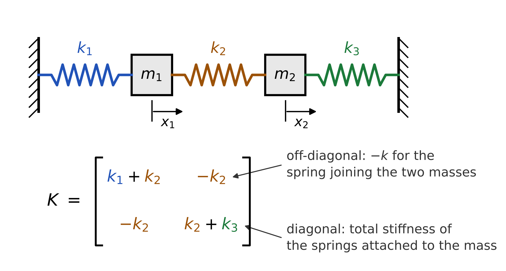
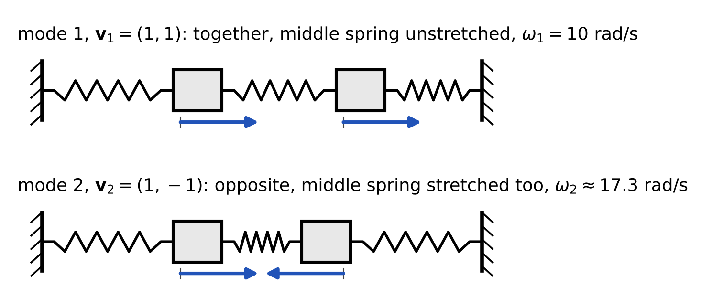
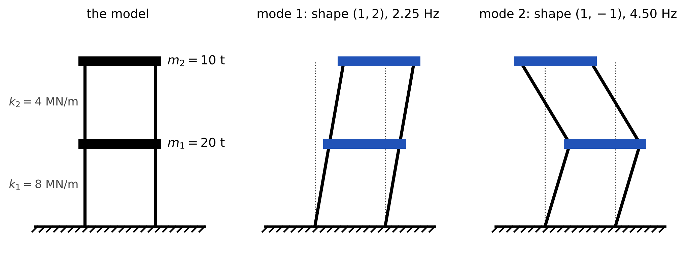

# Vibrations and normal modes {#sec-vibrations}

[Core]{.level-badge .core}

::: {.callout-note appearance="simple" icon=false}
## In this chapter you will

- write the equations of motion of a system of masses and springs as $\M{M}\ddot{\vect{x}} + \M{K}\vect{x} = \zerovec$
- find its natural frequencies and mode shapes from the eigenvalue problem $\M{K}\vect{v} = \omega^2\M{M}\vect{v}$
- build any free vibration from the normal modes, using their orthogonality
- explain resonance, and how a small added mass can stop a large one vibrating
:::

**Builds on** @sec-eigenvalues. It also uses three results from @sec-symmetric-matrices and @sec-linear-odes, given in the box below, so you can read it without those chapters. The stiffness matrix of @sec-trusses helps, but this chapter explains what it needs.

::: {.callout-tip appearance="simple"}
## What you need from Chapters 20 and 23
- A symmetric matrix has real eigenvalues and a full set of perpendicular eigenvectors, even when an eigenvalue repeats.
- If $\vect{x}\T\M{S}\vect{x} \ge 0$ for every $\vect{x}$ (the matrix is **positive semidefinite**), every eigenvalue of $\M{S}$ is at least 0.
- A linear system of differential equations can be solved one eigenvector at a time: write the starting state as a combination of eigenvectors, and each part then changes on its own. This chapter does the same for equations with second derivatives, and explains it as it goes.
:::

## The problem

Everything with mass and stiffness vibrates: buildings and bridges, car suspensions, aircraft wings, guitar strings, the atoms in a molecule. Each structure has a few **natural frequencies** at which it prefers to vibrate, and at each one it moves in a particular pattern, its **mode shape**. Engineers need to know both. If an earthquake, a machine, the wind or footsteps push a structure at one of its natural frequencies, the vibrations build up: this is **resonance**, and it can break things. Chemists use the same ideas the other way round: a molecule absorbs infrared light at its natural frequencies, which identifies the molecule.

For a structure with $n$ moving parts, the natural frequencies and mode shapes come from an $n \times n$ eigenvalue problem. This chapter sets it up for masses joined by springs, the model behind both a tall building and a vibrating molecule.

## The model

### Equations of motion

Take $n$ masses $m_1, \dots, m_n$ in a line, joined to each other and to fixed walls by springs, and let $x_i$ be the displacement of mass $i$ from its resting position. A spring of stiffness $k$ stretched by $\delta$ pulls with force $k\delta$, so the spring between masses $i$ and $i + 1$ pulls mass $i$ with force $k(x_{i+1} - x_i)$, and mass $i + 1$ with the opposite force. Newton's second law for each mass gives one equation, and together they form
$$
\M{M}\ddot{\vect{x}} + \M{K}\vect{x} = \zerovec,
$$ {#eq-free-vibration}
where the dots mean derivatives with respect to time, $\M{M} = \operatorname{diag}(m_1, \dots, m_n)$ is the **mass matrix** and $\M{K}$ is the **stiffness matrix**. For three springs and two masses between walls (@fig-two-masses),
$$
\M{K} = \mat{k_1 + k_2 & -k_2 \\ -k_2 & k_2 + k_3}.
$$
Each mass's diagonal entry is the total stiffness of the springs attached to it, and each spring joining two masses puts $-k$ in their off-diagonal entries. As for a truss (@sec-trusses), $\M{K} = \M{B}\T\M{D}\M{B}$, where $\M{B}$ turns displacements into spring extensions and $\M{D}$ holds the stiffnesses, so $\M{K}$ is symmetric and positive semidefinite.

{#fig-two-masses fig-alt="A wall on the left, spring k1, mass m1, spring k2, mass m2, spring k3, and a wall on the right. Arrows under the masses show their displacements x1 and x2 to the right. Below, K is the 2 by 2 matrix with rows k1 plus k2, minus k2 and minus k2, k2 plus k3. A note says the off-diagonal entry is minus k for the spring joining the two masses, and another says each diagonal entry is the total stiffness of the springs attached to that mass." width=85%}

### Natural frequencies and mode shapes

Look for motions in which every mass moves in step, at the same frequency:
$$
\vect{x}(t) = \vect{v}\cos(\omega t).
$$
Then $\ddot{\vect{x}} = -\omega^2\vect{v}\cos(\omega t)$, and @eq-free-vibration becomes $(\M{K} - \omega^2\M{M})\vect{v}\cos(\omega t) = \zerovec$ for all $t$, so
$$
\M{K}\vect{v} = \omega^2\M{M}\vect{v}.
$$ {#eq-generalised-eigen}
This is a **generalised eigenvalue problem**: an ordinary one when $\M{M} = m\M{I}$, but with $\M{M}$ in place of $\M{I}$ in general. It has a nonzero solution $\vect{v}$ only when
$$
\det(\M{K} - \omega^2\M{M}) = 0,
$$
a polynomial equation of degree $n$ in $\omega^2$. Its roots give the **natural frequencies** $\omega_1 \le \omega_2 \le \dots \le \omega_n$, in radians per second ($f = \omega/2\pi$ in hertz, cycles per second), and the solutions $\vect{v}_i$ are the **mode shapes**. A mode shape gives the pattern of the motion, not its size: any multiple of $\vect{v}_i$ is also a mode shape.

Because $\M{K}$ and $\M{M}$ are symmetric, and $\M{M}$ is positive definite, the modes behave like the eigenvectors of a symmetric matrix. Substitute $\vect{v} = \M{M}^{-1/2}\vect{w}$, where $\M{M}^{-1/2} = \operatorname{diag}(1/\sqrt{m_1}, \dots, 1/\sqrt{m_n})$. Then @eq-generalised-eigen becomes
$$
\M{M}^{-1/2}\M{K}\M{M}^{-1/2}\,\vect{w} = \omega^2\vect{w},
$$
an ordinary eigenvalue problem for a symmetric positive semidefinite matrix (@sec-symmetric-matrices). So:

- every $\omega^2$ is real and at least 0, so every natural frequency is real;
- there are $n$ independent mode shapes, even when frequencies repeat;
- the modes are **orthogonal with respect to $\M{M}$**: $\vect{v}_i\T\M{M}\vect{v}_j = 0$ for $i \neq j$ (exercise 2), and also $\vect{v}_i\T\M{K}\vect{v}_j = 0$.

A natural frequency of zero means that $\M{K}\vect{v} = \zerovec$: the structure can move in the pattern $\vect{v}$ without stretching any spring. That is a **rigid-body mode**, such as a molecule drifting through space, or a mechanism (@sec-trusses).

::: {#ex-vibrations-1 .callout-note appearance="simple" icon=false}
### Example 1: two masses between walls

Two masses of $m = 1$ kg are joined to each other and to two walls by three springs of stiffness $k = 100$ N/m. Find the natural frequencies and mode shapes.

**Solution.** Here $\M{M} = \M{I}$ and
$$
\M{K} = \mat{200 & -100 \\ -100 & 200},
\qquad
\det(\M{K} - \lambda\M{I}) = (200 - \lambda)^2 - 100^2 = (\lambda - 100)(\lambda - 300),
$$
writing $\lambda = \omega^2$. For $\lambda = 100$, $\M{K} - 100\M{I} = \mat{100 & -100 \\ -100 & 100}$ gives $\vect{v}_1 = (1, 1)\T$: the masses move together, in step, and the middle spring is never stretched. For $\lambda = 300$, $\M{K} - 300\M{I} = \mat{-100 & -100 \\ -100 & -100}$ gives $\vect{v}_2 = (1, -1)\T$: the masses move in opposite directions, stretching and squashing the middle spring as well (@fig-two-mass-modes). The natural frequencies are
$$
\omega_1 = 10 \text{ rad/s}\;(1.59 \text{ Hz}),
\qquad
\omega_2 = \sqrt{300} \approx 17.3 \text{ rad/s}\;(2.76 \text{ Hz}).
$$
The mode that stretches more springs, for the same displacements, is the stiffer one, and so the faster one. That is true in general: higher modes have more changes of direction along the structure.

{#fig-two-mass-modes fig-alt="Two rows, each showing two masses between walls joined by three springs, with blue arrows under the masses for their displacements. Mode 1: both arrows point right, and the middle spring is its normal length. Mode 2: the arrows point towards each other, and the middle spring is compressed." width=80%}

[Open the two masses in the normal modes app](../apps/normal-modes.html?preset=Two%20masses){target="_blank" aria-label="Open the two masses in the normal modes app (opens in a new tab)"} to watch each mode on its own.

:::

### Building any motion from the modes

The equations are linear, so any combination of modes is also a motion, and every free vibration is one:
$$
\vect{x}(t) = \sum_{i=1}^n \vect{v}_i\bigl(a_i\cos(\omega_i t) + b_i\sin(\omega_i t)\bigr).
$$ {#eq-modal-sum}
This is the same idea as solving $\dot{\vect{x}} = \M{A}\vect{x}$ with eigenvectors (@sec-linear-odes); here the equation is second order, so each mode has a cosine and a sine instead of one exponential. The starting displacement $\vect{x}_0$ and velocity $\dot{\vect{x}}_0$ fix the coefficients, and $\M{M}$-orthogonality gives them directly. Multiplying @eq-modal-sum at $t = 0$ by $\vect{v}_i\T\M{M}$ kills every term except the $i$th:
$$
a_i = \frac{\vect{v}_i\T\M{M}\vect{x}_0}{\vect{v}_i\T\M{M}\vect{v}_i},
\qquad
b_i = \frac{\vect{v}_i\T\M{M}\dot{\vect{x}}_0}{\omega_i\,\vect{v}_i\T\M{M}\vect{v}_i}.
$$
Each mode then carries on at its own frequency, ignoring the others. The motion as a whole needn't repeat, because the frequencies needn't be in simple ratios.

::: {#ex-vibrations-2 .callout-note appearance="simple" icon=false}
### Example 2: pulling one mass and letting go

In Example 1, mass 1 is pulled 2 cm to the right and both masses are released from rest. Describe the motion.

**Solution.** With $\M{M} = \M{I}$, the coefficients are $a_i = \vect{v}_i\T\vect{x}_0/\vect{v}_i\T\vect{v}_i$. For $\vect{x}_0 = (0.02, 0)\T$,
$$
a_1 = \frac{0.02}{2} = 0.01,
\qquad
a_2 = \frac{0.02}{2} = 0.01,
$$
and every $b_i = 0$, since the start is from rest. So
$$
\vect{x}(t) = 0.01\cos(10t)\mat{1 \\ 1} + 0.01\cos(17.3t)\mat{1 \\ -1}.
$$
Mass 1 moves as $0.01\bigl(\cos(10t) + \cos(17.3t)\bigr)$ and mass 2 as $0.01\bigl(\cos(10t) - \cos(17.3t)\bigr)$. Pulling one mass excites both modes equally, and since $\sqrt{3}$ is irrational the motion never exactly repeats; but it is just two simple vibrations added together.
:::

::: {#ex-vibrations-3 .callout-note appearance="simple" icon=false}
### Example 3: a two-storey building

In a simple model of a two-storey building, each floor is a mass and each storey's columns are a spring that resists sideways movement. The lower floor has mass $m_1 = 20$ tonnes and the upper $m_2 = 10$ tonnes; the lower storey has stiffness $k_1 = 8$ MN/m and the upper $k_2 = 4$ MN/m. Find the natural frequencies and mode shapes.

**Solution.** The ground is fixed and the roof is free, so
$$
\M{K} = 10^6\mat{12 & -4 \\ -4 & 4},
\qquad
\M{M} = 10^4\mat{2 & 0 \\ 0 & 1}.
$$
Dividing both by $4 \times 10^6$ and writing $\mu = \omega^2/400$,
$$
\det\mat{3 - 2\mu & -1 \\ -1 & 1 - \mu} = (3 - 2\mu)(1 - \mu) - 1 = 2\mu^2 - 5\mu + 2 = (2\mu - 1)(\mu - 2) = 0.
$$
So $\mu = \tfrac{1}{2}$ or 2, that is $\omega^2 = 200$ or 800:
$$
\omega_1 \approx 14.1 \text{ rad/s}\;(2.25 \text{ Hz}),
\qquad
\omega_2 \approx 28.3 \text{ rad/s}\;(4.50 \text{ Hz}).
$$
The first row of $(\M{K} - \omega^2\M{M})\vect{v} = \zerovec$ gives $(3 - 2\mu)v_1 = v_2$. For $\mu = \tfrac{1}{2}$, $\vect{v}_1 = (1, 2)\T$: both floors sway the same way, the top one twice as far. For $\mu = 2$, $\vect{v}_2 = (1, -1)\T$: the floors sway in opposite directions (@fig-building-modes).

These modes are not perpendicular, $(1, 2) \cdot (1, -1) = -1$, but they are $\M{M}$-orthogonal:
$$
\vect{v}_1\T\M{M}\vect{v}_2 = 10^4(2 \times 1 \times 1 + 1 \times 2 \times (-1)) = 0.
$$
Earthquakes often shake the ground strongly at frequencies of a few hertz, close to these, which is why low-rise buildings in earthquake zones need careful design.

{#fig-building-modes fig-alt="Three sketches of a two-storey frame on hatched ground. The model: floors labelled m1 equals 20 t and m2 equals 10 t, with storeys labelled k1 equals 8 MN per m and k2 equals 4 MN per m. Mode 1, 2.25 Hz: both floors shifted right, the top twice as far. Mode 2, 4.50 Hz: the lower floor shifted right and the top floor shifted left by the same amount." width=95%}

[Open the building in the normal modes app](../apps/normal-modes.html?preset=Building){target="_blank" aria-label="Open the building in the normal modes app (opens in a new tab)"} to watch its two modes.

:::

### Forced vibration and resonance

Now push the masses with forces that vary like $\cos(\Omega t)$, at a **driving frequency** $\Omega$:
$$
\M{M}\ddot{\vect{x}} + \M{K}\vect{x} = \vect{f}\cos(\Omega t).
$$
Trying $\vect{x} = \vect{X}\cos(\Omega t)$ gives a linear system for the amplitudes,
$$
(\M{K} - \Omega^2\M{M})\vect{X} = \vect{f}.
$$ {#eq-forced}
When $\Omega$ is close to a natural frequency, the matrix $\M{K} - \Omega^2\M{M}$ is close to singular, so the amplitudes are huge: **resonance**. Writing $\vect{X}$ in terms of the modes, using their $\M{M}$-orthogonality, shows exactly how:
$$
\vect{X} = \sum_{i=1}^n \frac{\vect{v}_i\T\vect{f}}{(\omega_i^2 - \Omega^2)\,\vect{v}_i\T\M{M}\vect{v}_i}\,\vect{v}_i.
$$
Mode $i$ is amplified by $1/(\omega_i^2 - \Omega^2)$, which blows up as $\Omega$ approaches $\omega_i$. But a mode is not excited at all if $\vect{v}_i\T\vect{f} = 0$: pushing a structure where a mode doesn't move, or symmetrically when the mode is antisymmetric, can't drive it. Real structures have some **damping**, a friction-like force $\M{C}\dot{\vect{x}}$, which keeps the peaks finite; but lightly damped structures, which most are, still respond far more strongly near their natural frequencies. Designers move the natural frequencies away from the driving frequencies they expect, add damping, or add a **tuned mass damper**.

::: {#ex-vibrations-4 .callout-note appearance="simple" icon=false}
### Example 4: shaking one mass

In Example 1, a force $F\cos(\Omega t)$ pushes mass 1. Find the amplitudes of the two masses, and the driving frequencies at which they become very large. At what frequency does mass 1 not move at all?

**Solution.** @eq-forced is
$$
\mat{200 - \Omega^2 & -100 \\ -100 & 200 - \Omega^2}\mat{X_1 \\ X_2} = \mat{F \\ 0}.
$$
The determinant is $(200 - \Omega^2)^2 - 100^2 = (100 - \Omega^2)(300 - \Omega^2)$, so by the $2 \times 2$ inverse formula (@sec-inverses),
$$
X_1 = \frac{(200 - \Omega^2)F}{(100 - \Omega^2)(300 - \Omega^2)},
\qquad
X_2 = \frac{100F}{(100 - \Omega^2)(300 - \Omega^2)}.
$$
Both blow up at $\Omega = 10$ and $\Omega = \sqrt{300} \approx 17.3$ rad/s: the natural frequencies. But at $\Omega = \sqrt{200} \approx 14.1$ rad/s, $X_1 = 0$: mass 1 stands still, even though it is the one being pushed, while mass 2 moves with amplitude $X_2 = -F/100$. Mass 2 pulls on mass 1, through the middle spring, with a force that exactly cancels the push.

This is the principle of the **tuned mass damper**. A large mass attached to a vibrating structure by a spring, tuned to the troublesome frequency, absorbs the vibration. The 101-storey Taipei 101 tower has a 660-tonne steel ball hanging near its top for this reason.

[Open the normal modes app shaking mass 1 at 14.14 rad/s](../apps/normal-modes.html?preset=Two%20masses&drive=1&omega=14.14){target="_blank" aria-label="Open the normal modes app shaking mass 1 at 14.14 rad/s (opens in a new tab)"} to see mass 1 stand almost still, then move the slider towards 10 or 17.3.

:::

## Explore

The app shows a row of masses and springs. Choose a mode to watch it, start the masses from a pulled position, or shake the first mass and see how the amplitudes depend on the driving frequency.

::: {.app-embed}
<iframe class="app-frame" src="../apps/normal-modes.html?embed=1" title="Normal modes" loading="lazy"></iframe>

[Open the normal modes app in its own tab](../apps/normal-modes.html){.app-open target="_blank"}
:::

Things to try:

- In **Two masses**, play mode 1 and then mode 2. Which springs stretch in each? Then choose **Pull mass 1** and release it: can you see both modes in the motion?
- In **Five masses**, play the modes in order. How many times does the shape change direction in mode $k$? Does the pattern remind you of a vibrating string?
- In **Building**, double the mass of the top floor. Do the frequencies go up or down? Does the shape of mode 1 change?
- In **Absorber**, a 1 kg mass on a spring has a small 0.1 kg mass attached to it. Turn on **Shake mass 1** and slowly sweep the driving frequency from about 5 to 15 rad/s. Where does mass 1 stop moving, and how does that frequency compare with $\sqrt{k_2/m_2}$ for the small mass and its spring? Now make the small mass 0.2 kg: where does that point move?

## In code

`scipy.linalg.eigh` and MATLAB's `eig` both solve the generalised problem $\M{K}\vect{v} = \lambda\M{M}\vect{v}$ directly, when given both matrices.

::: {.panel-tabset group="language"}
## Python

```{python}
import numpy as np
from scipy.linalg import eigh

# Example 3: the two-storey building
K = 1e6 * np.array([[12, -4], [-4, 4]])
M = 1e4 * np.diag([2, 1])
lam, V = eigh(K, M)            # solves K v = lam M v, smallest lam first
omega = np.sqrt(lam)
print(omega, omega / (2 * np.pi))
print(V / V[0])                # scale each mode so that its first entry is 1
print(np.round(V.T @ M @ V, 10))   # M-orthogonal: eigh scales them so this is I

# Example 4: amplitudes when mass 1 is shaken
K1 = np.array([[200, -100], [-100, 200]])
for Om in [5, 10.5, np.sqrt(200), 20]:
    X = np.linalg.solve(K1 - Om**2 * np.eye(2), [1, 0])
    print(round(Om, 2), np.round(X, 4))
```

## MATLAB

```matlab
% Example 3: the two-storey building
K = 1e6 * [12 -4; -4 4];
M = 1e4 * diag([2 1]);
[V, L] = eig(K, M);            % solves K v = lambda M v
omega = sqrt(diag(L));
V = V ./ V(1, :);              % scale each mode so that its first entry is 1
fprintf('omega = %.4f rad/s, f = %.4f Hz, mode (1, %.4f)\n', [omega'; omega'/(2*pi); V(2, :)])

% Example 4: amplitudes when mass 1 is shaken
K1 = [200 -100; -100 200];
for Om = [5 10.5 sqrt(200) 20]
    X = (K1 - Om^2 * eye(2)) \ [1; 0];
    fprintf('%6.2f  %9.4f %9.4f\n', Om, X)
end
```

```{.text .code-output}
omega = 14.1421 rad/s, f = 2.2508 Hz, mode (1, 2.0000)
omega = 28.2843 rad/s, f = 4.5016 Hz, mode (1, -1.0000)
  5.00     0.0085    0.0048
 10.50    -0.0461   -0.0514
 14.14     0.0000   -0.0100
 20.00    -0.0067    0.0033
```
:::

Close to the first resonance, at $\Omega = 10.5$, the amplitudes are 5 to 10 times larger than at $\Omega = 5$, and both masses move the same way, roughly in the shape of mode 1. At $\Omega = \sqrt{200}$, mass 1 doesn't move, as Example 4 found.

## Check your understanding

::: {.callout-tip collapse="true"}
## If every mass in a structure is doubled, what happens to the natural frequencies?

They are divided by $\sqrt{2}$. Doubling $\M{M}$ turns $\M{K}\vect{v} = \omega^2\M{M}\vect{v}$ into $\M{K}\vect{v} = \omega^2(2\M{M})\vect{v}$, which has the same mode shapes with $\omega^2$ halved. Heavier structures vibrate more slowly; stiffer ones more quickly.
:::

::: {.callout-tip collapse="true"}
## In Example 1, can equal forces $F\cos(\Omega t)$ on both masses make the second mode resonate?

No. The force vector is $F(1, 1)$, and $\vect{v}_2\T(1, 1) = 1 - 1 = 0$, so the second mode isn't excited at all, whatever $\Omega$ is. Pushing both masses the same way can only drive the mode in which they move together.
:::

::: {.callout-tip collapse="true"}
## What does a natural frequency of zero mean?

That $\M{K}\vect{v} = \zerovec$ for the mode shape $\vect{v}$: the structure can move in that pattern without stretching any spring, so nothing pulls it back. It is a rigid-body motion, such as a whole molecule drifting, or a mechanism.
:::

## Key ideas

- Masses joined by springs obey $\M{M}\ddot{\vect{x}} + \M{K}\vect{x} = \zerovec$, with a diagonal mass matrix and a symmetric stiffness matrix.
- The natural frequencies and mode shapes solve the generalised eigenvalue problem $\M{K}\vect{v} = \omega^2\M{M}\vect{v}$.
- The frequencies are real, and the modes are orthogonal with respect to $\M{M}$, because the problem is a symmetric eigenvalue problem in disguise.
- Every free vibration is a sum of modes, each at its own frequency; $\M{M}$-orthogonality gives the amount of each from the starting state.
- Forcing at a natural frequency makes the amplitudes grow without limit (resonance), unless the force doesn't excite that mode. A tuned mass damper uses an added mass and spring to cancel the motion at one frequency.

## Exercises {#sec-vibrations-exercises}

1. []{#exercise-vibrations-1}Two masses $m$ hang one below the other from a fixed support: a spring $k$ joins the support to mass 1, and another spring $k$ joins mass 1 to mass 2. Find the natural frequencies, as multiples of $\sqrt{k/m}$, and the mode shapes.

   [Solution to exercise 1](../appendices/solutions-6.qmd#solution-vibrations-1){.sol-link}

2. []{#exercise-vibrations-2}Suppose $\M{K}\vect{v} = \lambda\M{M}\vect{v}$ and $\M{K}\vect{w} = \mu\M{M}\vect{w}$, with $\M{K}$ and $\M{M}$ symmetric and $\lambda \neq \mu$. Show that $\vect{v}\T\M{M}\vect{w} = 0$ and $\vect{v}\T\M{K}\vect{w} = 0$. (Hint: compute $\vect{v}\T\M{K}\vect{w}$ in two ways.)

   [Solution to exercise 2](../appendices/solutions-6.qmd#solution-vibrations-2){.sol-link}

3. []{#exercise-vibrations-3}A diatomic molecule is two atoms of masses $m_1$ and $m_2$ joined by a bond that acts like a spring of stiffness $k$, with no walls. Write down $\M{K}$ and $\M{M}$, and show that one natural frequency is 0 and the other is $\omega = \sqrt{k(1/m_1 + 1/m_2)}$. Describe both modes. For carbon monoxide, $k \approx 1900$ N/m, the atoms have masses 12 and 16 atomic mass units, and $1 \text{ u} = 1.661 \times 10^{-27}$ kg. Find the vibration frequency in hertz. (*Hint*: with no walls, $\M{K} = k\mat{1 & -1 \\ -1 & 1}$. Set $\det(\M{K} - \omega^2\M{M}) = 0$ and take out the factor $\omega^2$.)

   [Solution to exercise 3](../appendices/solutions-6.qmd#solution-vibrations-3){.sol-link}

4. []{#exercise-vibrations-4}In Example 1, both masses start at rest in their resting positions, and mass 1 is struck so that it starts with velocity 0.5 m/s. Find $\vect{x}(t)$.

   [Solution to exercise 4](../appendices/solutions-6.qmd#solution-vibrations-4){.sol-link}

5. []{#exercise-vibrations-5}The lower storey of the building in Example 3 is stiffened to $k_1 = 16$ MN/m. Find the new natural frequencies and mode shapes. Which way did the frequencies move, and how did the first mode shape change?

   [Solution to exercise 5](../appendices/solutions-6.qmd#solution-vibrations-5){.sol-link}

6. []{#exercise-vibrations-6}A machine of mass $m_1$ sits on a mounting of stiffness $k_1$, and an unbalanced motor shakes it with force $F\cos(\Omega t)$. A small mass $m_2$ is attached to it by a spring $k_2$. Show that the machine doesn't move at all when $\Omega^2 = k_2/m_2$, whatever $m_1$ and $k_1$ are. If the motor runs at 50 Hz and $m_2 = 2$ kg, what should $k_2$ be? (*Hint*: write the amplitude equations $(\M{K} - \Omega^2\M{M})\vect{X} = (F, 0)\T$ and eliminate $X_2$: the answer for $X_1$ has a factor $k_2 - \Omega^2 m_2$.)

   [Solution to exercise 6](../appendices/solutions-6.qmd#solution-vibrations-6){.sol-link}

7. []{#exercise-vibrations-7}**Code.** For $n$ equal masses $m$ joined by $n + 1$ equal springs $k$ between two walls, the natural frequencies are
   $$
   \omega_j = 2\sqrt{k/m}\,\sin\frac{j\pi}{2(n + 1)},
   \qquad j = 1, \dots, n.
   $$
   Check this numerically for $n = 10$, $m = 1$ and $k = 100$. Plot the first three mode shapes for $n = 30$. What shapes are they, and what physical object does a long chain of masses and springs approximate?

   [Solution to exercise 7](../appendices/solutions-6.qmd#solution-vibrations-7){.sol-link}

Solutions are in @sec-solutions-vibrations.

## Going further

- Real structures have damping, $\M{M}\ddot{\vect{x}} + \M{C}\dot{\vect{x}} + \M{K}\vect{x} = \vect{f}(t)$. If $\M{C}$ is a combination of $\M{M}$ and $\M{K}$ (**Rayleigh damping**), the same modes still separate the equations; otherwise the problem becomes a quadratic eigenvalue problem, with complex frequencies whose imaginary parts give the decay rates.
- In the **finite element method**, $\M{K}$ and $\M{M}$ for a bridge or an aircraft have millions of rows. Engineers need only the lowest few modes, and find them with shift-and-invert Lanczos iteration (@sec-eigenvalue-algorithms).
- As the number of masses grows, the chain becomes a string or a beam, the matrix becomes a differential operator, and the mode shapes become sines (exercise 7). The finite difference matrix of @sec-finite-differences is the same matrix.
- In chemistry, the vibrations of a molecule with $N$ atoms are found from a $3N \times 3N$ problem of this form, with six zero frequencies for the rigid-body translations and rotations. The other frequencies appear in its infrared and Raman spectra.
