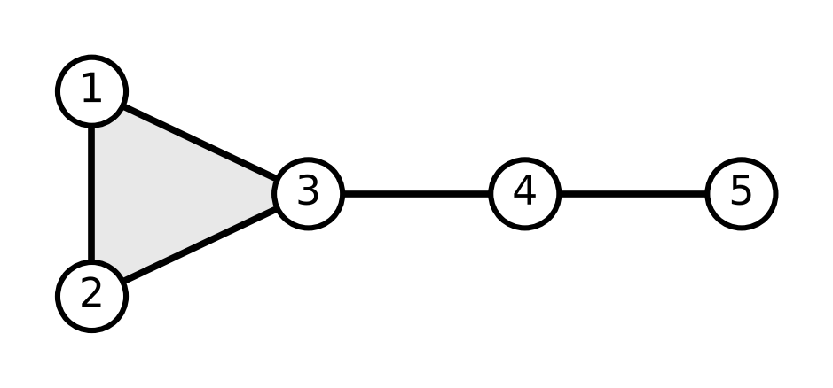
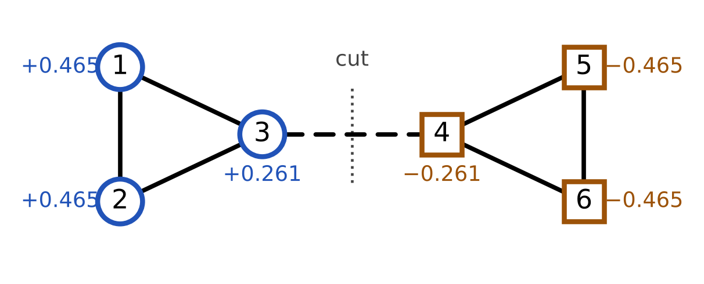
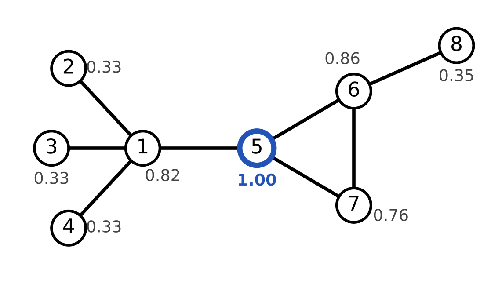

# Networks and graphs {#sec-networks}

[Core]{.level-badge .core}

::: {.callout-note appearance="simple" icon=false}
## In this chapter you will

- describe a network by its adjacency matrix, and count routes and triangles with its powers
- build the graph Laplacian, and use its null space to count the connected pieces of a network
- split a network into two communities using the eigenvector of the Laplacian's second smallest eigenvalue
- measure how important each node is, using the leading eigenvector of the adjacency matrix
:::

**Builds on** @sec-multiplication, @sec-fundamental-subspaces, @sec-eigenvalues. It also uses three results from @sec-symmetric-matrices, given in the box below, so you can read it without that chapter. The circuits of @sec-circuits and the PageRank of @sec-markov-pagerank use some of the same ideas.

::: {.callout-tip appearance="simple"}
## What you need from Chapter 20
- A symmetric matrix has real eigenvalues and a full set of perpendicular eigenvectors.
- If $\vect{x}\T\M{S}\vect{x} \ge 0$ for every $\vect{x}$ (the matrix is **positive semidefinite**), every eigenvalue of $\M{S}$ is at least 0.
- Among unit vectors, $\vect{x}\T\M{S}\vect{x}$ is smallest at the eigenvector of the smallest eigenvalue, where it equals that eigenvalue. Among unit vectors perpendicular to that eigenvector, it is smallest at the eigenvector of the next eigenvalue. This is used only in an optional aside on splitting networks.
:::

## The problem

Friendships, flights between airports, roads between towns, links between web pages, proteins that interact in a cell, neurons in a brain: all are **networks**, made of **nodes** joined by **edges**. The questions people ask about them are surprisingly similar across all these fields. How many ways are there to get from one node to another? Is the network in one piece, or several? Does it fall naturally into groups, or communities? Which nodes matter most?

Each question has an answer in terms of a matrix that describes the network, and the answers come from the ideas of Parts I to IV: powers of a matrix, null spaces, and the eigenvectors of symmetric matrices. Networks are also where those ideas are used at the largest scale, on graphs with billions of nodes.

## The model

### The adjacency matrix

Number the nodes $1, \dots, n$. The **adjacency matrix** $\M{A}$ has $a_{ij} = 1$ if there is an edge between nodes $i$ and $j$, and $a_{ij} = 0$ otherwise. In this chapter edges have no direction (if $i$ is friends with $j$, then $j$ is friends with $i$), so $\M{A}$ is symmetric, and there are no edges from a node to itself, so its diagonal is zero. The **degree** $d_i$ of node $i$, its number of edges, is the sum of row $i$.

Powers of $\M{A}$ count routes. A **walk** of length $k$ is a sequence of $k$ edges, each starting where the last one ended (it may revisit nodes). The $(i, j)$ entry of $\M{A}^2$ is $\sum_k a_{ik}a_{kj}$, and each term is 1 exactly when there is a walk $i \to k \to j$, so:

- entry $(i, j)$ of $\M{A}^2$ counts walks of length 2 from $i$ to $j$: in a friendship network, the number of friends that $i$ and $j$ have in common;
- the diagonal entry $(i, i)$ of $\M{A}^2$ is the degree $d_i$, since each edge out of $i$ gives a walk there and back;
- in general, entry $(i, j)$ of $\M{A}^k$ counts walks of length $k$ (as in exercise 7 of @sec-multiplication).

A walk of length 3 from a node back to itself goes round a triangle. Each triangle is counted from each of its 3 corners, in each of 2 directions, so
$$
\text{number of triangles} = \frac{\operatorname{trace}(\M{A}^3)}{6}.
$$
Triangles measure how clustered a network is: in friendship networks, your friends are often friends of each other.

::: {#ex-networks-1 .callout-note appearance="simple" icon=false}
### Example 1: friends in common

Five people are friends as follows: 1–2, 1–3, 2–3, 3–4 and 4–5 (@fig-friends). Write down $\M{A}$, find $\M{A}^2$, and interpret its entries. How many triangles are there?

{#fig-friends fig-alt="Five numbered circles. Nodes 1, 2 and 3 form a shaded triangle; node 3 is joined to node 4, and node 4 to node 5." width=50%}

**Solution.**
$$
\M{A} = \mat{0 & 1 & 1 & 0 & 0 \\ 1 & 0 & 1 & 0 & 0 \\ 1 & 1 & 0 & 1 & 0 \\ 0 & 0 & 1 & 0 & 1 \\ 0 & 0 & 0 & 1 & 0},
\qquad
\M{A}^2 = \mat{2 & 1 & 1 & 1 & 0 \\ 1 & 2 & 1 & 1 & 0 \\ 1 & 1 & 3 & 0 & 1 \\ 1 & 1 & 0 & 2 & 0 \\ 0 & 0 & 1 & 0 & 1}.
$$
The diagonal of $\M{A}^2$ gives the degrees: person 3 has 3 friends. Off the diagonal, $(\M{A}^2)_{12} = 1$ because 1 and 2 have one friend in common (person 3), and $(\M{A}^2)_{14} = 1$ because 1 and 4 aren't friends but share friend 3: a recommendation system might suggest that they meet. The diagonal of $\M{A}^3$ is $(2, 2, 2, 0, 0)$, so
$$
\text{triangles} = \frac{2 + 2 + 2 + 0 + 0}{6} = 1,
$$
the triangle 1–2–3. Persons 4 and 5 are in no triangle.
:::

### The graph Laplacian

Much as for the circuits of @sec-circuits, give each edge a direction, chosen arbitrarily, and form the **incidence matrix** $\M{B}$, with one row per edge: the row for an edge from $i$ to $j$ has $-1$ in column $i$, $+1$ in column $j$, and zeros elsewhere. If $\vect{x}$ assigns a number $x_i$ to each node (a voltage, a temperature, an opinion), then $\M{B}\vect{x}$ lists the differences $x_j - x_i$ across the edges. The **graph Laplacian** is
$$
\M{L} = \M{B}\T\M{B} = \M{D} - \M{A},
$$
where $\M{D} = \operatorname{diag}(d_1, \dots, d_n)$ holds the degrees. So $\M{L}$ has the degrees on its diagonal and $-1$ for each edge, and every row adds up to zero. (The directions don't matter: reversing an edge changes the sign of its row of $\M{B}$, which doesn't change $\M{B}\T\M{B}$.)

The key fact about $\M{L}$ is the quadratic form
$$
\vect{x}\T\M{L}\vect{x} = \lVert\M{B}\vect{x}\rVert^2 = \sum_{\text{edges } ij} (x_i - x_j)^2.
$$ {#eq-laplacian-form}
It is never negative, so $\M{L}$ is symmetric positive semidefinite (@sec-symmetric-matrices): its eigenvalues are real and at least zero, $0 = \lambda_1 \le \lambda_2 \le \dots \le \lambda_n$, with orthogonal eigenvectors. And it measures how much $\vect{x}$ changes across the edges: it is small when neighbouring nodes have similar values.

### Connected pieces and the null space

If $\M{L}\vect{x} = \zerovec$, then $\vect{x}\T\M{L}\vect{x} = 0$, so by @eq-laplacian-form every edge has $x_i = x_j$. Following edges, $\vect{x}$ is constant on each **connected component**, each piece of the network in which every node can reach every other. Conversely, any vector that is constant on each component is in the null space. So:

- the vector $\vect{1}$ of all ones is always in the null space, so $\lambda_1 = 0$;
- the dimension of the null space of $\M{L}$, the number of zero eigenvalues, equals the number of connected components;
- the network is connected exactly when $\lambda_2 > 0$.

Testing connectivity is easy enough by following edges. The real value of the Laplacian lies in what $\lambda_2$ says when it is small but not zero.

::: {#ex-networks-2 .callout-note appearance="simple" icon=false}
### Example 2: two pieces

A network has edges 1–2, 2–3 and 4–5. Find its Laplacian and the null space, and check that it counts the components.

**Solution.** The degrees are $(1, 2, 1, 1, 1)$, so
$$
\M{L} = \mat{1 & -1 & 0 & 0 & 0 \\ -1 & 2 & -1 & 0 & 0 \\ 0 & -1 & 1 & 0 & 0 \\ 0 & 0 & 0 & 1 & -1 \\ 0 & 0 & 0 & -1 & 1}.
$$
$\M{L}\vect{x} = \zerovec$ says $x_1 = x_2$ (row 1), then $x_2 = x_3$ (row 3), and $x_4 = x_5$ (row 4). So the null space has the basis $(1, 1, 1, 0, 0)\T$ and $(0, 0, 0, 1, 1)\T$: dimension 2, one vector for each piece. The eigenvalues are $0, 0, 1, 2, 3$: two zeros, two components. The matrix is **block diagonal**, one block for each component, which happens whenever the nodes of each piece are numbered together.

[Open the two pieces in the network app](../apps/network-split.html?preset=Two%20pieces){target="_blank" aria-label="Open the two pieces in the network app (opens in a new tab)"} to see the two zero eigenvalues.

:::

### Splitting a network: the Fiedler vector

Suppose we want to split a connected network into two groups, cutting as few edges as possible, without making one group tiny. Label the nodes in one group $x_i = +1$ and in the other $x_i = -1$. An edge inside a group contributes 0 to @eq-laplacian-form, and an edge between groups contributes $2^2 = 4$, so
$$
\vect{x}\T\M{L}\vect{x} = 4 \times (\text{number of edges cut}).
$$
Finding the best split exactly is very hard for a large network, but an eigenvector of $\M{L}$ gives an excellent approximate one.

::: {.callout-note appearance="simple" collapse="true"}
## Optional: why the eigenvector gives a good split
Requiring $\vect{x} \perp \vect{1}$ makes the two groups the same size. Finding the best $\pm 1$ vector is very hard for large networks, but if we allow any real numbers, with $\lVert\vect{x}\rVert = 1$ and $\vect{x} \perp \vect{1}$, the minimum of $\vect{x}\T\M{L}\vect{x}$ is $\lambda_2$, reached at its eigenvector $\vect{v}_2$. This is the third fact in the box at the start of the chapter, the Rayleigh quotient idea of @sec-symmetric-matrices: the smallest eigenvalue minimises $\vect{x}\T\M{L}\vect{x}$ over unit vectors, and the next one does so over unit vectors perpendicular to the first eigenvector, here $\vect{1}$.
:::

**Spectral partitioning** splits the nodes by the signs of $\vect{v}_2$, the eigenvector of the second smallest eigenvalue $\lambda_2$. This eigenvector is called the **Fiedler vector**, after Miroslav Fiedler. Its eigenvalue $\lambda_2$, the **algebraic connectivity**, measures how well connected the network is: a small $\lambda_2$ means that some split cuts few edges, and a network with a bottleneck has a small $\lambda_2$.

::: {#ex-networks-3 .callout-note appearance="simple" icon=false}
### Example 3: two triangles and a bridge

Two triangles, 1–2–3 and 4–5–6, are joined by one edge, 3–4. Find $\lambda_2$ and the Fiedler vector, and use it to split the network.

**Solution.** By symmetry, look for a Fiedler vector of the form
$$
\vect{x} = (a, a, b, -b, -a, -a),
$$
which is antisymmetric between the two halves, and so automatically perpendicular to $\vect{1}$. Node 1 has degree 2 and neighbours 2 and 3, so row 1 of $\M{L}\vect{x} = \lambda\vect{x}$ is
$$
2a - a - b = \lambda a, \quad\text{that is}\quad b = (1 - \lambda)a.
$$
Node 3 has degree 3 and neighbours 1, 2 and 4, so row 3 is
$$
3b - a - a - (-b) = \lambda b, \quad\text{that is}\quad (4 - \lambda)b = 2a.
$$
Substituting the first into the second, $(4 - \lambda)(1 - \lambda) = 2$, or $\lambda^2 - 5\lambda + 2 = 0$, whose smaller root is
$$
\lambda_2 = \frac{5 - \sqrt{17}}{2} \approx 0.438,
$$
with $b = (1 - \lambda_2)a \approx 0.562a$. Normalising,
$$
\vect{v}_2 \approx (0.465, 0.465, 0.261, -0.261, -0.465, -0.465).
$$ The signs split the network into $\{1, 2, 3\}$ and $\{4, 5, 6\}$, cutting only the bridge (@fig-two-triangles). The bridge nodes 3 and 4 have the smallest values: they are the least clearly in one group. (The other eigenvalues are 0, 3, 3, 3 and $(5 + \sqrt{17})/2 \approx 4.56$; the computer confirms this.)

{#fig-two-triangles fig-alt="Two triangles joined by a dashed bridge from node 3 to node 4, with a dotted line labelled cut across it. Nodes 1, 2 and 3 are blue circles with values plus 0.465, plus 0.465 and plus 0.261. Nodes 4, 5 and 6 are brown squares with values minus 0.261, minus 0.465 and minus 0.465." width=65%}

[Open the two triangles in the network app](../apps/network-split.html?preset=Two%20triangles){target="_blank" aria-label="Open the two triangles in the network app (opens in a new tab)"} to see $\lambda_2$ and the Fiedler vector.

:::

### Who matters most: eigenvector centrality

The simplest measure of a node's importance is its degree. But being connected to important nodes should count for more than being connected to unimportant ones. **Eigenvector centrality** asks for scores $c_i$ in which each node's score is proportional to the total score of its neighbours:
$$
\lambda c_i = \sum_j a_{ij}c_j,
\qquad\text{that is}\qquad
\M{A}\vect{c} = \lambda\vect{c}.
$$
For a connected network, the Perron–Frobenius theorem (@sec-markov-pagerank) guarantees that the largest eigenvalue of $\M{A}$ has an eigenvector with every entry positive, and that is the centrality. The power method (@sec-eigenvalue-algorithms) finds it, and it is the undirected cousin of PageRank.

::: {#ex-networks-4 .callout-note appearance="simple" icon=false}
### Example 4: a hub or a well-connected node?

Eight nodes have edges 1–2, 1–3, 1–4, 1–5, 5–6, 5–7, 6–7 and 6–8. Node 1 has the highest degree, 4. Is it the most central?

**Solution.** The degrees are $(4, 1, 1, 1, 3, 3, 2, 1)$. The largest eigenvalue of $\M{A}$ is about 2.45, and its eigenvector, scaled so that its largest entry is 1, is
$$
\vect{c} \approx (0.82, 0.33, 0.33, 0.33, 1.00, 0.86, 0.76, 0.35).
$$
Node 5, with only three edges, is the most central (@fig-hub): it links the hub, node 1, to the tightly knit group 5–6–7. Node 1's many neighbours are leaves, nodes 2, 3 and 4, which have no other connections, so they add little. Eigenvector centrality rewards being connected to well-connected nodes, the same idea as PageRank.

{#fig-hub fig-alt="Eight numbered nodes. Node 1 is a hub joined to leaves 2, 3 and 4 and to node 5. Nodes 5, 6 and 7 form a triangle, and node 8 hangs off node 6. Centralities beside the nodes: 1: 0.82; 2, 3 and 4: 0.33; 5: 1.00, highlighted in blue; 6: 0.86; 7: 0.76; 8: 0.35." width=65%}

[Open the hub in the network app, coloured by centrality](../apps/network-split.html?preset=Hub&show=centrality){target="_blank" aria-label="Open the hub in the network app, coloured by centrality (opens in a new tab)"} to compare the centralities with the degrees.

:::

## Explore

The app shows a small network. Each node is labelled with its entry in the Fiedler vector, or its centrality, and the panel lists the eigenvalues of the Laplacian. Click one node and then another to add or remove an edge between them.

::: {.app-embed}
<iframe class="app-frame" src="../apps/network-split.html?embed=1" title="Network split" loading="lazy"></iframe>

[Open the network app in its own tab](../apps/network-split.html){.app-open target="_blank"}
:::

Things to try:

- In **Two triangles**, check the values of $\lambda_2$ and the Fiedler vector against Example 3. Now add the edge 2–5. How does $\lambda_2$ change, and is the split still clear?
- Remove the bridge between the triangles. How many eigenvalues are now 0? What does the app say about the Fiedler vector, and why?
- In **Ring**, every node looks the same. How many edges does the Fiedler vector's split cut? Why are $\lambda_2$ and $\lambda_3$ equal here? Add one edge across the ring and look again.
- In **Hub**, switch the colouring to **Centrality** and compare it with the degrees, as in Example 4. Add an edge from node 2 to node 6: who gains most?

## In code

::: {.code-files}
**Run this chapter's code yourself:** [open the notebook in Colab](https://colab.research.google.com/github/trgoodale/matrix-book/blob/main/code/python/41-networks.ipynb){target="_blank" aria-label="Open the notebook in Colab (opens in a new tab)"}, or download the [Jupyter notebook](../code/python/41-networks.ipynb){download=""} or the [MATLAB script](../code/matlab/ch41_networks.m){download=""}.
:::

::: {.panel-tabset group="language"}
## Python

```{python}
import numpy as np

def adjacency(n, edges):
    A = np.zeros((n, n))
    for i, j in edges:                      # nodes numbered from 1
        A[i - 1, j - 1] = A[j - 1, i - 1] = 1
    return A

# Example 1: walks and triangles
A = adjacency(5, [(1, 2), (1, 3), (2, 3), (3, 4), (4, 5)])
A2 = A @ A
print(A2)
print("triangles:", np.trace(A2 @ A) / 6)

# Example 3: the Fiedler vector
A = adjacency(6, [(1, 2), (1, 3), (2, 3), (3, 4), (4, 5), (4, 6), (5, 6)])
L = np.diag(A.sum(axis=1)) - A
lam, V = np.linalg.eigh(L)                  # eigenvalues in increasing order
print(np.round(lam, 4) + 0)                 # + 0 turns -0 into 0
f = V[:, 1] * np.sign(V[0, 1])             # the Fiedler vector, signed so node 1 is positive
print(np.round(f, 4))
print("groups:", np.where(f > 0)[0] + 1, np.where(f < 0)[0] + 1)

# Example 4: eigenvector centrality by the power method
A = adjacency(8, [(1, 2), (1, 3), (1, 4), (1, 5), (5, 6), (5, 7), (6, 7), (6, 8)])
c = np.ones(8)
for k in range(200):
    c = A @ c
    c = c / c.max()
print(np.round(c, 2))
```

## MATLAB

```matlab
% Example 3: the Fiedler vector
E = [1 2; 1 3; 2 3; 3 4; 4 5; 4 6; 5 6];
A = zeros(6);
A(sub2ind([6 6], E(:, 1), E(:, 2))) = 1;
A = A + A';                          % edges go both ways
L = diag(sum(A, 2)) - A;
[V, D] = eig(L);                     % eigenvalues in increasing order
lambda = round(diag(D)' * 1e4) / 1e4 + 0   % round to 4 places; + 0 turns -0 into 0
f = V(:, 2)' * sign(V(1, 2))         % the Fiedler vector, signed so node 1 is positive
groupA = find(f > 0)
groupB = find(f < 0)

% Example 4: eigenvector centrality by the power method
E = [1 2; 1 3; 1 4; 1 5; 5 6; 5 7; 6 7; 6 8];
A = zeros(8);
A(sub2ind([8 8], E(:, 1), E(:, 2))) = 1;
A = A + A';
c = ones(8, 1);
for k = 1:200
    c = A * c;
    c = c / max(c);
end
fprintf('%.2f ', c); fprintf('\n')
```

```{.text .code-output}
lambda =

         0    0.4384    3.0000    3.0000    3.0000    4.5616

f =

    0.4647    0.4647    0.2610   -0.2610   -0.4647   -0.4647

groupA =

     1     2     3

groupB =

     4     5     6

0.82 0.33 0.33 0.33 1.00 0.86 0.76 0.35
```
:::

The first eigenvalue is zero only up to rounding error, about $10^{-16}$, which is why the MATLAB code rounds the eigenvalues before printing them. MATLAB's `graph` objects can do all of this too: `laplacian(graph(E(:, 1), E(:, 2)))` builds the Laplacian, and `centrality` computes the eigenvector centrality, scaled to add up to 1. For large networks, the adjacency and Laplacian matrices are stored as sparse matrices, and `scipy.sparse.linalg.eigsh` or MATLAB's `eigs` finds just the few eigenvectors needed.

## Check your understanding

::: {.callout-tip collapse="true"}
## Why does every row of the Laplacian add up to zero?

The diagonal entry of row $i$ is the degree $d_i$, and the row has a $-1$ for each of the $d_i$ neighbours. So $\M{L}\vect{1} = \zerovec$: the vector of all ones is in the null space.
:::

::: {.callout-tip collapse="true"}
## A network has Laplacian eigenvalues $0, 0, 0, 1.2, 2.5, 3, 4$. How many pieces is it in?

Three: the number of zero eigenvalues is the dimension of the null space, which equals the number of connected components.
:::

::: {.callout-tip collapse="true"}
## Why is the Fiedler vector perpendicular to $\vect{1}$?

$\vect{1}$ is the eigenvector for $\lambda_1 = 0$, and eigenvectors of a symmetric matrix for different eigenvalues are orthogonal. So the entries of the Fiedler vector add up to zero: some are positive and some negative, which is what makes it split the nodes into two groups.
:::

## Key ideas

- The adjacency matrix $\M{A}$ records which nodes are joined; entry $(i, j)$ of $\M{A}^k$ counts the walks of length $k$ from $i$ to $j$, and $\operatorname{trace}(\M{A}^3)/6$ counts triangles.
- The graph Laplacian $\M{L} = \M{D} - \M{A} = \M{B}\T\M{B}$ is symmetric positive semidefinite, with $\vect{x}\T\M{L}\vect{x} = \sum_{\text{edges}}(x_i - x_j)^2$.
- The number of zero eigenvalues of $\M{L}$ is the number of connected pieces of the network.
- The eigenvector of the second smallest eigenvalue, the Fiedler vector, splits a network into two well-separated groups by its signs; a small $\lambda_2$ signals a bottleneck.
- Eigenvector centrality, the leading eigenvector of $\M{A}$, rates a node by the importance of its neighbours.

## Exercises {#sec-networks-exercises}

Exercises marked † are harder: they take longer, or need an idea that the worked examples don't show.

1. []{#exercise-networks-1}A **star** has a centre, node 1, joined to three leaves, nodes 2, 3 and 4, and no other edges. Find $\M{A}^2$ and $\M{A}^3$, and explain what their entries count. Why is $\operatorname{trace}(\M{A}^3) = 0$?

   [Solution to exercise 1](../appendices/solutions-6.qmd#solution-networks-1){.sol-link}

2. []{#exercise-networks-2}Show that $\vect{x}\T\M{L}\vect{x} = \sum_{\text{edges } ij}(x_i - x_j)^2$ directly from $\M{L} = \M{D} - \M{A}$, by writing out $\vect{x}\T\M{D}\vect{x}$ and $\vect{x}\T\M{A}\vect{x}$ as sums. (*Hint*: $\vect{x}\T\M{D}\vect{x} = \sum_i d_i x_i^2$ and $\vect{x}\T\M{A}\vect{x} = \sum_{\text{edges } ij} 2x_ix_j$. Share each $d_ix_i^2$ out as one $x_i^2$ for each edge at node $i$.)

   [Solution to exercise 2](../appendices/solutions-6.qmd#solution-networks-2){.sol-link}

3. []{#exercise-networks-3}[†]{.harder aria-hidden="true" title="Harder"}[Harder exercise.]{.visually-hidden} Find the Laplacian eigenvalues of (a) the complete graph on 4 nodes, in which every pair is joined, and (b) the path 1–2–3–4. Which has the larger algebraic connectivity $\lambda_2$, and why does that make sense? (For (a), try the vectors $\vect{1}$ and $(1, -1, 0, 0)\T$.)

   [Solution to exercise 3](../appendices/solutions-6.qmd#solution-networks-3){.sol-link}

4. []{#exercise-networks-4}A square, the cycle 1–2–3–4–1, has no triangles. Check that $\operatorname{trace}(\M{A}^3) = 0$. Then add the diagonal 1–3, and find the number of triangles from $\operatorname{trace}(\M{A}^3)$.

   [Solution to exercise 4](../appendices/solutions-6.qmd#solution-networks-4){.sol-link}

5. []{#exercise-networks-5}In Example 3, add an edge between nodes 2 and 5. Show that $\vect{x} = (2, 1, 1, -1, -1, -2)\T$ is now an eigenvector of $\M{L}$ with eigenvalue 1, and (using the computer, or the app) that this is $\lambda_2$. Where does its sign split the network, and what does the increase in $\lambda_2$ from 0.438 to 1 tell you?

   [Solution to exercise 5](../appendices/solutions-6.qmd#solution-networks-5){.sol-link}

6. []{#exercise-networks-6}[†]{.harder aria-hidden="true" title="Harder"}[Harder exercise.]{.visually-hidden} Explain why, if the nodes of a network are numbered so that each connected component's nodes come together, $\M{L}$ is block diagonal. Use this to show that the number of zero eigenvalues is at least the number of components. (*Hint*: each block is the Laplacian of one component, and every Laplacian has eigenvalue 0 with eigenvector $\vect{1}$. Pad that vector with zeros outside the block.)

   [Solution to exercise 6](../appendices/solutions-6.qmd#solution-networks-6){.sol-link}

7. []{#exercise-networks-7}**Code.** Make a random network with two hidden communities of 50 nodes each: join each pair of nodes in the same community with probability 0.3, and each pair in different communities with probability 0.05. Find the Fiedler vector, split the nodes by its signs, and count how many nodes end up in the right group. Repeat with a between-community probability of 0.15. What happens, and why?

   [Solution to exercise 7](../appendices/solutions-6.qmd#solution-networks-7){.sol-link}

Solutions are in @sec-solutions-networks.

## Going further

- **Community detection** on real networks often uses several Laplacian eigenvectors at once (**spectral clustering**), or optimises a measure called **modularity**. Newman's *Networks* is a thorough introduction to these and many other network methods.
- The **normalised Laplacian** $\M{D}^{-1/2}\M{L}\M{D}^{-1/2}$ suits networks whose nodes have very different degrees, and is closely related to random walks, and so to the Markov chains of @sec-markov-pagerank.
- The Laplacian also governs things that spread across a network, such as heat, opinions or diseases: $\dot{\vect{x}} = -\M{L}\vect{x}$ is the network version of the heat equation of @sec-finite-differences, and its slowest decaying mode is the Fiedler vector.
- **Graph neural networks**, used to predict the properties of molecules and to recommend products, are built from repeated multiplication by the adjacency matrix or the normalised Laplacian.
