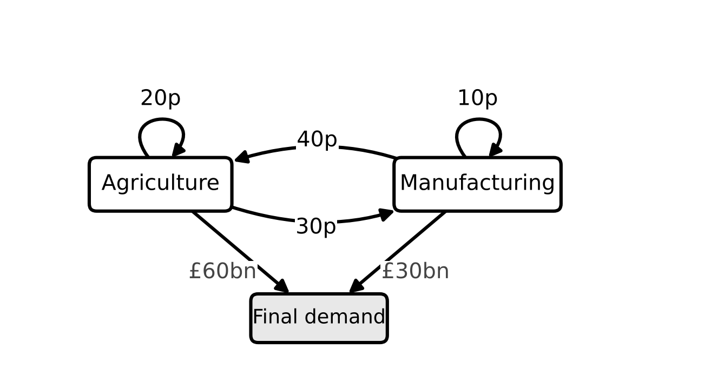

# Economics: input–output models {#sec-input-output}

[Core]{.level-badge .core}

::: {.callout-note appearance="simple" icon=false}
## In this chapter you will

- model an economy whose industries use each other's products, as the linear system $(\M{I} - \M{A})\vect{x} = \vect{d}$
- read the Leontief inverse $(\M{I} - \M{A})^{-1}$ as the total effect, direct and indirect, of extra demand
- add up that effect round by round, as the series $\M{I} + \M{A} + \M{A}^2 + \cdots$
- trace the carbon emissions, or jobs, behind what people buy
:::

**Builds on** @sec-linear-systems, @sec-inverses. Only one remark uses eigenvalues (@sec-eigenvalues).

## The problem

To make cars, a factory needs steel, electricity, transport and accountants. To make steel, a steelworks needs electricity, transport, machinery (some of it made in factories) and accountants. Every industry uses the products of others, so extra demand for one product ripples through the whole economy. If people buy £1 billion more cars, how much more steel must be made, how much more electricity, how many more jobs will there be, and how much more carbon dioxide will be emitted?

In the 1930s Wassily Leontief answered such questions with a matrix: an **input–output table**, recording how much each industry buys from every other. He won the 1973 Nobel prize in economics for it. National statistics offices, including the UK's Office for National Statistics, publish these tables, and governments use them to estimate the effects of new spending, of a factory closing, and of what we buy on the climate. The mathematics is a single linear system, and its inverse matrix tells the whole story.

## The model

### Industries that use each other's products

Divide the economy into $n$ industries, or **sectors**. Measure each sector's output in money, say £ billion per year. The **technical coefficient** $a_{ij}$ is the value of sector $i$'s product needed to make £1 of sector $j$'s product. For example, $a_{12} = 0.05$ would mean that every £1 of manufacturing output (sector 2) uses 5p of agricultural products (sector 1). The **technical coefficients matrix** $\M{A} = (a_{ij})$ has a column for each sector's recipe: column $j$ lists what sector $j$ buys from every sector, per £1 of its output. The rest of each £1, $1 - \sum_i a_{ij}$, pays for wages, profits and imports: the **value added**.

Let $x_j$ be the total output of sector $j$, and $d_i$ the **final demand** for sector $i$'s product: what households, the government and other countries buy. Sector $i$'s output has to cover what the other sectors use and what final buyers take:
$$
x_i = a_{i1}x_1 + a_{i2}x_2 + \dots + a_{in}x_n + d_i,
\qquad\text{that is}\qquad
\vect{x} = \M{A}\vect{x} + \vect{d}.
$$
So the output needed to meet final demand $\vect{d}$ solves
$$
(\M{I} - \M{A})\vect{x} = \vect{d}.
$$ {#eq-leontief}

### The Leontief inverse

The solution is $\vect{x} = \M{L}\vect{d}$, where
$$
\M{L} = (\M{I} - \M{A})^{-1}
$$
is the **Leontief inverse**. Column $j$ of $\M{L}$ is the output needed from every sector to deliver £1 of sector $j$'s product to final buyers: it is $\M{L}\vect{e}_j$. Its entries are at least the direct requirements, and usually much more, because they include the indirect ones: the steel for the car, the electricity for the steel, the coal for the electricity, and so on. The sum of column $j$ is sector $j$'s **output multiplier**, the total output across the whole economy generated by £1 of final demand for sector $j$.

Since $\vect{x}$ depends linearly on $\vect{d}$, a change $\Delta\vect{d}$ in final demand changes output by $\Delta\vect{x} = \M{L}\,\Delta\vect{d}$, whatever the demand was before. For one change, there is no need to form $\M{L}$: solve @eq-leontief with $\Delta\vect{d}$ on the right (@sec-lu-decomposition). The inverse is worth having when its entries themselves are what we want to report.

::: {#ex-input-output-1 .callout-note appearance="simple" icon=false}
### Example 1: two sectors

An economy has two sectors, agriculture and manufacturing. Each £1 of agricultural output uses 20p of agricultural products and 40p of manufactured goods; each £1 of manufacturing output uses 30p of agricultural products and 10p of manufactured goods. Final demand is £60 billion of agricultural products and £30 billion of manufactured goods (@fig-two-sectors). What must each sector produce?

{#fig-two-sectors fig-alt="Two boxes, Agriculture and Manufacturing. Agriculture has a loop labelled 20p and an arrow to Manufacturing labelled 30p. Manufacturing has a loop labelled 10p and an arrow to Agriculture labelled 40p. Arrows from both boxes lead down to a shaded Final demand box, labelled £60bn from Agriculture and £30bn from Manufacturing." width=65%}

**Solution.** Each column is one sector's recipe:
$$
\M{A} = \mat{0.2 & 0.3 \\ 0.4 & 0.1},
\qquad
\M{I} - \M{A} = \mat{0.8 & -0.3 \\ -0.4 & 0.9}.
$$
The determinant of $\M{I} - \M{A}$ is $0.72 - 0.12 = 0.6$, so
$$
\M{L} = (\M{I} - \M{A})^{-1} = \frac{1}{0.6}\mat{0.9 & 0.3 \\ 0.4 & 0.8} = \mat{1.5 & 0.5 \\ 0.667 & 1.333},
$$
and
$$
\vect{x} = \M{L}\vect{d} = \mat{1.5 \times 60 + 0.5 \times 30 \\ 0.667 \times 60 + 1.333 \times 30} = \mat{105 \\ 80}.
$$
Agriculture must produce £105 billion and manufacturing £80 billion. Check: the sectors use $\M{A}\vect{x} = (21 + 24, 42 + 8) = (45, 50)$ of each other's products, and $\vect{x} - \M{A}\vect{x} = (60, 30)$, the final demand. ✓ Total output, £185 billion, is about twice final demand, because so much output is used up in making other output.
:::

::: {#ex-input-output-2 .callout-note appearance="simple" icon=false}
### Example 2: three sectors and their multipliers

An illustrative economy has three sectors, agriculture, manufacturing and services, with
$$
\M{A} = \mat{0.10 & 0.05 & 0.02 \\ 0.20 & 0.35 & 0.10 \\ 0.10 & 0.20 & 0.25}.
$$
Final demand is $\vect{d} = (20, 150, 300)$ £ billion. Find the Leontief inverse, the output multipliers and the output of each sector.

**Solution.** By computer (the code is below),
$$
\M{L} \approx \mat{1.138 & 0.101 & 0.044 \\ 0.390 & 1.639 & 0.229 \\ 0.256 & 0.451 & 1.400}.
$$
The column sums, the output multipliers, are 1.78, 2.19 and 1.67. So £1 of extra final demand for manufactured goods generates £2.19 of output in total: the £1 itself, £0.64 more from manufacturing (it uses a lot of its own products), £0.10 from agriculture and £0.45 from services. Then
$$
\vect{x} = \M{L}\vect{d} \approx (51.1, 322.3, 492.8)\T.
$$
Agriculture must produce £51 billion, although final buyers want only £20 billion of its products: the rest feeds the other sectors.
:::

### Round by round

Where does the inverse come from economically? Meeting final demand $\vect{d}$ needs inputs $\M{A}\vect{d}$; making those inputs needs $\M{A}(\M{A}\vect{d}) = \M{A}^2\vect{d}$; making those needs $\M{A}^3\vect{d}$; and so on. Adding up all the rounds,
$$
\vect{x} = \vect{d} + \M{A}\vect{d} + \M{A}^2\vect{d} + \cdots = (\M{I} + \M{A} + \M{A}^2 + \cdots)\vect{d}.
$$
This is the matrix version of the geometric series $1 + a + a^2 + \cdots = 1/(1 - a)$, and when it converges,
$$
\M{I} + \M{A} + \M{A}^2 + \cdots = (\M{I} - \M{A})^{-1}
$$
(exercise 5; the fundamental matrix of an absorbing Markov chain in @sec-markov-pagerank is the same series). It converges when the powers $\M{A}^k$ shrink to zero. A simple sufficient condition is that every column of $\M{A}$ adds up to less than 1, which says that every sector has some value added. An economy in which $\M{I} - \M{A}$ has an inverse with no negative entries is called **productive**: it can meet any final demand with outputs that are all positive. In terms of eigenvalues (@sec-eigenvalues), the series converges exactly when every eigenvalue of $\M{A}$ has size less than 1, and each round is then roughly the previous one multiplied by the largest of them.

::: {#ex-input-output-3 .callout-note appearance="simple" icon=false}
### Example 3: the ripples of extra demand

In Example 2, final demand for services rises by £100 billion. Follow the effect round by round.

**Solution.** Start with $\Delta\vect{d} = (0, 0, 100)$. Each round is $\M{A}$ times the last:

| Round | Agriculture | Manufacturing | Services | Total |
|:--|--:|--:|--:|--:|
| 0: the demand itself | 0 | 0 | 100 | 100 |
| 1: its direct inputs | 2.00 | 10.00 | 25.00 | 37.00 |
| 2: their inputs | 1.20 | 6.40 | 8.45 | 16.05 |
| 3 | 0.61 | 3.32 | 3.51 | 7.45 |
| 4 | 0.30 | 1.64 | 1.60 | 3.54 |
| All rounds: $\M{L}\,\Delta\vect{d}$ | 4.38 | 22.89 | 140.02 | 167.30 |

Each round is a little under half the previous one: the largest eigenvalue of $\M{A}$ is about 0.48. After four rounds, the total so far, 164.0, is within 2% of the final answer, $\M{L}\,\Delta\vect{d}$, column 3 of $\M{L}$ times 100. Manufacturing output rises by almost £23 billion, although nobody bought any extra manufactured goods.
:::

### Emissions, jobs and other footprints

Suppose each sector emits $e_j$ kg of carbon dioxide for each £1 of output, its **direct intensity**. The total emitted while producing $\vect{x}$ is $\vect{e}\T\vect{x} = \vect{e}\T\M{L}\vect{d}$. The row vector
$$
\vect{f}\T = \vect{e}\T\M{L}
$$
gives the **footprint** of each product: entry $j$ is the carbon emitted, anywhere in the economy, to deliver £1 of sector $j$'s product to a final buyer. Footprints, not direct intensities, measure the climate impact of what people buy, since buying a product causes all the emissions in its supply chain. The same calculation, with employment per £1 of output in place of $\vect{e}$, gives the jobs supported by each product; with water use, the water footprint; and so on.

::: {#ex-input-output-4 .callout-note appearance="simple" icon=false}
### Example 4: carbon footprints

In Example 2, the direct emissions are $\vect{e} = (1.0, 0.6, 0.1)$ kg of CO₂ per £1 of output, for agriculture, manufacturing and services. Find the footprint of each product, and the total emissions.

**Solution.** The footprints are
$$
\vect{f}\T = \vect{e}\T\M{L} \approx (1.40, 1.13, 0.32).
$$
Each £1 of food bought causes 1.40 kg of emissions, not the 1.0 kg emitted on the farm, because farming uses fuel, fertiliser and transport. The difference is largest for manufactured goods, at 1.13 kg against 0.6 kg directly, because manufacturing buys so much from itself and from agriculture. The total emissions are
$$
\vect{e}\T\vect{x} = \vect{f}\T\vect{d} \approx 1.0 \times 51.1 + 0.6 \times 322.3 + 0.1 \times 492.8 \approx 294,
$$
in billion kg, that is million tonnes. Splitting $\vect{f}\T\vect{d}$ by product shows who is responsible: $1.40 \times 20 = 28$ for food, $1.13 \times 150 = 169$ for manufactured goods and $0.32 \times 300 = 96$ for services. Services emit little directly, but because people buy so many of them, they account for a third of the total.
:::

## Explore

@fig-ripples shows Example 3 as a picture: the extra output in each round, for £100 billion of extra demand for services. The bars shrink by roughly the same factor each round, and their total is column 3 of the Leontief inverse.

```{python}
#| label: fig-ripples
#| fig-cap: "The extra output, by sector, in each round of knock-on demand following £100 billion of extra demand for services."
#| fig-alt: "Stacked bar chart of extra output in rounds 0 to 7. Round 0 is 100 billion pounds of services. Round 1 is 37 billion, mostly services and manufacturing; each later round is a little under half the one before, falling to under 1 billion by round 6."
import numpy as np
import matplotlib.pyplot as plt

A = np.array([[0.10, 0.05, 0.02], [0.20, 0.35, 0.10], [0.10, 0.20, 0.25]])
rounds = [np.array([0.0, 0.0, 100.0])]
for k in range(7):
    rounds.append(A @ rounds[-1])
R = np.array(rounds)

fig, ax = plt.subplots(figsize=(6.5, 3.5))
bottom = np.zeros(len(R))
for s, (name, hatch) in enumerate([("Agriculture", "//"), ("Manufacturing", ".."), ("Services", "")]):
    ax.bar(range(len(R)), R[:, s], bottom=bottom, label=name, hatch=hatch, edgecolor="black", linewidth=0.5)
    bottom += R[:, s]
ax.set_xlabel("round")
ax.set_ylabel("extra output (£ billion)")
ax.legend()
plt.show()
```

Things to try in code:

- Change $a_{22}$, the manufactured goods used per £1 of manufacturing, from 0.35 to 0.5. How do the rounds, and the multiplier for manufacturing, change?
- Start from extra demand for agriculture instead. Which sector gains most after the first round?
- Find the eigenvalues of $\M{A}$ and compare the largest with the ratio between the totals of successive rounds.
- Increase every entry of $\M{A}$ by the same factor until the rounds stop shrinking. What happens to $(\M{I} - \M{A})^{-1}$ at that point?

## In code

::: {.panel-tabset group="language"}
## Python

```{python}
import numpy as np

A = np.array([[0.10, 0.05, 0.02], [0.20, 0.35, 0.10], [0.10, 0.20, 0.25]])
d = np.array([20, 150, 300])
L = np.linalg.inv(np.eye(3) - A)     # the Leontief inverse
print(np.round(L, 3))
print("multipliers:", np.round(L.sum(axis=0), 2))
x = np.linalg.solve(np.eye(3) - A, d) # output for demand d: no inverse needed
print("output:", np.round(x, 1))

e = np.array([1.0, 0.6, 0.1])        # direct emissions, kg CO2 per pound of output
f = e @ L                            # footprints
print("footprints:", np.round(f, 2), " total:", round(e @ x, 1))
```

## MATLAB

```matlab
A = [0.10 0.05 0.02; 0.20 0.35 0.10; 0.10 0.20 0.25];
d = [20; 150; 300];
L = inv(eye(3) - A);                 % the Leontief inverse
disp(round(L * 1000) / 1000)
multipliers = sum(L, 1)
x = (eye(3) - A) \ d                 % output for demand d: no inverse needed

e = [1.0 0.6 0.1];                   % direct emissions, kg CO2 per pound of output
f = e * L                            % footprints
total = e * x
```

```{.text .code-output}
    1.1380    0.1010    0.0440
    0.3900    1.6390    0.2290
    0.2560    0.4510    1.4000

multipliers =

    1.7838    2.1904    1.6730

x =

   51.0776
  322.2939
  492.7554

f =

    1.3978    1.1294    0.3212

total =

  293.7295
```
:::

Real input–output tables have from about 10 to several hundred sectors. The UK's Office for National Statistics publishes tables with over 100, and the matrices are small enough to invert directly.

## Check your understanding

::: {.callout-tip collapse="true"}
## Why is the total output of an economy more than its final demand?

Because part of each sector's output is used up as input by other sectors (and by itself), on the way to producing what final buyers take. Total output counts those intermediate products as well: $\vect{x} = \M{A}\vect{x} + \vect{d}$.
:::

::: {.callout-tip collapse="true"}
## What does the entry in row 2, column 3 of the Leontief inverse mean?

The extra output of sector 2 needed, in total, to deliver £1 more of sector 3's product to final buyers: the direct inputs from sector 2, plus those needed to make the other inputs, and so on.
:::

::: {.callout-tip collapse="true"}
## Why must every column of $\M{A}$ add up to less than 1 in a working economy?

Column $j$ adds up the inputs bought by sector $j$ per £1 of its output. If they cost £1 or more, the sector would add no value, and would need to use at least as much as it makes. Column sums below 1 make the series $\M{I} + \M{A} + \M{A}^2 + \cdots$ converge, so the economy can meet any final demand.
:::

## Key ideas

- Column $j$ of the technical coefficients matrix $\M{A}$ lists what sector $j$ buys from each sector per £1 of its output.
- Output $\vect{x}$ must cover inputs and final demand, $\vect{x} = \M{A}\vect{x} + \vect{d}$, so $(\M{I} - \M{A})\vect{x} = \vect{d}$.
- The Leontief inverse $(\M{I} - \M{A})^{-1}$ gives the total output, direct and indirect, needed for each £1 of final demand; its column sums are the output multipliers.
- The inverse is the sum $\M{I} + \M{A} + \M{A}^2 + \cdots$ of rounds of knock-on demand, which converges when every column of $\M{A}$ adds up to less than 1.
- Footprints $\vect{e}\T(\M{I} - \M{A})^{-1}$ trace emissions, jobs or other quantities through the whole supply chain to the products people buy.

## Exercises {#sec-input-output-exercises}

Exercises marked † are harder: they take longer, or need an idea that the worked examples don't show.

1. []{#exercise-input-output-1}In Example 1, final demand for manufactured goods rises by £10 billion, with no change for agriculture. By how much must each sector's output rise?

   [Solution to exercise 1](../appendices/solutions-6.qmd#solution-input-output-1){.sol-link}

2. []{#exercise-input-output-2}Explain in words why every diagonal entry of the Leontief inverse is at least 1, and why every entry is at least the corresponding entry of $\M{I} + \M{A}$.

   [Solution to exercise 2](../appendices/solutions-6.qmd#solution-input-output-2){.sol-link}

3. []{#exercise-input-output-3}A two-sector economy has $\M{A} = \mat{0.5 & 0.7 \\ 0.6 & 0.4}$. Find the output needed to meet final demand $\vect{d} = (10, 10)$. What is wrong with the answer, and what do the column sums of $\M{A}$ show?

   [Solution to exercise 3](../appendices/solutions-6.qmd#solution-input-output-3){.sol-link}

4. []{#exercise-input-output-4}[†]{.harder aria-hidden="true" title="Harder"}[Harder exercise.]{.visually-hidden} **Prices.** Let $p_j$ be the price of sector $j$'s product per unit, and $v_j$ the value added (wages and profits) per unit of output. A sector's price must cover the inputs it buys and its value added: $p_j = \sum_i a_{ij}p_i + v_j$, that is $\vect{p} = \M{A}\T\vect{p} + \vect{v}$.

   a. In Example 1, with $v_j = 1 - \sum_i a_{ij}$, show that $\vect{p} = (1, 1)$.
   b. Wages in agriculture rise, so that $v_1$ rises by 0.1. Find the change in both prices, using $(\M{I} - \M{A}\T)^{-1} = \M{L}\T$.

   [Solution to exercise 4](../appendices/solutions-6.qmd#solution-input-output-4){.sol-link}

5. []{#exercise-input-output-5}[†]{.harder aria-hidden="true" title="Harder"}[Harder exercise.]{.visually-hidden} Show that $(\M{I} - \M{A})(\M{I} + \M{A} + \M{A}^2 + \dots + \M{A}^k) = \M{I} - \M{A}^{k+1}$. Explain why, if $\M{A}^{k} \to \M{0}$ as $k \to \infty$, the series $\M{I} + \M{A} + \M{A}^2 + \cdots$ converges to $(\M{I} - \M{A})^{-1}$. (*Hint*: multiply out the left-hand side: almost every term cancels with its neighbour.)

   [Solution to exercise 5](../appendices/solutions-6.qmd#solution-input-output-5){.sol-link}

6. []{#exercise-input-output-6}In Example 2, each £1 million of output supports 10 jobs in agriculture, 5 in manufacturing and 15 in services. How many jobs, in total, does £1 million of extra final demand for each product support? Which product supports the most?

   [Solution to exercise 6](../appendices/solutions-6.qmd#solution-input-output-6){.sol-link}

7. []{#exercise-input-output-7}**Code.** In Example 4, manufacturers cut their direct emissions by 20%. Find the new footprints of all three products. Why does the footprint of food fall, although farms emit as much as before? Which product's footprint falls by the largest fraction?

   [Solution to exercise 7](../appendices/solutions-6.qmd#solution-input-output-7){.sol-link}

Solutions are in @sec-solutions-input-output.

## Going further

- Leontief's original articles, and his book *Input–Output Economics*, are readable and still instructive. Miller and Blair's *Input–Output Analysis: Foundations and Extensions* is the standard modern textbook.
- **Multi-regional input–output models** link the tables of many countries through trade. They show, for example, how much of the carbon emitted in China is caused by what is bought in Europe, and they are used to compare countries' consumption-based emissions.
- The **Hawkins–Simon condition** says exactly when an economy is productive: every leading principal minor of $\M{I} - \M{A}$ must be positive. It is a cousin of the test for a positive definite matrix in @sec-symmetric-matrices.
- The theory of matrices with no negative entries, the **Perron–Frobenius theory** that also lies behind Markov chains (@sec-markov-pagerank) and population models (@sec-population-models), explains why productive economies have an inverse with no negative entries, and why the largest eigenvalue governs how fast the rounds shrink.
